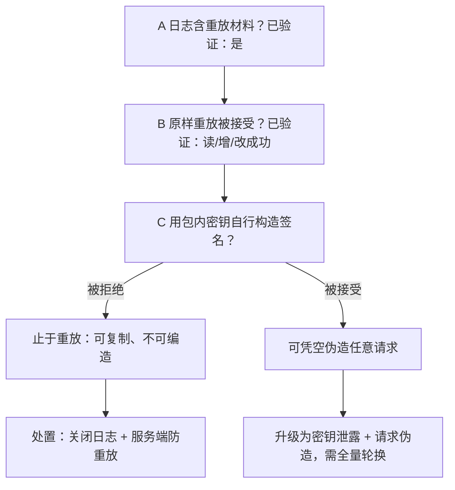
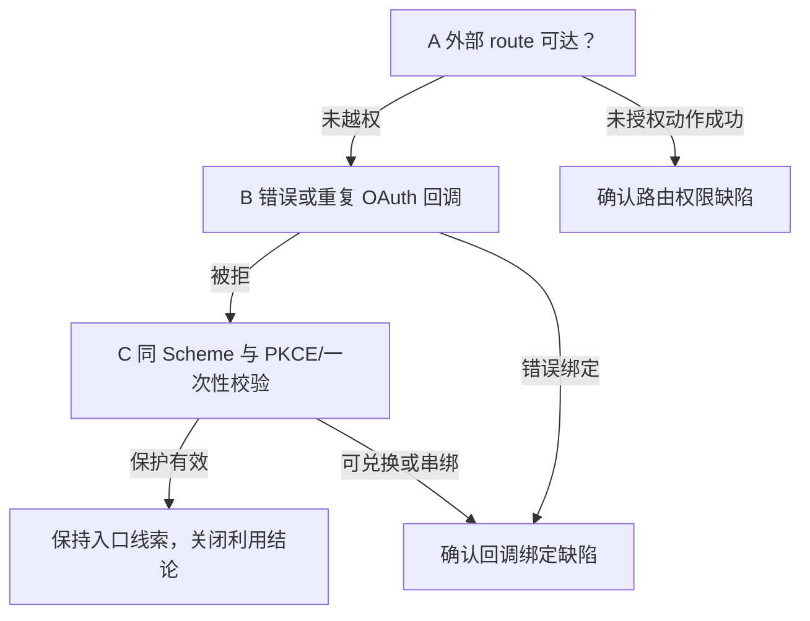
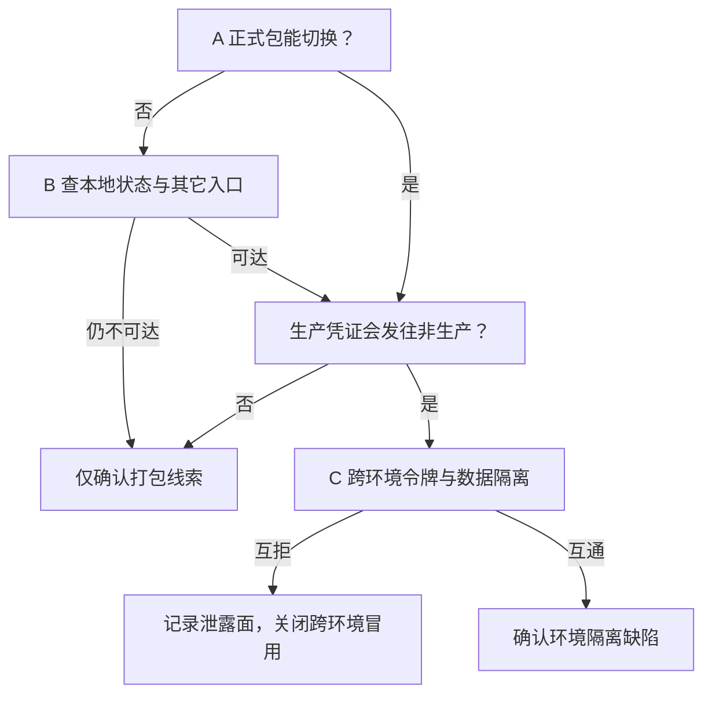
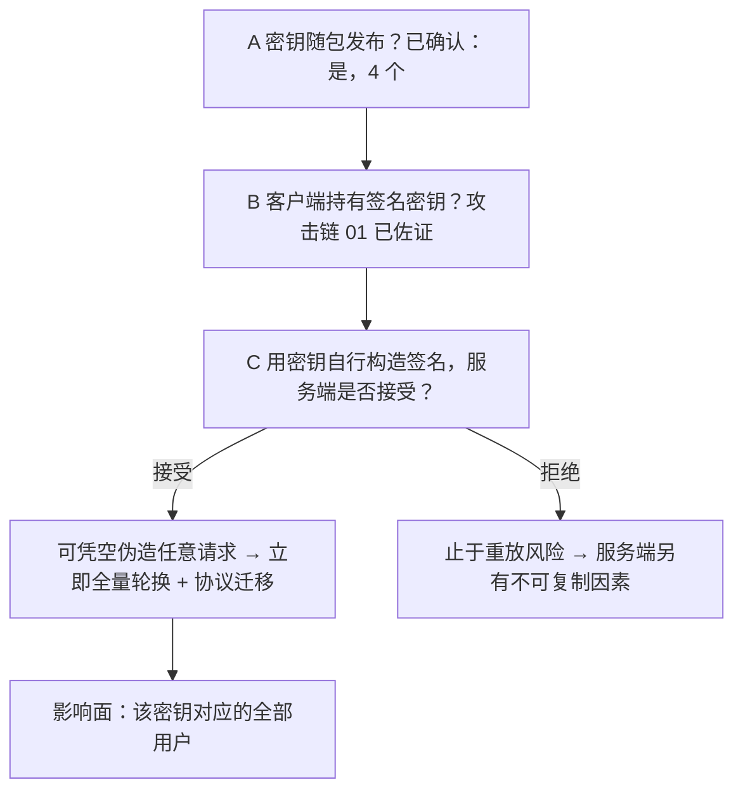
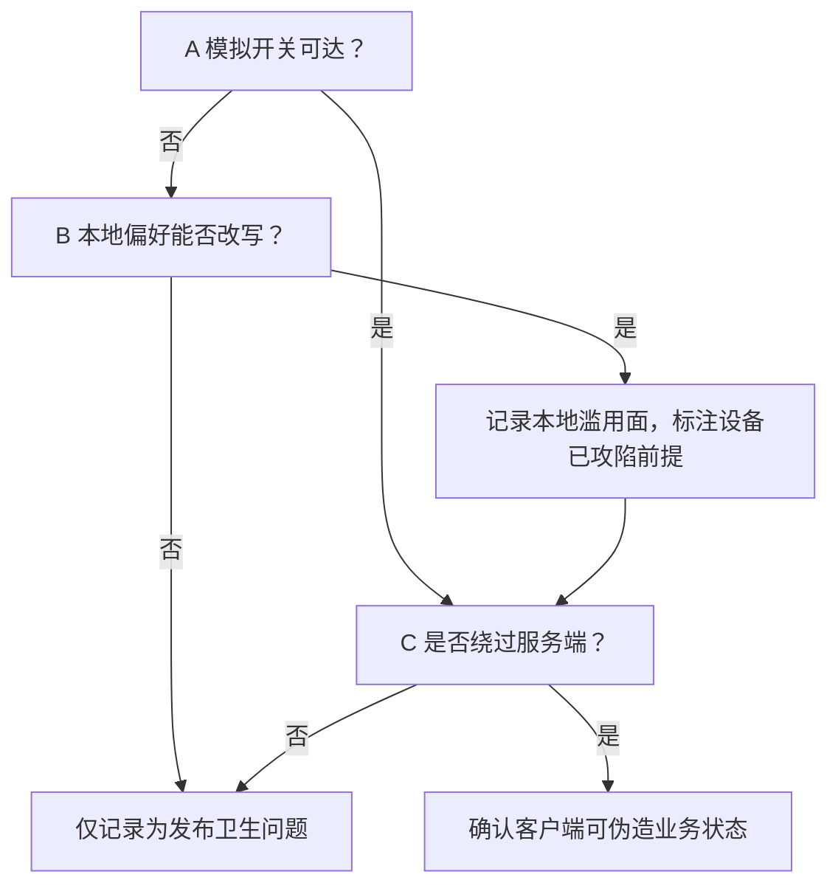
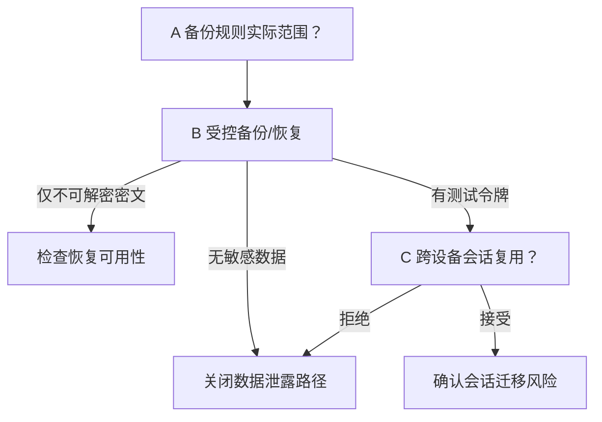
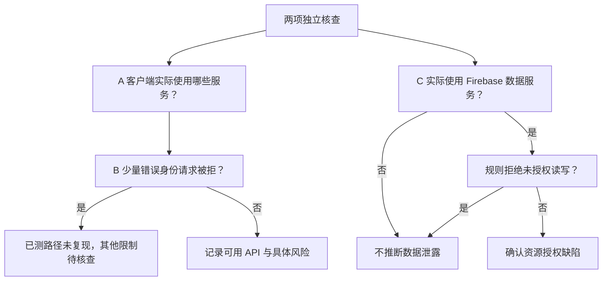
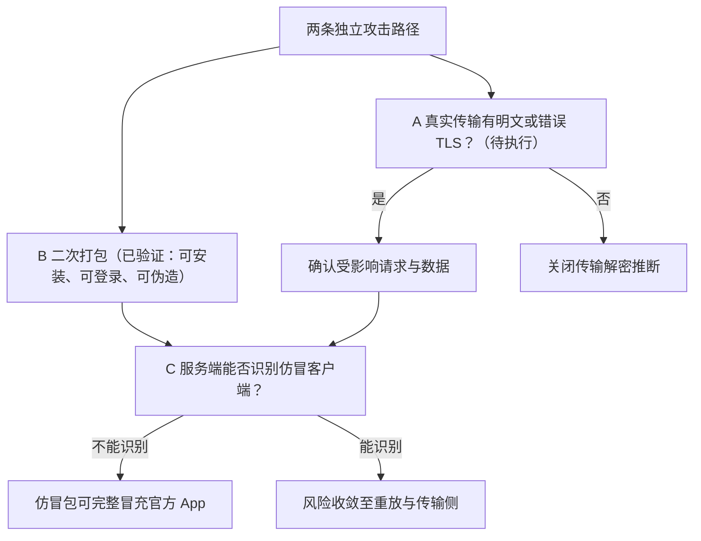
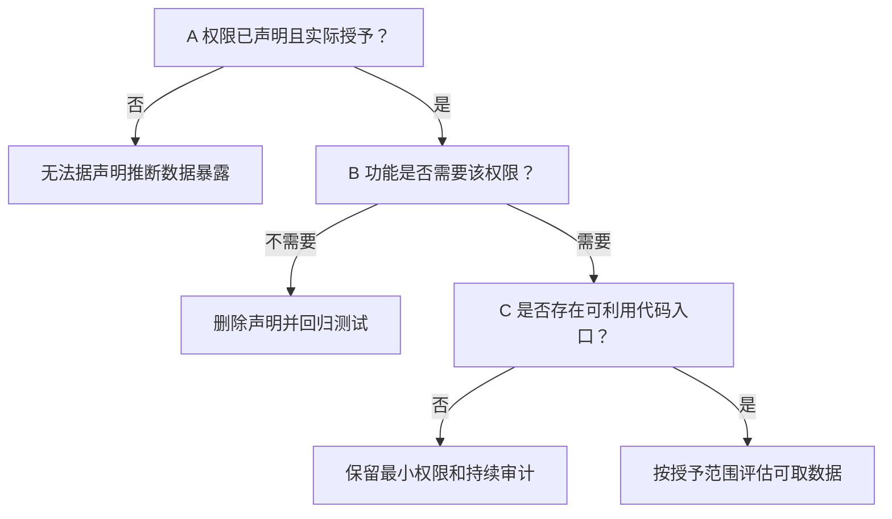

# Homewoo Android APK 安全静态评估报告

**评估对象**：`/Users/h1610/Desktop/安全方案/app-arm64-v8a-release.apk`  
**SHA-256**：`968460c42b849e0b91f2a1de46a8c1c18a12027066251aaaac190267c8545c38`  
**包名 / 版本**：`com.sdmc.homewoo` / `1.0.0`（versionCode `9303146`）  
**平台与构建**：Android min SDK 24、target SDK 36；Flutter AOT 应用，主要业务代码位于 `lib/arm64-v8a/libapp.so`。

## 结论与判定口径

**评估范围**：静态部分只分析上述 APK 的签名、Manifest、资源、DEX/Smali 和 Flutter AOT 库中可提取的字符串；相关条目已结合本项目三条攻击链的运行时验证结果给出最终判定。

**攻击者身份与起点**：本报告以外部攻击者身份分析；初始获得的材料只有这份 APK。攻击者可以用自己的设备安装 App、自行注册登录、操作可访问功能并观察结果；不假定掌握源码、服务端配置、云平台管理权限或他人的账号、设备、备份与后台日志。

**本次已执行**：**本报告**只对 APK 做离线静态检查，不含安装运行、注册登录、业务请求或流量采集。但**本项目另有三条攻击链已完成运行时验证**，见下节「配套动态验证」；本报告相关条目已据此更新判定。

**当前结论**：**三条攻击链已在受控测试环境中验证成功**——接口请求重放、客户端返回数据篡改、登录后首页覆盖。**第 4 项的共享密钥经证据确认为随包发布的实际密钥**。仍未验证的是：跨账号对象访问、生产环境复现，以及**用提取到的密钥自行构造新签名**（详见第 4 项与第 1 项）。

### 配套动态验证（已完成）

同一项目另有三份攻击复现文档，均在授权测试账号、Root 测试设备与开发/测试环境（`xhome-dev.sdmc.tv:18443`）中**实际执行并验证成功**，不涉及生产数据、跨账号访问或真实用户：

| 攻击链 | 复现目录 | 验证结果 |
|---|---|---|
| 接口日志泄露与请求重放 | [`01-接口日志泄露与请求重放攻击`](../01-接口日志泄露与请求重放攻击/攻击复现说明.md) | 日历**读取、新增、编辑**重放成功；修改请求体复用旧签名返回 HTTP 401 |
| APK 二次打包与返回数据篡改 | [`02-APK二次打包与返回数据篡改攻击`](../02-APK二次打包与返回数据篡改攻击/攻击复现说明.md) | 篡改接口地址后重打包、签名、安装均成功；页面显示伪造数据标记 |
| 客户端首页内容篡改 | [`03-客户端首页内容篡改攻击`](../03-客户端首页内容篡改攻击/攻击复现说明.md) | 登录后**完整覆盖原首页**成功；重启后保持；可引导用户外跳 |

产物与证据分别保存在各目录的 `artifacts/` 与 `evidence/`。本报告**第 1、8 项**已按“已确认”判定，第 4 项由静态证据确认，正文中均标注了对应的证据来源。

按潜在 App 安全影响和处置优先级排序：

| 顺序 | 问题 / 攻击面 | 影响级别 | APK 内证据强度 | 验证进度 |
|---|---|---|---|---|
| [1](#issue-1) | 接口日志泄露与请求重放 | **高，已确认** | 包内有记录完整请求/响应的代码 | **攻击链 01 已验证**：日历读取、新增、编辑重放成功 |
| [2](#issue-2) | 导出 Activity 接受外部路由与 OAuth 回调 | 高 | 外部可直接调起，回调会转发进 App | 入口确实存在，还没验证能否越权跳转或串绑账号 |
| [3](#issue-3) | 发布包包含非生产环境与切换线索 | 高 | 四套环境地址齐全，切换器已接入界面 | 切换器是真的，还没验证怎么触发、环境之间是否互通 |
| [4](#issue-4) | 发布包内置全局共享对称密钥 | **高，已确认** | **4 个 32 位密钥常量已实际找到** | **密钥在包里已经坐实**；下一步是**用密钥自行构造签名**（攻击链 01 已证明客户端生成签名） |
| [5](#issue-5) | 发布包带入模拟数据通路与调试组件 | 中，条件性 | 模拟请求、跨 5 模块假数据层、持久化开关、调试代理通道均已确认 | 还没验证开关能否被打开；与攻击链 03 同属“客户端内容可被替换” |
| [6](#issue-6) | App 数据备份与设备迁移规则待核查 | 中，待确认 | 备份规则一项都没配 | 还没验证实际备份了哪些数据、恢复后旧会话能否续用 |
| [7](#issue-7) | Maps Key 限制及 Firebase 资源授权待核查 | 中，待确认 | 客户端 Key 在包内（这本身是常规做法） | 还没核查云端限制、数据服务是否对外开放 |
| [8](#issue-8) | 客户端完整性缺失与网络传输核查 | 完整性 **高，已确认**；传输 未定级 | 没配网络安全策略，但已用 HTTPS 且签名有效 | **攻击链 02/03 已验证**：重打包可安装运行、可伪造数据、可覆盖首页；传输侧仍待核查 |
| [9](#issue-9) | 权限与兼容性声明需最小化 | 低，待确认 | 相机、录音、存储等权限已声明 | 还没核查是否都用得上、是否真的被授予 |

- **两列读法**：**「APK 内证据强度」看“包里有什么”，是静态确认的事实；「验证进度」看“危害证实到哪一步”。** 分开两列是为了避免把“包里有这段代码”直接读成“已经能被攻击”。
- **“高”**表示影响较大。**第 1、4、8 项已由攻击链验证坐实**，应作为最高处置优先级；优先核验第 1—5 项。
- **“核查项”**表示尚不能确认控制是否缺失，暂不计作已发现漏洞。
- 每项依次展示**证据 → 影响与具体行为 → A/B/C 验证路径及逻辑图 → 修复与复核**。标注“攻击链已验证”的条目，其后果已实测；其余条目的影响与行为仍属条件性推演。
- A、B、C 是后续可自行尝试的验证顺序。**第 1、8 项对应的验证已实际执行**（见「配套动态验证」），其余条目的 A/B/C 尚未执行。文中的“测试账号”指自行注册或控制的账号；若不能自行注册，相关路径保持待验证。

<a id="issue-1"></a>

## 1. 接口日志泄露与请求重放【高，已确认】

> **已确认**：发布包把服务端接受请求所需的材料（URL、请求体、`accessToken`、`signature`、`timestamp`、`clientId`、设备与版本信息）写入设备日志。  
> **已确认**：攻击链 01 已在测试环境用脚本在 App 外重放这些请求，**日历读取、新增、编辑均成功**。  
> **待验证**：普通未 Root 设备上的日志可读取性、跨账号对象访问，以及**用提取到的密钥自行构造新签名**。

### 包内证据与当前判断

- `lib/arm64-v8a/libapp.so` 中可提取 `XHOME_API`、`_logApiRequest`、`_logApiExchange`、`_formatApiRequestLog`、`requestHeaders`、`requestBody`、`responseBody`、`_writeXHomeLogToDebugConsole` 等业务符号；同时存在 `redactedLogFields`、`redactedResponseLogFields`、`_redactLogFields`、`_redactResponseLogValue`、`_redactSensitiveValues` 与 `<redacted>` 字面量，说明开发者**有**脱敏设计。
- 但攻击链 01 的实测结果表明：**脱敏未覆盖请求重放所需的全部材料**——脚本从日志中完整恢复了请求体、`accessToken`、`signature` 与 `timestamp`，并据此重放成功。

### 攻击链 01：请求重放（已验证）

- **原理**：App 已生成服务端认可的完整请求，攻击者只需**复制并重放**：

  ```text
  App 生成请求（URL / 请求体 / accessToken / signature / timestamp）
        ↓
     logcat
        ↓
  攻击脚本读取日志
        ↓
  在 App 外原样重发
        ↓
  服务端视为合法请求
  ```

- **实测结果**：

  | 动作 | 结果 |
  |---|---|
  | 日历读取 `list` | ✅ 重放成功，取得该账号事件数量与返回结果 |
  | 日历新增 `create` | ✅ 重放成功，返回新 `eventId` |
  | 日历编辑 `update` | ✅ 重放成功，标题/时间发生预期变化 |
  | 日历删除 `delete` | 接口返回成功；**删除动作的独立因果关系尚未完全证明** |
  | 修改请求体后复用旧签名 | **HTTP 401** —— 说明签名覆盖请求体，**完整性校验有效** |

- **最关键的一点**：这项攻击**不需要破解 TLS，也不需要知道签名算法**。签名能防“篡改请求”，但**不能防“复制合法请求”**。
- **复现入口**：[`01-接口日志泄露与请求重放攻击`](../01-接口日志泄露与请求重放攻击/攻击复现说明.md)

### 成功后的影响

- **成立条件已满足**：发布版确实写入了重放所需的完整材料，攻击者可读取本机日志。
- **可能获取**：有效访问令牌、请求签名、账号与设备标识、日历内容。
- **结果**：可在 App 外**读取、新增、编辑（删除待独立验证）**该账号的日历数据；结合日志中的关系与日程信息还可开展定向诈骗。
- **边界**：普通第三方 App 不能仅凭同机安装读取他人 logcat（攻击链 01 使用 Root 设备）；跨账号对象访问未验证；服务端对象权限仍可限制影响范围。[Android 日志信息泄露指南](https://developer.android.com/privacy-and-security/risks/log-info-disclosure)

#### 具体行为与后果

- **重放读取**：脚本从日志恢复请求后重放，即可在 App 外取得该账号的日历事件列表。**结果**：个人安排与家庭活动规律被批量获取。
- **重放写入**：重放 create/update 请求，可在用户无感知的情况下向日历插入虚假日程或改动既有事件。**结果**：数据完整性受损，用户可能错过行程或误信伪造安排。
- **冒充客服或熟人**：利用日志中的姓名、日程或设备信息编造可信的短信、电话或站外链接，诱导用户提供验证码。**结果**：从一次日志泄露发展为进一步的账号诈骗。

### 攻击路径与验证图

- **A｜本机日志读取（已完成）**：在 Root 测试设备运行 App，执行日历操作，从 `logcat` 提取请求材料。
  - **工具**：`adb logcat`、`01-接口日志泄露与请求重放攻击/run_replay_attack.sh`。
  - **判定**：**判定成立**——日志确实包含重放所需的完整材料。
- **B｜重放写操作（已完成）**：在 App 外原样重发提取到的请求。
  - **工具**：`run_replay_attack.sh list|create|update`、`verify_replay_result.py`。
  - **判定**：读/增/改**已确认成功**；删除动作需用专用测试对象做前后对照才能独立确认。
- **C｜自行构造签名（待执行，最高优先级）**：攻击链 01 已证明客户端会生成服务端认可的 `signature`，**因此客户端必然持有签名密钥**；第 4 项已在包内定位 4 个 32 位密钥常量。
  - **判定**：若能用这些密钥对**任意构造的请求体**生成被服务端接受的签名，则攻击从“只能重放”升级为“可凭空伪造”，性质完全不同。这是目前整个评估中价值最高的未验证点。



#### 最小验证命令

```bash
python3 Homewoo-Android-APK-验证助手.py logs /path/to/test-device-log.txt
```

### 给防守方的修复与复核建议

#### 修复建议

- **原理**：请求材料不落日志，攻击者就没有可复制的合法请求；服务端防重放则进一步使“复制来的请求”失效。两道都要做——攻击链 01 已证明**只靠签名不够**。
- **【立即】关闭日志输出**：发布版禁止输出完整请求/响应体、认证头、`accessToken`、`signature`、`timestamp`；只保留随机请求 ID、接口名、状态码、耗时等必要字段。
- **【立即】补服务端防重放**：签名校验通过不等于请求合法。需加入时间戳窗口、一次性 Nonce、服务端重放记录（按 nonce/请求指纹去重），并对写操作强制幂等键。**这是本项唯一能真正阻断攻击链 01 的措施**——因为签名本身设计上就无法防重放。
- 采用**字段白名单**生成诊断事件，禁止按黑名单猜测所有敏感字段；服务端日志、崩溃上报和客服导出也执行相同规则。
- 短时令牌与撤销机制可缩短泄露窗口；每个接口仍须独立校验身份与对象权限。
- Android 官方明确建议不要在非调试版本向 `logcat` 输出敏感数据。[Android 日志信息泄露指南](https://developer.android.com/privacy-and-security/risks/log-info-disclosure)

#### 开发方验证闭环

- 在专用测试账号上执行登录、刷新令牌、日历读写、设备绑定等操作，只检查本 App 的日志和诊断上报；用自动规则判定 `Authorization`、Token、Cookie、密码、验证码、`signature`、个人信息及完整请求/响应体均不出现。
- **回归验证攻击链 01**：整改后重新执行 `01-接口日志泄露与请求重放攻击/run_replay_attack.sh`，要求脚本**无法再从日志提取到可用请求材料**。
- **服务端防重放验证**：对同一请求重复提交，要求第二次起被拒绝（返回明确的重复请求错误码），而不是仅靠 Token 有效期兜底。
- 保留脱敏审计样本，不保存真实凭证。

<a id="issue-2"></a>

## 2. 导出 Activity 接受外部路由与 OAuth 回调【高】

> **已确认**：MainActivity 对外导出，接受 route 参数及日历 OAuth 回调 URI。  
> **待验证**：路由权限、OAuth state/PKCE/一次性绑定是否有效。

### 包内证据与当前判断

- Manifest 将 `com.sdmc.homewoo.MainActivity` 设为 `android:exported="true"`；其 `VIEW` 过滤器接受 `homewoo://calendar/google/complete...`。
- `MainActivity.smali` 的初始路由函数直接读取 Intent 中名为 `route` 的字符串并作为 Flutter 初始路由返回；`onNewIntent` 将匹配的回调 URI 字符串送入 `oauthCallback` 通道。
- APK 中还能看到 OAuth `nonce`、回调恢复相关符号，说明可能已经有进一步校验，但不能据此确认校验完整。

### 成功后的影响（条件性推演）

- **成立条件**：外部 route 能绕过页面检查，或 OAuth 回调缺少 state、PKCE、账号绑定及一次性校验。
- **可能获取**：可能接触错误开放的本地缓存；若授权码可兑换，可能取得其授权范围内的第三方日历令牌。
- **结果**：打开内部页面、错误绑定日历、改动事件；在服务端对象授权也失效时，才可能扩大到其他用户数据。
- **边界**：唤起页面或 Scheme 不等于越权；结果受会话、OAuth 授权范围和服务端校验约束。[Android 不安全深链风险](https://developer.android.com/privacy-and-security/risks/unsafe-use-of-deeplinks)

#### 具体行为与后果

- **强制打开内部页面**：恶意 App 向导出的入口反复发送自选路由，使受害者 App 显示本不应由外部直接打开的家庭、设备或授权页面；若页面或接口缺少校验，再利用当前会话读取资料或提交修改。**结果**：未授权页面访问、资料泄露或数据被改。仅能打开页面时不能认定已经越权。
- **伪造日历绑定结果**：发送构造的 OAuth 回调，把攻击者控制的日历账号冒充为受害者这次授权的结果；若同步方向和写权限允许，还可在受害者可见的日历中加入推广、假客服或钓鱼链接事件。**结果**：账号串绑、错误同步，以及借日历内容实施引流或诈骗；这不是仅凭自定义 Scheme 就能实现。
- **兑换被截获的授权码**：若同时缺少 PKCE 等保护，攻击者可把抢到的授权码换成第三方令牌，再用脚本读取或修改该授权范围内的日历。**结果**：第三方数据泄露或事件被篡改。

### 攻击路径与验证图（待执行）

- **A｜外部 route**：在专用设备向导出的 Activity 发送无效及受保护路由，分别以未登录和测试账号状态检查。
  - **工具**：`adb shell am start`、测试账号、业务接口审计日志。
  - **判定**：仅打开页面不构成越权；需证实未授权数据展示或动作实际成功。
- **B｜伪造回调**：A 未发现问题时，发送错误 `state`、无效授权码及重复 URI。
  - **工具**：`adb`、专用测试账号、服务端 OAuth 绑定记录。
  - **判定**：必须被拒，且账号和日历绑定不变。
- **C｜同 Scheme 争用与授权码保护**：再检查同 Scheme App、PKCE 和回调一次性消费；仅在受控设备及测试账号操作。
  - **判定**：只有可兑换授权码或错误绑定被实际证实，才能升级结论。



#### 最小验证命令

```bash
adb shell am start -n com.sdmc.homewoo/.MainActivity --es route /__security_test__
adb shell am start -a android.intent.action.VIEW -d 'homewoo://calendar/google/complete?state=invalid-test-state&code=invalid-test-code' -p com.sdmc.homewoo
```

### 给防守方的修复与复核建议

#### 修复建议

- **原理**：入口白名单阻断任意路由；state、PKCE 和一次性绑定把 OAuth 结果固定到本次授权尝试；最终对象权限必须由服务端检查。
- 对外路由设严格白名单；在接收 Intent、Flutter 路由层及最终业务接口三处分别做格式、会话和对象权限校验。
- OAuth 优先使用经过域名验证的 HTTPS Android App Links；保留自定义 Scheme 时必须校验 `state`、PKCE、过期时间、单次使用和当前用户/设备上的授权尝试绑定。
- 禁止回调参数直接决定登录账号或跳转到任意 URL。
- 相关依据：[Android App Links](https://developer.android.com/training/app-links/about)、[不安全深链风险](https://developer.android.com/privacy-and-security/risks/unsafe-use-of-deeplinks)

#### 开发方验证闭环

- 测试未登录/已登录时的任意 `route` 值、未知页面、需要权限的页面；用错误 `state`、过期授权、重复回调及别的测试账号发起的回调检查拒绝行为。
- 涉及账号或日历变更时，还需核对服务端授权结果。

<a id="issue-3"></a>

## 3. 发布包包含非生产环境与切换线索【高】

> **已确认**：包内包含开发、测试、预发地址及环境切换相关符号。  
> **待验证**：生产用户能否触发切换，身份和数据是否跨环境流动。

### 包内证据与当前判断

- `libapp.so` 中同时出现生产地址 `https://cloud-api.sdmc.tv/cloud/v5.0/`，以及三套非生产地址：
  - 开发 `https://xhome-dev.sdmc.tv:18443/aihome/cloud-api/cloud/v5.0/`
  - 测试 `https://xhome-test.sdmc.tv:18443/cloud-api/cloud/v5.0/`
  - 预发 `https://xhome-uat.sdmc.tv:18443/XHome-dev/cloud/v5.0/`
  - 注意：非生产环境使用**非标准端口 `18443`**，与生产环境的默认 443 不同。
- 环境切换相关符号：`Switch environment`、`auth-environment-sheet`、`auth-environment-trigger`、`auth-environment-option-`、`auth-environment-check-`、`homewoo_xhome_environment`、`_persistNativeEnvironment`、`_restartForEnvironment`、`XHomeApiEnvironment`、`XHomeApiEnvironmentProfile`。
- **切换入口已接线到界面，不是残留字符串**：包内同时存在 `_handleEnvironmentUnlockTap`、`_showEnvironmentSheet`、`_AuthEnvironmentSheet` / `_AuthEnvironmentSheetState`、`AuthEnvironmentController`、`AuthEnvironmentInfo`、`authEnvironmentOptionsProvider`、`authEnvironmentRestartProvider`。其中 `UnlockTap` 这一命名指向“连续点击触发解锁”的隐藏入口，说明该切换器是**有意实现、在发布配置中已完成接线、仅靠点击手势隐藏**的功能。
- 仍未验证的是：解锁手势的具体触发位置与次数，以及切换后生产凭证是否真的被发往非生产端。

### 成功后的影响（条件性推演）

- **成立条件**：正式用户请求可被导向非生产环境，且该环境日志、身份或数据隔离不足。
- **可能获取**：可能流入非生产服务的令牌、认证头、账号/家庭/设备标识和日历请求内容。
- **结果**：收集凭证、跨环境脚本调用、串写数据；若攻击者还能控制展示内容，可植入引流或钓鱼链接。
- **边界**：仅有地址和切换符号不能证明入口可用；环境间令牌互拒且数据隔离时，上述后果不成立。

#### 具体行为与后果

- **把正式请求导向测试环境**：触发或修改环境选择，让正式用户登录、刷新令牌或同步数据时访问测试服务；若攻击者可接触该环境日志，就能收集生产令牌和个人数据。**结果**：真实资料流入保护较弱的系统，后续可被批量整理和滥用。
- **跨环境自动调用**：若测试环境接受生产令牌，攻击者用脚本批量读取或改写测试服务中关联的用户、家庭或设备记录；若生产环境反过来接受测试令牌，影响可能进入生产数据。**结果**：环境边界失效、数据串写或账户冒用。
- **利用受控测试响应误导用户**：只有在攻击者还能控制测试服务返回内容，且 App 会展示该内容时，才可能把帮助地址或展示文案改成推广、假客服或钓鱼链接。**结果**：引流和诈骗；环境地址出现在 APK 中本身不足以造成这一结果。

### 攻击路径与验证图（待执行）

- **A｜入口可达性**：检查正式包是否能触发环境切换，记录实际请求目的地。
  - **工具**：测试设备、UI 操作、下方 APK/HAR 只读检查命令。
  - **判定**：地址字符串存在但入口不可达，应维持“打包线索”结论。
- **B｜本地环境状态**：A 不可达时，在自己控制的安装设备上观察本地状态、深链和设置入口能否改变请求目的地。
  - **工具**：受控设备、本地状态观察、测试 App 数据清单和 HAR 目的地统计。
  - **判定**：即使可切换，也要继续查生产凭证是否真的被发到非生产端。
- **C｜跨环境身份隔离**：用各环境专用测试令牌交叉验证网关拒绝与数据隔离。
  - **工具**：各环境自有测试账号、接口响应和脱敏流量记录；无法注册或访问的环境保持待验证。
  - **判定**：生产与非生产令牌互拒、数据库隔离时，跨环境冒用路径关闭。



#### 最小验证命令

```bash
python3 Homewoo-Android-APK-验证助手.py apk /path/to/app-arm64-v8a-release.apk
python3 Homewoo-Android-APK-验证助手.py har /path/to/test-traffic.har
```

### 给防守方的修复与复核建议

#### 修复建议

- **原理**：生产包移除切换入口能减少误发请求；环境独立的令牌发行者、受众、密钥和数据使一侧凭证无法在另一侧使用。
- 分别构建生产和测试 APK；生产包只含生产域名及允许的配置，删除环境切换入口和开发/测试证书。
- 服务端对环境分别使用独立用户库、令牌发行者/受众、签名密钥、API Key 和权限域；生产网关拒绝非生产令牌，测试网关拒绝生产令牌。
- 对环境选择值采取受签名保护的发布配置，不能信任本地偏好值决定敏感请求去向。

#### 开发方验证闭环

- 在隔离测试设备上检查发布包是否可触发切换；观察所有环境的登录、刷新、业务请求目的地；用不同环境的测试令牌交叉调用，要求均被拒绝。
- 此项的真正严重性取决于环境隔离结果。

<a id="issue-4"></a>

## 4. 发布包内置全局共享对称密钥【高，已确认】

> **已确认**：发布包中实际存在 4 个符合 `XHOME_SECRET_KEY` 格式要求（恰好 32 位 ASCII）的密钥常量，且与 iOS 发布包逐字节相同。  
> **待验证**：服务端是否将该密钥用于签名授权，以及历史调用是否已被滥用。

### 包内证据与当前判断

- `libapp.so` 中存在 `secretKey`、`XHOME_SECRET_KEY must be 32 ASCII characters for XHome AES-256.`、`Missing XHOME_SECRET_KEY. Provide it with --dart-define or a local env file.`、`Missing XHOME_CLIENT_ID. Provide it with --dart-define or a local env file.` 等字符串。
- **密钥常量已实际定位**。按错误串给出的格式要求（恰好 32 位 ASCII）筛查 `libapp.so` 中全部 32 位字母数字常量，共得到 63 个候选串，其中 **59 个是可识别的 Dart 标识符**（如 `CalendarGoogleOAuthAttemptStatus`、`MqttPublishReleaseVariableHeader`、`listsMqttRefreshListenerProvider`），**仅 4 个为无语义的随机串**（均为大小写混合字母、不含数字）。沿用本报告“不抄录疑似值”的既定口径，此处只给出可用于核对的片段特征：

  | 序号 | 长度 | 首 4 位 … 末 4 位 | 特征 |
  |---|---|---|---|
  | 1 | 32 | `JCcn…Iucz` | 随机串，无字典语义、无驼峰结构 |
  | 2 | 32 | `LNIa…YdyJ` | 随机串，无字典语义、无驼峰结构 |
  | 3 | 32 | `gplw…MLgXW` | 随机串，无字典语义、无驼峰结构 |
  | 4 | 32 | `iiqI…LfZP` | 随机串，无字典语义、无驼峰结构 |

  （上表仅列首尾各 4 位，合计暴露 8/32 字符——**足以让开发方在构建配置中定位是哪一条，不足以重建密钥**。`Homewoo-Android-APK-验证助手.py` 的 `apk` 模式会用同一组片段做回归比对。）

- **四条相互独立的证据共同支撑“这 4 个串即 `XHOME_SECRET_KEY` 的实际取值”**：
  1. **格式精确吻合**——错误串明确要求“恰好 32 位 ASCII”，这 4 个串长度均恰为 32，且均为纯 ASCII；
  2. **统计排他性**——全包 63 个同长度候选中，其余 59 个**全部**是可读的 Dart 类名 / Provider / Repository 命名，只有这 4 个不符合任何命名规范；
  3. **仅存在于业务代码**——这 4 个串在 `libflutter.so`、`classes.dex` 及包内其他 `.so` 中命中次数**均为 0**，只出现在承载业务逻辑的 `libapp.so`；
  4. **跨平台一致且数量吻合**——在 Android APK 与 iOS IPA（`App.framework/App`）中**逐字节相同**；共 4 个，与包内 4 套环境（生产 / 开发 / 测试 / 预发）数量一致。
- 包内同时存在 `XHomeCrypto`、`xhome_crypto.dart`、`_requestBodyForSignature`、`AES-256`、HMAC 相关符号，说明该密钥很可能用于**请求体签名**，而不仅是本地缓存加密。
- **判定边界的说明**：本次未能取得 AOT 层调用图（该包 Dart 版本为 3.13.2，**本次评估所用的主线 blutter 版本不支持本包快照格式**），因此“某个密钥与某个具体调用点的绑定关系”属推断，而非反编译实证。但**“密钥随包发布”这一事实由上述四条独立证据支撑，结论成立**——建议直接按已泄露处置，不再等待运行时验证。

### 成功后的影响（条件性推演）

- **成立条件**：**前半已经成立**——共享密钥确实随包发布（见上）。剩余待验证条件为：攻击者可取得对应密文或报文，且服务端错误地仅凭该密钥认可请求。
- **可能获取**：若用于加密且密文可得，可能解读家庭、设备、日历等对应业务数据。
- **结果**：在服务端另有授权缺陷时可能脚本构造被接受的报文、修改记录并触发大范围密钥轮换。
- **边界**：密钥已确认随包发布，但**尚不能证明服务端仅凭它授权**；若服务端仍严格校验独立会话与对象权限，仅持有密钥不足以直接改动他人数据。[OWASP MASWE-0003](https://mas.owasp.org/MASWE/MASVS-STORAGE/MASWE-0003/)

#### 具体行为与后果

- **伪造批量请求**：若服务端另将该共享密钥用于签名且仅凭签名认可请求，攻击者提取一次密钥后可写脚本生成“合法格式”的报文，尝试批量修改设备设置、日历记录或其他服务器接受的业务字段。**结果**：数据完整性受损，影响范围可能覆盖所有使用该密钥的用户。
- **解读已取得的密文**：若该密钥实际用于保护本地缓存或业务报文，攻击者取得相应密文后可统一解密，整理家庭关系、设备资料或日程。**结果**：原本依赖该密钥保护的数据失去保密性。
- **长期复用伪造能力**：旧密钥在服务器继续有效时，攻击者可持续生成新报文并避开单次令牌泄露的时效限制。**结果**：需要全量轮换密钥和淘汰旧协议。若服务器仍严格核对独立会话、对象权限与一次性挑战，仅有密钥并不能直接改动所有用户数据。

### 攻击路径与验证图

- **A｜发布包逆向（已完成）**：从可分发 APK 的二进制与资源中查找真实密钥值或派生逻辑。
  - **工具**：`strings` + ELF 段解析 + 跨平台（APK / IPA）比对 + 下方只读 APK 脚本。
  - **判定**：**判定成立**——已定位 4 个 32 位密钥常量，不再是“仅有提示字符串而无真实共享值”。
  - **复核方法**：`strings -a lib/arm64-v8a/libapp.so | awk 'length($0)==32 && /^[A-Za-z0-9]+$/' | sort -u`，人工剔除 Dart 标识符后即得该 4 个串；亦可与 iOS 包 `App.framework/App` 交叉比对确认跨平台一致。
- **B｜用途确认（部分完成，由攻击链 01 补足）**：攻击链 01 已证明**请求携带 `signature` 字段，且该签名由客户端生成并被服务端接受**——因此客户端**必然持有签名密钥**。这把本项从“包内有密钥常量”推进到“客户端持有可生成有效签名的密钥”。
  - **仍待确认**：这 4 个密钥中哪一个用于签名、按何种规则选取环境、是否每设备独立。
  - **工具**：受控设备运行时观测（如 Frida hook `xHomeCryptoProvider`）和测试流量；不在报告中披露真实密钥。
- **C｜自行构造签名（待执行，最高优先级）**：攻击链 01 只验证了**原样重放**，并明确记录“未证明攻击者可以自行生成新签名”。本步是用提取到的密钥对**任意构造的请求体**生成签名并提交，观察服务端是否接受。
  - **判定（被接受）**：攻击从“复制合法请求”升级为“凭空伪造任意请求”，可对他人对象发起写操作（仍受服务端对象权限约束），影响面覆盖该密钥对应的**全部用户**——**必须立即全量轮换密钥并迁移协议**。
  - **判定（被拒绝）**：说明服务端另有客户端不可复制的认证因素，本项止于重放风险。
  - **这是目前整个评估中价值最高的未验证点**：它决定了攻击链 01 究竟是“只能复制”还是“可以编造”。



#### 最小验证命令

```bash
python3 Homewoo-Android-APK-验证助手.py apk /path/to/app-arm64-v8a-release.apk
```

### 给防守方的修复与复核建议

#### 修复建议

- **原理**：不向所有客户端分发同一长期秘密，单个安装包被分析时就不会暴露全体设备的共享凭据；服务端独立授权阻止仅凭客户端可生成材料操作他人数据。
- **【立即】按密钥泄露事件处置**：这 4 个密钥已确认随发布包分发，且 iOS 与 Android 共用同一套值。**在评估影响前先假定其已泄露**——评估服务端签名校验逻辑与调用日志，确认是否出现非 App 来源的请求。
- **【立即】全量轮换并迁移协议**：若服务端确有凭该密钥验签的逻辑，需按密钥泄露预案轮换，并淘汰依赖旧密钥的协议版本。注意：**换账号、改密码、登出都无法缓解**，因为泄露的是客户端共享秘密，不是用户凭证。
- **[架构] 停止在客户端分发共享秘密**：服务端长期密钥只放在服务端密钥管理系统；客户端不应持有能为全体用户生成合法签名的材料。
- **[架构] 改用设备级密钥**：客户端加密应使用每台设备 Android Keystore 生成的不可导出密钥；敏感操作由服务器按会话、用户、设备和对象重新授权，必要时将设备公钥注册到服务端并支持轮换。
- OWASP 将硬编码密钥及平台 Keystore 之外的密钥存储列为高风险弱点。[OWASP MASWE-0003](https://mas.owasp.org/MASWE/MASVS-STORAGE/MASWE-0003/)

#### 开发方验证闭环

- **“是否携带”已无需再确认**（本次已确认携带）。核对重点转为：这 4 个密钥分别归属哪套环境、用于签名还是加密、凭密钥可执行哪些操作、以及服务端是否存在仅凭签名放行的接口。
- 检索服务端调用日志，评估泄露窗口期内是否已有异常调用；留存审计结论。
- 留存轮换记录与旧密钥下线的验证结果。

<a id="issue-5"></a>

## 5. 发布包带入模拟数据通路与调试组件【中，条件性】

> **已确认**：包内存在完整的模拟（Mock）HTTP 客户端、跨 5 个模块的假数据层、假数据库及持久化启用开关。  
> **已确认**：包内注册了 Flutter 调试组件（`flutter_debug_kit`），含 `dev.flutter_debug_kit/system_proxy` 代理通道。  
> **待验证**：模拟开关能否被用户或第三方 App 诱导开启、启用后是否真的绕过服务端，以及调试代理通道是否可达。

### 包内证据与当前判断

- `libapp.so` 中存在一套**完整的模拟数据通路**，而非零散测试字符串：

  | 组件 | 作用 |
  |---|---|
  | `CalendarMockHttpClient`（`mock_calendar_http_client.dart`） | 模拟 HTTP 客户端，可替换真实 API 客户端 |
  | `CalendarMockHttpRequest` | 模拟请求对象 |
  | `MockCalendarRepository`（`mock_calendar_repository.dart`） | 客户端本地伪造的数据仓库 |
  | `MockCalendarProtocolIdCodec` | 模拟协议编解码器 |
  | `CalendarMockController` | 启用控制 |
  | `FakeAppDatabase`（含 `.seeded` 构造）/ `fakeAppDatabaseProvider`（`fake_app_database.dart`） | 假数据库 |
  | `calendarMockEnabledProvider`、`calendarMockHttpClientProvider`、`calendarMockXHomeApiClientProvider` | 依赖注入层的启用开关与替换点 |
  | **`mockCalendarServiceProvider`、`mockCalendarRepositoryProvider`、`mockCalendarProtocolIdCodecProvider`** | **服务层 / 仓库层 / 编解码层的替换点**——正是修复建议中要求“生产包不得注册”的那一类 |
  | `calendarMockControllerProvider`、`calendarMockPreferenceStoreProvider` | 控制器与开关存储的注入点 |
  | `SecureCalendarMockPreferenceStore`（`secure_calendar_mock_preference_store.dart`） | 开关的持久化存储 |
  | `CalendarMockPreferenceStore`（`calendar_mock_preference_store.dart`） | 存储抽象 |
  | `calendar_mock_preference.dart`（application 层） | 特性级 mock 开关 API |

- **存在持久化开关**：共享偏好键 `wall_planner_calendar_mock_enabled` 已打进发布包，说明启用状态会被写入本地并跨启动保留——这不是一次性的调试分支，而是可被持久改变运行模式的状态位。
- 配套的模拟对象 ID 前缀：`mock_api_`、`mock-oauth-attempt-`、`mock-google-oauth-`、`mock-google-connection-`；模拟 OAuth 地址 `https://accounts.google.com/o/oauth2/v2/auth?mockAttempt=`。
- 错误处理串 `Unknown Calendar Mock endpoint:`、`Unknown Calendar Mock protocol ID:`、`Calendar Mock OAuth attempt was not found.`、`Calendar Mock body must be an object.` 等，表明该通路包含明确的接口路由与校验逻辑，是**可运行的代码而非占位符**。
- **与第 3 项的关键区别**：环境切换只是把请求指向另一台**真实服务端**（仍有服务端校验兜底）；模拟通路是在**客户端本地**生成“成功”响应，理论上可完全不经过服务端。这一点比环境切换更值得关注。
- **影响面不止日历**：包内除日历 mock 外，还存在一套**跨 5 个模块的假数据层（fake repository）**，符号已确认：

  | 模块 | 假实现 |
  |---|---|
  | `core/data/` | `FakeAppDatabase`（含 `.seeded`）、`fakeAppDatabaseProvider` |
  | `features/calendar/` | `FakeCalendarRepository`、`fakeCalendarRepositoryProvider` |
  | `features/family/` | `FakeFamilyRepository`、`FakeFamilyInviteRepository` |
  | `features/devices/` | `FakeDeviceRepository`、`FakePocketRepository` |
  | `features/photos/` | `FakePhotoRepository` |
  | 跨模块 | `FakePocketStore`、`FakePocketRecord`、`fakePocketStoreProvider` |

  这意味着本节“成功后的影响”中推演的“伪造的日历、提醒、**家庭或设备信息**”，在符号层面**已有现成实现**，并非需要额外开发的假设场景。**影响范围应表述为日历、家庭、设备、口袋、照片共 5 个业务模块。**
- **调试组件同样进入发布包**：`classes.dex` 的 `GeneratedPluginRegistrant` 中存在 `flutter_debug_kit` 插件的注册块，其混淆后类 `Lq4/a` 实现 Flutter 插件接口并注册方法通道 `dev.flutter_debug_kit/system_proxy`。
  - **注意**：该插件类名已被 R8 混淆为 `Lq4/a`，**用原始类名搜索类型描述符会落空**——只有注册处的错误消息字符串保留了原名 `dev.flutterdebugkit.flutter_debug_kit.FlutterDebugKitPlugin`。同名框架在 iOS 包中亦存在（见 iOS 报告第 6 项）。
  - 该通道名为 `system_proxy`（系统代理），与本节“调试/测试能力进包”属同一类发布卫生问题。
- **边界**：以上均为静态符号证据。本次未运行 App，因此**不能证明该开关与代理通道对用户可达**；但这些组件确实随包发布，且其影响面覆盖上述 5 个模块。
- **与攻击链 03 的关系**：本项是“**客户端自带**的模拟通路”，开关在包内；攻击链 03 是“**攻击者改包**注入伪造首页”，不依赖本项。两者**殊途同归**——都导致用户看到被伪造的内容，且**服务端都无法感知**。攻击链 03 已验证可行（见第 8 项），说明这类风险的**实现门槛并不高**；本项则可能在**无需改包**的前提下达到类似效果，因此同样值得核查。反之，第 8 项的服务端完整性方案也能同时收敛本项。

### 成功后的影响（条件性推演）

- **成立条件**：开关可被诱导开启（用户误触隐藏入口、第三方 App 经导出组件传入参数、本地偏好被改写），且模拟数据会被界面当作真实内容展示。
- **可能获取**：不直接泄露数据，但可**控制受害者所看到的业务内容**。
- **结果**：App 内出现伪造的日历、提醒、家庭或设备信息；可进一步植入推广、假客服或钓鱼链接。
- **边界**：影响范围限于被开启模拟的那台设备。但需特别注意：**服务端对此无感知、无日志，因此服务端侧无法拦截或审计**——这是本项区别于其他各项的主要风险特征。

#### 具体行为与后果

- **诱导启用后投放伪造内容**：若开关可通过外部 Intent、深链或本地偏好改写开启，攻击者让受害者 App 进入模拟模式，界面随即展示由本地构造的日程、提醒或家庭信息。**结果**：用户基于伪造信息做出错误判断（如误信“设备告警”“家人日程变更”），可被用于诈骗。
- **替换帮助与客服入口**：若模拟数据中包含帮助链接或客服地址，攻击者可将其替换为钓鱼站点。**结果**：用户被引流至假客服，进而泄露验证码或支付信息。这一路径与“客户端首页内容篡改”属同一类风险。
- **掩盖真实故障状态**：模拟模式让用户在界面看到“同步正常”，而真实同步已失败或凭证已失效。**结果**：数据不一致、漏提醒，且排查时缺少服务端日志佐证。

### 攻击路径与验证图（待执行）

- **A｜开关可达性**：检查发布配置下模拟开关能否被开启——先看 App 内是否存在隐藏入口，再测导出组件与深链能否传入控制参数。
  - **工具**：测试设备、`adb shell am start`、第 2 项的 `route` 参数测试、本地偏好观察。
  - **判定**：仅字符串存在不能认定可达；必须实际观察到开关状态由关变开。
- **B｜本地偏好改写**：A 不可达时，在自有 root / 调试设备上直接改写偏好键 `wall_planner_calendar_mock_enabled`，观察重启后是否进入模拟模式。
  - **工具**：受控 root 设备、`run-as` / 备份恢复、界面比对。
  - **判定**：能改本地偏好只说明“存在本地滥用面”，**不等同于远程可利用**；须区分“设备已被攻陷”与“远程诱导”两种前提。
- **C｜服务端是否被绕过**：开关开启后，用自有测试账号观察是否仍产生真实网络请求、服务端是否有对应记录。
  - **工具**：受控网络代理、HAR 目的地统计、自有测试账号。
  - **判定**：若真实请求完全消失而界面仍显示成功，则确认客户端可脱离服务端伪造业务状态。



#### 最小验证命令

```bash
python3 Homewoo-Android-APK-验证助手.py apk /path/to/app-arm64-v8a-release.apk
adb shell run-as com.sdmc.homewoo ls -R /data/data/com.sdmc.homewoo/shared_prefs
```

### 给防守方的修复与复核建议

#### 修复建议

- **原理**：模拟通路属于测试能力，应在**编译期**从发布包中完全剔除。仅在编译期隔离，才能保证即使本地偏好被改写也无代码可走；仅在运行期加判断则仍留下可被绕过的入口。
- 用构建变体（flavor）或条件编译隔离模拟实现：生产包**不注册** `calendarMockXHomeApiClientProvider` 等替换点，不编译 `mock_calendar_*.dart`、`fake_app_database.dart`。
- 若确需保留演示能力，应限制为独立的应用内演示模式，明确标注“演示数据”，并**禁止其影响帮助链接、客服入口、支付入口**等敏感跳转。
- 发布流水线增加失败检查：产物中不得出现 `mock_api_`、`wall_planner_calendar_mock_enabled`、`FakeAppDatabase`、`CalendarMockHttpClient` 等标记。

#### 开发方验证闭环

- 在正式构建变体上确认模拟开关不受任何 UI、Intent、深链或本地偏好影响；对“模拟模式下是否仍产生真实网络请求”做一次对照测试。
- 留存两份证据：产物标记扫描结果，以及“开关不可达”的验证记录。

<a id="issue-6"></a>

## 6. App 数据备份与设备迁移规则待核查【中，待确认】

> **已确认**：Manifest 未显式配置备份与迁移排除规则。  
> **待验证**：实际进入备份的数据、恢复行为及会话能否跨设备复用。

### 包内证据与当前判断

- Manifest 的 `<application>` 未设置 `android:allowBackup`、`android:fullBackupContent`、`android:dataExtractionRules`；包内可见 `flutter_secure_storage` 依赖。
- Android 文档说明 `allowBackup` 默认是 `true`，SharedPreferences 等通常在默认备份范围内；Android 12+ 设备迁移行为还要按系统版本核对。
- 仅凭 APK 无法知道运行后是否真的备份了令牌或敏感缓存。

### 成功后的影响（条件性推演）

- **成立条件**：敏感文件确实进入备份，且攻击者控制用户备份账户或迁移流程。
- **可能获取**：可能是偏好、家庭/设备资料、日历缓存、令牌或受 Android Keystore 保护的密文。
- **结果**：有效令牌可造成跨设备会话冒用；无法在新设备解密的密文更可能造成登录或恢复异常。
- **边界**：普通第三方 App 无法据此读取系统备份；云备份受账户及设备安全机制保护。[Android Auto Backup](https://developer.android.com/identity/data/autobackup)

#### 具体行为与后果

- **在受控设备上恢复数据**：取得用户备份账户或控制换机流程后，把备份中的 App 数据恢复到另一设备，查看其中的日历缓存、家庭或设备资料。**结果**：备份数据被二次读取；是否能看到明文取决于实际存储和备份加密。
- **复用恢复出的会话**：如果备份里有仍有效的令牌且服务器允许跨设备使用，攻击者可用脚本继续查询或修改该账号有权访问的日历、设备资料。**结果**：换机过程变成会话冒用入口。
- **造成恢复后异常**：如果只迁移了 Keystore 密钥保护的密文而未迁移密钥，攻击者未必能解密，却可能让应用出现无法登录、缓存损坏或反复报错。**结果**：用户无法正常使用，需要重置本地状态。普通第三方 App 不能直接读取别人的系统备份。

### 攻击路径与验证图（待执行）

- **A｜规则核对**：核对 Manifest 缺省行为，以及不同 Android 版本实际适用的备份规则。
  - **工具**：下方 APK 检查命令、受控设备的备份/恢复测试和 Android 官方文档。
  - **判定**：缺少显式规则只说明需要查，不能代替备份内容证据。
- **B｜受控恢复**：在专用账号和设备做备份/迁移，清点恢复后的文件类别与敏感字段，避免保存真实令牌。
  - **工具**：测试设备、备份/恢复测试、下方 `container` 检查命令。
  - **判定**：记录哪些文件实际迁移，以及 Keystore 密文是否能用。
- **C｜会话复用**：若在自己的备份中恢复了测试令牌，再通过另一台自有设备的登录状态与接口响应观察该会话是否仍可用；服务端日志由开发方另行复核。
  - **判定**：跨设备拒绝或撤销成功时，会话冒用路径关闭。



#### 最小验证命令

```bash
python3 Homewoo-Android-APK-验证助手.py apk /path/to/app-arm64-v8a-release.apk
python3 Homewoo-Android-APK-验证助手.py container /path/to/test-app-data
```

### 给防守方的修复与复核建议

#### 修复建议

- **原理**：把令牌、密钥和 Keystore 密文排除备份后，恢复过程不会携带这些材料；服务端设备绑定和撤销进一步阻止旧会话跨设备继续使用。
- 明确配置 `allowBackup` 及 Android 11 以下的 `fullBackupContent`、Android 12 以上的 `dataExtractionRules`；按业务需要只备份可恢复的非敏感数据，排除令牌、密钥、会话、设备凭据和受 Keystore 保护的密文。
- 对于能从服务器重建的状态，可直接关闭相应备份和设备迁移。
- 不同 Android 版本都做一次备份/恢复测试。[Android Auto Backup 官方文档](https://developer.android.com/identity/data/autobackup)

#### 开发方验证闭环

- 在覆盖 Android 11 及 Android 12 以上的受控设备上执行备份/迁移与恢复，检查令牌、密钥、Keystore 密文和个人缓存是否被带入；验证恢复后的登录可用性与旧会话撤销。
- 留存脱敏文件类别和服务端拒绝记录。

<a id="issue-7"></a>

## 7. Maps Key 限制及 Firebase 资源授权待核查【中，待确认】

> **已确认**：资源中存在 Google/Firebase 客户端 Key 名称和项目配置。  
> **待验证**：Key 的云端限制、实际启用的数据服务及资源授权规则。

### 包内证据与当前判断

- `res/values/strings.xml` 包含 `google_api_key`、`google_crash_reporting_api_key`、`google_maps_api_key`、Firebase 项目标识和存储桶名称。
- 报告不重复完整 Key，避免扩大扩散。
- 这类客户端 Key 本来就可从 APK 读取，**存在 Key 不等于 Key 已可被滥用**；关键是云端应用限制、API 限制和配额。

### 成功后的影响（条件性推演）

- **成立条件**：Google API Key 限制不足；数据泄露还要求对应 Firebase 数据服务被使用且授权规则过宽。
- **可能获取**：前者主要涉及调用额度与账单；后者仅涉及实际存在且错误开放的用户数据或文件。
- **结果**：脚本消耗配额、增加费用；若有可写的云资源，还可能批量覆盖展示内容、植入广告或钓鱼链接。
- **边界**：Firebase 客户端 Key 是项目标识，不是管理员凭据；Key 可提取不等于数据库可读。[Firebase API Key 说明](https://firebase.google.com/docs/projects/api-keys)

#### 具体行为与后果

- **脚本刷第三方 API**：在 Key 可用于未授权的高成本 API 时，攻击者持续发起地图等请求，消耗配额并增加费用。**结果**：项目账单上升，正常用户可能因配额耗尽而无法加载地图。
- **批量导出或覆盖云数据**：只有 Firebase 对应资源的 Security Rules 也允许未授权读写时，攻击者才能用脚本遍历可访问记录、下载文件或覆盖数据；若被覆盖的字段会在 App 中显示，可进一步植入推广文案、假客服信息或钓鱼链接。**结果**：用户资料泄露、内容污染和引流诈骗。
- **界限**：拿到 Firebase 客户端 Key 一项，不能直接修改 App 页面、发送特权推送或获取云管理员权限；上述内容篡改必须有实际可写资源和展示路径。

### 攻击路径与验证图（待执行）

- **A｜客户端用途识别**：从 APK 和自有设备运行结果识别 Key 对应的地图、登录或云资源功能，不把 Key 可提取当作漏洞。
  - **工具**：下方 APK 检查命令、受控设备和脱敏请求记录。
  - **判定**：只确认可观察到的调用用途；无法从安装包单独判断全部云端限制。
- **B｜错误身份拒绝**：针对包内对应的实际 Key 和已识别功能，使用自己控制的客户端做极少量错误包名/证书或无关 API 请求，观察具体接口是否拒绝；换用另一个项目的 Key 不能证明本项目的限制状态。
  - **工具**：受控测试客户端和接口响应；不进行刷量或压力请求。
  - **判定**：误放行需记录具体 API 和条件；单次拒绝也不能证明所有云端限制完整。
- **C｜Firebase 数据访问**：若 App 实际使用 Firestore、Realtime Database 或 Storage，只对自有测试数据检查匿名和跨账号访问结果。
  - **工具**：自有测试账号、可观察到的资源路径和接口响应。
  - **判定**：未使用服务或访问被拒时，不推断 Firebase 数据泄露；内部规则配置由开发方在复核环节另查。



#### 最小验证命令

```bash
python3 Homewoo-Android-APK-验证助手.py apk /path/to/app-arm64-v8a-release.apk
```

### 给防守方的修复与复核建议

#### 修复建议

- **原理**：应用/API 限制让错误签名与无关服务请求被拒；Firebase Security Rules 在每次资源访问时校验身份和对象，App Check 只作为附加信号。
- 在 Google Cloud 控制台将 Android Key 限制为 `com.sdmc.homewoo` 加正式发布签名证书指纹，并限定具体 API；Firebase 各资源写严密 Security Rules，按业务加入 App Check，设置预算/配额告警。
- 服务端 Web Service Key 不应放在 APK。
- 发现无限制 Key 时先补限制、评估调用日志，再安排轮换。[Google Maps Platform Key 安全指南](https://developers.google.com/maps/api-security-best-practices)

#### 开发方验证闭环

- 核对 Cloud Console 中应用/API 限制及历史调用；确认实际启用的 Firebase 数据服务，用 Emulator 对未登录、跨用户读写和 App Check 缺失场景执行规则测试。
- 只留拒绝矩阵与账单/配额统计。

<a id="issue-8"></a>

## 8. 客户端完整性缺失与网络传输核查【完整性：高，已确认；传输：未定级】

> **已确认**：未见 Manifest 网络安全配置、明确的完整性标记或 Play Integrity 集成；APK v2 签名有效。  
> **已确认**：**攻击链 02、03 已在测试设备上完成二次打包并成功运行**——篡改包可安装、可登录、可伪造返回数据、可覆盖首页。  
> **待验证**：运行时 TLS 校验、是否存在明文请求、服务端完整性信号与风控。

### 包内证据与当前判断

- Manifest 未引用 `networkSecurityConfig`，资源中未发现 pin-set；业务地址使用 HTTPS。
- 静态字符串中没有查到明确的 Play Integrity 集成标识。
- APK 使用有效的 v2 签名。签名者证书 SHA-256 为 `ba5a88384efa67b266332354677c121ffcf2354a701a09ef292ec09d7450ec41`；公钥算法 RSA 2048；证书主体为 `CN=homewoo, OU=SDMC, O=SDMC, L=Shenzhen, ST=Guangdong, C=CN`，**自签名**（issuer 与 subject 相同），有效期 **2026-07-13 至 2053-11-28**。
- **签名方案覆盖情况需注意**：`apksigner verify` 显示 **v1 / v3 / v3.1 / v4 均未启用，仅 v2 有效**。
  - v2 覆盖 Android 7.0（API 24）及以上，与本包 min SDK 24 刚好吻合，因此**不影响当前支持范围**；
  - 但缺少 v3 意味着**不支持签名密钥轮换**（v3 才引入 proof-of-rotation）。叠加 27 年的证书有效期，一旦签名私钥泄露，既无法靠轮换迁移、也无法靠证书过期自然止损，只能换包名或要求全体用户重装。
- **没有网络配置或 Play Integrity 字符串不能证明运行时没有自定义证书校验或服务端完整性验证**。注意：包内出现的 `registerBadCertificateCallback` / `SecureSocket_RegisterBadCertificateCallback` 属于 Dart `dart:io` 的标准 API 符号，**其存在不构成“已实现自定义证书校验（Pinning）”的证据**，不应据此判定已开启 Pinning。
- v2 签名能防止原签名包被无声修改，但攻击者仍可将篡改包用自己的证书重新签名并通过侧载传播。

### 攻击链 02、03：二次打包（已验证）

- **原理**：原包无任何客户端完整性校验，攻击者用 `apktool` 解包 → 修改 → 重打包 → 用**自己的证书**重新签名，即可得到一个功能完整、可通过登录的仿冒 App。
- **实测结果**：

  | 攻击链 | 手法 | 结果 |
  |---|---|---|
  | **02 返回数据篡改** | 原地改写 `libapp.so` 内的接口地址（`https://xhome-dev.sdmc.tv` → `http://192.168.68.84:18443`，**两者恰好同为 24 字符**，不破坏 AOT 快照结构），指向自建 Mock 服务 | 重打包、签名、安装全部成功；登录与业务请求经 Mock 转发；页面显示伪造的日历数据 |
  | **03 首页内容篡改** | 注入 `classes2.dex`（`CustomHomeActivity` + `RedirectWatcher`），改写 `MainActivity.smali` 的 `m()` 方法，在检测到登录态后**覆盖当前 Activity 内容层** | 登录后**完整覆盖原首页**成功；强制停止重启后仍保持覆盖；可引导用户点击跳转外部页面 |

- **关键观察**：
  - 攻击链 03 注入的 `m()` 方法，正是第 2 项识别出的**外部路由读取点**——同一位置既是路由入口，也是注入点。
  - 攻击链 02 的等长地址改写说明：**接口地址以明文常量存在于 AOT 快照中，可被原地替换**，无需反编译。
  - 篡改包使用攻击者证书（`CN=Authorized Homewoo UI Test, O=Security Lab, C=CN`），与官方证书（`CN=homewoo, OU=SDMC`）完全不同，但 App 内**没有任何机制察觉**。
- **复现入口**：[`02-APK二次打包与返回数据篡改攻击`](../02-APK二次打包与返回数据篡改攻击/攻击复现说明.md)、[`03-客户端首页内容篡改攻击`](../03-客户端首页内容篡改攻击/攻击复现说明.md)

### 成功后的影响

- **成立条件（完整性已满足）**：无需服务端配合即可产出可用仿冒包；**仅需诱导用户安装**。
- **可能获取**：用户在该 App 内的全部操作与输入，包括账号、密码、验证码与支付信息。
- **结果**：**可完全控制登录后用户所见的一切内容**——伪造首页、公告、业务入口、收款页面，并引导用户外跳至钓鱼站点。
- **边界**：需用户实际安装仿冒包（侧载或第三方渠道），不是远程修改已安装的官方签名 App。传输侧（TLS/Pinning）是独立问题，尚未核查。[Android 网络安全配置](https://developer.android.com/privacy-and-security/security-config)

#### 具体行为与后果

- **伪造首页并收集凭证**：攻击链 03 已实测登录态出现即覆盖内容层。在此之上加入仿冒登录页、二次验证页或支付确认页，用户输入的一切都会被攻击者取得。**结果**：账号接管、资金损失、企业数据泄露。**这比“插入广告”严重一个量级。**
- **伪造业务数据误导决策**：攻击链 02 已实测可让页面显示 Mock 返回的伪造日历。若扩展到公告、账单、设备状态或家庭成员信息，用户会基于完全虚假的信息做出判断。**结果**：业务判断错误、错过真实提醒、被引导至错误操作。
- **改写网络响应**（独立于重打包）：只有实际存在明文连接或错误证书校验、且攻击者控制网络路径时，才可能把接口返回内容改成自己的推广/钓鱼地址。**结果**：App 内出现误导内容或会话被冒用；仅缺少 Pinning 不足以做到这一点。

### 攻击路径与验证图

- **A｜真实传输（待执行）**：在受控设备观察请求是否走 HTTPS，并检查无效证书与明文请求是否被拒。
  - **工具**：自己的设备、受控网络代理、下方 `har` 检查命令和 App 可见结果；不假定能查看服务端访问日志。
  - **判定**：系统 TLS 正常拒绝无效证书时，不能仅因无 Pinning 认定中间人解密。
- **B｜二次打包（已完成）**：用攻击者证书重签篡改包并安装运行。
  - **工具**：`02`/`03` 目录下的 `run_*_attack.sh`、`build_*` 脚本。
  - **判定**：**判定成立**——篡改包可安装、可登录、可伪造数据、可覆盖首页，App 全程无察觉。
- **C｜服务端是否识别仿冒客户端（待执行）**：检查服务端是否校验包签名、证书摘要或 Play Integrity，以及令牌是否与客户端完整性绑定。
  - **工具**：测试设备、自有测试账号和接口响应；内部校验逻辑留给开发方复核。
  - **判定**：若仿冒包能正常调用全部业务接口，则服务端**完全没有**客户端完整性校验——这是本项风险能否被收敛的关键。



#### 最小验证命令

```bash
python3 Homewoo-Android-APK-验证助手.py har /path/to/test-traffic.har
```

### 给防守方的修复与复核建议

#### 修复建议

- **原理**：客户端完整性信号只是**提高门槛**，因为攻击者总能改包；真正能收敛风险的是**服务端不信任客户端**——关键业务状态由服务端确认，客户端展示不作为可信依据。
- **【优先】服务端识别仿冒客户端**：这是攻击链 02/03 唯一有效的收敛手段。接入 Play Integrity（或其他平台证明），并把结果与具体请求绑定（nonce/hash），对高风险操作要求完整性信号；非 Google Play 渠道需另设来源校验与风控。
- **【优先】不信任客户端展示结果**：关键业务状态（余额、订单、设备状态、成员权限）必须由服务端在动作时重新确认，客户端界面只作展示。这样即使首页被覆盖，也无法伪造服务端认可的业务结果。
- **[加固] 提高改包成本**：代码混淆 + 字符串加密可让攻击链 02 的“等长地址改写”不再轻易可行；Dart 侧启用 `--obfuscate --split-debug-info`。
- **[加固] 传输侧**：保持系统 TLS 校验，明确禁用明文流量；对自控高价值域名按运维能力评估公钥绑定，配备用公钥与轮换方案。
- **[加固] 分发侧**：通过官方商店分发并启用 Play 应用签名；启用 v3 签名以支持密钥轮换（见上）。
- 任何客户端完整性信号均不得替代服务端权限校验。
- 相关依据：[Android 网络安全配置](https://developer.android.com/privacy-and-security/security-config)、[Play Integrity 官方说明](https://developer.android.com/google/play/integrity/overview)、[OWASP MASVS Resilience](https://mas.owasp.org/MASVS/11-MASVS-RESILIENCE/)

#### 开发方验证闭环

- **回归验证攻击链 02/03**：整改后重新执行 `02`/`03` 目录的 `build` 与 `verify`，要求伪造数据标记与自定义首页**不再生效**，或相关请求被服务端拒绝。
- 确认真实用户的业务接口在**缺少有效完整性信号**时是否被拒绝（而不是仅记录日志）。
- 在受控网络中验证敏感请求均为预期 HTTPS，错误证书与明文请求被拒。
- 传输侧与完整性侧分别记录结果，不混为一个问题。

<a id="issue-9"></a>

## 9. 权限与兼容性声明需最小化【低，待确认】

> **已确认**：Manifest 声明相机、录音、通知、存储等权限。  
> **待验证**：哪些权限对当前功能必需，哪些在目标系统版本被实际授予。

### 包内证据与当前判断

- Manifest 申请相机、录音、通知、存储读取、旧版存储写入、唤醒锁、支付、生物识别等权限。
- 功能资源显示扫码、录音、支付等场景，不能简单判定这些权限多余；但 `READ_EXTERNAL_STORAGE` 和限定至 API 28 的 `WRITE_EXTERNAL_STORAGE` 需要按实际支持版本复核。

### 成功后的影响（条件性推演）

- **成立条件**：用户已授予相关危险权限，且恶意代码或可利用插件在本 App 进程中运行。
- **可能获取**：依实际授权可能接触相机画面、录音或媒体文件；通知、唤醒锁主要影响提示与耗电。
- **结果**：隐私内容可被用于定向诈骗；恶意通知可引向假客服，过度唤醒可降低可用性。
- **边界**：权限声明本身不泄露数据；支付和生物识别声明不提供银行卡详情或原始指纹。[Android 运行时权限](https://developer.android.com/training/permissions/requesting)

#### 具体行为与后果

- **利用已授予的传感器权限**：若恶意插件或被利用的代码在本 App 进程内运行，并且用户已授予相机/麦克风权限，它可在系统允许的范围内采集扫码画面、二维码或语音片段。**结果**：隐私被窥探，二维码或谈话内容可能被用于设备绑定欺骗或定向诈骗。
- **读取不必要的媒体**：若 App 持有宽泛存储读取权限，恶意代码可筛查与功能无关的照片、截图或二维码图片，再把发现的个人信息用于站外钓鱼。**结果**：隐私暴露范围超过用户预期。
- **滥用通知或唤醒锁**：若代码可代表本 App 发送通知，可伪装成官方提醒，把用户引到假客服或促销页面；滥用唤醒锁可造成明显耗电。**结果**：骚扰、误导和可用性下降。权限声明本身不能在官方 App 中插广告；生物识别权限也不给 App 原始指纹数据。

### 攻击路径与验证图（待执行）

- **A｜权限清单**：按功能和 Android 版本盘点 Manifest 声明及实际授予的权限。
  - **工具**：下方 APK 检查命令、`adb shell dumpsys package`、产品功能清单。
  - **判定**：只声明未授予的危险权限，不能得出敏感数据已暴露。
- **B｜功能触发**：逐项走扫码、录音、媒体选择、通知等功能，核对申请时机与最小范围。
  - **工具**：测试设备权限面板、Android Studio、功能测试记录。
  - **判定**：无实际用途的权限应删除；存储访问优先使用系统选择器。
- **C｜代码执行前提**：若从原 APK 找到可在官方安装版触发的组件或插件漏洞，再在自己的设备上验证已授予权限能否被该入口滥用。
  - **工具**：原包组件测试、权限调用日志和自有设备。
  - **判定**：必须同时证明原包的可执行入口及授权状态；仅重签一个自制包不能证明官方 App 存在该漏洞。



#### 最小验证命令

```bash
python3 Homewoo-Android-APK-验证助手.py apk /path/to/app-arm64-v8a-release.apk
adb shell dumpsys package com.sdmc.homewoo
```

### 给防守方的修复与复核建议

#### 修复建议

- **原理**：按功能申请并删除不必要权限，可减少恶意代码一旦进入 App 进程时可调用的系统能力；使用系统选择器减少对整个媒体库的授权。
- 按功能触发时申请权限；能使用系统照片选择器的地方避免广泛存储权限；检查插件合并的权限并删除未使用声明，定期审核第三方 SDK。

#### 开发方验证闭环

- 按 Android 版本与功能建立“声明—请求—授予—实际使用”矩阵；删除无用途权限后回归扫码、录音、媒体、通知和支付流程，并记录第三方插件引入权限的来源。

## 给防守方的成熟做法与落地顺序

头部移动应用通常按 [OWASP MASVS](https://mas.owasp.org/MASVS/) 覆盖存储、认证、网络、平台交互和抗篡改，并将**服务器作为最终信任边界**：令牌短时且可撤销、每次请求校验用户与对象权限；高风险请求绑定一次性挑战与完整性结果；客户端只持有设备级密钥，长期共享秘密留在服务器；发布流水线在构建阶段检查 Manifest、环境地址、日志、Key 限制和依赖更新。这是行业控制组合，不是对某一家公司的未公开实现作断言。

| 时限建议 | 具体动作 | 完成判据 |
|---|---|---|
| 立即，1—3 天 | **①【最高】关闭发布版请求日志输出（攻击链 01 已验证重放成功，这是根因）；②【最高】服务端补防重放：时间戳窗口 + 一次性 Nonce + 重放去重；③【最高】对第 4 项 4 个共享密钥执行全量轮换，并审计历史调用；④ 验证能否用该密钥自行构造签名（第 4 项 C 路径）** | **日志中不再出现请求体、`accessToken`、`signature`；同一请求重放被拒；服务端不再接受旧密钥；签名伪造测试有明确结论** |
| 近期，1—2 周 | 用构建变体剔除第 5 项模拟通路；修复外部路由和 OAuth 校验；隔离各环境并移除环境切换解锁入口；配置备份排除规则；**评估服务端 Play Integrity 接入以收敛攻击链 02/03** | 产物中不含 `mock_api_`/`wall_planner_calendar_mock_enabled`/`FakeAppDatabase`；伪造/重放回调被拒；跨环境令牌互拒；备份不含秘密；仿冒包被服务端识别 |
| 中期，2—6 周 | 关键业务状态改由服务端确认（不信任客户端展示）；按风险设计证书绑定与轮换；**启用 v3 签名以支持签名密钥轮换**；对高风险操作增加服务端二次确认 | 客户端界面被篡改无法影响服务端认可的业务结果；签名私钥泄露后可轮换；高风险操作有服务端复核 |
| 持续 | 按 MASVS 做发布前静态/动态检查、依赖和第三方 SDK 审核；**发布包启用 `--obfuscate --split-debug-info`，并确保符号映射文件不进入发布产物**；每版回跑三条攻击链做回归 | 每版生成可复核证据，例外项有负责人及到期时间；三条攻击链在整改后均不再复现 |

## 已确认的安全基线与评估边界

- APK 的 v2 签名校验通过；Manifest 未设置 `android:debuggable="true"`，按 Android 默认值发布包不可调试；业务主地址为 HTTPS。这些是正向信号，但不能证明整体安全。
- 绝大多数后台 Service、Provider 标注为 `exported="false"`；对外的 Firebase 接收器、Google 撤销服务和 ProfileInstallReceiver 都声明了权限。没有证据表明这些组件可被普通第三方 App 直接任意调用。
- **本项目已完成三条攻击链的运行时验证**（见「配套动态验证」），均限于授权测试账号、Root 测试设备与开发/测试环境。第 1、8 项已据此判定为“已确认”。
- 本次**未**验证：服务器鉴权与对象权限、Firebase 资源授权、Google Key 的实际可调用范围、备份内容、运行时证书校验、**跨账号读写**，以及**用提取到的密钥自行构造签名**。这些条目不得作为“已攻破”的结论传播。
- 静态字符串可揭示功能和代码路径，但 Flutter AOT 的可达性、条件分支和实际参数需要运行时测试确认；开发方也可用内部源码辅助复核。外部攻击路径不以取得源码为前提。
- **例外**：第 1、4、8 项不属于“待运行时确认”的范畴——它们已由攻击链或静态证据坐实（日志含完整请求材料、密钥随包发布、篡改包可运行）。请不要把它们与其余各项一并按“待验证”处理。
- **分析方法边界（解释本报告为何大量使用“存在性”而非“可达性”结论）**：本包业务逻辑位于 Dart AOT 快照（`libapp.so`），该二进制**无 DWARF、无 `.symtab`**（符号表已剥离），且其 Dart 版本（3.13.2）**不被本次评估所用的 blutter 主线版本支持**——该工具仍按旧符号名 `_kDartVmSnapshotData` 查找，而本包为 `_kDartSnapshotData`，快照格式已变更（社区分支可能有更宽的版本覆盖，本报告不据此作结论）。因此本次只能做**符号与字符串层面的存在性判定**，无法还原调用图。本报告中凡涉及“可达性”的条目，都是受此方法边界限制，而非分析深度不足；要升级为可达性结论，应改用**动态分析**（如 Frida hook），该路径不受 Dart 版本限制。

## 开发方复核所需的最小证据

对第 1—5 项各保存一份**脱敏**结果：日志字段清单与关闭后的回归记录；外部 Intent/OAuth 回调拒绝矩阵；环境切换与跨环境令牌测试；**4 个已确认密钥的环境归属、用途与轮换记录**；**模拟开关不可达的验证记录**。第 6—9 项另需备份恢复清单、Google Cloud 限制及 Firebase Rules 测试、TLS/完整性核查记录、权限必要性矩阵。补齐后可把“待确认”升级为已验证问题或关闭误报，并重新计算优先级。

第 1、4、8 项的证据已经闭合，可直接进入整改，无须等待运行时验证。整改后应**回跑三条攻击链**作为验收依据。

本次静态分析未对生产接口发送请求；本项目另有三条攻击链在授权测试环境中执行，全部使用测试账号与测试数据，未涉及生产数据、跨账号访问或真实用户。报告中未抄录密钥与 Google Key 的完整取值。

## 附录：只读验证脚本

将以下源码保存为 [Homewoo-Android-APK-验证助手.py](./Homewoo-Android-APK-验证助手.py)。它提供 APK、测试日志、HAR、测试 App 数据目录四种只读检查；其中 APK 模式同时执行**第 4 项的密钥指纹回归检查**（按首尾各 4 位片段比对，判断密钥是否仍随包发布）与**第 5 项的模拟通路标记检查**。脚本不打印完整 Key、令牌或业务内容。真实 OAuth 回调、业务 API、测试环境令牌、Firebase 资源路径和服务端协议未提供，因此不虚构可直接执行的在线攻击脚本。

<details>
<summary>展开查看完整 Python 脚本</summary>

```python
#!/usr/bin/env python3
"""Read-only evidence triage for Homewoo Android security review.

No network requests are made. The script does not print API keys, tokens,
log lines, HAR bodies, or app data file contents.
"""

import argparse
import collections
import json
import pathlib
import re
import shutil
import subprocess
import urllib.parse
import zipfile


MARKERS = {
    "1 API 日志": ("_logApiRequest", "_logApiExchange", "redactedLogFields"),
    "3 环境切换": ("xhome-dev.sdmc.tv", "xhome-test.sdmc.tv", "xhome-uat.sdmc.tv", "Switch environment"),
    "4 AES 配置": ("XHOME_SECRET_KEY",),
    "5 模拟通路": ("CalendarMockHttpClient", "MockCalendarRepository", "wall_planner_calendar_mock_enabled"),
}

# 第 4 项：32 位 ASCII 常量筛查。
# 自动区分“Dart 标识符”与“随机密钥”并不可靠，因此这里不做启发式分类，
# 改为对已确认的 4 个密钥做“首尾片段指纹”比对，作为回归检查。
# 仅保存首尾各 4 位，不含完整值。
KEY_LENGTH = 32
KEY_FINGERPRINTS = (
    ("JCcn", "Iucz"),
    ("LNIa", "YdyJ"),
    ("gplw", "MLgXW"),
    ("iiqI", "LfZP"),
)

LOG_PATTERNS = {
    "Authorization 字段": re.compile(r"\bauthorization\s*[:=]", re.I),
    "Cookie 字段": re.compile(r"\b(?:cookie|set-cookie)\s*[:=]", re.I),
    "令牌字段": re.compile(r"\b(?:access[_-]?token|refresh[_-]?token|id[_-]?token)\s*[:=]", re.I),
    "密码/验证码字段": re.compile(r"\b(?:password|passwd|otp|verification[_-]?code)\s*[:=]", re.I),
}


def find_aapt():
    direct = shutil.which("aapt")
    if direct:
        return direct
    candidates = sorted(
        pathlib.Path.home().glob("Library/Android/sdk/build-tools/*/aapt"),
        reverse=True,
    )
    return str(candidates[0]) if candidates else None


def inspect_key_candidates(app: bytes) -> None:
    """第 4 项回归检查：按首尾片段指纹确认 4 个共享密钥是否仍在包内。"""
    pattern = re.compile(rb"(?<![A-Za-z0-9])[A-Za-z0-9]{%d}(?![A-Za-z0-9])" % KEY_LENGTH)
    tokens = {match.group().decode() for match in pattern.finditer(app)}
    print(f"32 位 ASCII 常量候选：{len(tokens)} 个（含 Dart 标识符，完整清单需人工核对）")
    for head, tail in KEY_FINGERPRINTS:
        hit = any(t.startswith(head) and t.endswith(tail) for t in tokens)
        state = "仍存在 ← 需处置" if hit else "未见"
        print(f"  第 4 项密钥指纹 {head}…{tail}: {state}")
    print("说明：只比对首尾片段，不输出完整值；'未见' 仅代表本包不再携带该密钥。")


def inspect_apk(path: pathlib.Path) -> None:
    with zipfile.ZipFile(path) as archive:
        app = archive.read("lib/arm64-v8a/libapp.so")
        resources = archive.read("resources.arsc")
    print("APK 本地证据；只报告存在性，不显示密钥或业务数据")
    for issue, markers in MARKERS.items():
        found = sum(marker.encode() in app for marker in markers)
        print(f"线索 {issue}: {found}/{len(markers)} 个标记可见")
    inspect_key_candidates(app)
    for name in ("google_api_key", "google_maps_api_key", "google_crash_reporting_api_key"):
        print(f"资源名 {name}:", name.encode() in resources)

    aapt = find_aapt()
    if not aapt:
        print("未找到 Android SDK aapt；Manifest 属性与权限需用 Android Studio APK Analyzer 核对。")
        return
    manifest = subprocess.run(
        [aapt, "dump", "xmltree", str(path), "AndroidManifest.xml"],
        capture_output=True, text=True, check=True,
    ).stdout
    badging = subprocess.run(
        [aapt, "dump", "badging", str(path)],
        capture_output=True, text=True, check=True,
    ).stdout
    package = re.search(r"package: name='([^']+)'", badging)
    target = re.search(r"targetSdkVersion:'([^']+)'", badging)
    print("包名:", package.group(1) if package else "未知")
    print("target SDK:", target.group(1) if target else "未知")
    for attr in ("allowBackup", "fullBackupContent", "dataExtractionRules", "networkSecurityConfig"):
        print(f"Manifest 显式设置 {attr}:", f"android:{attr}" in manifest)
    main = re.search(r'android:name[^\n]*="com\.sdmc\.homewoo\.MainActivity"[^\n]*\n([^\n]*)', manifest)
    print("MainActivity exported=true:", bool(main and "android:exported" in main.group(1) and "0xffffffff" in main.group(1)))
    permissions = re.findall(r"uses-permission: name='([^']+)'", badging)
    print("已声明权限:", ", ".join(permissions))
    print("说明：Manifest 属性缺省、字符串和资源名存在均不能证明运行时漏洞。")


def inspect_logs(path: pathlib.Path) -> None:
    counts = collections.Counter()
    with path.open("r", encoding="utf-8", errors="replace") as stream:
        for line in stream:
            for label, pattern in LOG_PATTERNS.items():
                if pattern.search(line):
                    counts[label] += 1
    print("日志敏感字段命中次数；不输出原文和值")
    for label in LOG_PATTERNS:
        print(f"{label}: {counts[label]}")
    print("命中需人工核对脱敏情况；零命中不代表所有字段都安全。")


def inspect_har(path: pathlib.Path) -> None:
    data = json.loads(path.read_text(encoding="utf-8"))
    origins = collections.Counter()
    for entry in data.get("log", {}).get("entries", []):
        parsed = urllib.parse.urlsplit(entry.get("request", {}).get("url", ""))
        if parsed.scheme in ("http", "https"):
            origins[(parsed.scheme, parsed.hostname or "未知")] += 1
    print("HAR 请求目的地；不显示路径、查询参数、请求头或响应内容")
    for (scheme, host), count in sorted(origins.items()):
        print(f"{scheme}://{host}: {count}")
    print("只覆盖 HAR 已捕获的流量；代理未捕获的请求需另查。")


def inspect_container(path: pathlib.Path) -> None:
    counts = collections.Counter()
    for item in path.rglob("*"):
        if item.is_file() and not item.is_symlink():
            counts[item.suffix.lower() or "无扩展名"] += 1
    print("测试 App 容器文件类型计数；不显示文件名、路径或内容")
    for extension, count in sorted(counts.items()):
        print(f"{extension}: {count}")
    print("文件清单不能证明内容、备份范围或 Keystore 密钥可迁移性。")


def main() -> None:
    parser = argparse.ArgumentParser(description=__doc__)
    parser.add_argument("mode", choices=("apk", "logs", "har", "container"))
    parser.add_argument("path", type=pathlib.Path)
    args = parser.parse_args()
    if not args.path.exists():
        parser.error("输入路径不存在")
    {"apk": inspect_apk, "logs": inspect_logs, "har": inspect_har, "container": inspect_container}[args.mode](args.path)


if __name__ == "__main__":
    main()
```

</details>
