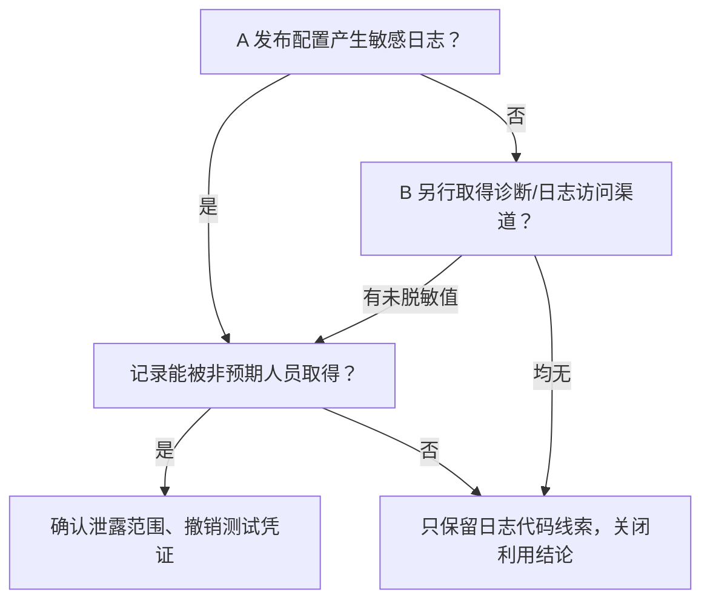
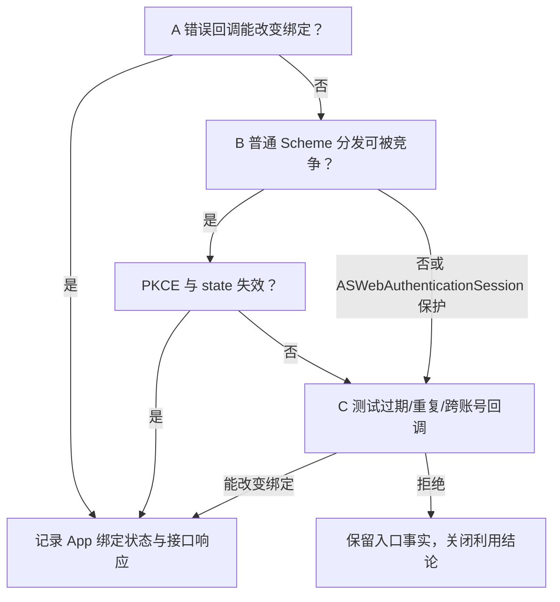
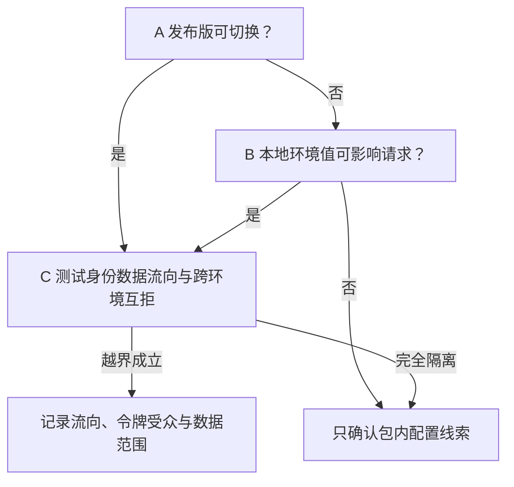
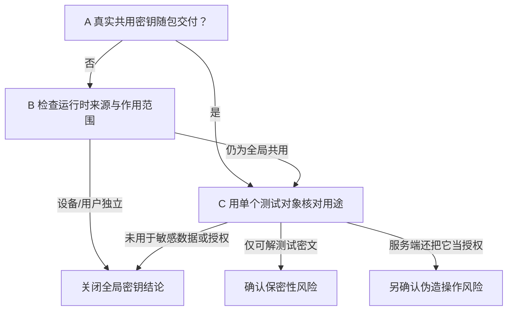
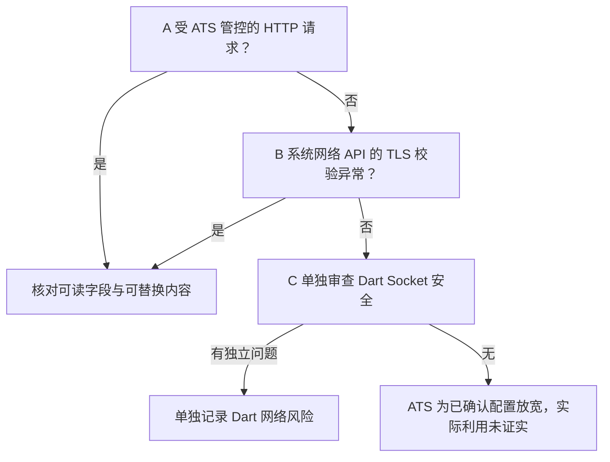
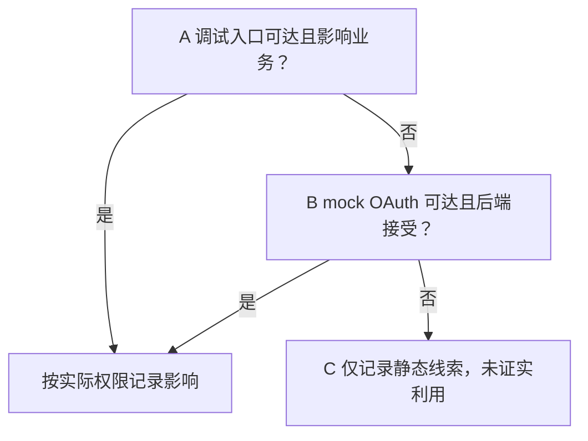
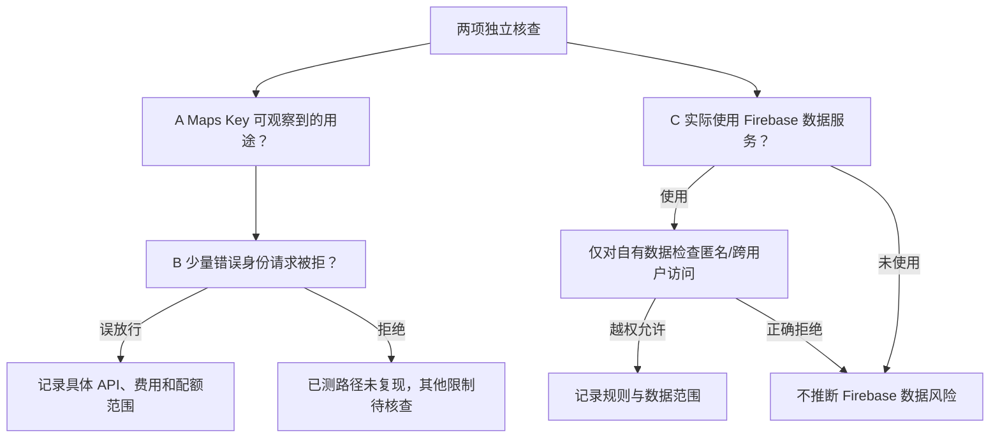
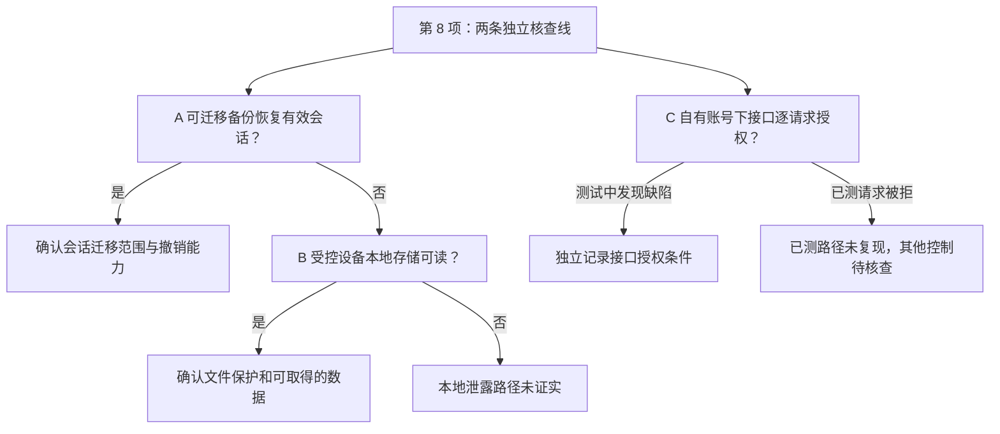

# Homewoo iOS IPA 安全静态评估报告

**评估对象**：`/Users/h1610/Desktop/安全方案/Homewoo.ipa`  
**SHA-256**：`f3ccf8ccc660633de441e27ad011a14d3052827348c670ca80438df546b71581`  
**Bundle ID / 版本**：`com.sdmc.wallplanner.ios` / `1.0.0`（build `202609301554`）  
**平台与构建**：最低 iOS `15.0`；arm64；Flutter AOT 应用，主要 Dart 业务代码位于 `Payload/Runner.app/Frameworks/App.framework/App`。

## 结论与判定口径

**评估范围**：只分析上述 IPA 的文件清单、`Info.plist`、签名、Entitlements、Provisioning Profile、内嵌框架和可提取字符串。

**攻击者身份与起点**：本报告以外部攻击者身份分析；初始获得的材料只有这份 IPA。攻击者可以用自己的设备安装 App、自行注册登录、操作可访问功能并观察结果；不假定掌握源码、服务端配置、云平台管理权限或他人的账号、设备、备份与后台日志。

**本次已执行**：只对 IPA 做离线静态检查；没有安装运行 App、注册账号、发送业务请求或采集流量。下文的安装、注册、操作及异常输入是**攻击者可自行尝试但本次尚未执行**的验证路径。

**当前结论**：包内配置与代码线索可以确认；可利用后果仍待验证。**没有证据证明本次已实现账号接管、跨用户数据访问或生产流量解密。**

按潜在 App 安全影响和处置优先级排序：

| 顺序 | 问题 / 攻击面 | 影响级别 | IPA 内证据强度 | 利用结果状态 |
|---|---|---|---|---|
| [1](#issue-1) | 发布包保留 API 请求/响应日志路径 | 高 | 确认存在日志相关业务符号 | 发布版是否输出敏感字段待验证 |
| [2](#issue-2) | 自定义 URL Scheme 接收日历 OAuth 回调 | 高 | 确认注册入口及原生转发桥接 | 回调注入、拦截及账号串绑待验证 |
| [3](#issue-3) | 发布包包含开发、测试、预发环境及切换线索 | 高 | 确认存在地址和切换相关符号 | 能否触发及跨环境身份隔离待验证 |
| [4](#issue-4) | 客户端包含对称密钥配置逻辑 | 高，待确认 | 确认存在 AES 密钥配置提示 | 真实密钥是否随包发布待验证 |
| [5](#issue-5) | 全局放宽适用系统网络栈的 ATS 限制 | 高，条件性 | `Info.plist` 配置已确认 | 具体受影响请求及明文/弱 TLS 传输待验证 |
| [6](#issue-6) | 发布包带入调试、集成测试及模拟 OAuth 代码 | 中 | 框架链接与模拟路径已确认 | 生产运行时是否可触发待验证 |
| [7](#issue-7) | Maps Key 限制及 Firebase 资源授权待核查 | 中，待确认 | 客户端 Key 存在已确认，属常见配置 | 云端限制、实际使用的数据服务和权限规则待验证 |
| [8](#issue-8) | 本地数据保护与服务端 App 完整性核查项 | 未定级，核查项 | 静态仅能确认依赖与可见配置 | 运行时存储、备份及服务端验证待核查 |

- **“高”**表示利用条件成立后可能产生较大影响，不表示已验证可利用；优先核验第 1—5 项。
- **“核查项”**表示尚不能确认控制是否缺失，暂不计作已发现漏洞。
- 每项依次展示**证据 → 影响与具体行为 → A/B/C 验证路径及逻辑图 → 修复与复核**。影响与行为均为条件性推演，不是已发生的攻击记录。
- A、B、C 是从安装包分析到自行安装、注册登录、操作 App 的后续尝试顺序，并非已执行的攻击。文中的“测试账号”指攻击者自行注册或控制的账号；若不能自行注册，相关路径保持待验证。只有涉及他人设备、备份、内部日志、网络路径控制或云平台管理权限时，才需要另列额外条件。

<a id="issue-1"></a>

## 1. 发布包保留 API 请求/响应日志路径【高】

> **已确认**：发布包包含 API 日志相关符号和脱敏字段线索。  
> **待验证**：发布配置是否输出未脱敏敏感值，以及谁能取得日志。

### 包内证据与当前判断

- `Frameworks/App.framework/App` 中可提取业务符号 `XHOME_API`、`_logApiRequest`、`_logApiExchange`、`_formatApiRequestLog`、`_formatApiExchangeLog`、`requestBody`、`responseBody`、`_writeXHomeLogToDebugConsole` 和 `XHOME_API loggerReady source=main`。
- 同时可见 `redactedLogFields`、`redactedResponseLogFields`，表明已有脱敏设计线索；静态字符串无法确认其覆盖字段、触发条件和发布版开关。

### 成功后的影响（条件性推演）

- **成立条件**：发布版写入未脱敏字段，且攻击者能接触设备诊断、客服导出或日志系统。
- **可能获取**：访问/刷新令牌、Cookie、签名、家庭成员、设备和日历内容；若记录密码或验证码，影响更大。
- **结果**：凭证有效时可能冒用会话，读取或修改该账号有权操作的数据，并利用日程、关系信息实施定向诈骗。
- **边界**：普通第三方 iOS App 不能仅因同机安装就读取本 App 日志；脱敏、令牌权限、对象授权和撤销会限制影响。[Apple OSLogPrivacy](https://developer.apple.com/documentation/os/oslogprivacy)

#### 具体行为与后果

- **脚本批量导出**：拿到有效会话令牌后，逐页请求该账号可访问的日历、家庭成员和设备资料并保存副本。**结果**：个人安排、家庭关系和设备情况集中泄露，便于后续定向诈骗。
- **脚本修改记录**：若令牌及服务器权限允许，批量修改或删除日历事件、设备名称或绑定信息。**结果**：业务数据被篡改，用户可能错过提醒或误判设备状态。
- **伪装客服或熟人**：利用泄露的姓名、日程、设备信息编造可信的短信或站外链接，诱导用户交出验证码。**结果**：隐私泄露进一步演变成钓鱼和账号诈骗。

### 攻击路径与验证图（待执行）

- **A｜本机发布日志**：在自己控制的安装设备上执行登录、刷新、日历同步，观察发布版是否写出完整请求/响应。该结果只说明自己的日志暴露，不代表能读取其他用户设备。
  - **工具**：Xcode Devices and Simulators、macOS Console；导出专用测试日志后运行下方 `logs` 命令。
  - **判定**：若出现未脱敏测试值，只能确认自己的设备会输出；他人的日志取得渠道须另证。

- **B｜日志取得渠道**：只有另行取得用户分享的诊断文件，或获得客服导出、崩溃上报、服务端日志访问权时，才检查这些渠道是否含他人的未脱敏值；当前仅持 IPA 无法检查。
  - **工具**：合法取得的诊断导出、同一只读日志扫描脚本。
  - **判定**：没有实际取得渠道和真实未脱敏值，不能认定攻击者能窃取他人凭证。



#### 最小验证命令

```bash
python3 Homewoo-iOS-IPA-验证助手.py logs /path/to/test-device-log.txt
```

### 给防守方的修复与复核建议

#### 修复建议

- 发布版关闭完整认证头、请求体和响应体日志，只保留随机请求 ID、接口名、状态码和耗时。
- 以允许字段清单生成诊断事件，检查错误上报、崩溃分析和客服导出是否复用同一脱敏规则；会话令牌应短时、可撤销。
- 使用 Apple 日志 API 时对个人数据和账号信息设置隐私遮盖。
- Apple 官方说明应用日志可能被他人获取，并提供隐私标记机制。[Apple OSLogPrivacy](https://developer.apple.com/documentation/os/oslogprivacy)

#### 开发方验证闭环

- 用专用测试账号执行登录、刷新令牌、日历同步、设备绑定和支付失败流程；只检查本 App 的日志与诊断上报。
- 自动检索 `Authorization`、Cookie、Token、密码、验证码、签名、个人信息及完整报文。
- 留存脱敏审计结果，不保存真实凭证。

<a id="issue-2"></a>

## 2. 自定义 URL Scheme 与日历 OAuth 回调【高】

> **已确认**：两个 Scheme 已注册，日历 OAuth 回调桥接线索存在。  
> **待验证**：回调校验是否有效、是否采用受保护的认证会话。

### 包内证据与当前判断

- `Info.plist` 分别注册了 `homewoo` Scheme 和 Google 登录相关的 `com.googleusercontent.apps...` Scheme；不能仅凭两项注册信息认定它们走同一套日历回调流程。
- `Runner` 中存在 `SceneDelegate`、`scene:openURLContexts:`、`CalendarGoogleOAuthCallbackBridge`、`pendingCalendarGoogleOAuthCallback`、`com.sdmc.homewoo/calendar_google_oauth_callback` 等符号；Flutter AOT 中有 `CalendarGoogleOAuthCallbackController`、`oauthCallback` 等处理线索。
- 签名 Entitlements 未包含 `com.apple.developer.associated-domains`，当前包未配置 Universal Links 关联域。
- 静态证据能确认入口与桥接，**不能确认每一个回调参数如何校验**。

### 成功后的影响（条件性推演）

- **成立条件**：回调绑定、state、PKCE、时效或一次性消费等校验失效。
- **可能获取**：可兑换授权码对应范围内的 Google 日历权限，或使用户绑定到错误的日历。
- **结果**：日历读取、增删改、账号串绑和错误同步；若受控事件会展示，还可能出现广告或钓鱼链接。
- **边界**：仅能唤起 Scheme 不等于获得令牌；ASWebAuthenticationSession 的回调会话不因同 Scheme 注册而被直接抢收。[Apple ASWebAuthenticationSession](https://developer.apple.com/documentation/authenticationservices/aswebauthenticationsession/)

#### 具体行为与后果

- **伪造绑定结果**：向回调入口发送构造参数，尝试让受害者当前会话绑定攻击者控制的 Google 日历。**结果**：账号串绑、错误同步；若受控事件会展示，可出现推广或假客服链接。只有服务端错误接受该回调才会发生。
- **兑换授权码并自动操作**：若攻击者确实取得可兑换授权码且 PKCE 等保护失效，用脚本读取或修改授权范围内的事件。**结果**：日程泄露、事件被添加或删除。具体能力由 OAuth Scope 决定。
- **投放诱导事件**：在已能向受害者可见日历写入的前提下，批量增加含广告、假支付通知或钓鱼网站链接的事件。**结果**：App 内出现引流内容，用户可能被诱导到诈骗网站；单有自定义 Scheme 不足以做到这一步。

### 攻击路径与验证图（待执行）

- **A｜回调注入**：向 `homewoo:` 入口发送畸形路径、错误 `state` 或自选参数，观察是否被当作当前测试用户的授权结果。
  - **工具**：安装原 IPA 的自有 iPhone、系统 URL 打开方式，以及 App 可见的绑定状态和接口响应；不假定另有模拟器构建。
  - **判定**：只有客户端/后端实际接受错误回调并改变测试账号绑定，才确认回调注入。

- **B｜Scheme 竞争**：A 被拒后，测试另一个测试 App 注册同 Scheme 是否可取得普通 URL 分发的回调。若流程走 `ASWebAuthenticationSession`，其会话保护应阻止同 Scheme App 直接抢收，不能把竞争注册算作成功。
  - **工具**：攻击者自行制作的同 Scheme App、自有设备上的回调接收情况和授权流程外部表现。
  - **判定**：必须实际取得可用于该授权尝试的回调，并证明 PKCE/`state` 等保护失效。

- **C｜回调重放**：B 不成立时，只有能在自己账号的授权流程中取得可复用回调时，才检查过期、重复或属于另一自有账号的回调；若无法取得回调则保持待验证。
  - **工具**：自行注册的账号、可观察的授权回调和 App 绑定结果；不假定能读取后端审计日志。
  - **判定**：只有重放导致错误绑定或权限变化，才记为可利用。



#### 最小验证命令

以下命令只验证未知路径是否被拒，不会产生有效 Google 授权码。

```bash
xcrun simctl openurl booted 'homewoo://__security_test__/?state=invalid-test-state'
```

### 给防守方的修复与复核建议

#### 修复建议

- 对 Scheme、Host、Path、参数数量和编码做严格白名单校验；由发起授权的一方保存并核对 `state`、当前用户、待完成授权尝试、有效期和一次性消费，OAuth 授权服务器在兑换授权码时校验 PKCE。
- 若由业务后端接收回调或兑换令牌，后端还须核对授权对象及本系统账号绑定关系。
- 优先评估受域名控制的 Universal Links；Google 登录若使用 `ASWebAuthenticationSession`，应核对其回调会话保护方式，不能直接假定同 Scheme App 一定能截获该会话。
- 业务接口继续独立校验对象权限。[Apple Universal Links](https://developer.apple.com/documentation/Xcode/allowing-apps-and-websites-to-link-to-your-content)、[ASWebAuthenticationSession](https://developer.apple.com/documentation/AuthenticationServices/ASWebAuthenticationSession)、[RFC 8252](https://www.rfc-editor.org/info/rfc8252/)

#### 开发方验证闭环

- 在测试设备上打开未知路径、畸形参数、错误 `state`、过期授权码、重复回调和另一个测试账号发起的回调；同时测试同 Scheme 竞争 App。
- 记录客户端拒绝结果及服务端账号绑定结果，不在生产账号上操作。

<a id="issue-3"></a>

## 3. 发布包包含非生产环境配置与切换线索【高】

> **已确认**：生产与非生产地址及切换线索进入同一 IPA。  
> **待验证**：发布版能否切换、身份和数据是否跨环境流动。

### 包内证据与当前判断

- Flutter AOT 库中同时出现生产地址 `https://cloud-api.sdmc.tv/cloud/v5.0/`，以及 `xhome-dev.sdmc.tv`、`xhome-test.sdmc.tv`、`xhome-uat.sdmc.tv` 的开发、测试和预发地址；还可见 `Switch environment`、`auth-environment-trigger`、`auth-environment-sheet`、`homewoo_xhome_environment`、`_persistNativeEnvironment`。
- 这确认非生产信息和切换逻辑线索进入同一发布包，尚不能证明普通用户可触发切换。

### 成功后的影响（条件性推演）

- **成立条件**：发布版可改请求目的地，且生产身份/数据进入非生产服务；跨环境冒用还要求认证域未隔离。
- **可能获取**：生产令牌、账号和设备标识、日历及请求体，范围取决于测试系统访问权限与日志策略。
- **结果**：隐私泄露、会话冒用、跨环境数据串写；受控测试响应被展示时，还可能出现广告或假客服链接。
- **边界**：IPA 出现测试地址不等于真实用户资料已经流入测试环境。

#### 具体行为与后果

- **将正式请求切到测试服务**：通过可达入口或本地状态选择非生产环境，让正式用户登录或同步时把令牌、日历和设备数据发送过去；攻击者还须有权接触该服务或其日志。**结果**：真实资料流入保护较弱的环境，可被批量整理和滥用。
- **跨环境脚本调用**：若测试服务接受生产令牌，或生产服务接受测试令牌，自动查询、添加、修改用户相关记录。**结果**：环境边界失效，出现数据泄露、串写或错误设备状态。
- **利用受控响应引流**：只有攻击者同时能控制测试服务返回内容、且 App 会展示相应文字或链接时，才可将帮助地址改为广告、假客服或钓鱼网站。**结果**：用户被引流、误付费或泄露账号信息。

### 攻击路径与验证图（待执行）

- **A｜界面切换**：在发布配置中寻找可见或隐藏的环境选择入口，触发后观察专用测试账号请求是否从生产目标转到 dev/test/uat。
  - **工具**：测试设备、受控网络记录、下方 `har` 命令。
  - **判定**：需要实际请求目的地变化；IPA 中出现域名还不够。

- **B｜本地环境值**：A 不可达时，检查自己控制设备上的持久化环境值能否影响发布版请求。该步骤不说明可远程改动受害者设备。
  - **工具**：发布版测试设备和可观察的本地状态；无设备访问条件时保持待验证。
  - **判定**：必须证明普通发布版会读取该值并转发敏感请求。

- **C｜跨环境身份**：若能切换，再用不同环境的**测试令牌**做互拒验证，并查看是否有真实业务数据进入低保护环境。
  - **工具**：各环境自有测试账号、脱敏流量与接口响应；不能访问的环境保持待验证。
  - **判定**：跨环境令牌被接受或生产资料实际进入测试环境，才升级为实质风险。



#### 最小验证命令

```bash
python3 Homewoo-iOS-IPA-验证助手.py ipa '/Users/h1610/Desktop/安全方案/Homewoo.ipa'
python3 Homewoo-iOS-IPA-验证助手.py har /path/to/test-flow.har
```

### 给防守方的修复与复核建议

#### 修复建议

- 生产构建只包含生产环境路由，移除开发/测试/预发地址、切换入口及相关本地偏好；各环境分别管理用户、令牌发行者/受众、密钥、API Key 和权限域。
- 服务端对跨环境令牌互相拒绝，并避免让可由客户端改写的环境值决定敏感请求去向。

#### 开发方验证闭环

- 在隔离设备上检查发布版所有可达设置及本地状态；记录不同流程的请求目的地，用测试令牌做跨环境互拒测试。
- 只有确认生产身份数据可进入非生产环境时，才能进一步定性实际泄露。

<a id="issue-4"></a>

## 4. 客户端包含对称密钥配置逻辑【高，待确认】

> **已确认**：存在 AES 密钥配置提示。  
> **待验证**：真实密钥是否随包交付、是否共用及是否参与服务端授权。

### 包内证据与当前判断

- Flutter AOT 库包含 `secretKey`、`XHOME_SECRET_KEY must be 32 ASCII characters for XHome AES-256.`、`Missing XHOME_SECRET_KEY. Provide it with --dart-define or a local env file.` 等字符串。
- 静态字符串扫描**未确认真实密钥值**，也不能确定该密钥是否进入发布配置、保护哪些数据或是否被其他完整性机制复用；AES-256 提示本身并不是“使用该密钥给请求签名”的证据。
- 因此本项是高影响架构核查点，不是“已泄露密钥”的结论。

### 成功后的影响（条件性推演）

- **成立条件**：真实密钥随包交付且被多用户共用；伪造请求还要求服务端错误地把客户端可构造材料当授权。
- **可能获取**：若有对应密文，可解读受该密钥保护的缓存或报文。
- **结果**：数据保密性受损；若服务端授权设计有缺陷，还可能脚本伪造业务操作，带来批量修改和密钥轮换成本。
- **边界**：本次只确认配置提示，没有确认密钥值或用途；独立会话与对象授权可阻断跨账号操作。[OWASP MASWE-0003](https://mas.owasp.org/MASWE/MASVS-STORAGE/MASWE-0003/)

#### 具体行为与后果

- **批量伪造请求**：只有服务端错误地把可由共享密钥构造的加密报文或校验值当作充分授权时，攻击者才能提取密钥后编写脚本，生成合法格式的请求并尝试修改设备设置、日历或其他可写字段。**结果**：数据完整性受损，影响可能跨多个使用同一密钥的用户。
- **解密已取得的数据**：若同一密钥保护本地缓存或报文，攻击者在获得密文后统一解密，整理家庭关系、设备资料和日程。**结果**：依赖该密钥保护的数据失去保密性。
- **反复使用旧密钥**：若服务端长期接受泄露的共享密钥构造的业务材料，持续提交伪造报文。**结果**：风险持续存在，必须轮换密钥并停用旧协议；独立会话及对象授权仍可阻断越权修改。

### 攻击路径与验证图（待执行）

- **A｜发布包密钥**：从 IPA 的二进制常量和资源线索寻找是否存在实际共用密钥；本报告只显示标记存在，不输出疑似密钥。
  - **工具**：只读 IPA 脚本、安装包二进制与资源检查。
  - **判定**：需要证明真实值随发布包交付，且不同用户/安装复用。

- **B｜运行时来源**：A 未见密钥时，在自己控制的测试设备上检查密钥是否由运行时下载或按用户生成；这可能是完全不同的风险。
  - **工具**：受控设备的运行时观测和脱敏测试流量；不假定可获得内部代码。
  - **判定**：若每设备/每用户独立且服务端有对象授权，不能按“全局密钥泄露”定性。

- **C｜服务端用途**：若确认共用，再用**单个测试对象**核对它能否解密对应测试密文；另查服务端是否错误地把客户端可构造的材料当授权依据。
  - **工具**：自有测试密文、测试账号和接口响应；内部协议及后端逻辑由开发方另行复核。
  - **判定**：仅解密能力与伪造业务权限是两项不同结论，分别记录。



#### 最小验证命令

```bash
python3 Homewoo-iOS-IPA-验证助手.py ipa '/Users/h1610/Desktop/安全方案/Homewoo.ipa'
```

### 给防守方的修复与复核建议

#### 修复建议

- 长期服务端密钥只保存在服务端；客户端不应持有全体用户共用且被服务端当作身份依据的秘密。
- 本机确需加密时使用 iOS Keychain 管理设备/用户级密钥，并按实际后台任务需要选择合适的可访问级别；敏感业务操作仍由服务端按用户、会话和对象授权。
- 发现全局共享密钥后按影响范围轮换并改造协议。[OWASP MASWE-0003](https://mas.owasp.org/MASWE/MASVS-STORAGE/MASWE-0003/)、[Apple Keychain](https://developer.apple.com/documentation/security/using-the-keychain-to-manage-user-secrets)

#### 开发方验证闭环

- 审计构建参数、密钥来源和服务端解密及可能存在的消息认证逻辑；确认不同安装、用户和环境是否使用相同值，核对是否可由客户端生成服务端认可的高权限请求。

<a id="issue-5"></a>

## 5. 全局放宽适用系统网络栈的 App Transport Security【高，条件性】

> **已确认**：Info.plist 全局放宽 ATS。  
> **待验证**：实际受影响的系统请求是否使用弱连接；Dart 请求需另查。

### 包内证据与当前判断

- `Info.plist` 明确设置 `NSAppTransportSecurity` → `NSAllowsArbitraryLoads = true`，未见限定域名的 `NSExceptionDomains`。
- 这是**已确认的全局 ATS 配置放宽**。
- 包内能提取的主要业务地址为 HTTPS，但静态分析无法确定所有运行时请求地址，也不能证明已发生明文传输。
- ATS 主要约束 Apple URL Loading System（如 URLSession）的连接；Flutter 官方说明，由 Dart/Flutter 自有 Socket 发起的连接不由平台网络策略覆盖。
- 因此，不能仅凭这项配置推断主要 Flutter API 请求受其影响，也不能据此判断所有 Flutter 网络请求已被解密。[Apple ATS 配置](https://developer.apple.com/documentation/bundleresources/information-property-list/nsapptransportsecurity)、[Flutter 网络策略说明](https://docs.flutter.dev/release/breaking-changes/network-policy-ios-android)

### 成功后的影响（条件性推演）

- **成立条件**：实际系统网络流程使用 HTTP，且攻击者控制相关网络路径；弱 TLS 是否可利用须另证。
- **可能获取**：该弱连接上的请求参数、认证材料、个人信息和响应内容。
- **结果**：读取或替换 HTTP 内容，造成信息泄露、错误状态展示、广告引流或钓鱼。
- **边界**：正常 HTTPS 仍须校验证书；ATS 配置不能说明 Dart 自有 Socket 的安全状况。[Apple NSAllowsArbitraryLoads](https://developer.apple.com/documentation/bundleresources/information-property-list/nsapptransportsecurity/nsallowsarbitraryloads)

#### 具体行为与后果

- **读取明文请求**：在受控公共 Wi-Fi 等网络路径上观察真实 HTTP 请求中的令牌、账号、日历或设备数据，再尝试用仍有效的凭证调用接口。**结果**：隐私泄露与会话冒用。前提是相应敏感数据确实通过可观察的弱连接传输。
- **替换展示内容**：若 App 从弱连接获取并展示帮助页、公告或可点击链接，攻击者将响应中的地址改成自己的网站，添加推广或假客服支付入口。**结果**：App 内引流、钓鱼和诈骗。
- **篡改业务响应**：若弱连接承载日历或设备状态数据，修改返回字段使 App 显示错误提醒或状态。**结果**：数据展示失真、用户误操作；服务端持久数据是否改变仍取决于后续写接口的授权与校验。

### 攻击路径与验证图（待执行）

- **A｜HTTP 请求**：观察登录、日历、地图、帮助等流程是否存在受 ATS 管控的 HTTP 请求。攻击者必须位于相关网络路径上，才可能读取或替换明文。
  - **工具**：授权测试设备、Charles/mitmproxy 的受控抓包、`har` 目的地统计。
  - **判定**：需确认真实 HTTP 请求、敏感字段及响应展示位置；仅 `NSAllowsArbitraryLoads=true` 不够。

- **B｜TLS 校验**：A 没有 HTTP 时，只在自己设备和可控制的网络路径上观察原签名安装版是否接受本应被系统拒绝的服务器身份；安装了自签测试 CA 后能抓包，不等于证书校验存在缺陷。
  - **工具**：自有设备、受控网络代理和设备网络日志；无法获得合适的网络条件时保持待验证。
  - **判定**：必须证明原安装版在未额外授信的情况下接受无效服务器身份；正常 HTTPS 不能据此认定可解密。

- **C｜Dart 网络**：A/B 不成立时，从自己设备可观察的流量和安装包线索检查 Dart 自有 Socket 是否出现 HTTP、异常证书接受或不安全重定向；这条路径不受 ATS 键直接控制。
  - **工具**：IPA 可提取线索、受控设备流量、下方 `har` 统计；没有可观察请求时保持待验证。
  - **判定**：发现实际问题须另行记录 Dart 网络风险；不能用 ATS 配置推断 Dart 请求已失守。



#### 最小验证命令

```bash
python3 Homewoo-iOS-IPA-验证助手.py har /path/to/test-flow.har
```

### 给防守方的修复与复核建议

#### 修复建议

- 删除全局 `NSAllowsArbitraryLoads`，让受 ATS 管控的系统网络 API 恢复默认规则；若某个不可升级的受控地址确实需要例外，先改造服务端，再考虑限定到单域名/具体用途的最小例外。
- 对业务 URL、重定向目标和 WebView 导航建立 HTTPS 与域名白名单；Flutter/Dart 自有 Socket 的请求也要在应用逻辑和运行时流量核验中单独约束。
- 检查第三方 SDK 是否要求弱化配置。
- Apple 建议尽量缩小 ATS 例外范围。[Apple 网络连接安全指南](https://developer.apple.com/documentation/security/preventing-insecure-network-connections)、[Flutter 网络策略说明](https://docs.flutter.dev/release/breaking-changes/network-policy-ios-android)

#### 开发方验证闭环

- 在测试版去除全局例外后跑登录、日历、地图、支付、帮助页面和媒体流程，定位确有兼容需求的地址；分别核对系统网络 API 与 Flutter/Dart 自有网络请求的地址和协议。
- 用专用测试账号检查无认证信息或个人数据走 HTTP、HTTPS 不接受无效服务器证书。
- 单靠删除 Info.plist 键不能完成对 Dart 自有 Socket 的验证。

<a id="issue-6"></a>

## 6. 调试、集成测试及模拟 OAuth 代码进入发布包【中】

> **已确认**：调试/测试框架与模拟 OAuth 字符串进入发布包。  
> **待验证**：入口能否触发、服务端是否接受模拟授权。

### 包内证据与当前判断

- `Runner` 的动态依赖包含 `flutter_debug_kit.framework` 和 `integration_test.framework`；前者包含 `dev.flutter_debug_kit/system_proxy` 通道名。
- Flutter AOT 库还保留 `mock-oauth-attempt-`、`mock-google-oauth-`、`https://accounts.google.com/o/oauth2/v2/auth?mockAttempt=` 和 `Calendar Mock OAuth attempt was not found.`。
- `Runner` 中可见 `IntegrationTestPlugin`。
- 这些是**发布包中存在测试与调试组件的确定证据**，但静态分析不能证明模拟授权入口对用户可达，也不能证明该插件可被其他 App 直接调用。

### 成功后的影响（条件性推演）

- **成立条件**：调试/模拟路径在发布配置可达，并能影响真实请求，或模拟授权被服务端错误接受。
- **可能获取**：受控代理可见的测试请求资料、错误绑定的日历授权状态；具体范围仍取决于实际功能。
- **结果**：凭证暴露、错误同步或日历被改；如果仅框架存在而入口不可达，则是发布卫生问题。
- **边界**：其他 iOS App 不能仅凭框架随包存在就直接调用 Flutter 插件。

#### 具体行为与后果

- **启用调试代理**：若正式构建存在可触发且缺少权限控制的代理入口，在已控制的设备上将 App 请求导向受控代理，收集请求参数或认证材料。**结果**：相关流程中的信息泄露；还要看 TLS 校验和代理能否真正接入。
- **提交模拟授权结果**：若模拟 OAuth 路径可达且生产服务端错误接受，脚本反复提交模拟回调，尝试绑定攻击者日历或伪造授权完成状态。**结果**：账号串绑、错误同步，可能进一步出现数据篡改。
- **向错误绑定的日历投放内容**：只有绑定被接受且该日历的事件可由攻击者写入并在 App 展示时，才可插入广告或钓鱼链接事件。**结果**：用户在正常日历界面看到引流内容。

### 攻击路径与验证图（待执行）

- **A｜调试入口**：逆向查看发布包中的调试入口和代理通道，尝试在自己控制的设备上触发。框架被链接不等于普通第三方 App 能调用通道。
  - **工具**：只读 IPA 脚本、Xcode 符号/依赖检查、发布配置测试设备。
  - **判定**：必须证明真实发布版有可达入口及实际业务影响。

- **B｜模拟授权**：A 未触发时，检查发布版中可见的 mock OAuth 路径能否在自有设备触发；若可达，用自有测试账号观察后端是否拒绝模拟结果。
  - **工具**：发布版安装包、受控测试设备、测试账号和接口响应。
  - **判定**：只有模拟结果被正式后端接受并改变绑定，才确认授权绕过。

- **C｜静态线索收束**：A/B 均未触发时，只保留“测试组件进入包”的静态发现；发布治理留在修复与复核环节。
  - **工具**：发布包依赖和可提取符号检查。
  - **判定**：不把静态字符串写成已实现账号接管。



#### 最小验证命令

```bash
python3 Homewoo-iOS-IPA-验证助手.py ipa '/Users/h1610/Desktop/安全方案/Homewoo.ipa'
```

### 给防守方的修复与复核建议

#### 修复建议

- 将集成测试和调试依赖限定在开发/测试构建；发布流水线对框架名、通道名、`mock-oauth` 路径和测试 URL 做失败检查。
- 若业务确需诊断能力，应使用正式环境专用、受认证控制且不处理生产秘密的最小实现。
- 模拟 OAuth 只能在隔离测试环境运行，服务端不能接受模拟结果替代真实授权。

#### 开发方验证闭环

- 复核 Flutter 构建配置、依赖注册和条件编译；在正式配置的测试设备上尝试触发相关入口，并在服务端确认模拟授权材料一律被拒绝。

<a id="issue-7"></a>

## 7. Maps Key 限制及 Firebase 资源授权待核查【中，待确认】

> **已确认**：Maps/Firebase 客户端 Key 可提取，属常见配置。  
> **待验证**：Maps 限制、实际 Firebase 数据服务和资源规则。

### 包内证据与当前判断

- `Info.plist` 包含 `GOOGLE_MAPS_API_KEY`；`GoogleService-Info.plist` 包含 `API_KEY`、Google/Firebase 项目标识与客户端标识。
- 报告不重复完整 Key，以免扩大传播。
- 移动端 API Key 本来可以从 IPA 提取，**Key 可提取本身不是漏洞**，也不等于云资源已被滥用或 Firebase 数据可读；决定性因素是云端应用/API 限制、实际启用的服务、认证与资源规则及配额。[Firebase API Key 官方说明](https://firebase.google.com/docs/projects/api-keys)

### 成功后的影响（条件性推演）

- **成立条件**：Maps Key 缺少适用的限制；Firebase 数据风险还要求相关服务被使用且权限规则允许越权。
- **可能获取**：Key 本身只用于识别项目；只有规则失守时，才可能访问相应云端数据。
- **结果**：Maps 调用造成配额耗尽、费用增长；若 Firebase 资源可越权读写且内容被展示，还可能导致数据泄露、篡改与钓鱼引流。
- **边界**：客户端 Key 可提取属正常现象，不能单独作为“数据库可读”的证据。[Firebase API Key](https://firebase.google.com/docs/projects/api-keys)、[Google Maps Key 指南](https://developers.google.com/maps/api-security-best-practices)

#### 具体行为与后果

- **刷取高成本 API**：用未受限的 Maps Key 编写脚本，连续调用允许的计费接口。**结果**：项目费用上升、额度耗尽，正常用户地图请求可能失败。
- **滥用认证端点**：若项目实际启用 Firebase Authentication 的密码登录，且相关端点缺少合适的配额与风控，攻击者可能利用公开 Key 对该项目发起大量登录尝试。**结果**：认证配额或服务可用性受影响，并可能加剧撞库风险；Key 本身仍不能绕过密码或读取受 Security Rules 保护的数据。[Firebase API Key 官方说明](https://firebase.google.com/docs/projects/api-keys)
- **读取或覆盖云端记录**：只有 App 确实使用相关 Firebase 数据服务，且 Security Rules 或其他权限配置允许非授权操作时，才可脚本批量下载、添加、修改数据。**结果**：用户资料泄露、记录被篡改或服务不可用；Key 出现在 IPA 中本身不构成该权限。
- **写入展示型钓鱼内容**：若 App 确实从 Firebase 数据服务读取并展示可编辑内容，且攻击者取得对应写权限，才可将标题或链接改为广告或假客服网站。**结果**：App 内引流和诈骗；需同时满足服务被使用、内容可写、App 会展示三个条件。

### 攻击路径与验证图（待执行）

- **A｜客户端用途**：从客户端取得 Key 后先识别 App 实际调用哪些 API。Key 可提取属正常现象；真正风险取决于应用/API 限制。
  - **工具**：只读 IPA 脚本、受控设备与脱敏请求记录。
  - **判定**：只能识别可观察到的用途，安装包无法单独证明全部云端限制。

- **B｜拒绝测试**：针对 IPA 中对应的实际 Key 和已识别功能，使用自己控制的客户端做极少量错误 Bundle ID 或非允许 API 请求，观察具体接口是否拒绝；换用另一个项目的 Key 不能证明本项目的限制状态。REST/Web Service 还须区分其适用限制。
  - **工具**：受控测试客户端与接口响应；不做批量刷量。
  - **判定**：误放行需记录具体 API 和条件；单次拒绝不能证明全部云端限制完整。

- **C｜Firebase 数据访问**：先确认 App 实际使用 Firestore、Realtime Database 或 Storage 等服务，再只对自有测试数据观察匿名/跨用户访问是否被拒。
  - **工具**：自有测试账号、可观察到的资源路径与接口响应；规则配置留给开发方复核。
  - **判定**：服务未使用或规则拒绝时，不写“Firebase 数据可读”。



#### 最小验证命令

```bash
python3 Homewoo-iOS-IPA-验证助手.py ipa '/Users/h1610/Desktop/安全方案/Homewoo.ipa'
```

### 给防守方的修复与复核建议

#### 修复建议

- 在 Google Cloud 为 iOS SDK Key 设置适用的 Bundle ID 应用限制及所需 API 限制；若确需调用 Maps REST/Web Service，优先由受认证的后端代理并使用独立的服务端 Key。
- 客户端和服务器使用不同 Key，审计调用日志、配额与预算告警。
- 对实际使用的 Firebase 数据服务配置最小权限规则，按业务评估 App Check，并对异常调用实施限速。[Google Maps Platform Key 安全指南](https://developers.google.com/maps/api-security-best-practices)、[Firebase API Key 官方说明](https://firebase.google.com/docs/projects/api-keys)

#### 开发方验证闭环

- 由云平台管理员核对每个 Key 的限制、启用 API、最近调用来源及配额，先确认 App 实际使用哪些 Firebase 数据服务；用不匹配的测试 Bundle ID 或非允许 API 验证拒绝结果，并针对实际使用的 REST/Web Service 分别确认限制能否生效。
- Firebase 数据访问测试须按所用服务检查 Security Rules、认证和 App Check 结果。

<a id="issue-8"></a>

## 8. 本地数据保护与服务端 App 完整性：待核查【未定级】

> **已确认**：安全存储、SQLite 与 App Check 依赖存在。  
> **待验证**：实际存储、备份和服务端完整性验证；本项未定级。

### 包内证据与当前判断

- 包中有 `flutter_secure_storage_darwin.framework`、`sqflite_darwin.framework` 和 `AppCheckCore.framework`。
- `Info.plist` 未见 `NSPinnedDomains`，但证书绑定可以在代码中实现，且**没有证书绑定本身不等于 TLS 漏洞**；App Check 依赖存在也不能证明服务端已启用验证。
- IPA 没有用户运行后的容器数据，无法判断令牌是否写入 SQLite、Keychain 项目的可访问级别、文件保护类或实际备份内容。
- 因此，本项是需要运行时及服务端资料的核查项，当前不能断言保护缺失。

### 成功后的影响（条件性推演）

- **成立条件**：攻击者已取得受控设备或可恢复备份，且凭证/资料实际存于保护不足的可访问位置。
- **可能获取**：令牌、家庭/设备资料和日历缓存；若令牌仍有效，可能继续访问该账号有权操作的数据。
- **结果**：隐私泄露、会话冒用和业务数据被改。
- **边界**：是否可跨设备恢复取决于 Keychain 级别、备份和设备解锁条件；缺少静态 pinning/App Attest 证据不等于本项可利用。[Apple Keychain](https://developer.apple.com/documentation/security/restricting-keychain-item-accessibility)

#### 具体行为与后果

- **复制本地缓存**：在已控制设备或可访问备份的前提下，提取实际未妥善保护的数据库、缓存，整理其中的日历、家庭和设备资料。**结果**：个人信息集中泄露；若文件受充分保护且攻击者不具备解锁条件，该路径不成立。
- **跨设备恢复会话**：若令牌保存在可迁移存储中、攻击者取得可恢复的备份及必要解锁条件、且会话未被撤销，尝试在另一设备继续使用该账号。**结果**：会话冒用。采用不迁移的 Keychain 级别、设备绑定或服务端撤销可阻断相应环节。
- **脚本操作账号数据**：若攻击者实际取得仍有效的令牌，用脚本读取、修改或删除该账号有权限的日历和设备记录。**结果**：隐私泄露或数据篡改；服务端对象权限和写操作校验仍决定最终范围。

### 攻击路径与验证图（待执行）

- **A｜备份迁移**：若取得可恢复备份及解锁条件，尝试在另一台测试设备恢复，检查测试会话是否迁移并保持有效。
  - **工具**：两台测试设备、受控备份、服务端测试账号。
  - **判定**：需要实际恢复成功且服务器接受旧会话；仅有 SQLite 框架不够。

- **B｜受控设备**：A 不成立时，攻击者可在自己安装 App 的设备上观察本地状态；只有具备该 App 容器的读取能力，才能进一步检查令牌或个人资料。普通未越狱设备上的发布 IPA 不能直接用下方命令读取容器。
  - **工具**：可合法访问的受控设备数据、`container` 文件类型统计和本地数据保护检查。
  - **判定**：必须核对内容、文件保护与攻击者能力；脚本仅统计扩展名，不能单独给出泄露结论。

- **C｜接口授权观察**：本地路径之外，用自有测试账号比较无会话、错误对象和重复请求的结果，检查高风险业务接口是否仍逐请求验证身份及对象权限。
  - **工具**：自有测试账号和接口响应；App Attest/App Check 的内部验证逻辑留给开发方复核。
  - **判定**：没有 App Attest 本身不是漏洞；真正结论取决于会话、对象授权和实际完整性策略。



#### 最小验证命令

```bash
python3 Homewoo-iOS-IPA-验证助手.py container /path/to/test-app-container
```

### 给防守方的修复与复核建议

#### 修复建议

- 令牌和小型秘密使用 Keychain，并按登录体验、后台任务与设备迁移需求选择合适的 `kSecAttrAccessible` 级别；数据库及缓存使用合适的数据保护与备份排除设置，服务端保持短时令牌、撤销与对象授权。
- 若高风险业务需要核验 App 来源，可评估 Apple App Attest 或 Firebase App Check，并由服务端按所选机制验证；采用 App Attest 时，应验证一次性挑战、断言计数，并将敏感请求内容绑定到断言。
- 这些机制是附加信号，不替代用户授权。
- 证书绑定若采用，须配套备用密钥与轮换方案。
- Apple 提供 `ThisDeviceOnly` 类别以限制跨设备迁移，也提供文件备份排除属性。[Apple Keychain 可访问级别](https://developer.apple.com/documentation/security/restricting-keychain-item-accessibility)、[备份排除属性](https://developer.apple.com/documentation/foundation/urlresourcekey/isexcludedfrombackupkey)、[Apple App Attest](https://developer.apple.com/documentation/devicecheck/validating-apps-that-connect-to-your-server)

#### 开发方验证闭环

- 检查运行后的 Keychain 属性、应用容器文件与备份样本；用测试凭证做跨设备恢复，再确认退出登录和撤销令牌后的数据清除。
- 若业务依赖 App 完整性证明，核对服务端是否按实际采用的机制校验结果、有效期及失败策略；采用 App Attest 断言时，额外检查挑战、计数和敏感请求绑定。

**边界说明**：攻击者若另有可用的 iOS 签名与安装分发渠道，才可能传播重签名仿冒 App；用户实际安装并使用后，仿冒界面可添加广告、把帮助或支付入口改成攻击者网站、骗取登录信息。这是独立的仿冒分发和社会工程风险。仅持有本 IPA 不等于已具备分发能力，也不能推断官方 App 已被篡改；App Attest 不能单独防止用户在仿冒界面输入信息。

## 给防守方的成熟做法与落地顺序

移动应用可按 [OWASP MASVS](https://mas.owasp.org/MASVS/) 覆盖存储、认证、网络、平台交互和抗篡改，把**服务端作为最终授权边界**：每次请求校验用户与对象权限；令牌短时且可撤销；发布流水线阻止测试组件、非生产地址和全局 ATS 例外进入正式包；客户端只持有设备/用户级秘密；高风险操作使用与请求绑定的完整性信号和风控。这里描述的是控制组合，不是对本 App 服务端现状的断言。

| 时限建议 | 具体动作 | 完成判据 |
|---|---|---|
| 立即，1—3 天 | 核查发布日志、OAuth 回调、环境切换、AES 密钥用途和 ATS 例外；审计 Google Key 限制 | 测试流程无敏感日志；回调异常参数被拒；生产令牌不能进入测试环境；已列清所有 ATS 例外需求 |
| 近期，1—2 周 | 移除全局 ATS 放宽和发布测试组件；收敛自定义 Scheme；隔离各环境；审计模拟 OAuth 路径 | 全流程仅使用预期 HTTPS；正式包无测试框架/模拟授权入口；跨环境令牌互拒；伪造回调失败 |
| 中期，2—6 周 | 完善本地存储/备份策略和服务端防重放、对象授权测试；按场景评估完整性证明与证书绑定 | 凭证不进入非预期备份；退出/撤销后失效；高风险请求有可核验的服务端控制 |
| 持续 | 将签名、Entitlements、ATS、环境地址、依赖和敏感字符串纳入每版自动检查 | 每版产出可复核证据；例外项有负责人和到期时间 |

## 已确认的安全基线与评估边界

- `codesign --verify --deep --strict` 校验通过；签名者为 `Apple Distribution: Shenzhen SDMC Technology Co., Ltd`，Team ID 为 `58KTGPZB5W`。签名 Entitlements 的 `get-task-allow=false`，推送环境为 `production`；Provisioning Profile 无设备白名单，属于分发配置。这些是正向信号，不代表业务逻辑已安全。
- `Info.plist` 为相机、麦克风和照片访问提供了用途说明；包内包含 `flutter_secure_storage_darwin`。它们只能说明存在对应功能/依赖，不能证明权限使用和敏感信息存储符合最小化要求。
- 本次未验证服务器鉴权与对象权限、Google Key 的实际可调用范围、Firebase 资源授权、真实日志、网络流量、设备备份、Keychain 属性或 App Check 服务端验证；没有向生产接口发送请求，也未提取或保存用户凭证。
- Flutter AOT 字符串可以揭示配置和函数名，不能独立证明代码可达性、条件分支、密钥值或请求参数。第 1—4、6、8 项仍需运行时验证；开发方也可用内部源码辅助复核。外部攻击路径不以取得源码为前提。

## 开发方复核所需的最小证据

对优先项各留一份**脱敏**记录：发布版日志字段清单；OAuth 回调拒绝矩阵及服务端绑定结果；环境切换/跨环境令牌测试；密钥来源与用途审计；去掉全局 ATS 例外后的兼容性与流量清单；正式包依赖清单及模拟 OAuth 不可达/拒绝证据。补齐后可把“待确认”升级为已验证问题或关闭误报，并重新计算优先级。

## 附录：只读验证脚本

将以下源码保存为 [Homewoo-iOS-IPA-验证助手.py](./Homewoo-iOS-IPA-验证助手.py)。它提供 IPA、测试日志、HAR、测试 App 容器四种只读检查；不打印 Key、令牌或业务内容。真实 OAuth 回调、业务 API、测试环境令牌、Firebase 资源路径和服务端协议未提供，因此不虚构可直接执行的在线请求脚本。

<details>
<summary>展开查看完整 Python 脚本</summary>

```python
#!/usr/bin/env python3
"""Read-only evidence triage for Homewoo iOS security review.

This script never sends network requests or prints API keys, tokens, log lines,
HAR bodies, or container file contents.
"""

import argparse
import collections
import json
import pathlib
import plistlib
import re
import urllib.parse
import zipfile


MARKERS = {
    "1 日志路径": ("_logApiRequest", "_logApiExchange", "redactedLogFields"),
    "2 OAuth 回调": ("CalendarGoogleOAuthCallbackBridge", "oauthCallback"),
    "3 环境切换": ("xhome-dev.sdmc.tv", "xhome-test.sdmc.tv", "xhome-uat.sdmc.tv", "Switch environment"),
    "4 AES 配置": ("XHOME_SECRET_KEY",),
    "6 测试路径": ("mock-oauth-attempt-", "mock-google-oauth-", "IntegrationTestPlugin"),
}

LOG_PATTERNS = {
    "Authorization 字段": re.compile(r"\bauthorization\s*[:=]", re.I),
    "Cookie 字段": re.compile(r"\b(?:cookie|set-cookie)\s*[:=]", re.I),
    "令牌字段": re.compile(r"\b(?:access[_-]?token|refresh[_-]?token|id[_-]?token)\s*[:=]", re.I),
    "密码/验证码字段": re.compile(r"\b(?:password|passwd|otp|verification[_-]?code)\s*[:=]", re.I),
}


def inspect_ipa(path: pathlib.Path) -> None:
    with zipfile.ZipFile(path) as archive:
        app = archive.read("Payload/Runner.app/Frameworks/App.framework/App")
        runner = archive.read("Payload/Runner.app/Runner")
        info = plistlib.loads(archive.read("Payload/Runner.app/Info.plist"))
        firebase = plistlib.loads(archive.read("Payload/Runner.app/GoogleService-Info.plist"))
        names = archive.namelist()

    print("IPA 本地证据；只报告存在性，不显示密钥或业务数据")
    print("Bundle ID:", info.get("CFBundleIdentifier", "未知"))
    print("ATS 全局放宽:", bool(info.get("NSAppTransportSecurity", {}).get("NSAllowsArbitraryLoads")))
    schemes = sorted({scheme for item in info.get("CFBundleURLTypes", []) for scheme in item.get("CFBundleURLSchemes", [])})
    print("URL Scheme 数量:", len(schemes))
    print("homewoo Scheme:", "homewoo" in schemes)
    print("Google 回调 Scheme:", any(s.startswith("com.googleusercontent.apps.") for s in schemes))
    print("Maps Key 已配置:", bool(info.get("GOOGLE_MAPS_API_KEY")))
    print("Firebase Key 已配置:", bool(firebase.get("API_KEY")))
    for name in ("flutter_debug_kit", "integration_test", "flutter_secure_storage_darwin", "sqflite_darwin", "AppCheckCore"):
        prefix = f"Payload/Runner.app/Frameworks/{name}.framework/{name}"
        print(f"框架 {name}:", prefix in names)
    for issue, markers in MARKERS.items():
        found = sum(marker.encode() in app or marker.encode() in runner for marker in markers)
        print(f"线索 {issue}: {found}/{len(markers)} 个标记可见")
    print("说明：字符串和框架存在不证明代码可达或服务端存在漏洞。")


def inspect_logs(path: pathlib.Path) -> None:
    counts = collections.Counter()
    with path.open("r", encoding="utf-8", errors="replace") as stream:
        for line in stream:
            for label, pattern in LOG_PATTERNS.items():
                if pattern.search(line):
                    counts[label] += 1
    print("日志敏感字段命中次数；不输出原文和值")
    for label in LOG_PATTERNS:
        print(f"{label}: {counts[label]}")
    print("命中只表示需人工核对脱敏情况；零命中不代表所有字段都安全。")


def inspect_har(path: pathlib.Path) -> None:
    data = json.loads(path.read_text(encoding="utf-8"))
    entries = data.get("log", {}).get("entries", [])
    origins = collections.Counter()
    for entry in entries:
        raw_url = entry.get("request", {}).get("url", "")
        parsed = urllib.parse.urlsplit(raw_url)
        if parsed.scheme in ("http", "https"):
            origins[(parsed.scheme, parsed.hostname or "未知")] += 1
    print("HAR 请求目的地；不显示路径、查询参数、请求头或响应内容")
    for (scheme, host), count in sorted(origins.items()):
        print(f"{scheme}://{host}: {count}")
    print("注意：仅能检查 HAR 已捕获的流量；代理未捕获的 Dart Socket 请求需另查。")


def inspect_container(path: pathlib.Path) -> None:
    counts = collections.Counter()
    for item in path.rglob("*"):
        if item.is_file() and not item.is_symlink():
            counts[item.suffix.lower() or "无扩展名"] += 1
    print("测试 App 容器文件类型计数；不显示文件名、路径或内容")
    for extension, count in sorted(counts.items()):
        print(f"{extension}: {count}")
    print("注意：容器清单不包含 Keychain，也不能证明文件保护级别或备份策略。")


def main() -> None:
    parser = argparse.ArgumentParser(description=__doc__)
    parser.add_argument("mode", choices=("ipa", "logs", "har", "container"))
    parser.add_argument("path", type=pathlib.Path)
    args = parser.parse_args()
    if not args.path.exists():
        parser.error("输入路径不存在")
    {"ipa": inspect_ipa, "logs": inspect_logs, "har": inspect_har, "container": inspect_container}[args.mode](args.path)


if __name__ == "__main__":
    main()
```

</details>
