# App 安全：从比亚迪车机破解到 Homewoo

> 本文从一个真实事件讲起，把 App 安全这件事拆开讲清楚：先建立正确的认知，再看攻击者怎么做，然后落到我们自己的项目 Homewoo，逐项分析它的真实问题与解决方案。
>
> 全文不含面试题，不堆术语。每个结论都尽量给出证据与判断标准，而不是"应该这样做"。

## 目录

- [第一部分：为什么每个做 App 的人都要懂安全](#第一部分为什么每个做-app-的人都要懂安全)
- [1. 引子：比亚迪车机破解事件](#1-引子比亚迪车机破解事件)
- [2. App 安全的底层认知](#2-app-安全的底层认知)
  - [2.1 第一原则：客户端永远不可信](#21-第一原则客户端永远不可信)
  - [2.2 为什么"藏起来"不等于安全](#22-为什么藏起来不等于安全)
  - [2.3 平台提供了哪些安全底座](#23-平台提供了哪些安全底座)
  - [2.4 攻击者的起点：他手里有什么](#24-攻击者的起点他手里有什么)
  - [2.5 攻击者的终点：他能得到什么](#25-攻击者的终点他能得到什么)
  - [2.6 安全边界的三层划分](#26-安全边界的三层划分)
  - [2.7 六个常见认知误区](#27-六个常见认知误区)
- [第二部分：风险与攻击](#第二部分风险与攻击)
- [3. App 安全的十四类核心风险](#3-app-安全的十四类核心风险)
  - [3.1 分类依据与本章边界](#31-分类依据与本章边界)
  - [3.2 凭据与密钥泄露](#32-凭据与密钥泄露)
  - [3.3 数据存储与日志泄露](#33-数据存储与日志泄露)
  - [3.4 组件与入口暴露](#34-组件与入口暴露)
  - [3.5 通信与协议安全](#35-通信与协议安全)
  - [3.6 密码学实现误用](#36-密码学实现误用)
  - [3.7 认证与会话安全](#37-认证与会话安全)
  - [3.8 WebView 与 JS 桥](#38-webview-与-js-桥)
  - [3.9 界面劫持与旁路窃取](#39-界面劫持与旁路窃取)
  - [3.10 客户端完整性与运行环境](#310-客户端完整性与运行环境)
  - [3.11 环境与配置管理失控](#311-环境与配置管理失控)
  - [3.12 第三方 SDK 与供应链](#312-第三方-sdk-与供应链)
  - [3.13 权限、隐私与合规](#313-权限隐私与合规)
  - [3.14 业务逻辑与越权](#314-业务逻辑与越权)
  - [3.15 输入校验与注入](#315-输入校验与注入)
- [4. 攻击者视角：一条完整的攻击链](#4-攻击者视角一条完整的攻击链)
  - [4.1 攻击链全景：六个阶段](#41-攻击链全景六个阶段)
  - [4.2 阶段一：情报侦察](#42-阶段一情报侦察)
  - [4.3 阶段二：静态分析与反编译](#43-阶段二静态分析与反编译)
  - [4.4 阶段三：代码与配置审计](#44-阶段三代码与配置审计)
  - [4.5 阶段四：动态分析与运行时 Hook](#45-阶段四动态分析与运行时-hook)
  - [4.6 阶段五：流量分析与协议逆向](#46-阶段五流量分析与协议逆向)
  - [4.7 阶段六：投毒与二次分发](#47-阶段六投毒与二次分发)
  - [4.8 Android 与 iOS 攻击路径的差异](#48-android-与-ios-攻击路径的差异)
  - [4.9 攻击的"成本—收益"视角](#49-攻击的成本收益视角)
- [第三部分：防御体系](#第三部分防御体系)
- [5. 分层防御：每一层能挡住什么](#5-分层防御每一层能挡住什么)
  - [5.1 防御的第一原则：服务端是最终信任边界](#51-防御的第一原则服务端是最终信任边界)
  - [5.2 客户端侧防护：加固与应用层配置](#52-客户端侧防护加固与应用层配置)
  - [5.3 传输层防护](#53-传输层防护)
  - [5.4 服务端授权、防重放与风控](#54-服务端授权防重放与风控)
  - [5.5 密钥与凭据的生命周期管理](#55-密钥与凭据的生命周期管理)
  - [5.6 安全运营与应急响应](#56-安全运营与应急响应)
  - [5.7 发布流水线治理](#57-发布流水线治理)
  - [5.8 对标行业标准：OWASP MASVS 与 Mobile Top 10](#58-对标行业标准owasp-masvs-与-mobile-top-10)
  - [5.9 各层能力边界对照表](#59-各层能力边界对照表)
- [第四部分：Homewoo 项目](#第四部分homewoo-项目)
- [6. 项目评估：方法与结论](#6-项目评估方法与结论)
  - [6.1 评估对象与范围](#61-评估对象与范围)
  - [6.2 静态分析与动态验证的分工](#62-静态分析与动态验证的分工)
  - [6.3 攻击链：三条已打通，一条入口已实测](#63-攻击链三条已打通一条入口已实测)
  - [6.4 九个问题全景](#64-九个问题全景)
- [7. 问题详解：我们自己的 App 为什么能被攻破](#7-问题详解我们自己的-app-为什么能被攻破)
  - [7.1 接口日志泄露与请求重放](#71-接口日志泄露与请求重放)
  - [7.2 全局共享对称密钥](#72-全局共享对称密钥)
  - [7.3 客户端完整性缺失](#73-客户端完整性缺失)
  - [7.4 外部路由与 OAuth 回调](#74-外部路由与-oauth-回调)
  - [7.5 非生产环境与切换入口](#75-非生产环境与切换入口)
  - [7.6 内置模拟数据通路](#76-内置模拟数据通路)
  - [7.7 备份与设备迁移规则](#77-备份与设备迁移规则)
  - [7.8 第三方 Key 与云资源授权](#78-第三方-key-与云资源授权)
  - [7.9 传输安全与权限声明](#79-传输安全与权限声明)
  - [7.10 Android 与 iOS 的问题差异](#710-android-与-ios-的问题差异)
  - [7.11 证据强度总表](#711-证据强度总表)
- [8. 解决方案：从"能演示"到"能上线"](#8-解决方案从能演示到能上线)
  - [8.1 修复优先级：先切因果链，再补纵深](#81-修复优先级先切因果链再补纵深)
  - [8.2 客户端日志：从黑名单改成白名单](#82-客户端日志从黑名单改成白名单)
  - [8.3 服务端防重放：三件套缺一不可](#83-服务端防重放三件套缺一不可)
  - [8.4 密钥与凭证：从"共享密钥"到"设备级凭证"](#84-密钥与凭证从共享密钥到设备级凭证)
  - [8.5 完整性校验：让服务端能区分真包与改包](#85-完整性校验让服务端能区分真包与改包)
  - [8.6 外部入口：`route` 白名单 + OAuth 回调](#86-外部入口route-白名单--oauth-回调)
  - [8.7 构建变体：让测试环境进不了生产包](#87-构建变体让测试环境进不了生产包)
  - [8.8 发布门槛：把上面的修复变成自动化的闸门](#88-发布门槛把上面的修复变成自动化的闸门)
  - [8.9 备份与网络配置](#89-备份与网络配置)
  - [8.10 权限最小化](#810-权限最小化)
  - [8.11 第三方 Key 与云资源](#811-第三方-key-与云资源)
  - [8.12 回归：怎么保证修好的不会退回去](#812-回归怎么保证修好的不会退回去)
- [9. 落地：实施顺序与持续治理](#9-落地实施顺序与持续治理)
  - [9.1 优先级排序](#91-优先级排序)
  - [9.2 实施时间线](#92-实施时间线)
  - [9.3 本项目的发布门槛](#93-本项目的发布门槛)
  - [9.4 长期机制](#94-长期机制)
- [10. 结语](#10-结语)

---

## 第一部分：为什么每个做 App 的人都要懂安全

## 1. 引子：比亚迪车机破解事件

2026 年，澳大利亚 ABC《Four Corners》栏目联合汽车安全研究员 Dan Hreszczuk（Fortify Labs），对比亚迪 Shark 6 做了一次为期两周的实路测试。研究员坐在路边，记者驾车以约 30 km/h 行驶——研究员用笔记本远程锁死了车门、把音响开到最大、在车机大屏投放图片、把雨刮开到最高档，并在夜间行驶中**直接关闭了大灯**。刹车和摄像头他进不去（厂商对这两个模块做了更强的防护），但他能实时追踪车辆位置、**远程激活车内麦克风**。

整条攻击链的起点简单到令人意外：**那个入口完全没有设置密码**。研究员原话是——"我根本不需要撬锁，因为比亚迪直接把前门敞开着。"

最值得细看的是他如何用麦克风拿到记者的网银密码：录下记者说"Hey Siri"的片段，与新的提问音频拼接后经车载扬声器播放，手机直接作答。**这条链没有利用任何软件漏洞**，只利用了"语音助手信任所有听到的声音"这一设计前提。

技术之外还有一层——**监管空白**：澳大利亚对联网洗衣机的网络安全要求都比对汽车严格。厂商回应"从未向中国官方提交过数据"，而文章的回应是整个事件的题眼：

> **"目前还没有做过"和"从机制上不可能做到"完全是两回事。**

前者是**意图**问题，无法从技术上验证；后者是**能力**问题，可以验证。测试证明的是后者：**能力确凿存在**。

> **完整报道**：[比亚迪 Shark 6 实测遭远程破解，暴露联网汽车多重安全风险](https://mp.weixin.qq.com/s/m6BLlyA__FA1yyAJvwsuaw)  
> 原始报道：[A BYD Shark 6 Hack Shows the Risks of Connected Cars](https://securityaffairs.com/199460/hacking/a-byd-shark-6-hack-shows-the-risks-of-connected-cars.html)

**车机与 App 是同一个问题。** 车机离大多数开发者很远，但这次事件暴露的问题，与手机 App 安全是同一套东西的两种形态：

| 车机       | 手机 App             |
| -------- | ------------------ |
| 远程控制接口   | 业务 API             |
| 无密码的攻击入口 | 未鉴权的接口 / 未校验的导出组件  |
| 车载麦克风    | 麦克风 / 相机 / 位置权限    |
| 车机大屏     | 页面渲染层 / 内嵌 WebView |
| 车载扬声器    | 系统 TTS / 通知 / 剪贴板  |

**三条通用规律，是后文的总纲：**

1. **客户端侧的一切都可以被攻击者拿到**——任何只存在于客户端的秘密、校验、判断，都不能作为安全依据
2. **真正的安全边界在服务端**——客户端做的一切校验都只是"提高攻击成本"
3. **危害最大的往往不是"控制"，而是"监控"**——改一次数据看得见，持续窃取看不见

**本文的落点：** 后半部分转向我们自己的项目 **Homewoo**——一款面向家庭的智能设备与家庭协作应用，客户端有 Android 与 iOS 两个版本（详见 6.1）。后文凡出现"**本项目**"，都指它；"**四条攻击链**""**九个问题**"也都是针对它得出的结论。

## 2. App 安全的底层认知

这一章立思维模型，是后面所有章节的基础。

### 2.1 第一原则：客户端永远不可信

**这是所有移动安全讨论的公理。** APK 或 IPA 就在用户（以及攻击者）的设备上：可以解包、反编译、改包、Hook（运行时拦截并改写函数调用，详见 4.5）——都不需要攻破服务端。

**工程含义：** 客户端提交的数据、展示的状态、声称的身份，服务端都必须独立验证：

| 客户端声称         | 服务端必须自己确认            |
| ------------- | -------------------- |
| "我是用户 A"      | 令牌是不是真的、有没有过期、有没有被吊销 |
| "我有权限做这件事"    | 这个用户在这个资源上到底有没有这个权限  |
| "这条数据是 100 元" | 服务端自己算一遍             |

**反例：** 客户端判断"是不是 VIP"来决定显示不显示"下载高清"按钮——攻击者改包让它永远返回 true，或绕过 UI 直接调接口。服务端若不独立校验，**这个判断等于没做**。客户端 UI 是"给老实人看的门牌号"，不是锁。

### 2.2 为什么"藏起来"不等于安全

|      | 保密性        | 隐蔽性        |
| ---- | ---------- | ---------- |
| 依赖什么 | 密钥管理       | 攻击者找不到     |
| 能否设计 | 能，数学上可证明   | 只能拖延       |
| 失效条件 | 密钥泄露       | 攻击者花足够时间   |
| 举例   | AES-GCM 加密 | 代码混淆、字符串加密 |

混淆、加固、字符串加密的真实作用是**提高攻击成本**，不是让攻击不可能。否则会出现危险推论："密钥做了字符串加密，放在客户端也没关系"——**错**。

### 2.3 平台提供了哪些安全底座

| Android  | 作用                         |
| -------- | -------------------------- |
| 应用沙箱     | 每个 App 独立用户 ID 与数据目录，互相读不到 |
| 权限模型     | 安装时声明 + 运行时授予              |
| SELinux  | 强制访问控制                     |
| 应用签名体系   | 用证书绑定应用身份                  |
| Keystore | 硬件支持的密钥存储，密钥可做到不可导出        |

| iOS                       | 作用                      |
| ------------------------- | ----------------------- |
| 沙盒 / Entitlements         | 独立容器；能力由签名授权，App 不能自行声明 |
| 代码签名与公证                   | 保证来源，并提供一层恶意软件扫描        |
| 数据保护等级                    | 按文件粒度指定加密与可访问时机         |
| Secure Enclave / Keychain | 硬件隔离的密钥运算与安全存储          |

**两个平台的"签名"管的是不同的事：** iOS 的签名分 App Store 分发、开发调试，以及面向企业内部分发的**企业证书**——后者不经过商店审核，是仿冒包进入 iOS 的主要途径之一（4.8 再展开）。

**这一层是平台免费提供的防线**：第三方 App 读不到你的私有目录与日志（Android 4.1 起）、改过的包装不上，都是它在挡。

**但它保护不了：** 用户主动安装来源不明的包、设备被 Root/越狱、攻击者直接拿到安装包、用户自己授予了危险权限。

**落点：** 第 3 章的十四类风险，全都是平台底座之上的**应用自身责任**。

### 2.4 攻击者的起点：他手里有什么

**最低门槛：** 一个应用商店下载的安装包 + 一台普通设备。**静态分析不需要运行 App**。进阶条件才是 Root/越狱设备、抓包代理、反编译工具链。

**技术栈决定起手难度：**

| 技术栈                         | 逆向难度                    |
| --------------------------- | ----------------------- |
| 原生 Android（DEX 字节码）         | 低——反编译接近源码              |
| React Native（JS Bundle）     | 低——明文可读                 |
| **Flutter（Dart AOT 原生机器码）** | **中——反编译难，但字符串与符号大量保留** |
| 原生 iOS（Mach-O）              | 高——只能到伪代码               |
| 加壳应用                        | 取决于壳的强度                 |

注意 Flutter 那一行：**"反编译难"和"信息拿不到"是两件事**。Dart AOT 快照会保留类名、方法名、字符串常量、源码路径（见 6.2）。

**关键洞察：** 绝大多数攻击的起点不是"攻击者拿到了什么特殊工具"，而是**"包里本来就有的东西"**——明文接口地址、硬编码密钥、调试日志、多余入口。所以第一步永远是同一个问题：

> **假设我是攻击者，我手上只有这个包，我能看到什么？**

### 2.5 攻击者的终点：他能得到什么

按危害递增：**信息获取**（接口结构、内网地址，本身不直接造成损失但它是后三类的输入）→ **数据窃取**（凭据、个人信息）→ **身份冒用**（用你的账号做他能做的事）→ **内容控制**（让用户看到攻击者想让他看到的）。

|        | 可见性高 | 可见性低          |
| ------ | ---- | ------------- |
| **只读** | 信息获取 | **数据窃取（最危险）** |
| **可写** | 内容控制 | **身份冒用（最危险）** |

右下角两格最需要防——因为它们**不容易被用户发现**。

### 2.6 安全边界的三层划分

第 5 章防御体系与第 8 章解决方案都以这个模型为骨架。

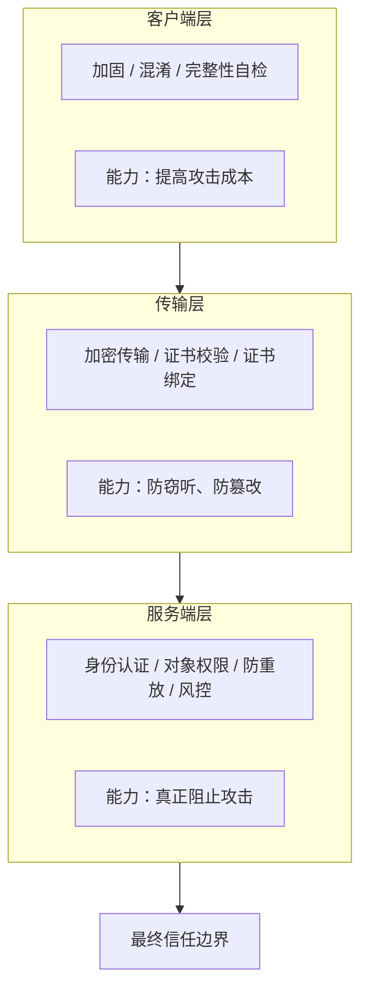

> 客户端和传输层是**成本**，服务端是**边界**。把安全决策放在客户端，等于没有安全决策。

### 2.7 六个常见认知误区

| 误区              | 为什么错                 |
| --------------- | -------------------- |
| "我们不出名，没人攻击"    | 自动化扫描不看知名度           |
| "代码混淆了就安全了"     | 混淆不加密字符串             |
| "用了 HTTPS 就安全了" | 管不了重放、改包、自己的客户端写日志   |
| "有签名校验就能防篡改"    | 签名防"改"防不住"抄"；且攻击者可重签 |
| "测试环境的东西不影响生产"  | 凭证与数据会跨环境流动          |
| "这是小问题，先记着"     | 小问题常常是攻击链的第一环        |

## 第二部分：风险与攻击

## 3. App 安全的十四类核心风险

**本章只讲风险本身——它是什么、为什么会发生、会导致什么。** 对应的防御措施统一放在第 5 章，具体案例放在第 7 章。

### 3.1 分类依据与本章边界

**为什么不按"漏洞名"分类：**

漏洞名（CVE 编号、OWASP 条目名）描述的是**结果**；风险面描述的是**成因**。按照结果分类，你只能在扫描报告出来之后做事；按照成因分类，你可以在设计和编码阶段就预防。

**分类参考的框架：**

本章参考了业界通行标准——[OWASP MASVS](https://mas.owasp.org/MASVS/)（移动应用安全验证标准）的存储、加密、认证、网络、平台交互、代码质量、抗篡改等控制域，以及 OWASP Mobile Top 10 的高频问题清单。

**本章的组织维度：**

按"数据与信任的流动环节"重新组织：


**明确边界：**

- 本节**不写**"应该怎么防"——防御方案见第 5 章
- 本节**不写**"我们项目有没有这个问题"——见第 7 章

### 3.2 凭据与密钥泄露

**是什么：**

把 API Key、签名密钥、加密密钥直接写进客户端代码或资源文件里。

**为什么会发生：**

- **为了省事**——"先写死，以后再抽出来"（然后就没有以后了）
- **为了跨平台一致**——Android 和 iOS 都要用同一个密钥，索性两边都硬编码
- **误解了客户端的信任模型**——认为"编译进二进制就看不见了"

**核心矛盾：**

> **客户端持有的密钥，等于公开的密钥。**

原因见 2.1：攻击者手里有完整的包。密钥在包里，就是在他手里。

**但要区分两种情形——这是最容易搞错的地方：**

| 类型          | 例子                     | 泄露后果         | 是否严重              |
| ----------- | ---------------------- | ------------ | ----------------- |
| **客户端 Key** | 地图 SDK Key、Firebase 配置 | 可能被盗刷配额、产生费用 | **通常不严重**——设计上就公开 |
| **服务端密钥**   | 请求签名密钥、数据加密密钥、管理接口凭据   | 可伪造请求 / 解密数据 | **严重**            |

OWASP 把这一类拆成了两个独立的弱点条目：

| 弱点                                                                               | 覆盖什么                          |
| -------------------------------------------------------------------------------- | ----------------------------- |
| [MASWE-0004：敏感数据硬编码在应用包中](https://mas.owasp.org/MASWE/MASVS-STORAGE/MASWE-0004/) | 密钥、凭据被直接写进客户端                 |
| [MASWE-0003：密钥存储在平台密钥库之外](https://mas.owasp.org/MASWE/MASVS-STORAGE/MASWE-0003/) | 密钥没有交给 Keystore / Keychain 托管 |


注意后者**不是**在说"客户端不能有密钥"，而是在说"有密钥就必须交给平台密钥库"。这两条合起来才是完整的判断：

> 客户端**可以**持有设备级密钥（交给平台密钥库托管），**不能**持有全局共享密钥。

很多扫描工具会把两类 Key 混为一谈，报出一堆"硬编码密钥"告警，导致团队麻木。**判断标准应该是一个问题：**

> 这个密钥泄露后，别人能冒充**服务端**，还是只能冒充**某个用户**？

- 能冒充服务端（比如用它给任意请求签名）→ 严重，必须立即处置
- 只能冒充某个用户（比如用它解密本地缓存）→ 取决于影响面
- 只是 SDK 的公开标识 → 补云端限制即可

### 3.3 数据存储与日志泄露

敏感数据会从六个地方漏出去。

**位置一：日志**

最常见，也最容易被低估。

开发者为了排查线上问题，往往会打印完整的请求和响应——包含 URL、请求体、认证头、令牌、签名。这些日志：

- 在调试版本里是"方便"
- 在发布版本里是**直接把可用的凭据交出去**

Android 官方对这类问题的定性见 [日志信息泄露风险](https://developer.android.com/privacy-and-security/risks/log-info-disclosure)；OWASP 也把它列为一条独立弱点：[MASWE-0005：敏感数据被写入日志](https://mas.owasp.org/MASWE/MASVS-STORAGE/MASWE-0005/)。

**关键点：日志泄露不是"信息泄露"那么简单。** 常规的信息泄露（比如接口结构暴露）只影响"攻击者更了解你"；而日志里的令牌是**可以立刻使用的凭据**。第 7.1 节会讲一个真实案例——攻击者从日志里取出完整请求，在 App 外原样重放，成功读写了业务数据。

**位置二：本地存储**

| 平台      | 常见位置                                          |
| ------- | --------------------------------------------- |
| Android | SharedPreferences、SQLite、内部/外部存储文件、缓存目录       |
| iOS     | NSUserDefaults、SQLite、Documents/Library 目录、缓存 |


这些都是**明文或弱保护**的。敏感数据不该直接放进去。

**位置三：平台安全存储**

Android Keystore 与 iOS Keychain 能保护**密钥本身**不被导出——这是它们的设计目的。

但要注意：

> **它们保护的是密钥，不是使用方法。**

具体含义：

- 密钥不可导出 ✓
- 但 App 用这个密钥解密出来的明文，仍然可能在内存里、在日志里、在临时文件里
- 设备已解锁的情况下，第三方仍可能诱导 App 执行解密操作

**位置四：备份与设备迁移**

- Android 的 `allowBackup` 默认是 `true`，即**默认允许**备份 App 数据（官方说明见 [Auto Backup](https://developer.android.com/identity/data/autobackup)）
- iOS 的 iCloud 备份与本地备份包含 App 容器内容

如果没有显式配置排除规则，令牌、缓存、偏好都可能进入备份。这一条在 OWASP 中同样有独立条目：[MASWE-0006：敏感数据未从备份中排除](https://mas.owasp.org/MASWE/MASVS-STORAGE/MASWE-0006/)。

**位置五：第三方 SDK**

统计、推送、崩溃上报类 SDK 可能采集了超出你预期的数据——设备标识、位置、行为轨迹，甚至剪贴板。**这些采集行为不体现在你的代码里**，但责任在你。

**位置六：通知栏与锁屏**

验证码、私信内容、订单信息直接展示在通知里。未锁屏时任何拿到设备的人都看得到；锁屏通知未设置隐藏内容时同样如此。

**这一类风险的共同特点：** 它们都不需要攻击者攻破任何东西——数据**本来就放在了一个能被读到的地方**。

### 3.4 组件与入口暴露

**Android 侧：**

| 组件类型      | 暴露的后果                 |
| --------- | --------------------- |
| Activity  | 外部可直接调起任意页面，可传参       |
| Service   | 外部可绑定或启动后台服务          |
| Receiver  | 外部可发送广播触发逻辑           |
| Provider  | 外部可读写其暴露的数据           |
| Deep Link | 任何 App 都能用 URL 调起你的页面 |

**iOS 侧：**

| 机制              | 风险                                 |
| --------------- | ---------------------------------- |
| URL Scheme      | **没有域名归属校验**——任何 App 都能注册同名 Scheme |
| Universal Links | 有域名归属校验，安全性更好，但配置复杂                |

**为什么危险：**

> **任何 App 都能调起你的导出入口。**

这意味着攻击者不需要改你的包，只要装一个自己的 App，就能往你的业务流程里注入调用。


**典型后果：**

- **越权跳转**：直接打开需要权限的页面，若页面本身不校验则可能看到不该看的数据
- **参数注入**：传入构造的参数，影响业务逻辑
- **OAuth 回调截获**：见 3.7

**但要注意一个关键区分：**

> **入口暴露本身不是漏洞，"缺少校验的入口"才是。**

Launcher Activity 必须导出，深链必须注册——这些是功能需要。问题出在"收到外部输入之后没有校验"。

**判断标准：** 把外部传入的参数换成任意值，业务逻辑会不会照单全收？

### 3.5 通信与协议安全

**问题一：明文传输**

HTTP、明文 WebSocket、明文的 MQTT——攻击者控制网络路径时可直接读取。

**问题二：证书校验问题**

| 错误做法         | 后果                         |
| ------------ | -------------------------- |
| 完全不校验        | 任何证书都接受，中间人可解密             |
| 信任所有证书       | 同上                         |
| 只信任内置的一份证书列表 | 这是**证书绑定（SSL Pinning）**，见下 |

**证书绑定（SSL Pinning）** 是把服务端证书或公钥固定在客户端，用于防中间人。它有效，但**有运维代价**——证书轮换时必须同步更新客户端，否则老版本 App 全部失联，所以需要配备用公钥（详见 5.3）。

**问题三：平台级网络安全配置被放宽**

| 平台      | 配置                                                                                                                        | 作用                |
| ------- | ------------------------------------------------------------------------------------------------------------------------- | ----------------- |
| Android | [网络安全配置（network security config）](https://developer.android.com/privacy-and-security/security-config)                     | 决定全局是否允许明文、信任哪些证书 |
| iOS     | [App Transport Security（ATS）](https://developer.apple.com/documentation/security/preventing-insecure-network-connections) | 决定全局是否强制加密传输      |

这两个配置是**全局开关**。一旦被放宽（比如为了让测试环境的自签证书能用），影响的是**整个应用的所有请求**，而不只是那一个接口。

**问题四：协议选择本身**

除 HTTP(S) 外，App 常用的长连接协议（如 MQTT、WebSocket）若未启用加密传输或未校验对端身份，同样会暴露在这类问题下。

**问题五：中间人**

攻击者控制网络路径时（公共 Wi-Fi、恶意热点、ARP 欺骗），可以读取甚至改写未受保护的流量。

**问题六：请求重放**

这是**最容易被误判**的一类。

> 即使签名有效、加密完好，攻击者仍可"原样复制一份合法请求"再发一次。

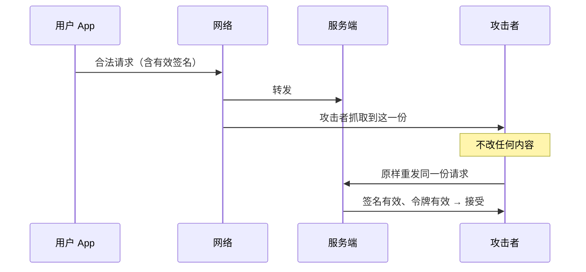

**核心结论：**

> **"有签名"不等于"能防重放"。**
>
> 签名防的是"**改**"，防不住"**抄**"。

防御措施见 5.3（传输）与 5.4（防重放）。

### 3.6 密码学实现误用

**与 3.2 的区别：** 3.2 讲"密钥被拿走"，本节讲"**密钥还在，但用法错了**"。

这类问题的特点是：**代码里明明写了加密，但实际保护强度接近零**。

**错误一：算法选择错误**

| 错误                | 问题           |
| ----------------- | ------------ |
| 用 MD5 / SHA-1 存口令 | 已被淘汰，可高速暴力破解 |
| 用弱随机数生成密钥或令牌      | 输出可预测，等于密钥已知 |

**错误二：算法合规性**

在需要满足国内密码管理要求的场景，应使用国密算法族（SM2 签名、SM3 摘要、SM4 分组加密）而非国际通用算法。**选错不只是安全问题，也可能直接不合规。**

**错误三：口令处理错误**

| 错误           | 后果               |
| ------------ | ---------------- |
| 直接把口令当密钥使用   | 口令熵太低，可被字典攻击     |
| 缺少随机加盐（salt） | 相同口令产生相同结果，可用彩虹表 |
| 密钥派生迭代次数过低   | 离线暴力破解成本极低       |

**错误四：模式与参数错误**

| 错误      | 后果                                         |
| ------- | ------------------------------------------ |
| ECB 模式  | 相同明文块产生相同密文块，**泄露明文结构**（经典例子：加密后的图片仍能看出轮廓） |
| 固定 IV   | 加密结果可预测、可对比                                |
| 缺少完整性校验 | 密文可被篡改而不被发现                                |

**错误五：自研加密**

自己发明加密协议或签名算法。未经公开审查的算法几乎必然存在缺陷——**密码学不是可以"自己想办法"的领域**。

**错误六：密钥管理缺失**

- 所有用户共用一把密钥
- 密钥从不轮换
- 密钥与它保护的数据存在一起（等于把钥匙插在锁上）

**为什么这类问题难发现：** 代码里有 `AES`、有 `encrypt()`，代码评审时看起来"做了加密"。**只有真正看参数才能发现问题**——这往往在代码审计阶段才被揪出来。

OWASP 把本节的几类问题拆成了独立弱点，可以作为代码审计时的对照清单：

| 弱点                                                                         | 对应本节的哪一类           |
| -------------------------------------------------------------------------- | ------------------ |
| [MASWE-0007：加密实现不当](https://mas.owasp.org/MASWE/MASVS-CRYPTO/MASWE-0007/)  | 模式与参数错误（ECB、固定 IV） |
| [MASWE-0008：哈希实现不当](https://mas.owasp.org/MASWE/MASVS-CRYPTO/MASWE-0008/)  | 用淘汰算法存口令           |
| [MASWE-0012：随机数生成不当](https://mas.owasp.org/MASWE/MASVS-CRYPTO/MASWE-0012/) | 用弱随机数生成密钥或令牌       |
| [MASWE-0014：密钥派生不当](https://mas.owasp.org/MASWE/MASVS-CRYPTO/MASWE-0014/)  | 口令处理错误（缺盐、迭代过低）    |

### 3.7 认证与会话安全

**问题一：登录态判断位置错误**

由客户端决定"是否已登录"，服务端只做展示。攻击者改包即可绕过（见 2.1 的反例）。

**问题二：令牌生命周期失控**

| 问题         | 后果              |
| ---------- | --------------- |
| 有效期过长      | 泄露后可用窗口大        |
| 无法主动吊销     | 用户改密码、登出后旧令牌仍可用 |
| 登出只在客户端清状态 | 服务端仍认这个令牌       |

**问题三：令牌结构问题**

自包含令牌（如 JWT）若未正确校验签名或算法，可被伪造或降级攻击（比如把算法改成 `none`，或从非对称降级为对称）。

**问题四：认证强度不足**

只依赖口令或短信验证码这类**可被钓鱼、可被劫持**的手段：

- 口令 → 可被撞库、可被钓鱼页面骗取
- 短信验证码 → 可被 SIM 卡劫持、可被诱导转发

更强的选择是多因子（MFA）与**抗钓鱼的 Passkey / FIDO2**——基于公钥、与域名绑定，钓鱼站点拿到的凭据无法在其他站点使用。

**问题五：OAuth 授权流程缺陷**

| 缺陷            | 后果                                                                                                                 |
| ------------- | ------------------------------------------------------------------------------------------------------------------ |
| 缺少 `state` 校验 | 跨站请求伪造，攻击者可把受害者账号绑定到自己的第三方账号（防护要求见 [RFC 6749 §10.12](https://datatracker.ietf.org/doc/html/rfc6749#section-10.12)） |
| 缺少 PKCE       | 授权码被截获后可被抢先用掉（防护机制见 [RFC 7636](https://datatracker.ietf.org/doc/html/rfc7636)）                                     |
| 回调未做一次性消费     | 同一份回调可被重复利用                                                                                                        |

**问题六：多端与会话管理**

- 改密码后旧会话是否失效？
- 异地登录是否有感知？
- 多设备登录的策略是什么？

**问题七：生物识别与验证码**

- 生物识别只作为**本地解锁**手段，不能替代服务端认证
- 短信/邮件验证码接口缺少限流会被批量刷

**问题八：账号安全类攻击**

这类攻击**不依赖任何客户端缺陷**，但客户端与接口往往是它们的入口：

| 攻击   | 手法                                |
| ---- | --------------------------------- |
| 撞库   | 拿已泄露的账号密码库批量试登录                   |
| 账号枚举 | 借注册或找回密码接口的**不同错误提示**，判断某手机号是否已注册 |
| 弱口令  | 缺少密码强度策略                          |
| 短信轰炸 | 验证码接口无频控，被当成骚扰工具                  |

**与 3.4 的联系：** OAuth 回调是一类特殊入口，它的安全性取决于上述校验是否完整。

### 3.8 WebView 与 JS 桥

**WebView 的常见风险：**

| 风险        | 说明                |
| --------- | ----------------- |
| 加载任意 URL  | 攻击者可诱导 App 加载钓鱼页面 |
| JS 注入     | 页面内容可控时，可执行任意脚本   |
| 本地文件访问    | 若开启，网页可读取本地文件     |
| 原生能力暴露给网页 | 见下                |

**JS 桥是什么：**

App 与网页互相调用的通道。原生侧注册一些方法供网页调用（比如"获取用户信息""打开支付"）。

**核心风险：**

> **一旦网页可控，就等于原生能力可控。**

攻击路径：


**典型场景：** 内置帮助页、活动页、第三方登录页。这些页面只要有一个能被替换，桥就变成了攻击入口。

**与 3.4 的关系：** WebView 是一种特殊的"入口"，区别在于它执行的是网页内容而非原生代码。防御要点见 5.2。

### 3.9 界面劫持与旁路窃取

这一族攻击的共同点：**不碰你的服务端、不改你的包**，只利用操作系统提供的合法能力。

**无障碍服务滥用（本族中危害最大）**

用户为辅助功能开启无障碍权限后（通常是给读屏软件、自动化工具用的），恶意应用可以：

- 读取屏幕上的**全部文字**
- **模拟点击**
- 代替用户完成操作

也就是说，它能"看到"并"操作"你的 App。**应用侧几乎无法阻止**——这个权限是用户授予的，系统层的。

**悬浮窗覆盖（界面劫持）**

攻击者用一个透明窗口盖住真实界面，或者显示一个与真实界面几乎一样的假界面。用户以为自己在操作 App A，实际点的是攻击者的窗口。

典型场景：诱导用户点击"确认转账""授权登录"。

**剪贴板**

- 读取剪贴板内容（口令、验证码、钱包地址）
- 或替换剪贴板内容（用户复制的收款地址被换成攻击者的）

**截屏与录屏**

敏感页面未做防截屏，内容被其他应用持续采集。

**输入法与键盘缓存**

敏感输入可能被第三方输入法记录。

**为什么容易被忽略：** 这类风险不在"应用安全"的常规清单里，也扫不出来——它们是**平台能力的副作用**。防御见 5.2。

### 3.10 客户端完整性与运行环境

**三类篡改攻击：**

| 类型       | 手法            |
| -------- | ------------- |
| 重打包      | 改包后用自己的证书重新签名 |
| 运行时 Hook | 在运行时拦截并改写函数调用 |
| 内存篡改     | 直接修改进程内存中的数据  |

**重打包为什么可行：**

> **攻击者可以用自己的证书重新签名，而 App 无法察觉。**

关键在于：**签名是给系统看的，不是给 App 自己看的**。系统用签名来判断"这个包能不能覆盖安装"，但 App 运行时并不会主动去查"我的签名是不是原来的那个"。

**APK 签名方案演进：**

| 方案 | 引入版本                 | 特点                                |
| -- | -------------------- | --------------------------------- |
| v1 | 最初                   | JAR 签名，逐文件校验，慢且可被部分绕过             |
| v2 | Android 7.0 (API 24) | 整包签名，校验更快更完整                      |
| v3 | Android 9 (API 28)   | **引入签名密钥轮换能力**（proof-of-rotation） |

**注意：只启用 v2 意味着无法轮换签名密钥。** 一旦签名私钥泄露，既不能换密钥（老版本装不上新包），也很难要求全体用户重装。

校验逻辑在 AOSP 的 `apksig` 模块里。`frameworks/base` 中保存了它在框架内的实现（包名 `android.util.apk`），下面两段就是其中 v2 的校验入口：

```java
// ApkSignatureSchemeV2Verifier.java (AOSP frameworks/base, android12-release, 第 75 行)
// 源码链接：
// https://github.com/aosp-mirror/platform_frameworks_base/blob/c53e71dc397de7486c9a8899f71598c3c3a18d44/core/java/android/util/apk/ApkSignatureSchemeV2Verifier.java#L75

    // v2 签名块在 APK Signing Block 里的固定 ID。
    // 一个包里只可能有这么一块——协议层面就没有「多把密钥并存」的位置。
    private static final int APK_SIGNATURE_SCHEME_V2_BLOCK_ID = 0x7109871a;
```


```java
// ApkSignatureSchemeV2Verifier.java (AOSP frameworks/base, android12-release, 第 152-155 行)
// 源码链接：
// https://github.com/aosp-mirror/platform_frameworks_base/blob/c53e71dc397de7486c9a8899f71598c3c3a18d44/core/java/android/util/apk/ApkSignatureSchemeV2Verifier.java#L152-L155

    // 只用上面那个固定 ID 去定位签名数据，
    // 没有「从多把密钥里挑一把」的逻辑可供调用。
    public static SignatureInfo findSignature(RandomAccessFile apk)
            throws IOException, SignatureNotFoundException {
        return ApkSigningBlockUtils.findSignature(apk, APK_SIGNATURE_SCHEME_V2_BLOCK_ID);
    }
```


两处值得注意：

1. **`findSignature` 用的是固定 block ID**（`APK_SIGNATURE_SCHEME_V2_BLOCK_ID`）——签名数据在包里只有一个位置，没有"多把密钥并存"的结构。
2. **整个文件里没有任何"密钥轮换"或"旧密钥"概念**——把 [这个文件](https://github.com/aosp-mirror/platform_frameworks_base/blob/c53e71dc397de7486c9a8899f71598c3c3a18d44/core/java/android/util/apk/ApkSignatureSchemeV2Verifier.java) 全文检索 `rotation`（忽略大小写）命中 **0 处**——这个 0 在任何口径下都成立。对照 v3 的 `ApkSignatureSchemeV3Verifier.java`：同一口径下 15 处（其中小写字面量 `rotation` 5 处、`ProofOfRotation` 里的 `Rotation` 8 处、`ROTATION` 常量 2 处；口径不同数字会不同，所以这里把口径写出来）。这个类只回答一个问题："这个包是不是被当前这把密钥签的？"

这正是 v2 无法轮换签名密钥的根因：**协议层面就没有给"换密钥"留位置**。轮换能力（proof-of-rotation）是 v3 才引入的，由 `V3SchemeSigner` / `V3SchemeVerifier` 实现——它允许在新密钥的签名块里附上一条用旧密钥签名的"轮换声明"，让老版本系统仍能验证血缘关系。

OWASP 把"密钥轮换未实现"单独列为一条弱点：[MASWE-0015](https://mas.owasp.org/MASWE/MASVS-CRYPTO/MASWE-0015/)。它同时适用于签名密钥与服务端使用的加密密钥——**只要一把密钥需要长期使用却没有任何轮换路径，一旦泄露就只能被动应对**。

这类"抗篡改"控制的目标定位，可参考 [OWASP MASVS-RESILIENCE：抗逆向与防篡改控制域](https://mas.owasp.org/MASVS/11-MASVS-RESILIENCE/)。

**动态下发与热更新**

部分框架允许绕过应用商店直接下发代码或资源。下发通道一旦被控制，**等于给攻击者开了一条"合法"的代码执行入口**。同时这类做法在多数平台也不符合上架要求。

**运行环境风险**

| 环境          | 影响           |
| ----------- | ------------ |
| Root / 越狱设备 | 沙箱与权限模型被绕过   |
| 模拟器 / 云手机   | 便于批量自动化      |
| 应用多开与克隆     | 多实例共享数据或伪造环境 |
| 调试器附加       | 可断点、可改内存     |

它们本身不是漏洞，但会**显著降低后续攻击的成本**。

**对应的防护手段**是平台提供的完整性证明服务——Android 的 [Play Integrity](https://developer.android.com/google/play/integrity/overview)、iOS 的 App Attest，以及客户端自校验。它们的作用与局限见 5.2、5.4。

### 3.11 环境与配置管理失控

**类型一：多环境地址进包**

开发、测试、预发地址出现在生产包中。攻击者由此知道你的非生产环境地址，而**非生产环境通常防护更弱**。

**类型二：环境切换入口**

尤其是"连点解锁"式隐藏调试入口。

这里要强调一个判断：

> **它是有意实现的功能，不是残留。**

包内出现 `_handleEnvironmentUnlockTap`、`_showEnvironmentSheet` 这类符号，说明这是开发者**主动实现、专门加了隐藏手势**的功能。不应该被当成"误打进包的测试代码"轻轻放过。

**类型三：调试/测试代码进包**

| 类型        | 举例                       |
| --------- | ------------------------ |
| Mock 数据通路 | 可在客户端本地生成"成功"响应，完全不经过服务端 |
| 测试框架      | 集成测试、调试代理                |
| 调试通道      | 系统代理开关等                  |

**为什么 Mock 通路特别值得关注：** 环境切换指向的是**真实服务端**（仍有服务端校验兜底）；Mock 通路是在**客户端本地**生成响应。**服务端对此无感知、无日志、无法审计。**

**核心判断标准：**

> 这段代码在生产包里能不能被触发？触发后能不能影响真实业务？

两个问题都要问。只问第一个会漏掉"虽然难触发但一旦触发影响极大"的情况；只问第二个会浪费精力在无害的调试代码上。

### 3.12 第三方 SDK 与供应链

**引入即继承**

第三方 SDK 会带来它自己的权限、网络行为、数据采集和漏洞。**你的 App 要为它的行为负责**——监管处罚罚的是你，不是 SDK 供应商。

**典型问题：**

| 问题      | 说明                                       |
| ------- | ---------------------------------------- |
| 权限膨胀    | SDK 要求了 App 本身不需要的敏感权限（合并到你的 Manifest 里） |
| 静默上传    | SDK 在后台采集并上传设备信息、行为数据                    |
| 版本过旧    | 存在已知 CVE                                 |
| 隐私政策不一致 | SDK 采集范围超出你声明的范围                         |

**供应链投毒：**

- 依赖包被篡改（`npm install` 拉到了被投毒的版本）
- 构建环境被污染
- 内部制品库被替换

**为什么容易被忽视：**

SDK 通常是"接进去就不管了"，且它的行为**不体现在你的代码里**——代码评审看不到，扫描工具也未必报。

**与 3.13 的关系：** SDK 采集的数据同样受隐私合规约束，且必须在隐私政策中披露。

### 3.13 权限、隐私与合规

**权限维度**

危险权限清单：相机、麦克风、位置、通讯录、存储。

**过度申请的代价：** 一旦 App 进程被利用，这些权限就是**攻击者的能力**。

与车机事件直接呼应：**车载麦克风被远程激活**，本质就是"权限被不该有权限的人用上了"。车载麦克风本身是合法功能（语音助手需要它），问题在于**权限被不该用的实体用上了**。

**隐私维度**

| 检查项        | 说明                 |
| ---------- | ------------------ |
| 收集范围       | 是否超出隐私政策声明         |
| 告知同意       | 是否履行了告知义务、是否取得有效同意 |
| 第三方 SDK 采集 | 是否已在政策中披露          |
| 数据出境       | 见下                 |

**数据出境：** 使用境外云服务（如 Firebase 等）会把用户数据传出境外，需评估是否触发数据出境安全评估与标准合同备案要求，并在隐私政策中明确告知。

**合规维度——国内不止一部法律**

| 法规 / 标准          | 关注点            |
| ---------------- | -------------- |
| 《个人信息保护法》        | 告知同意、最小必要、用户权利 |
| 《网络安全法》          | 网络运行安全、日志留存    |
| 《数据安全法》          | 数据分类分级、重要数据保护  |
| 网络安全等级保护（等保 2.0） | 系统定级与测评        |
| GB/T 35273       | 个人信息安全规范       |
| 工信部 App 专项治理     | 通报与整改机制        |
| GDPR（涉及海外用户）     | 更严格的同意与用户权利要求  |
| 各应用商店审核要求        | 上架门槛           |

**用户权利的落地**

法规要求提供**账号注销、个人信息的查阅/复制/转移、数据删除**等能力。

这里要强调一句：

> 这些不是"页面里有入口"就算数，而是要**真的能执行、能留痕、能在合理时限内完成**。

**为什么把合规放在安全章节：** 合规是安全的**底线要求**，也是审计时最先被检查的部分。

### 3.14 业务逻辑与越权

**水平越权（IDOR）**

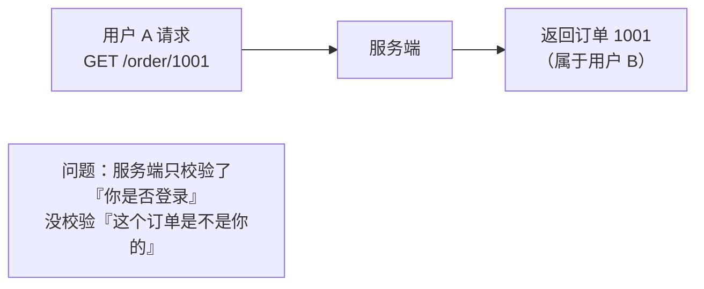

**垂直越权**

普通用户调用了管理员接口。同样是"只校验了身份，没校验权限"。

**业务流程缺陷**

| 例子      | 缺失的校验      |
| ------- | ---------- |
| 优惠券重复领取 | 领取次数限制     |
| 订单金额可篡改 | 服务端未重新计算金额 |
| 步骤可跳过   | 服务端未校验前置状态 |

这类问题**与加密完全无关**，纯粹是逻辑校验缺失。

**为什么归到 App 安全：**

这类问题**只能在服务端修**——但它常常**通过客户端逆向被发现**。原因很直接：接口结构、参数含义、字段名都在包里。攻击者从包里读出 `GET /order/{id}`，然后试一下把 `id` 改掉，就发现了。

**与 2.1 呼应：** 客户端不可信，最终意味着**服务端必须逐个请求校验两个问题**——"你是谁" + "这个对象是不是你的"。

### 3.15 输入校验与注入

**为什么单列一类：** OWASP Mobile Top 10 把"输入/输出校验不足"列为独立类别。它的特点是**危害跨越多个入口**——同一个根因，可以在组件、WebView、网络接口三处分别被利用。

**Android 组件侧**

| 问题                           | 说明                         |
| ---------------------------- | -------------------------- |
| Intent 参数未校验                 | 外部传入的值直接被使用                |
| ContentProvider 查询条件被 SQL 拼接 | 注入                         |
| 文件共享的路径遍历                    | `../` 逃出授权目录               |
| 不可信数据被反序列化                   | 把外部传入的字节流还原成对象时，触发非预期的构造逻辑 |

**WebView 侧**

- 网页输入未编码导致脚本注入
- 桥接接口对网页传入的参数缺少类型与边界检查

**网络接口侧**

服务端对客户端提交的参数缺少**类型、长度、范围、枚举**校验，导致越权查询、批量拉取或注入。

**客户端本地**

- 本地数据库查询用字符串拼接
- 动态拼接文件路径
- 用客户端传入的值直接定位资源

**关键认知：**

> **客户端做的输入过滤只是体验优化，不能算安全措施。**

原因见 2.1：攻击者可以绕开你的 App，直接向接口发送构造好的请求。你在客户端做的正则校验，对他毫无约束。

**判断标准：** 把一个正常请求里的参数替换成**任意值、超长值、特殊字符**后直接发给服务端，服务端会不会照单全收？

## 4. 攻击者视角：一条完整的攻击链

本章把第 3 章的风险面串成一条真实的攻击流程，并给出每个阶段实际会用到的工具。

### 4.1 攻击链全景：六个阶段


| 阶段      | 输入        | 产出       | 能拿到什么              |
| ------- | --------- | -------- | ------------------ |
| ① 情报侦察  | APK / IPA | 包的画像     | 技术栈、加固情况、明文地址、权限清单 |
| ② 静态分析  | 包         | 可读代码/伪代码 | 类结构、字符串、配置、硬编码凭据   |
| ③ 代码审计  | 代码        | 风险清单     | 密钥用法、认证流程、组件配置     |
| ④ 动态分析  | 运行中的 App  | 运行时真相    | 解密后的参数、内存中的密钥      |
| ⑤ 流量分析  | 网络流量      | 协议理解     | 接口格式、签名算法、可重放性     |
| ⑥ 投毒与分发 | 原包        | 伪造包      | 可给用户安装的假 App       |

**这条链是"逐级解锁"的**——前一阶段的产出是后一阶段的输入。因此：

> **防御的价值在于"打断任意一环"，而不是"守住最后一环"。**

**本章的写法：** 每一节按"这一阶段做什么 → 用什么工具 → 对应第 3 章的哪类风险 → 本项目是否已被验证"。

**先交代本项目的进度：** 本项目已完整复现三条攻击链，另有一条只验证到入口这一层，它们分别落在上述六阶段的第五步和第六步——

- **攻击链 01**：接口日志泄露与请求重放，落在阶段五
- **攻击链 02**：APK 二次打包与返回数据篡改，落在阶段六
- **攻击链 03**：客户端首页内容篡改，落在阶段六
- **攻击链 04**：外部链接与 OAuth 回调伪造，落在阶段五（**只验证到“入口可达”，利用未证实**）

四条链的验证结论见 6.3，逐项问题详解见第 7 章；本章 4.6、4.7 两节会分别标注它们对应哪一步。

### 4.2 阶段一：情报侦察

**做什么：**

| 动作            | 目的           |
| ------------- | ------------ |
| 文件指纹（哈希与签名信息） | 确认样本、判断签名方案  |
| 清单解剖          | 看权限、导出组件、SDK |
| 字符串与资源搜集      | 找地址、密钥、调试标记  |
| 加固检测          | 判断后续是否需要脱壳   |

**常用工具：**

| 工具                 | 用途                     |
| ------------------ | ---------------------- |
| `unzip`            | 看包结构（APK/IPA 本质都是 zip） |
| `apktool`          | 解包与清单还原                |
| `aapt`             | 清单与权限导出                |
| `strings` / `grep` | 字符串挖掘                  |
| `MobSF`            | 自动化初筛                  |

**对应的风险面：** 3.11（环境地址暴露在字符串里）、3.2（密钥藏在字符串池里）、3.13（权限清单直接可读）。

**关键认知：**

> **很多问题在这一步就暴露了，不需要反编译、不需要运行 App。**

一个 `strings` 命令就能把明文地址、硬编码密钥、调试标记全捞出来。这也是为什么"包里不该出现的东西"是最低成本也最高收益的修复项。

### 4.3 阶段二：静态分析与反编译

**Android 侧流程与工具：**


- **脱壳**：移除加固保护，让 DEX 能被正常反编译
- **Smali**：DEX 的人类可读形式，用于精确到指令级的定位与改写（4.7 的重打包就要改它）

**iOS 侧流程与工具：**

- 脱壳（App Store 分发的二进制是加密的，需先解密导出）
- 类与方法还原（`class-dump`）
- 反汇编与伪代码（`Hopper` / `IDA` / `Ghidra`）
- 依赖与配置审计
- 硬编码密钥挖掘

**跨平台框架另有一套工具：**

Flutter 应用的业务逻辑被编译成 Dart AOT 快照，常规 DEX / Mach-O 工具对它无效，需要用专门工具（如 `blutter`）解析快照的对象池、类表与函数表。

但这类工具**与 Dart 版本强绑定，版本不匹配就完全用不了**——本项目正好撞上这一点（见 6.2），只能退回字符串层面的分析。

**不同技术栈的难度差异：** Java/Kotlin 反编译接近源码；原生 iOS 与 Dart AOT 只能到伪代码。

**本节的落点：**

> **"反编译不出来"不等于"信息拿不到"。**

字符串和符号往往已经够了。本项目就是活例子：反编译工具用不了，但仍然从字符串池里挖出了密钥、环境地址、Mock 通路和调试组件。

### 4.4 阶段三：代码与配置审计

**做什么：** 在拿到可读代码后，按固定清单逐项检查。

**审计方向与第 3 章风险面的对应关系：**

| 审计方向           | 对应风险 |
| -------------- | ---- |
| 密钥与凭据          | 3.2  |
| 存储与日志          | 3.3  |
| 组件安全           | 3.4  |
| 网络与证书校验        | 3.5  |
| 加解密实现          | 3.6  |
| 认证与会话流程        | 3.7  |
| WebView 与 JS 桥 | 3.8  |
| 环境与配置          | 3.11 |
| 依赖与 SDK        | 3.12 |

**辅助工具：** `MobSF` 可自动完成一部分，但**逻辑类问题（3.6、3.7、3.14）仍需人工阅读**。

自动扫描能发现"这里有个硬编码字符串"，但发现不了"这个 AES 用了 ECB 模式"或"这个 OAuth 回调没校验 state"——后者需要理解业务意图。

**强调：** 这是**纯静态就能完成**的审计，也是投入产出比最高的一环。

### 4.5 阶段四：动态分析与运行时 Hook

**做什么：**


**常用工具：**

| 工具          | 用途                     |
| ----------- | ---------------------- |
| `Frida`     | 跨平台 Hook 框架，最常用        |
| `objection` | 基于 Frida 的封装，可一键绕过常见保护 |
| `Xposed`    | Android 系统级 Hook       |
| `Magisk`    | Root 与隐藏 Root          |

**Hook 能做什么：**

- 直接看到**解密后的参数**（不用去逆算法）
- 绕过客户端校验（把判断函数的返回值改掉）
- 导出内存中的密钥

**关键认知：**

> **只要攻击者能运行被 Hook 的 App，客户端的一切"自保护"都会失效。**

这正是"完整性校验只能提高成本"的技术原因（对应 3.10）：你的反调试代码、你的 Root 检测、你的完整性自检，全部运行在**攻击者可控的环境里**，他可以逐个绕过。

### 4.6 阶段五：流量分析与协议逆向

**做什么：** 代理与中间人 → 证书绑定绕过 → 重放与篡改 → 协议与签名逆向。

**常用工具：**

| 工具                                     | 用途             |
| -------------------------------------- | -------------- |
| `mitmproxy` / `Burp Suite` / `Charles` | 抓包与改包          |
| `objection` / `Frida` 脚本               | 绕过证书绑定         |
| `r0capture`                            | Android 侧免代理抓包 |

**说明顺序：**

1. 先抓包
2. 抓不到（证书绑定）→ 绕过
3. 抓到后先看**能不能重放**
4. 再看**能不能伪造**

**本项目落在这一阶段的有两条：**攻击链 01 已完整验证（第 7.1 节详述）；攻击链 04（外部链接与 OAuth 回调伪造）也归在这一步，但**只验证到「入口可达」，利用未证实**（第 7.4 节详述）。


**关键结论：**

> **"改请求体后签名失效"和"原样重放被接受"可以同时成立。**

这恰恰是很多团队误判的地方——他们测了"改请求体"，发现签名校验拦住了，就认为"签名机制有效，重放也没问题"。但这是两件事：

| 测试         | 结果  | 说明                    |
| ---------- | --- | --------------------- |
| 改请求体 + 旧签名 | 401 | 说明签名**覆盖了请求体**（完整性有效） |
| 原样重放       | 200 | 说明**没有任何防重放机制**       |

第一条通过不代表第二条也安全。

**与 3.5、3.6 呼应：** 重放与签名分别对应这两节的风险。

### 4.7 阶段六：投毒与二次分发

**做什么：** 代码注入 → 重打包 → 签名与校验绕过 → 二次分发。

**常用工具：**

| 工具                              | 用途               |
| ------------------------------- | ---------------- |
| `apktool`                       | 解包与回编译           |
| `d8` / `dx`                     | 将新增 Java 编译为 DEX |
| `zipalign`                      | 对齐               |
| `apksigner` / `uber-apk-signer` | 重新签名             |

**完整攻击链闭环：** 从"研究一个包"到"产出一个可以给用户装的假包"。

**本项目已验证的攻击链 02、03 就落在这一阶段**（第 7.3 节详述）。

**这一阶段的特殊性：**

> **它不需要服务端有任何漏洞，只要用户装了假包。**

前面五个阶段都是在"理解并利用"你的系统；这一阶段是**直接替换掉你的客户端**。服务端看到的是一个签名不同、但行为"正常"的客户端——如果没有完整性校验，它无从分辨。

**与 3.10 呼应：** 这是"客户端完整性缺失"的直接后果。


### 4.8 Android 与 iOS 攻击路径的差异

本节只讲**攻击路径本身**的差异，各风险类别的技术细节见第 3 章对应小节。

| 维度        | Android        | iOS                                |
| --------- | -------------- | ---------------------------------- |
| **攻击起点**  | 可直接拿到 APK 并侧载  | 需先解密导出（App Store 包是加密的），或依赖企业证书/越狱 |
| **静态分析**  | DEX 反编译接近源码    | Mach-O 只能到伪代码，方法名依赖符号表保留情况         |
| **动态分析**  | Hook 生态更成熟     | 依赖越狱或重签名注入                         |
| **分发落地**  | 侧载自由，仿冒包传播成本极低 | 受生态管控，但企业证书与测试分发渠道仍存在滥用空间          |
| **完整性服务** | Play Integrity | App Attest                         |

**结论：**

> **iOS 的"难"来自生态管控，不是技术不可破。**
>
> **同样的设计缺陷在两个平台上都存在。**

这一点对本项目很重要：Android 和 iOS 包里发现了**同一套**密钥、同一套 Mock 通路（见 7.10）。问题不在平台，在**构建配置和代码本身**。

### 4.9 攻击的"成本—收益"视角

攻击者会选**成本最低**的路径，不会选最"高级"的。

**成本排序（从低到高）：**

| 手段      | 成本              |
| ------- | --------------- |
| 字符串扫描   | 几分钟，全自动         |
| 静态审计    | 几小时，半自动         |
| 动态 Hook | 需要 Root 设备与调试环境 |
| 协议逆向    | 需要理解签名算法        |
| 重打包分发   | 需要诱导用户安装        |

**防御的含义：**

> **把攻击成本抬到高于收益，而不是追求"不可能被攻破"。**

这也是混淆/加固的真实价值所在（与 2.2 呼应）：它不能阻止攻击，但能把攻击从"字符串扫描"这一档，推到"需要动态调试"那一档。

**实践建议：** 先做掉**成本最低、收益最高**的修复项（关闭日志、移除硬编码密钥、剔除调试代码），这些能一次性把攻击者从"几分钟"推到"几小时"。再考虑加固这类"抬高上限"的措施。

---

## 第三部分：防御体系

## 5. 分层防御：每一层能挡住什么

本章是第 8 章解决方案的理论依据。

### 5.1 防御的第一原则：服务端是最终信任边界

重申 2.1，并给出工程化表述：

> **所有安全决策必须在服务端做。**

**服务端必须独立完成的三件事：**

| 校验   | 问题         |
| ---- | ---------- |
| 认证   | 你是谁？       |
| 授权   | 你能不能做这件事？  |
| 对象权限 | 这个数据是不是你的？ |

**反例：** 把"是否已登录""是否有权限"的判断放在客户端——见 2.1。

**设计阶段就要做的事：威胁建模**

不要等到上线前扫描。在设计阶段就：

1. **画数据流图**——数据从哪来、经过什么、存到哪
2. **标出信任边界**——每一处"跨越信任边界"的地方都是检查点
3. **用 STRIDE 逐条提问**

**STRIDE 六问：**

| 威胁                               | 对应问题              |
| -------------------------------- | ----------------- |
| **S**poofing（仿冒）                 | 这里能不能冒充别人？        |
| **T**ampering（篡改）                | 这里的数据能不能被改？       |
| **R**epudiation（否认）              | 做了坏事能不能赖掉？（是否有审计） |
| **I**nformation disclosure（信息泄露） | 这里会不会漏数据？         |
| **D**enial of service（拒绝服务）      | 这里能不能被打瘫？         |
| **E**levation of privilege（权限提升） | 这里能不能越权？          |

**与 3.14 呼应：** 越权问题的唯一解法在服务端。

### 5.2 客户端侧防护：加固与应用层配置

**第一类：加固（提高绕过成本，不追求"挡住"）**

| 手段        | 效果        | 局限                 |
| --------- | --------- | ------------------ |
| 代码混淆      | 读懂逻辑的成本上升 | 字符串不加密             |
| 字符串加密     | 提高提取秘密的成本 | 运行时必然解密，可被 Hook 截获 |
| 反调试       | 阻止附加调试器   | 可被绕过               |
| Root/越狱检测 | 标记高风险环境   | 可被隐藏，且会误报          |
| 模拟器与多开检测  | 阻止批量自动化   | 可被伪装               |
| 完整性自检     | 发现改包      | 自检代码本身也能被改         |

**加固的取舍：** 会带来性能开销、崩溃排查困难、误报风险（正常用户被误判为 Root 设备）。需要按业务价值权衡。

**第二类：WebView 与 JS 桥的安全配置**（对应 3.8）

| 措施                  | 说明                    |
| ------------------- | --------------------- |
| 只加载白名单内的可信域名        | 拒绝加载任意 URL            |
| 关闭不必要的 JS 能力与本地文件访问 | 最小化攻击面                |
| 把 JS 桥暴露给网页的接口压到最小  | 每个暴露的方法都是攻击面          |
| 外部链接一律交给系统浏览器打开     | 不在有桥的 WebView 里加载外部页面 |

**第三类：敏感界面防护**（对应 3.9）

| 措施            | 说明           |
| ------------- | ------------ |
| 敏感页面禁止截屏与录屏   | 系统提供的标志位     |
| 关键操作对悬浮窗覆盖做检测 | 检测是否有遮挡      |
| 剪贴板内容用完即清     | 并对读取行为做提示    |
| 引导使用系统输入法     | 降低第三方输入法记录风险 |

**结论：**

- 加固是"拖延战术"，必须与 5.4 配合才有意义
- **而应用层配置是"成本极低、收益明确"的一类，应当优先做掉**

### 5.3 传输层防护

**全站加密传输，禁用明文**

同步收紧 Android 网络安全配置与 iOS ATS（见 3.5）——注意这是**全局开关**，不能为了某一个接口放宽。

**证书校验的正确做法与常见错误**

| 正确        | 错误              |
| --------- | --------------- |
| 使用系统默认校验  | 信任所有证书          |
| 绑定业务域名与公钥 | 为了调试把校验关掉并提交到生产 |
| 配备用公钥     | 只绑定一张证书，轮换时全量失联 |

**证书绑定（Pinning）的取舍**

| 收益     | 代价           |
| ------ | ------------ |
| 防中间人   | 证书轮换的运维成本    |
| 提高抓包门槛 | 需要配备用公钥与轮换方案 |

**双向认证（mTLS / 客户端证书）**

在需要强身份绑定的场景，让客户端出示证书以证明"请求来自持有该证书的客户端"。

**但要注意：** 证书本身同样可能被从设备中提取，**必须与设备级密钥配合使用，不能单独作为授权依据**（与 3.2 呼应）。

**与 3.5 呼应：** 这是本章最"立竿见影"的一环。

### 5.4 服务端授权、防重放与风控

**防重放的三件套**（对应 3.5）

| 机制                  | 作用        |
| ------------------- | --------- |
| 请求携带时间戳并校验有效期       | 限制重放的时间窗口 |
| 一次性随机数（Nonce）       | 每条请求唯一    |
| 服务端保存已用 Nonce 的去重记录 | 重复出现即拒绝   |

**三者缺一不可：**

- 只有时间戳 → 窗口期内仍可重放
- 只有 Nonce 不去重 → 形同虚设
- 有去重但无时间戳 → 记录表无限增长

**逐请求的对象权限校验**（对应 3.14）

每个请求都要校验"这个对象是不是你的"，而不是只校验"你是否登录"。

**响应数据最小化**

接口只返回本次操作真正需要的字段，避免把整个用户档案或完整对象图回给客户端——**客户端一旦被逆向，多余字段就是白送的信息**。

**高风险操作的服务端二次确认**

改密码、改绑定关系、大额操作等，要求服务端做额外校验（如再次验证身份）。

**认证强度提升**（对应 3.7）

高风险场景引入多因子；优先采用**抗钓鱼的 Passkey / FIDO2**，逐步降低对短信验证码的依赖。

**客户端完整性信号如何与请求绑定**

Play Integrity / App Attest 的校验结果，需要与具体请求绑定（nonce / hash），否则攻击者可以复用一次有效的校验结果。

**关键原则：**

> **完整性信号是"风险信号"，不是"放行依据"**——它提高门槛，但不替代授权。

即使完整性校验通过，该做的对象权限校验一样不能少。

**与 3.7 呼应：** 令牌吊销与短时有效期能缩短泄露窗口。

### 5.5 密钥与凭据的生命周期管理

**密钥分级**

| 类型     | 放哪          | 理由           |
| ------ | ----------- | ------------ |
| 设备级密钥  | 可以放客户端      | 可撤销、影响面限于单设备 |
| 全局共享密钥 | **必须留在服务端** | 泄露影响全体用户     |

（对应 3.2 的核心矛盾）

**工程手段**

- 服务端密钥交由密钥管理服务（KMS）或硬件安全模块（HSM）托管，避免写进配置文件与代码
- 需要客户端加密时，优先使用设备级密钥（Android Keystore / iOS Secure Enclave）而非共享密钥

**白盒密码的定位**

它把密钥隐藏在算法中，能提高提取成本，但**属于加固手段而非保密手段**，不能替代服务端授权。

**算法与参数基线**（对应 3.6）

| 用途   | 推荐                                      | 禁止             |
| ---- | --------------------------------------- | -------------- |
| 对称加密 | AES-GCM、ChaCha20-Poly1305               | 裸用 ECB/CBC     |
| 口令哈希 | Argon2id、scrypt、PBKDF2（配随机盐与足够的迭代/内存代价） | MD5、SHA-1 直接哈希 |
| 随机数  | 平台的密码学安全随机源                             | 普通随机函数         |

**这条要能写进编码规范并被代码评审检查到**——否则就是纸面规定。

**本地敏感数据的加密存储**

需要在本地落盘的敏感数据，应使用平台提供的加密存储（Android 的 EncryptedSharedPreferences 或 SQLCipher、iOS 的 Keychain 访问控制），而不是自建加密方案或明文落盘。Android 侧的相关指引见 [Cryptography | Android Developers](https://developer.android.com/privacy-and-security/cryptography)。

**轮换机制**

| 要素        | 说明            |
| --------- | ------------- |
| 轮换周期      | 定期主动轮换，不等出事   |
| 双密钥并行过渡   | 新旧密钥同时有效一段时间  |
| 客户端版本兼容窗口 | 考虑未升级的老版本 App |

**泄露预案**

发现泄露后的处置顺序：**先评估影响面与调用日志 → 再轮换 → 最后下线旧密钥**。

### 5.6 安全运营与应急响应

**接口限流与防刷**（对应 3.7）

防止验证码、登录、查询类接口被批量滥用。

**审计日志**

记录谁在什么时候做了什么。

**注意：** 审计日志本身**不得包含敏感字段**（对应 3.3）——否则它就成了新的泄露点。

**监控与告警**

- 异常调用量
- 客户端的异常特征（如版本号、签名摘要、完整性信号与正常用户明显不同的调用方）
- 异地登录的及时发现

**应急响应流程**

密钥泄露、令牌泄露、仿冒包传播时的处置：

| 事件    | 处置动作                  |
| ----- | --------------------- |
| 密钥泄露  | 评估影响 → 轮换 → 下线旧密钥     |
| 令牌泄露  | 批量吊销 → 强制重新登录         |
| 仿冒包传播 | 渠道下架 → 用户通知 → 服务端识别拦截 |

**漏洞接收与披露渠道**

给外部研究者一个报告问题的入口，比让他们直接公开要好。

**为什么这一节重要：**

> 前面的防御是"**不发生**"，这一节是"**发生了怎么办**"。

### 5.7 发布流水线治理

**为什么流水线有效：**

这类问题的根因往往在**构建配置**里，而非某一行代码。只有把检查固化到流程里，才能防止"这次修了、下版又回来"。

**治理的三类手段：**

| 手段        | 说明                               |
| --------- | -------------------------------- |
| **构建期隔离** | 用构建变体区分生产与测试，让测试代码在**编译期**就不进入产物 |
| **产物期扫描** | 对构建产物做标记与指纹检查，命中即阻断发版（判据必须是具体的标记或指纹，不能是「存在某类常量」） |
| **发布期把关** | 签名、渠道、灰度与回滚策略                    |

**自动化手段**

| 工具类型         | 作用                   |
| ------------ | -------------------- |
| SAST（静态代码扫描） | 查代码里的不安全写法           |
| SCA（第三方依赖扫描） | 查已知漏洞的依赖版本           |
| 密钥扫描         | 在代码提交与构建产物两个环节查硬编码凭据 |
| SBOM（软件物料清单） | 明确每个产物里到底包含哪些组件与版本   |

**失败即阻断：** 把检查做成流水线的**硬门槛**，而不是"建议"。

**与 3.11 呼应：** 环境与调试代码进包，本质上是一个**流水线问题**——如果构建时就能把测试变体的代码排除在外，这类问题根本不会发生。

本项目的具体检查清单见 9.3。

### 5.8 对标行业标准：OWASP MASVS 与 Mobile Top 10

**三个标准的定位：**

| 标准                                               | 是什么                      | 怎么用         |
| ------------------------------------------------ | ------------------------ | ----------- |
| **MASVS**                                        | 移动应用安全验证标准——把安全要求分为若干控制域 | 作为自评清单与验收口径 |
| [**MSTG / MASTG**](https://mas.owasp.org/MASTG/) | 移动应用安全测试指南——对应的测试方法与用例   | 作为"怎么验"的参考  |
| **Mobile Top 10**                                | 业界最高频的十类移动安全问题           | 用来做快速对标     |

**使用方式：**

1. 先用本文第 3 章的十四类风险做内部盘点
2. 再映射到 MASVS 控制域
3. 找出**没有对应控制措施**的空白区

**为什么需要标准：**

> **它让"安全做到什么程度算够"有了外部参照**，避免自评时标准漂移。

内部自评的常见问题是"越看越觉得自己做得还行"。有了外部标准，就能明确定位到"MASVS 的某个控制域我们完全没有措施"。

### 5.9 各层能力边界对照表

| 层次                                     | 能防什么          | 防不住什么            | 绕过成本 |
| -------------------------------------- | ------------- | ---------------- | ---- |
| **客户端加固**                              | 批量自动化分析、低水平改包 | 有耐心的逆向者、动态 Hook  | 低—中  |
| **完整性自检**                              | 未修改的直接重打包     | 针对性绕过、Hook 返回值   | 中    |
| **传输加密**                               | 网络路径窃听        | 客户端本身的泄露         | 低    |
| **证书绑定**                               | 常规中间人抓包       | 设备被控后的运行时绕过      | 中    |
| **完整性信号（Play Integrity / App Attest）** | 明显异常的环境与改包    | 高仿真环境、结果复用（未绑定时） | 中—高  |
| **服务端对象权限**                            | 越权访问          | 服务端自身逻辑错误        | 高    |
| **服务端防重放**                             | 请求复制          | 服务端实现缺陷          | 高    |
| **设备级密钥**                              | 单设备泄露扩散       | 该设备本身被控          | 高    |

**明确结论：**

> **没有单点防御，只有纵深组合。**

一张表要连着读：**任何单独一行都挡不住有决心的攻击者；但组合起来，攻击者需要在每一层都付出成本。**

这张表是理解第 8 章"为什么这个方案有效"的钥匙——一个好的修复方案，应该能在**多个层**同时抬高成本，而不是只加固一层。

---

## 第四部分：Homewoo 项目

## 6. 项目评估：方法与结论

### 6.1 评估对象与范围

**先说清楚这是什么产品：**

Homewoo 是一款面向家庭的智能设备与家庭协作应用，客户端同时提供 Android 与 iOS 两个版本。从包内可见的业务模块看，功能覆盖：

- 家庭日历（支持绑定 Google 日历）
- 家庭成员与邀请
- 智能设备与口袋设备绑定
- 照片、清单、任务提醒
- 支付
- 一个名为 Cedar 的语音助手

实时数据通过 MQTT 同步，后端服务位于 `sdmc.tv` 域下。

后文提到"日历""首页""公告""设备"等概念，都指这些实际业务模块。

**评估对象：**

| 平台      | 文件                          | SHA-256               |
| ------- | --------------------------- | --------------------- |
| Android | `app-arm64-v8a-release.apk` | `968460c4...c8545c38` |
| iOS     | `Homewoo.ipa`               | —                     |


**技术栈：** Flutter 应用，业务逻辑编译为 Dart AOT（见 2.4），位于 `libapp.so` / `App.framework`。

**范围与边界：**

- 授权测试账号
- Root 测试设备
- 开发/测试环境（`xhome-dev.sdmc.tv:18443`）
- **不涉及生产数据与真实用户**

**明确声明本次边界——哪些做了、哪些没做：**

| 做了         | 说明                                |
| ---------- | --------------------------------- |
| 离线静态检查     | 签名、Manifest、资源、DEX/Smali、AOT 库字符串 |
| 攻击链 01—03 的实机验证；攻击链 04 的入口验证 | 在授权测试账号、Root 测试设备、开发/测试环境完成 |
| 跨平台对照      | Android 与 iOS 包逐项比对               |

| 没做            | 原因               |
| ------------- | ---------------- |
| 跨账号对象访问测试     | 需要他人账号，超出授权范围    |
| 生产环境复现        | 不触碰生产数据与真实用户     |
| 服务端内部校验逻辑审计   | 无可访问权限，需开发方自查    |
| 用提取到的密钥自行构造签名 | 属尚未执行的下一步（见 7.1） |

最后一条尤其要注意：它**不是"没做"而是"还没做"**，且是当前价值最高的待验证项——它决定了攻击链 01 是"只能复制"还是"可以编造"。

### 6.2 静态分析与动态验证的分工

**静态分析：**

对象是签名、Manifest、资源、DEX/Smali、AOT 库可提取字符串（工具见 4.2、4.3）。


**动态验证：**

攻击链 01—03 的实机验证，以及攻击链 04 的入口可达性验证（工具见 4.5、4.6、4.7）。

**为什么两者都要：**

|    | 能做                | 不能做        |
| -- | ----------------- | ---------- |
| 静态 | **穷举存在性**（包里有/没有） | 给不出**可达性** |
| 动态 | 验证可达性             | 只能覆盖测过的路径  |

两者是互补的：静态告诉你"这里有个东西"，动态告诉你"这个东西真的能被触发"。

**一个具体的方法学限制：**

本包 Dart 版本（3.13.2）不被本次评估所用的 blutter 主线版本支持，且二进制已剥离符号表（无 DWARF、无 `.symtab`）。因此静态只能做到**"符号与字符串层面的存在性判定"**。

这正是某些结论必须靠动态验证补足的原因——**不是分析深度不足，是工具能力边界**。

**一个反直觉的事实：** 反编译不出来，不代表信息拿不到。本项目反编译工具用不了，但仍然从字符串池里挖出了：

- 4 个全局共享密钥常量
- 多环境地址（含非标准端口）
- 完整的 Mock 数据通路
- 调试组件与代理通道

### 6.3 攻击链：三条已打通，一条入口已实测

先说清"已验证"这个词的分寸。本章用三个层次描述进度：

| 层次 | 含义 | 判据 |
| --- | --- | --- |
| **已打通** | 从入口到危害的完整因果链都跑通了 | 有前/后对比的实测记录 |
| **入口已实测** | 攻击的第一段被证实可达，但危害未证实 | 有可复现的入口证据，**没有**危害证据 |
| **入口存在** | 包内有明确配置，未做动态验证 | 只有静态证据 |

**把"入口已实测"直接写成"已打通"，是安全评估里最常见的一种高估。** 下面第四条链就是一个必须按第二层来写的例子。

**攻击链 01：接口日志泄露与请求重放**

|        |                                                                              |
| ------ | ---------------------------------------------------------------------------- |
| 攻击起点   | 设备日志                                                                         |
| 关键步骤   | 从 `logcat` 提取完整请求（URL、请求体、`accessToken`、`signature`、`timestamp`），在 App 外原样重发 |
| 验证结果   | 日历**读取、新增、编辑**均成功；删除接口返回成功但未证明因果关系                                           |
| 为什么能成功 | 日志里有服务端接受请求所需的全部材料；签名能防"改"，防不住"抄"                                            |
| 进度     | **已打通**                                                                      |

**攻击链 02：APK 二次打包与返回数据篡改**

|        |                                          |
| ------ | ---------------------------------------- |
| 攻击起点   | 原 APK                                    |
| 关键步骤   | 原地改写 `libapp.so` 内的接口地址指向自建服务，重新打包、签名、安装 |
| 验证结果   | 页面显示伪造数据                                 |
| 为什么能成功 | App 无任何客户端完整性校验；接口地址以明文常量存在，且可等长改写       |
| 进度     | **已打通**                                  |

**攻击链 03：客户端首页内容篡改**

|        |                               |
| ------ | ----------------------------- |
| 攻击起点   | 原 APK                         |
| 关键步骤   | 注入代码，检测到登录态后覆盖当前 Activity 内容层 |
| 验证结果   | 登录后**完整覆盖原首页**；重启后保持；可引导用户外跳  |
| 为什么能成功 | 无完整性校验；攻击者可用自己的证书重新签名         |
| 进度     | **已打通**                        |

**攻击链 04：外部链接与 OAuth 回调伪造**

|        |                                                                        |
| ------ | ---------------------------------------------------------------------- |
| 攻击起点   | 原 APK 的导出组件 + ADB 或任意第三方 App                                           |
| 关键步骤   | 构造 `homewoo://calendar/google/complete?code=…&state=…` 发送给 `MainActivity`，观察回调是否被接收 |
| 验证结果   | **回调已确认送达**（`am start` 成功、Activity 正确、退出码 0）；**OAuth 是否被绕过未证实**             |
| 为什么值得关注 | 导出组件接受外部路由；但**入口可达本身不是漏洞**，关键是第 2 层校验是否失效                             |
| 进度     | **入口已实测；利用未证实**                                                        |

**为什么这一条不能写成"已打通"：** 有防护时，第 1 层（入口可达）**仍然会成立**，而第 2 层（绑定关系被未授权改变）**必须失败**。所以"回调能到 App"既不是漏洞证据，也不是安全证据——它只是一个前置条件。详见 7.4。

**四条链的严重性排序依据：**

> **01 改的是服务端数据，02/03 改的是客户端显示，04 目前只走到门口。**

排序的理由是**攻击面**，而不仅仅是危害：

| 链条 | 需要什么前提 | 攻击面 |
| --- | --- | --- |
| **01** | 能读到设备日志 | **设备本身**（Root、调试桥、恶意应用） |
| 02 / 03 | 用户主动安装假包 | 分发渠道 |
| 04 | 能发出 Intent | 设备本身（但危害尚未证实） |

**01 最严重**，因为它同时满足两条：**不需要诱导安装**（攻击面是设备本身），**且直接影响服务端的真实数据**（不是只骗过界面）。

**04 的特殊之处**在于：它的攻击面与 01 一样低（都是设备本身），**但危害那一半还没被证明**。这正是它被单列出来、而不与 02/03 并列的原因。

### 6.4 九个问题全景

| 顺序 | 问题                           | 影响级别      | 证据强度                                  | 验证进度                            |
| -- | ---------------------------- | --------- | ------------------------------------- | ------------------------------- |
| 1  | 接口日志泄露与请求重放                  | **高，已确认** | 包内有记录完整请求/响应的代码                       | 攻击链 01 已验证                      |
| 2  | 导出 Activity 接受外部路由与 OAuth 回调 | 高         | 外部可直接调起                               | **攻击链 04：入口已实测可达；利用未证实**        |
| 3  | 发布包包含非生产环境与切换线索              | 高         | 四套环境地址齐全，切换器已接入界面                     | 触发方式待验证                         |
| 4  | 发布包内置全局共享对称密钥                | **高，已确认** | 4 个 32 位密钥常量已实际找到                     | 密钥已坐实；服务端是否凭其授权待验证              |
| 5  | 发布包带入模拟数据通路与调试组件             | 中，条件性     | Mock 通路 + 跨 5 模块假数据层 + 持久化开关 + 调试代理通道 | 可达性待验证                          |
| 6  | 数据备份与设备迁移规则                  | 中，待确认     | 备份规则一项都没配                             | 实际备份内容待验证                       |
| 7  | 第三方 Key 与云资源授权               | 中，待确认     | 客户端 Key 在包内（常规做法）                     | 云端限制待核查                         |
| 8  | 客户端完整性缺失                     | **高，已确认** | 无完整性校验                                | 攻击链 02/03 已验证                   |
| 9  | 传输安全与权限声明                    | 低         | 已用加密传输；权限对应真实功能                       | 属加固建议                           |

**关于第 2 项的更新：** 相比初版评估，"入口是否存在"这个问号已经变成了确定的事实（攻击链 04）——**入口确实可达，且实测可复现**。但"危害是否成立"这个问号**没有变化**，仍然悬着。表格里两栏都按这个状态写，避免读者把"入口确认"读成"漏洞确认"。

**按性质分四类，避免"九个高危"的误读：**

| 性质        | 项     | 含义         |
| --------- | ----- | ---------- |
| **已确认缺陷** | 1、4、8 | 证据闭合，需立即处置 |
| **真实攻击面** | 2、3、5 | 入口存在，危害待验证 |
| **待核查项**  | 6、7   | 尚不知是否有问题   |
| **加固建议**  | 9     | 不是漏洞，是纵深防御 |

**为什么这个分类重要：** 它决定了处置优先级和对外表述口径。把"加固建议"和"已确认缺陷"并列，会让读者要么过度紧张，要么因为整体被稀释而轻视真正严重的那几项。

**九个问题与第 3 章十四类风险的映射：**

| 问题           | 对应风险面    |
| ------------ | -------- |
| 1 日志与重放      | 3.3、3.5  |
| 2 路由与 OAuth  | 3.4、3.7  |
| 3 非生产环境      | 3.11     |
| 4 共享密钥       | 3.2、3.6  |
| 5 Mock 与调试组件 | 3.11     |
| 6 备份规则       | 3.3      |
| 7 第三方 Key    | 3.2、3.12 |
| 8 完整性缺失      | 3.10     |
| 9 传输与权限      | 3.5、3.13 |

**本项目未发现问题的那几类：** 3.8（WebView 与 JS 桥）、3.9（界面劫持）、3.14（业务逻辑与越权）、3.15（输入校验与注入）。

> **注意：** "未发现问题"不等于"没有问题"。本次评估的静态部分未覆盖这些方向（比如接口的对象权限校验需要服务端配合测试），不应据此认为它们是安全的。

## 7. 问题详解：我们自己的 App 为什么能被攻破

第 6 章给出的是结论；本章给出**结论背后的东西**——每一项的包内证据、已经被验证到哪一步、以及哪些说法目前还不能下。

**本章的读法（三件事分开写）：**

| 层次 | 回答什么 | 证据从哪来 |
| --- | --- | --- |
| **现象** | 包里到底有什么 | 静态：符号、字符串、Manifest、签名 |
| **验证** | 实际打到了哪一步 | 动态：真机复现、前后对比、脚本输出 |
| **边界** | 哪些还不能说 | 明确的未验证项 |

把这三层混在一起，就会出现两种典型错误：把"包里有这段代码"读成"已经被攻破"（高估），或者把"没验证过"读成"应该没问题"（低估）。

### 7.1 接口日志泄露与请求重放

**现象：发布包把重放所需要的全部材料写进了设备日志**

包内可提取到这条日志链路的完整符号：

| 符号 | 作用 |
| --- | --- |
| `_logApiRequest` / `_logApiExchange` | 请求与响应的记录入口 |
| `_formatApiRequestLog` | 把请求对象拼成可打印文本 |
| `requestHeaders` / `requestBody` / `responseBody` | 被拼接进去的字段 |
| `_writeXHomeLogToDebugConsole` | 落点：写到设备调试控制台（即 `logcat`） |

注意最后一行——**落点是开发者自己写的“调试控制台”函数**，这一点在第 8 章的修复里很关键。

**一个容易被忽略、但决定修法的细节：脱敏代码是有的**

包内同时存在**脱敏相关**的符号与字面量：

```text
redactedLogFields          redactedResponseLogFields
_redactLogFields           _redactResponseLogValue
_redactSensitiveValues     "<redacted>"
```

也就是说：**开发者做了脱敏，但实测仍然不够。**

实测结果是——脚本从日志里完整恢复了重放所需的 `accessToken`、`signature`、`timestamp` 与请求体。这说明脱敏覆盖的是"开发者想到的字段"，而漏掉了服务端接受请求所必需的那几个。

**这不是"忘了脱敏"，而是"脱敏方式本身不可靠"。**

原因是：`redactedLogFields` 这类实现是**黑名单**——它列举"哪些字段名要被替换成 `<redacted>`"。黑名单有三个绕不过去的洞：

| 洞 | 具体表现 |
| --- | --- |
| **命名变体** | 同一个东西可能叫 `accessToken`、`access_token`、`Authorization`、`token`，还可能嵌在 `headers` 里 |
| **嵌套与序列化** | 一旦某个对象被 `toString()` 展开，敏感值就以字符串形态出现，字段名已经不在检查范围内 |
| **新增字段** | 下次接口加一个字段，脱敏列表不会自动跟着变——**默认放行** |

正确做法是反过来：**白名单**。第 8.2 节给出可落地的实现，而它的核心思想是一句话——

> **不是"把敏感字段过滤掉"，而是让记录用的数据结构里根本没有地方放敏感数据。**

**验证：攻击链 01 的完整还原**

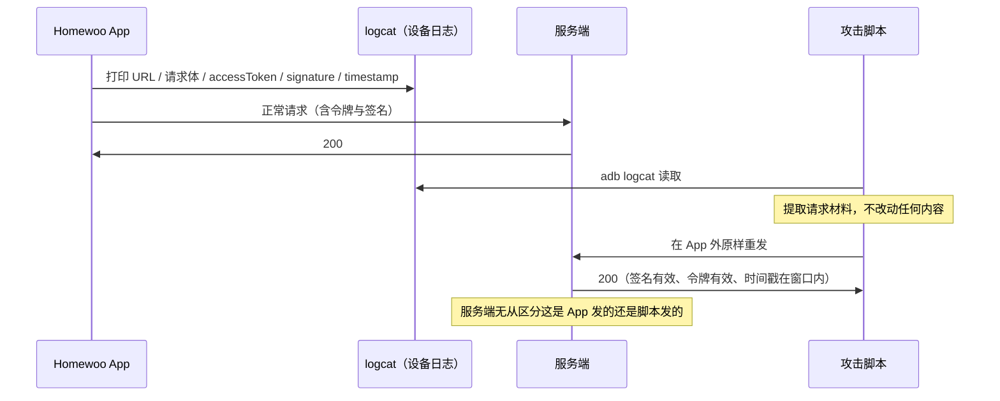

关键的一步在最后：**服务端看不到任何异常**。因为这份请求本来就是 App 用合法材料生成的，每一个字段都是真的。

**实测结果：**

| 动作 | 结果 | 判据 |
| --- | --- | --- |
| 读取 `list` | ✅ 成功 | 返回该账号的事件数量与内容 |
| 新增 `create` | ✅ 成功 | 返回新的 `eventId` |
| 编辑 `update` | ✅ 成功 | 标题/时间发生预期变化 |
| 删除 `delete` | 接口返回成功 | **独立因果关系未证明**——见下 |
| 改请求体 + 旧签名 | **HTTP 401** | 说明签名覆盖了请求体，完整性校验有效 |

**"删除未证明"是什么意思：** 删除操作要成立，需要"操作前对象存在 → 脚本删除 → 操作后对象不存在"这条因果链。如果对象在脚本执行前已经被 App 自己删掉了，那就只能记录"接口返回成功"，**不能记录"脚本删除成功"**。

这条边界看起来琐碎，但它是评估报告可信度的分水岭：**能被复核的结论，必须能指向一条可重放的操作链。**

**最关键的一点**

> **签名能防"篡改请求"，防不住"复制合法请求"。**

而且要注意这两件事可以**同时成立**：

| 测试 | 结果 | 说明了什么 |
| --- | --- | --- |
| 改请求体 + 旧签名 | 401 | 签名机制**是有效的** |
| 原样重放 | 200 | 但**完全没有防重放机制** |

很多团队只做第一个测试，看到 401 就认为"签名机制工作正常，安全"——**这正是本项被长期忽略的原因。**

**为什么两项都极其严重，但严重的方式不同**

| | 日志泄露 | 请求重放 |
| --- | --- | --- |
| 性质 | **根因**：持续产生可复制的材料 | **放大器**：让材料直接变成操作 |
| 单独存在时 | 攻击者拿到令牌，还要自己想办法用 | 没有可复制材料就无从重放 |
| 修复难度 | 低（改代码 + 构建配置） | 中（需要服务端协议配合） |
| 修复后 | 停止产生新材料 | 让历史泄露的材料也失效 |

**只做一件都不够**：只关日志，历史已经泄露的令牌仍然可重放；只做防重放，日志还在持续泄露新材料。**两件都要做**（见 8.2）。

**边界：三项尚未验证**

- 普通**未 Root** 设备上，第三方 App 能否读到这些日志——本项验证在 Root 设备上完成，Root 扩大了可读取范围；
- **跨账号**对象访问——需要他人账号，超出授权范围；
- 用包内密钥**自行构造签名**——见 7.2，这是当前价值最高的待验证项。

### 7.2 全局共享对称密钥

**现象**

发布包内实际存在 **4 个**符合格式要求的 32 位密钥常量，且 Android 包与 iOS 包中**逐字节一致**。

**证据链**

包内先有这两条错误提示串，它们把格式要求写得非常明确：

```text
XHOME_SECRET_KEY must be 32 ASCII characters for XHome AES-256.
Missing XHOME_SECRET_KEY. Provide it with --dart-define or a local env file.
Missing XHOME_CLIENT_ID. Provide it with --dart-define or a local env file.
```

按"长度恰为 32 的字母数字连续段"筛查 `libapp.so`，**去重后共 123 个候选**，其中：

| 类别 | 数量 | 说明 |
| --- | --- | --- |
| 驼峰式 Dart 标识符 | **112** | 如 `CalendarGoogleOAuthAttemptStatus`、`MqttPublishReleaseVariableHeader` |
| 纯十六进制串 | **7** | 掩码常量与摘要值，如 `3fffffff7fffffff…` |
| **无字典语义的随机串** | **4** | 四条独立证据指向它们就是那 4 把密钥 |

> **口径要写清楚**：候选数是**扫描口径的函数**。这里用的是"字母数字连续段、长度恰为 32、去重"。换一个口径会得到完全不同的数字。

**这不是一句空话，下面就是实测到的差异：**

| 扫描口径 | `libapp.so` 报出的候选数 | 差异原因 |
| --- | --- | --- |
| **极大连续段**（前后加"非字母数字"断言） | **123** | 只有**长度恰为 32** 的段才算候选；更长的段（如 64 字符）**一个都不算** |
| **任意定长切片**（只用 `[A-Za-z0-9]{32}`，再 `set()` 去重） | **877** | 长度 ≥32 的段都会被**不重叠**地切成若干 32 字符片段，切完共 **1213** 个，去重后剩 **877** |

**同一份文件，两套写法差 7 倍。** 所以评估结论不能只写一个数字，必须连口径一起写——否则复核者拿到的数字对不上，会先怀疑结论，而不是先怀疑口径。

**四条相互独立的证据：**

| 证据 | 内容 |
| --- | --- |
| **格式精确吻合** | 错误串明确要求"恰好 32 位 ASCII"，这 4 个串长度均恰为 32 |
| **统计排他性** | 其余 119 个候选中，112 个是可读的 Dart 命名、7 个是十六进制常量——只有这 4 个不符合任何已知形态 |
| **仅存在于业务代码** | 在 `libflutter.so`、`classes.dex` 及其他 `.so` 中命中次数**均为 0** |
| **跨平台一致且数量吻合** | Android 与 iOS 包中逐字节相同；共 4 个，与包内 4 套环境数量一致 |

**为什么"4 个"这个数字本身也是证据**

包内有 **4 套环境**（生产 / 开发 / 测试 / 预发，见 7.5）。密钥数量与环境数量吻合，指向一个具体的工程做法：**每个环境一把 `XHOME_SECRET_KEY`，通过 `--dart-define` 在构建时注入。**

这个做法有两个后果：

1. **它是"每环境一把"，不是"每设备一把"**——同一环境的所有安装包共用同一个值；
2. **`--dart-define` 注入的值会进入客户端产物**——它不是密钥管理机制，只是一个编译期常量传递方式。

**用途推断（有证据支撑，但不是反编译实证）**

包内同时存在 `XHomeCrypto`、`xhome_crypto.dart`、`_requestBodyForSignature`、`AES-256`、HMAC 相关符号，说明这把密钥**很可能用于请求体签名，而不只是本地缓存加密**。

这一点由攻击链 01 从行为侧补足：**客户端会生成服务端认可的 `signature`，因此客户端必然持有签名密钥。**

**诚实标注方法边界：** 本包业务逻辑位于 Dart AOT 快照，且该二进制已剥离符号表（无 DWARF、无 `.symtab`），所用工具的版本又不支持本包的快照格式——因此"**哪一个**密钥绑定到**哪一个**调用点"属于推断。

> 但"**密钥随包发布**"这一事实由上述四条独立证据支撑，**结论成立，建议直接按已泄露处置**，不要等运行时验证。

**危害推演与边界**

若服务端凭该密钥认可请求，则**持有安装包的任何人都具备伪造能力**，且：

> **换密码、换账号、登出都无法缓解**——因为泄露的不是用户凭证，是**客户端共享秘密**。

**边界：** 尚不能证明服务端仅凭它授权。若服务端仍严格校验独立会话与对象权限，仅持有密钥不足以直接改动他人数据。

**当前价值最高的待验证项**

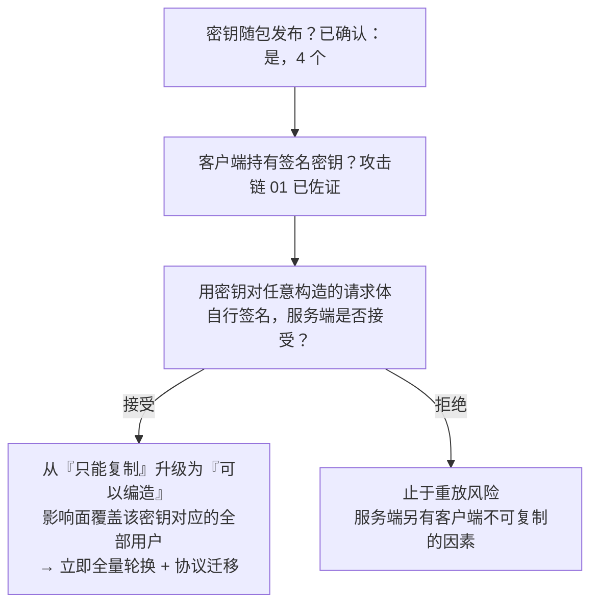

这条分岔决定了本项的**性质**：它目前是"重放风险"，还是"任意请求伪造"。


### 7.3 客户端完整性缺失

**现象**

包内未见完整性校验、字符串加密或自检逻辑。

**签名方案的实际覆盖情况**（这一项很容易被忽略）：

| 方案 | 状态 | 后果 |
| --- | --- | --- |
| v1 | 未启用 | — |
| **v2** | **有效** | 覆盖 Android 7.0（API 24）及以上，与 min SDK 24 刚好吻合 |
| v3 / v3.1 | 未启用 | **不支持签名密钥轮换** |
| v4 | 未启用 | — |

签名者证书为**自签名**，有效期 **2026-07-13 至 2053-11-28**（27 年）。

**为什么"缺 v3 + 27 年有效期"是一个组合问题：** v3 才引入 proof-of-rotation（密钥轮换）。两件事叠加意味着——**一旦签名私钥泄露，既不能靠轮换迁移，也不能靠证书过期自然止损**，只能换包名或要求全体用户重装。

这个说法可以到 AOSP 源码里核对。**v3 引入的轮换证明，落在一个叫 `PROOF_OF_ROTATION_ATTR_ID` 的签名块属性上**——这个属性 ID（`0x3ba06f8c`）以及解析它的那套 `ProofOfRotation` 结构，在 v2 的验证器里一次都不出现：

```java
// ApkSignatureSchemeV3Verifier.java (AOSP frameworks/base, android12-release, 第 384-427 行)
// 源码链接：
// https://github.com/aosp-mirror/platform_frameworks_base/blob/c53e71dc397de7486c9a8899f71598c3c3a18d44/core/java/android/util/apk/ApkSignatureSchemeV3Verifier.java#L384-L427

    private static final int PROOF_OF_ROTATION_ATTR_ID = 0x3ba06f8c;

    // 校验签名块里的附加属性。
    // 注意：v2 的验证器里也有一个**同名**方法，但那个只处理
    // STRIPPING_PROTECTION_ATTR_ID（用于发现 v3 签名被剥离）；
    // 轮换记录（Proof-of-rotation）这套属性与解析结构是 v3 才引入的，
    // 在 v2 里一次都不出现——连同下面的方法签名也不同：
    // v2 是 (ByteBuffer) → void，这里是三参数 → Pair。
    private static Pair<X509Certificate[], ApkSigningBlockUtils.VerifiedProofOfRotation>
            verifyAdditionalAttributes(ByteBuffer attrs, List<X509Certificate> certs,
                CertificateFactory certFactory) throws IOException {
        X509Certificate[] certChain = certs.toArray(new X509Certificate[certs.size()]);
        ApkSigningBlockUtils.VerifiedProofOfRotation por = null;

        // 遍历附加属性区，逐个取出属性。
        while (attrs.hasRemaining()) {
            ByteBuffer attr = getLengthPrefixedSlice(attrs);
            if (attr.remaining() < 4) {
                throw new IOException("Remaining buffer too short to contain additional attribute "
                        + "ID. Remaining: " + attr.remaining());
            }
            // 读出属性 ID，用它决定走哪个分支。
            int id = attr.getInt();
            switch (id) {
                // 只处理「轮换记录」这一种属性。
                case PROOF_OF_ROTATION_ATTR_ID:
                    // 同一个签名块里出现两条轮换记录 → 直接判为无效。
                    if (por != null) {
                        throw new SecurityException("Encountered multiple Proof-of-rotation records"
                                + " when verifying APK Signature Scheme v3 signature");
                    }
                    // 解析轮换记录结构。
                    por = verifyProofOfRotationStruct(attr, certFactory);
                    // make sure that the last certificate in the Proof-of-rotation record matches
                    // the one used to sign this APK.
                    // 关键校验：轮换记录里的**最后一个证书**，
                    // 必须与本次签名的证书一致。
                    try {
                        if (por.certs.size() > 0
                                && !Arrays.equals(por.certs.get(por.certs.size() - 1).getEncoded(),
                                certChain[0].getEncoded())) {
                            throw new SecurityException("Terminal certificate in Proof-of-rotation"
                                    + " record does not match APK signing certificate");
                        }
                    // 证书取编码失败时，同样按「签名无效」处理，不放过。
                    } catch (CertificateEncodingException e) {
                        throw new SecurityException("Failed to encode certificate when comparing"
                                + " Proof-of-rotation record and signing certificate", e);
                    }

                    break;
                // 其它属性不是这里要找的，跳过。
                default:
                    // not the droid we're looking for, move along, move along.
                    break;
            }
        }
        // 返回证书链与轮换记录。
        return Pair.create(certChain, por);
    }
```

**怎么用这个源码判断"是不是 v3"：** 在 AOSP 里对比两个验证器即可——`ApkSignatureSchemeV2Verifier.java` 中 **0 次**出现 `rotation`；`ApkSignatureSchemeV3Verifier.java` 中 **15 次**出现 `rotation`、**8 次**出现 `ProofOfRotation`。

> **这就是"v3 才有密钥轮换"的源码依据**：轮换是 v3 独有的属性，v2 里根本没有这个概念。本项目只启用了 v2，所以**没有任何轮换能力**。

**攻击链 02：等长地址改写**

接口地址以**明文常量**存在于 AOT 快照中。而且它比"一个域名"长得多——真实常量是**带端口和路径的完整基地址**。下面两条是从原始包里直接读出来的（`lib/arm64-v8a/libapp.so`，字节偏移 `+810936` 与 `+1132891`）：

| 用途 | 包内常量 | 长度 |
| --- | --- | --- |
| 业务接口基地址 | `https://xhome-dev.sdmc.tv:18443/aihome/cloud-api/cloud/v5.0/` | **60 字节** |
| 帮助页地址 | `https://xhome-dev.sdmc.tv:18443/H5-Help_Support.html` | **52 字节** |

**注意这两条的长度不是一个"凑巧的小数字"。** 常被误传的"24 字符"其实是把域名当成了常量——`https://xhome-dev.sdmc.tv` 单独拿出来是 25 字符，`http://192.168.68.84:18443` 是 26 字符，**两者并不等长**。

**那真正被替换的是哪一段？这个问题有确定答案，而且能在包里直接验。** 三组数字把它钉死（都是从原始包与产物里逐字节量出来的）：

| 量什么 | 原始包 | 产物 |
| --- | --- | --- |
| 偏移 `+799009` 那条**独立的裸域名常量** | 存在 | **原样存在，逐字节相同** |
| 带协议端口的前缀 `https://xhome-dev.sdmc.tv:18443`（31 字节） | 2 次 | **0 次** |
| 新前缀 `http://192.168.68.84:18443`（26 字节） | 0 次 | **2 次** |

（第一行数的是**那条独立常量**。如果按**子串**数裸域名，原始包里是 3 次——另外两次嵌在那两条 31 字节前缀里。口径不同数字就不同，所以这里把口径写明。）

三行合起来说明：**替换的单位既不是域名，也不是整条 60 字节基地址，而是那个 31 字节的「协议 + 主机 + 端口」前缀。**

- **不是域名**——裸域名在包里是**另一个独立常量**，改动前后完全一样。所以"把域名换掉"这种说法，连改的是哪一段都没说对。
- **不是整条基地址**——那样就解释不了下面那条帮助页常量为什么也变了：它根本不含完整的接口路径，却和业务基地址**共用同一个 31 字节前缀**。前缀一换，两条一起变。

**这个区别不是抠字眼。** 它正好解释了这次改写里"为什么两条常量都变了、而裸域名没变"——不知道替换单位是前缀，这三件事看起来是互相矛盾的。

**改写必须"原地等长"，不是"随便换个域名"：** Dart AOT 快照内部有大量偏移量引用。如果替换串长度不同，所有后续偏移都会错位，快照直接损坏。所以做法是——**让替换串与原始串字节数完全一致，差额用 `/` 填充**：

```text
原始（60 字节）
https://xhome-dev.sdmc.tv:18443/aihome/cloud-api/cloud/v5.0/
        └─────── 这一段换成下面 ───────┘
替换后（60 字节，落在同一偏移）
http://192.168.68.84:18443//////aihome/cloud-api/cloud/v5.0/
                          └─ 主机名变短留下的 5 字节差额，用斜杠补足
                             （补的 5 个，与原有的 1 个路径分隔斜杠相连，
                               所以看上去是连续 6 个——差额是 5，不是 6）
```

**多出来的斜杠为什么无害：** 目标接口的判断是**路径子串匹配**（Mock 服务里就是一句 `"/calendar/event/list" not in self.path`），`//////aihome/cloud-api/cloud/v5.0/...` 里那段子串原样存在，照常命中。这不是随手选的——填充符必须是"多几个也不影响语义"的字符，否则等长约束根本没法满足。

**等长的实测证据（可以直接复核）：**

| 项 | 原始包 | 重打包包 |
| --- | --- | --- |
| `libapp.so` 总长度 | 14,549,896 字节 | **14,549,896 字节** |
| 偏移 `+810936` | `https://xhome-dev.sdmc.tv:18443/aihome/cloud-api/cloud/v5.0/`（60） | `http://192.168.68.84:18443//////aihome/cloud-api/cloud/v5.0/`（60） |
| 偏移 `+1132891` | `https://xhome-dev.sdmc.tv:18443/H5-Help_Support.html`（52） | `http://192.168.68.84:18443//////H5-Help_Support.html`（52） |

**包总长度一字节不差，两条常量各自等长**——这才是"原地改写"能成立的全部理由。改写脚本本身也把这条约束写死了：**新串比旧串长就直接报错退出**（`new URL is too long`），短的用 `/` 补足。

> **一个容易看漏的细节：斜杠补在哪一段，取决于新旧地址哪一段更短。** 本例里主机名从 17 字符的域名换成了 13 字符的内网 IP，所以差额补在主机名之后。位置随输入而变，**不变的只有总长度**——复核时要盯的是长度，不是斜杠的位置。

**证据来源：** 改写脚本 `02-APK二次打包与返回数据篡改攻击/scripts/patch_libapp_url.py`（第 18-20 行即"长了报错、短了补斜杠"）、产物 `02-APK二次打包与返回数据篡改攻击/artifacts/homewoo-repackaged-local-mock.apk`。长度与偏移可用 `unzip -p <包> lib/arm64-v8a/libapp.so` 后按偏移直接复核。

**关于上表的字节是怎么产生的，有一点必须说清楚**，否则照着脚本去复核会得出"对不上"的结论：

同目录的 `scripts/build_repackaged_homewoo.sh` 第 30-33 行是一个替换调用，但它**并不能生成上表里的字节**——它传入的旧串是**整条 60 字节基地址**，按这个传参，补足的斜杠会落在**尾部**（`...cloud/v5.0//////`），而且那条 52 字节的帮助页常量不含整条基地址，**根本不会被替换**。上表里两条常量的斜杠却都在**主机名之后**、两条都被替换了。

与产物逐字节相符的是另一个变换：把 **31 字节的主机前缀** `https://xhome-dev.sdmc.tv:18443` 换成 `http://192.168.68.84:18443` **再加 5 个斜杠**，作用于全文所有出现处。按这个变换从原始包模拟，所得 `libapp.so` 与产物**逐字节相同**（`14,549,896` 字节全等）。产物的生成时间（16:43）也早于这两个脚本（20:00 / 22:21）。

**这两条结论都指向同一件事：等长改写里"补在哪一段"不是细节，它决定了产物长什么样。** 上表的字节以产物为准，可直接复核；脚本是事后整理的，与产物不是同一次运行的记录。

**完整链路：**


**实测结果：** 重打包、对齐、签名、安装**全部成功**；登录与业务请求经 Mock 转发；`/calendar/event/list` 返回伪造事件，页面显示出攻击者设定的标记。

篡改包使用的证书（`CN=Authorized Homewoo UI Test, O=Security Lab`）与官方证书（`CN=homewoo, OU=SDMC`）**完全不同**，但 App 内**没有任何机制察觉**。

**攻击链 03：覆盖内容层**

**这一条的技术要点在于"覆盖"而不是"跳转"。** 早期版本尝试启动一个新的 `CustomHomeActivity`，结果是：原 Flutter 首页已经绘制完成，用户会看到"原首页 → 自定义首页"的闪烁，而且 `MainActivity` 仍在任务栈中，可能重新回到前台。

最终可行的做法是：

1. 用 `apktool` 解包，向 Manifest 加入测试 Activity 与主题；
2. 编译注入的 Java 代码并入 `classes2.dex`；
3. **改写 `MainActivity.smali` 的 `m()` 方法**，在 Flutter 页面初始化阶段启动状态观察器；
4. 观察 `FlutterSecureStorage` 的条目数量，作为"已完成登录"的判据；
5. 登录态出现后，往当前 `MainActivity` 的 `android.R.id.content` 内容层**加入一个全屏 View**，直接盖住 Flutter 页面。

**结果：** 登录后完整覆盖原首页；**强制停止并重启后仍保持覆盖**（因为判据是"当前登录态存在"，不是一次性标记）；可引导用户点击外跳。

**一个必须指出的交点**

> **攻击链 03 注入的 `m()` 方法，正是 7.4 中识别出的外部路由读取点。**

同一个方法，既是 App 自己的路由入口，也是攻击者的注入点。这说明它处在一个**既接收不可信外部输入、又决定应用主流程**的位置——这类位置在所有 App 里都应当被单独审视。

**最严重的后果**

> 可完全控制登录后用户所见的一切内容——伪造首页、公告、收款页面，引导用户输入密码与验证码。

**与第 1 章呼应：** 车机事件里攻击者能控制车机屏幕；这里是攻击者能控制 App 首页。**本质是同一件事。**

**边界**

需要用户**实际安装**仿冒包（侧载或第三方渠道），不是远程改写已安装的官方签名 App。并且本次复现复用设备上已有的登录态，未重新走一遍新登录流程。

### 7.4 外部路由与 OAuth 回调

**现象**

包内证据：

- Manifest 将 `com.sdmc.homewoo.MainActivity` 设为 `android:exported="true"`；
- 其 `VIEW` 过滤器接受 `homewoo://calendar/google/complete…`；
- `MainActivity.smali` 的初始路由函数**直接读取 Intent 中名为 `route` 的字符串**并作为 Flutter 初始路由返回；
- `onNewIntent` 将匹配的回调 URI 字符串送入 `oauthCallback` 通道；
- 包内另有 OAuth `nonce`、回调恢复相关符号，**说明可能已经有进一步校验，但不能据此确认校验完整**。

**攻击链 04：入口可达性实测**

这一步验证的是**链路的第一段**：外部 Intent 能否把构造的回调交给原始 APK 的 `MainActivity`。

做法是先用只读方式从 APK 提取深链配置，再通过 ADB 发送带**明显无效**测试标记的回调：

```text
homewoo://calendar/google/complete?code=lab-invalid-code&state=lab-invalid-state
```

两个参数值都是固定的实验标记，不使用真实授权码。发送期间临时阻断目标 App UID 的出站流量，结束后恢复，以保证不会发生真实兑换。

**实测证据**（`evidence/forged-invalid-20261013-031435.json`）：

| 字段 | 值 |
| --- | --- |
| `adb_exit_code` | `0` |
| `am_start_status` | `ok` |
| `uri_parameters_in_am_output` | `true` |
| `activity` | `com.sdmc.homewoo/.MainActivity` |
| `callback_delivered` | **`true`** |
| `oauth_bypass_proven` | **`false`** |
| `business_binding_verified` | `false` |

**为什么"入口到达"和"OAuth 被绕过"必须分开说**

这两层经常被混为一谈，但它们是完全不同的结论：

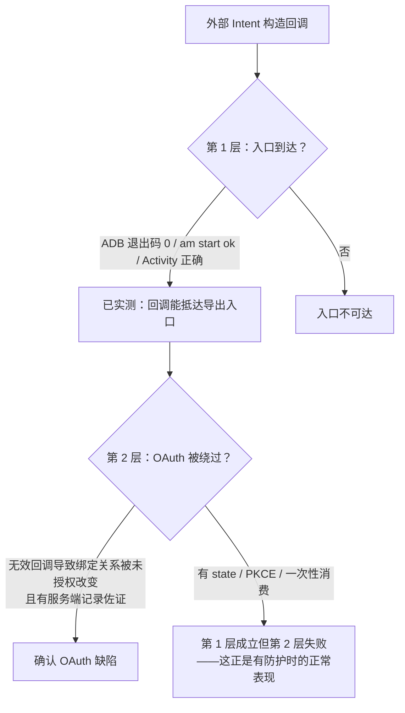

**关键判断：**

> **有防护时，第 1 层仍然会成立，而第 2 层必须失败。**

也就是说，"回调能到达 App"**既不是漏洞，也不是安全的证据**——它只是一个前置条件。`am start` 证明的是 Android 把 Intent 交给了 Activity，**不证明 Flutter/Dart 层最终采纳了参数**，更不证明授权码被兑换。

**本次结论：入口已实测可达；利用未证实。** 不能据此说"OAuth 伪造成功"，也不能据此说"一定安全"。

**同样重要的：脚本自己的失败记录**

本次实验早期有两条记录（`031317`、`031336`）是**无效历史记录**——URI 中的 `&` 被远端 shell 解释，ADB 退出码为 `127`。脚本修正引号处理、并把 `adb_exit_code=0` 与完整参数出现设为硬性前置条件后，才重新生成了有效记录。

把无效记录**留在证据目录里并注明原因**，而不是删掉——这是评估报告能被信任的前提。

**潜在危害（条件性）**

若后续证实 App 接受了伪造回调，且 `state`、PKCE、一次性消费或账号绑定检查失效，可能造成：

- 日历账号**串绑**（攻击者的日历被冒充为受害者的授权结果）；
- 错误同步；
- 在受害者可见的日历中写入推广、假客服或钓鱼链接事件。

**边界**

- 没有使用有效 Google 授权码，没有执行真实 OAuth 兑换或跨账号绑定测试；
- 应用直接出站流量被临时阻断，**因此无法验证服务端行为**；
- 目标 App UID 的阻断不覆盖系统服务代表 App 发出的全部流量，不能声称整机网络完全隔离。

### 7.5 非生产环境与切换入口

**现象**

包内同时存在**四套**接口地址：

| 环境 | 地址 | 备注 |
| --- | --- | --- |
| 生产 | `https://cloud-api.sdmc.tv/cloud/v5.0/` | 标准 443 |
| 开发 | `https://xhome-dev.sdmc.tv:18443/aihome/cloud-api/cloud/v5.0/` | **非标准端口** |
| 测试 | `https://xhome-test.sdmc.tv:18443/cloud-api/cloud/v5.0/` | 非标准端口 |
| 预发 | `https://xhome-uat.sdmc.tv:18443/XHome-dev/cloud/v5.0/` | 非标准端口 |

**关键证据：它不是残留字符串，是有意实现的功能**

包内存在一整套**互相咬合**的符号：

```text
界面层：Switch environment / auth-environment-sheet / auth-environment-trigger
        auth-environment-option- / auth-environment-check-
        _AuthEnvironmentSheet / _AuthEnvironmentSheetState
控制层：AuthEnvironmentController / authEnvironmentOptionsProvider
        authEnvironmentRestartProvider / _restartForEnvironment
持久层：homewoo_xhome_environment / _persistNativeEnvironment
解锁层：_handleEnvironmentUnlockTap / _showEnvironmentSheet
```

**为什么这组符号足以定性：**

- `_handleEnvironmentUnlockTap` 这个命名直指"**连续点击触发解锁**"式隐藏入口；
- 有界面组件、有控制器、有持久化键、有重启逻辑——这是**一条完整的功能链路**，残留字符串不可能长成这样。

**判断结论：**

> **这是开发者主动实现、专门加了隐藏手势、在发布配置中已完成接线的功能**，不应被当成"误打进包的测试代码"轻轻放过。

**危害与边界**

**危害：** 若正式用户的请求可被导向非生产环境，且该环境隔离不足，则真实凭证可能流入防护较弱的系统。

**边界：** 解锁手势的具体触发位置与次数、以及切换后生产凭证是否真的被发往非生产端——**均未验证**。

**一个必须分开的两个问题：**

| 问题 | 性质 |
| --- | --- |
| 生产包里有没有这个入口 | **事实**（已确认） |
| 切换后请求会不会真的打到非生产端 | **危害**（未验证） |

### 7.6 内置模拟数据通路

**现象**

这不是零散的测试字符串，而是**一条完整的、可运行的代码通路**。

**日历模块的模拟链路：**

| 组件 | 作用 |
| --- | --- |
| `CalendarMockHttpClient`（`mock_calendar_http_client.dart`） | 模拟 HTTP 客户端，可替换真实 API 客户端 |
| `CalendarMockHttpRequest` | 模拟请求对象 |
| `MockCalendarRepository` | 客户端本地伪造的数据仓库 |
| `MockCalendarProtocolIdCodec` | 模拟协议编解码器 |
| `CalendarMockController` | 启用控制 |
| `SecureCalendarMockPreferenceStore` | 开关的持久化存储 |
| `mockCalendarServiceProvider` / `mockCalendarRepositoryProvider` | **服务层与仓库层的替换点** |

**开关是持久化的：** 共享偏好键 `wall_planner_calendar_mock_enabled` 已打进发布包，说明启用状态会写入本地并**跨启动保留**——这不是一次性的调试分支，而是可被持久改变运行模式的状态位。

**错误处理串证明它是真代码：** `Unknown Calendar Mock endpoint:`、`Calendar Mock OAuth attempt was not found.`、`Calendar Mock body must be an object.`——有接口路由、有校验逻辑。

**影响面不止日历**

包内另有一套**跨 5 个模块的假数据层**：

| 模块 | 假实现 |
| --- | --- |
| `core/data/` | `FakeAppDatabase`（含 `.seeded`） |
| `features/calendar/` | `FakeCalendarRepository` |
| `features/family/` | `FakeFamilyRepository`、`FakeFamilyInviteRepository` |
| `features/devices/` | `FakeDeviceRepository`、`FakePocketRepository` |
| `features/photos/` | `FakePhotoRepository` |

这意味着"伪造的日历、家庭、设备信息"**在符号层面已有现成实现**，不是需要额外开发的假设场景。

**调试组件同样进入发布包**

`classes.dex` 的 `GeneratedPluginRegistrant` 中存在 `flutter_debug_kit` 插件的注册块，其混淆后的类 `Lq4/a` 实现 Flutter 插件接口并注册方法通道 `dev.flutter_debug_kit/system_proxy`。

> **注意一个容易漏的点：** 该插件类名已被 R8 混淆为 `Lq4/a`，**用原始类名搜索类型描述符会落空**——只有注册处的错误消息字符串保留了原名 `dev.flutterdebugkit.flutter_debug_kit.FlutterDebugKitPlugin`。

同名框架在 iOS 包中也存在（见 7.10）。**这一条也是"只扫内容会漏"的实例**：如果只按方法通道名搜索，还会漏掉插件注册本身。

**与攻击链 03 的关系**

| | 来源 | 服务端能否感知 |
| --- | --- | --- |
| 攻击链 03 | **攻击者改包**注入伪造首页 | 不能 |
| 本项 | **客户端自带**的模拟通路 | 不能 |

**殊途同归。** 区别在于：本项可能在**无需改包**的前提下达到类似效果，因此同样值得核查；反过来说，7.3 的服务端完整性方案也能同时收敛这两项。

**与环境切换的关键区别**

> 环境切换指向的是**另一台真实服务端**（仍有服务端校验兜底）；
> 模拟通路是在**客户端本地**生成"成功"响应，可完全不经过服务端。

**服务端对此无感知、无日志、无法审计**——这是本项区别于其他各项的主要风险特征。

**边界**

以上均为**静态符号证据**。本次未运行 App，因此**不能证明该开关对用户可达**。可达性需要按"开关能否被诱导开启 → 启用后是否绕过服务端"两步验证。

### 7.7 备份与设备迁移规则

**现象**

Manifest 未显式配置备份与迁移排除规则。核对结果是三项全为否：

```text
Manifest 显式设置 allowBackup: False
Manifest 显式设置 fullBackupContent: False
Manifest 显式设置 dataExtractionRules: False
```

**先把定性说清楚：这是默认行为，不是配置错误**

`android:allowBackup` 的默认值是 `true`——**大多数 App 都是这个状态**。把"默认没配"直接写成"配置错误"，是评估里常见的高估。

这个默认值可以直接到 AOSP 源码里核对（两条独立证据，分别来自新旧两套解析器）：

```java
// PackageParser.java (AOSP frameworks/base, android12-release, 第 3385-3386 行)
// 源码链接：
// https://github.com/aosp-mirror/platform_frameworks_base/blob/c53e71dc397de7486c9a8899f71598c3c3a18d44/core/java/android/content/pm/PackageParser.java#L3385-L3386

        // 注意第二个参数：没有显式配置时，取到的默认值就是 true。
        // 也就是说「不写 allowBackup」等于「允许备份」。
        boolean allowBackup = sa.getBoolean(
                com.android.internal.R.styleable.AndroidManifestApplication_allowBackup, true);
```

```java
// ParsingPackageUtils.java (AOSP frameworks/base, android14-release, 第 2223-2225 行)
// 源码链接：
// https://github.com/aosp-mirror/platform_frameworks_base/blob/6e47c7075b91983ae501114425ea25e6df7690c8/services/core/java/com/android/server/pm/pkg/parsing/ParsingPackageUtils.java#L2223-L2225

        // AOSP 自己在注释里写明了默认值：Default true。
        // 与 android12 那段 PackageParser 逻辑一致，只是换了个写法——
        // 两处对照着看，能确认「默认允许备份」不是某一版的偶然。
        pkg
                // Default true
                .setBackupAllowed(bool(true, R.styleable.AndroidManifestApplication_allowBackup, sa))
```

**结论：`true` 是平台定的，不是本项目配错的。** 这一点决定了它在报告里的位置——**是"待确认项"，不是"配置错误"。**

**真正要问的两个问题**

| 问题 | 为什么重要 |
| --- | --- |
| **备份里到底有什么？** | 取决于令牌、密钥、家庭/日历缓存实际落在哪个目录 |
| **恢复后旧会话能否继续用？** | 这才是"备份是否等于泄露"的判据 |

**为什么通常风险有限：** 若安全存储用的是平台密钥库保护的密文，密文被迁移到新设备而密钥未迁移，**换设备解不开**。

**但有一个反向的坑：** 如果密文可备份而密钥不可迁移，用户换机后可能遇到"数据还在但永远解不开"的异常状态——这**不是安全问题，是可用性问题**，但同样需要显式设计。

**边界**

实际进入备份的数据、恢复行为、会话能否跨设备复用——**均未验证**。

### 7.8 第三方 Key 与云资源授权

**现象**

包内可见 Maps Key、Firebase 项目配置与存储桶名称。

**先澄清一个常见误读**

> 客户端 Key 本来就可从包内读取，**这是设计如此**。**存在 Key 不等于 Key 可被滥用。**

这一条如果读错方向，会导致两种浪费：把常规做法当成高危漏洞报上去，或者反过来——因为"反正都会泄露"而完全不做限制。

**真正要查的两个问题**

1. **云端是否配置了应用/API 限制？**（限制调用来源与可调用的 API 集合）
2. **Firebase 各资源的访问规则是否过宽？**（数据授权靠 Security Rules，不靠 Key 保密）

**与 7.2 的对比**

| | 7.8 第三方 Key | 7.2 共享对称密钥 |
| --- | --- | --- |
| 用途 | 标识项目/应用 | 参与请求签名 |
| 设计上是否公开 | **是** | **否** |
| 泄露后能做什么 | 盗刷配额、产生费用 | 可能伪造请求 |
| 修复方式 | 云端限制 + 访问规则 | 轮换 + 架构迁移 |

**性质完全不同，不应并列处理。**

**边界**

云端限制与访问规则的实际配置**未核查**——这需要云平台管理权限。

### 7.9 传输安全与权限声明

**传输**

未见网络安全配置与证书绑定，但业务地址使用加密传输。

> **没有证书绑定不等于可以被解密。** 系统 TLS 校验仍在工作；缺少绑定只意味着"攻击者若能控制网络路径并让设备信任一张伪造证书，就抓得到明文"。

**顺便把一个容易误判的点说清楚："没有 `networkSecurityConfig`"不等于"允许明文"。**

明文流量是否放行，取决于 `targetSdkVersion`。AOSP 的判定逻辑是这样的：

```java
// PackageParser.java (AOSP frameworks/base, android12-release, 第 3526-3530 行)
// 源码链接：
// https://github.com/aosp-mirror/platform_frameworks_base/blob/c53e71dc397de7486c9a8899f71598c3c3a18d44/core/java/android/content/pm/PackageParser.java#L3526-L3530

        // 没有显式配置 usesCleartextTraffic 时，默认值由 targetSdkVersion 决定：
        // 小于 28（P）→ 允许明文；大于等于 28 → 禁止明文。
        if (sa.getBoolean(
                com.android.internal.R.styleable.AndroidManifestApplication_usesCleartextTraffic,
                owner.applicationInfo.targetSdkVersion < Build.VERSION_CODES.P)) {
            ai.flags |= ApplicationInfo.FLAG_USES_CLEARTEXT_TRAFFIC;
        }
```

**本项目 `targetSdk = 36`（≥ 28），所以默认禁止明文。** 这是一项**实际生效的防护**，不能因为"没配 networkSecurityConfig"就记成缺失。

> **注意一个坑：** AOSP 里 `usesCleartextTraffic` 这个**属性的文档注释**写的是 "Defaults to true"，这与上面代码的实际行为不符（它只对 `targetSdk < 28` 成立）。**这份属性文档是过时的，不要拿它当依据——要读就读判定代码。**

**一个容易误判的细节：** 包内出现 `registerBadCertificateCallback` / `SecureSocket_RegisterBadCertificateCallback`——这两个是 Dart `dart:io` 的**标准 API 符号**，**它们的出现不构成"已实现证书绑定"的证据**。若按字符串扫描下结论，会得出完全相反的判断。

**签名方案：** 仅 v2 有效、缺少 v3 → 不支持密钥轮换；证书自签名且有效期长达 27 年（见 7.3）。

**权限**

已声明的权限：

```text
INTERNET / ACCESS_NETWORK_STATE / CAMERA / RECORD_AUDIO / POST_NOTIFICATIONS
WRITE_EXTERNAL_STORAGE（限定至 API 28）/ READ_EXTERNAL_STORAGE
WAKE_LOCK / BILLING / USE_BIOMETRIC / USE_FINGERPRINT / C2DM_RECEIVE
com.sdmc.homewoo.DYNAMIC_RECEIVER_NOT_EXPORTED_PERMISSION
```

上面是 13 项。最后一项不是业务声明的权限，是 AGP 在 `targetSdkVersion >= 33` 时
自动注入的（本包 targetSdk = 36）：它用**应用自己的包名前缀**定义了一个
`protectionLevel="signature"` 的自定义权限，供 AndroidX 注册**不导出**的动态广播接收器时用。
**列出来是为了清单完整，它本身没有被滥用的可能**——不要因为它"看起来不像系统的权限"就报警。

**不能简单判定为多余**——扫码、语音、支付都是真实功能。需要按实际支持版本复核的是 `READ_EXTERNAL_STORAGE` 与 `WRITE_EXTERNAL_STORAGE`。

**归纳**

> 这两项更接近"**加固建议**"，而非已发现的漏洞。

把它们和"已确认缺陷"并列，会让读者要么过度紧张，要么因为整体被稀释而轻视真正严重的那几项。

### 7.10 Android 与 iOS 的问题差异

**共通的问题**

密钥、日志、环境配置、Mock 通路——**说明根因在构建配置，不在平台。**

**iOS 特有**

| 项 | 说明 |
| --- | --- |
| ATS 全局放宽 | `NSAllowsArbitraryLoads=true`，影响**所有**未单独配置的域 |
| 调试与集成测试框架进包 | `flutter_debug_kit.framework`、`integration_test.framework` |
| 模拟 OAuth 字面量 | `mock-oauth-attempt-`、`mock-google-oauth-`、`mockAttempt=` |
| 自定义 URL Scheme | `homewoo:` 与 Google 登录回调 Scheme 均可被外部触发 |

**Android 特有**

| 项 | 说明 |
| --- | --- |
| 导出组件 | `MainActivity` 导出并接受 `route` 参数与 OAuth 回调 |
| 备份规则 | 三项备份配置均未显式声明 |
| 签名方案 | 仅 v2 有效，不支持密钥轮换；证书自签名、27 年有效期 |

**结论**

> **共通的那些问题，修一处就能同时收敛两个平台。**

这也是为什么"把修复做在构建配置层"比"逐平台打补丁"更划算——**四个共通问题的根因在同一个地方。**

### 7.11 证据强度总表

把 7.1—7.10 的结论收敛成一张表，避免"九个高危"式的误读：

| 顺序 | 问题 | 影响级别 | 证据强度 | 验证进度 |
| --- | --- | --- | --- | --- |
| 1 | 接口日志泄露与请求重放 | **高，已确认** | 包内有记录完整请求的代码 | **攻击链 01 已验证**：读/增/改重放成功 |
| 2 | 导出 Activity 与 OAuth 回调 | 高 | 外部可直接调起 | **攻击链 04：入口已实测可达；利用未证实** |
| 3 | 非生产环境与切换线索 | 高 | 四套地址齐全，切换器已接线 | 触发方式待验证 |
| 4 | 全局共享对称密钥 | **高，已确认** | 4 个 32 位密钥常量已定位 | 密钥已坐实；服务端是否凭其授权待验证 |
| 5 | 模拟数据通路与调试组件 | 中，条件性 | 跨越 5 模块的假数据层 | 可达性待验证 |
| 6 | 备份与设备迁移规则 | 中，待确认 | 三项备份配置均未声明 | 实际备份内容待验证 |
| 7 | 第三方 Key 与云资源授权 | 中，待确认 | 客户端 Key 在包内（常规做法） | 云端限制待核查 |
| 8 | 客户端完整性缺失 | **高，已确认** | 无任何完整性校验 | **攻击链 02/03 已验证** |
| 9 | 传输安全与权限声明 | 低 | 已用加密传输；权限对应真实功能 | 属加固建议 |

**按性质分四类：**

| 性质 | 项 | 含义 |
| --- | --- | --- |
| **已确认缺陷** | 1、4、8 | 证据闭合，需立即处置 |
| **真实攻击面** | 2、3、5 | 入口存在，危害待验证 |
| **待核查项** | 6、7 | 尚不知是否有问题 |
| **加固建议** | 9 | 不是漏洞，是纵深防御 |

**本项目未发现问题的那几类：** 3.8（WebView 与 JS 桥）、3.9（界面劫持）、3.14（业务逻辑与越权）、3.15（输入校验与注入）。

> **注意：** "未发现问题"不等于"没有问题"。本次静态评估未覆盖这些方向（例如接口的对象权限校验需要服务端配合测试），**不应据此认为它们是安全的。**

## 8. 解决方案：从"能演示"到"能上线"

第 7 章说明了几件事为什么会被攻破。本章给出的每一条方案都要求**可落地、可验证、可回归**——不是"建议加强安全意识"，而是"改哪一行、怎么判断改好了"。

**本章的写法约定：**

| 约定 | 含义 |
| --- | --- |
| 每条含 **完成判据** | 怎么证明改好了（可执行的检查，不是主观感受） |
| 每条含 **边界** | 这条方案防不住什么——避免"加了这个就安全了"的误读 |
| 代码可直接运行 | **自包含**示例标注依赖与运行方式（Python 只用标准库）；**依赖宿主工程、不能单独编译**的块按「片段」二字或首行工程路径头声明归属（只缺 SDK 依赖的自洽块不在此列） |

### 8.1 修复优先级：先切因果链，再补纵深

第 7 章的证据链指向一个清晰的优先级，而不是"九个问题一起修"：

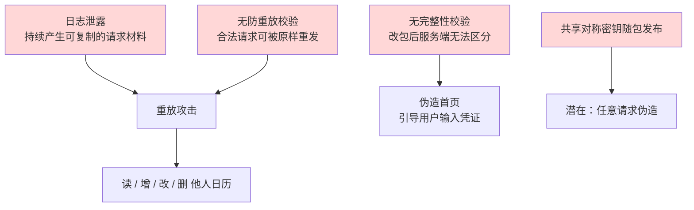

**注意图中的结构：A 与 B 是"与"关系，不是"或"。**

只关日志，历史已泄露的令牌仍可重放；只做防重放，日志还在持续产生新材料。**两者必须同时修**，只修一个都留着一个完整的攻击链。

**按"切断因果链的效率"排序：**

| 优先 | 动作 | 切断哪条链 | 为什么排这个位置 |
| --- | --- | --- | --- |
| **P0** | 服务端接入防重放 | 日志泄露 → 重放 | **唯一能同时让"已泄露材料"失效的措施**，且不依赖发版 |
| **P0** | 客户端日志改为白名单 | 日志泄露源头 | 与上一条配合才闭环；纯客户端改动，发版即可 |
| **P0** | 共享密钥全量轮换 + 迁移 | 密钥 → 伪造 | 密钥**已经按泄露处置**，轮换是止血 |
| **P1** | 服务端接入完整性校验 | 改包 → 伪造首页 | 同时收敛攻击链 02/03 与内置模拟通路 |
| **P1** | CI 发布门槛 | 以上各项的**回归** | 不加这道闸，修好的问题会随下一次构建回来 |
| **P2** | OAuth 一次性事务 | 回调伪造 | 利用尚未证实，但成本低、价值高 |
| **P2** | 构建变体隔离 + 环境切换下线 | 环境切换 / Mock 通路 | 属于"关掉不该存在的入口" |
| **P3** | 备份规则、网络配置、权限 | 纵深防御 | 属加固，不是已确认缺陷 |

**为什么 P0 里"轮换密钥"排在"改日志"前面？**

因为**时间维度不同**：改日志只影响**未来**产生的日志；而密钥一旦确认泄露，**过去所有已泄露的材料都还有效**。密钥轮换是唯一能对"已经流出去的东西"生效的措施。

**一个必须提前说清的取舍：** P0 的三条里有两条在服务端。**纯客户端加固无法解决这个项目的核心问题**——这一点必须在上报时讲清楚，否则容易被理解成"客户端团队加个班就好了"。


### 8.2 客户端日志：从黑名单改成白名单

**先破一个流行的错误修法**

看到日志泄露，最常见的反应是"把 `print` 换成 `debugPrint`"或"用 `assert` 包起来"。

**在 dio 这个场景下，这个修法恰好是反的。** 因为 dio 的 `LogInterceptor` **默认打印器本身就已经被 `assert` 包住了**——换句话说，dio 的默认拦截器**在 release 包里本来就不会打印任何东西**。

看 dio 的源码就能确认这一点：

```dart
// log.dart (cfug/dio, dio_v5.11.1, 第 180-185 行)
// 源码链接：
// https://github.com/cfug/dio/blob/dio_v5.11.1/dio/lib/src/interceptors/log.dart#L180-L185

// 只在断言生效时才真正打印——而断言只在 debug 构建里是开的：
// profile / release 构建里 assert 会被整体移除，这个函数就成了空壳。
void _debugPrint(Object? object) {
  assert(() {
    // 能执行到这一行，说明断言是**开着**的——但"什么时候开"和直觉不同：
    // Flutter 只在 debug 构建里传 --enable-asserts，profile 与 release 都**不传**，
    // 所以 profile 包里的这个函数**同样是空壳**（两处实测见下方表格）。
    print(object);
    // assert 的回调要求返回 bool。
    return true;
  }());
}
```

`logPrint` 的默认值就是它——[第 32 行 `this.logPrint = _debugPrint`](https://github.com/cfug/dio/blob/dio_v5.11.1/dio/lib/src/interceptors/log.dart#L32)。

**这里有个流传很广的错觉值得当场纠正：断言不是"debug 和 profile 都开"。** 它是一个**显式开关**，而 Flutter 只在一个构建模式下打开它。两处都实测过——工具链源码与运行时行为：

| 怎么构建 | 断言 | 依据 |
| --- | --- | --- |
| Flutter **debug** | **开** | [`buildModeOptions`](https://github.com/flutter/flutter/blob/3.47.7/packages/flutter_tools/lib/src/compile.dart#L192-L221)（`flutter_tools/lib/src/compile.dart`，Flutter 3.47.7）只在 `BuildMode.debug` 分支传 `--enable-asserts` |
| Flutter **profile** | **关** | 同一函数：`BuildMode.profile` 传的是 `-Ddart.vm.profile=true`、`-Ddart.vm.product=false` 和两个 `--delete-tostring-package-uri`（另外还展开一个 `...kDartCompilerExperiments`，该常量在 [`compile.dart` 第 29 行](https://github.com/flutter/flutter/blob/3.47.7/packages/flutter_tools/lib/src/compile.dart#L29) 定义为 `<String>[]`，**当前是空列表**），**不含** `--enable-asserts` |
| Flutter **release** | **关** | `BuildMode.release` 同理 |
| 裸 `dart run`（JIT） | **关** | Dart SDK 3.13.0：`--[no-]enable-asserts` 默认关，加 `--enable-asserts` 才打印 |

> **实测方式：** 一个只有 `assert(() { print('ASSERT_BODY_RAN'); return true; }())` 的 `main`，按上表逐个编译运行。打印出那行的只有两种情况——Flutter 的 debug 构建，以及显式带 `--enable-asserts` 的调用；**照抄 profile 的 `--dart-define` 编译出来的产物不打印。**

**上表的行号必须连版本一起读。** 这里引的是 Flutter 3.47.7；换一份工具链，`buildModeOptions` 和那个常量就整体挪位——本机另一份里它们分别在 L191 与 L28，**差一行**（该版本少一行 import）。**这不是吹毛求疵：引用行号的唯一价值是可复核，行号对不上就等于没给。****所以本文所有源码引用都写成"版本 + 链接 + 行号"三件套**——只给行号不给版本，复核者第一步就会怀疑结论。

**所以"profile 里也有断言"和本文反复讲的那类失败是同一个形状：你以为有个东西在兜底，而它在你要发布的那个构建里恰好不在。** 把诊断或兜底逻辑建立在"profile 会开断言"上，等于把它建在一个本就不存在的开关上——这一条的代价不是"日志少打几行"，而是**它和 release 一样静默**。

而 Dart 官方文档对断言在生产构建中的行为说得很明确：

> "**In production code, assertions are ignored, and the arguments to assert aren't evaluated.**"
>
> —— https://dart.dev/language/error-handling

Flutter 的构建模式文档也是同一个口径：

> "For mobile, release mode … means that: **Assertions are disabled.**"
>
> —— https://docs.flutter.dev/testing/build-modes

**注意用词**：官方说的是 "ignored" 和 "disabled"，**不是 "removed"**。这个区别有实际意义——因为**参数不会被求值**，被包住的代码在 AOT 里成为死代码被裁掉，但源码层面它还在。写文档时要按官方的口径说。

**这条事实推出的结论很重要**

既然 dio 的默认打印器在 release 里是**静默空操作**，那么：

> **Homewoo 发布包里泄露的那些日志，不可能来自 dio 的默认 `LogInterceptor`。**

这和 7.1 的包内证据完全吻合——包里有 `_logApiRequest`、`_logApiExchange`、`_writeXHomeLogToDebugConsole` 这一整套**自己的**记录函数。

**所以正确的修法是"改自己的那个写入器"，而不是"把 print 换成 debugPrint"。** 顺便说，`debugPrint` 也**不能**当作安全开关：

> "The `debugPrint` function **logs to console even in release mode**. As per convention, calls to `debugPrint` should be within a debug mode check or an assert"
>
> —— [print.dart](https://github.com/flutter/flutter/blob/3.47.7/packages/flutter/lib/src/foundation/print.dart#L37-L38)，Flutter 3.47.7
>
> **着重点为引者所加**；原文里两处 `debugPrint` 写作 dartdoc 引用形式 `[debugPrint]`，此处为便于阅读改成了代码体。
>
> —— [flutter 3.47.7 `print.dart` 第 37-38 行](https://github.com/flutter/flutter/blob/3.47.7/packages/flutter/lib/src/foundation/print.dart#L37-L38)

也就是说 `debugPrint` 在 release 包里**照样会打印**，它只是做了限流（约 12 KiB 后暂停 1 秒，见同文件的 `_kDebugPrintCapacity` 与 `_kDebugPrintPauseTime`）。**把敏感信息交给 `debugPrint` 等于没关。**

**黑名单为什么必然漏**

包内确实有脱敏代码（`redactedLogFields`、`_redactLogFields`、`_redactSensitiveValues`、`<redacted>`），但实测仍然泄露。原因不是"忘了脱敏"，而是**脱敏方向错了**。

| 洞 | 具体表现 | 例子 |
| --- | --- | --- |
| **命名变体** | 同一个东西有多个名字 | `accessToken` / `access_token` / `Authorization` / `token` |
| **嵌套序列化** | 对象被 `toString()` 展开后，字段名已不在检查范围 | `{"headers":{"X-Auth":"<值>"}}` 展开成字符串后只剩值 |
| **默认放行** | 新增字段不会自动进黑名单 | 接口加一个 `deviceSecret`，脱敏列表不会知道 |

第三条最致命：**黑名单的错误方向是"漏了就泄露"，白名单的错误方向是"漏了就看不见"。** 两个方向的失败代价完全不对称。

**白名单式日志：让记录结构里没有地方放敏感数据**

核心思路一句话：

> **不是"把敏感字段过滤掉"，而是让记录用的数据结构里根本没有地方放敏感数据。**

`_logApiRequest` 之所以危险，是因为它接收的是**完整的请求对象**——只要手里有这个对象，就可能一不小心把敏感字段带出去。修法是不给它这个对象：

```dart
// lib/core/logging/api_log_record.dart
//
// 白名单式 API 日志：写入方只能填"允许记录的字段"，
// 敏感值在类型层面就没有位置可放。
//
// 依赖：仅 dart:convert（标准库），可直接放进任何 Flutter 工程。
import 'dart:convert';

/// 一条 API 日志记录。
///
/// 注意字段类型：这里**没有** Map<String, dynamic> 类型的"原始请求"字段，
/// 也没有 headers / body 整体字段——这是故意的。
/// 只要结构里存在这样的字段，调用方就会忍不住往里塞。
class ApiLogRecord {
  const ApiLogRecord({
    required this.method,
    required this.path,
    required this.statusCode,
    required this.durationMs,
    this.traceId,
    this.errorCode,
  });

  final String method;
  final String path;       // 只记路径，不记查询串（查询串常带 token）
  final int statusCode;
  final int durationMs;
  final String? traceId;   // 服务端下发的追踪 ID，用于关联，本身不含凭证
  final String? errorCode; // 服务端的错误码，不是错误原文（原文可能回显请求体）

  /// 唯一的序列化出口。
  ///
  /// 因为字段是封闭集合，任何"顺手把 headers 也带上"的改动
  /// 都必须先改这个类——而改这个类会在 code review 里被看见。
  Map<String, Object?> toJson() => {
        'method': method,
        'path': path,
        'status': statusCode,
        'durationMs': durationMs,
        if (traceId != null) 'traceId': traceId,
        if (errorCode != null) 'errorCode': errorCode,
      };
}

/// 日志写入器。
class ApiLogger {
  const ApiLogger({required this.sink, required this.enabled});

  /// 落点函数。生产构建传入一个空实现（见下方 NoopSink），
  /// 而不是"传一个会打印但期望它不打印"的实现。
  final void Function(String line) sink;

  /// 是否记录。生产构建传 false。
  final bool enabled;

  /// 记录入口。**注意签名：接收的是散装字段，不是 RequestOptions。**
  ///
  /// 这是整个方案的关键——如果这里接收完整的请求对象，
  /// 那么以后任何人加一行 options.headers 就又把漏洞加回来了。
  void logRequest({
    required String method,
    required String path,
    required int statusCode,
    required int durationMs,
    String? traceId,
    String? errorCode,
  }) {
    if (!enabled) return;   // 关闭时连对象都不构造

    final record = ApiLogRecord(
      method: method,
      path: _stripQuery(path),   // 查询串可能含 token，统一裁掉
      statusCode: statusCode,
      durationMs: durationMs,
      traceId: traceId,
      errorCode: errorCode,
    );

    sink(jsonEncode(record.toJson()));
  }

  /// 裁掉 ? 之后的全部内容。
  ///
  /// 用白名单思路处理 URL：只保留到 path 为止。
  /// 黑名单思路会去列举"哪些参数要删"，永远列不全。
  static String _stripQuery(String url) {
    final q = url.indexOf('?');
    return q < 0 ? url : url.substring(0, q);
  }
}

/// 生产构建使用的空落点。
///
/// 为什么用空实现而不是"传 null 然后到处判空"：
/// 因为这样调用点不需要写 if，也就不会出现"某个分支忘了判空"。
void noopSink(String line) {}
```

**在构建时把它接上（而不是靠运行时开关）：**

```dart
// lib/core/logging/api_logger_provider.dart
//
// 用 kReleaseMode 在**编译期**决定落点。
//
// kReleaseMode 是编译期常量，AOT 会直接裁掉不可达分支——
// 也就是说 release 包里根本不存在会打印的那个版本。
import 'package:flutter/foundation.dart';   // kReleaseMode / kDebugMode
import 'api_log_record.dart';

/// 编译期常量来源：
/// [flutter 3.47.7 `constants.dart` 第 25 行](https://github.com/flutter/flutter/blob/3.47.7/packages/flutter/lib/src/foundation/constants.dart#L25)
///
/// const bool kReleaseMode = bool.fromEnvironment('dart.vm.product');
final apiLogger = ApiLogger(
  // 三目表达式的两个分支里，release 分支在编译期就被选定；
  // 调试分支连同它的 print 一起被 tree-shake 掉。
  sink: kReleaseMode
      ? noopSink
      : (line) => debugPrint('[api] $line'),
  enabled: !kReleaseMode,
);
```

**调用点长这样——注意它只传得出散装字段：**

```dart
// lib/core/logging/api_logger.dart —— 调用点
//
// 片段：依赖宿主工程的 apiLogger、RequestOptions、Response 等类型，
// 单独复制出去编译不了。本块只演示"传得出散装字段"这一点。
//
// 注意：这里拿得到 RequestOptions，但**没有办法**把它整个传给 logger
// ——类型上不允许。
apiLogger.logRequest(
  method: options.method,
  path: options.path,
  statusCode: response.statusCode ?? 0,
  durationMs: stopwatch.elapsedMilliseconds,
  traceId: response.headers.value('x-trace-id'),
  errorCode: response.data is Map ? response.data['code'] as String? : null,
);
```

**为什么这个方案有效（三个层次）**

| 层次 | 机制 | 效果 |
| --- | --- | --- |
| **类型层** | `ApiLogRecord` 字段是封闭集合 | 敏感值**没有地方放**，加字段必须改类 |
| **编译层** | `kReleaseMode` 是编译期常量 | release 包里**不存在**打印分支 |
| **流程层** | 加字段会在 diff 里显形 | code review 能拦住回退 |

第三层是很多方案忽略的：**安全设计必须让"变坏"这件事在 review 里看得见。**

**副本面：日志不止在客户端**

前面讲的都是**客户端**日志。但一条请求经过的链路上，能把它记下来的地方不止一处：

| 副本面 | 谁在记 | 为什么要一起管 |
| --- | --- | --- |
| 客户端 `logcat` / `log stream` | App 自己 | 本节前半段的主题 |
| **崩溃与诊断平台** | 上报 SDK 自动带上 | 崩溃时会把最近的日志缓冲一并上传 |
| **网关 / 服务端日志** | 接入层 | 常把整条 URL 与请求体打进访问日志 |
| **APM / 链路追踪** | 后端 | 追踪详情里能看到参数 |
| **客服导出 / 离线诊断包** | 用户或客服主动导出 | 一导出就是完整副本，且落在 App 之外 |

**这五处必须执行同一份字段清单。** 只改客户端会出现一种很尴尬的局面：客户端干净了，同一个令牌却仍然躺在服务端的访问日志里——**风险一点没降，只是换了个地方。**

所以完成判据也要**在每一面上各查一次**，而不是只在 `logcat` 上查一遍。

**那么排障怎么办？** 字段清单**默认拒绝新字段**，那就一定会遇到"这条日志不够用"的时候。素材给的答案是换一条路，而不是给日志开个口子：**客户端只带一个请求 ID，细节去有访问控制的服务端查。**

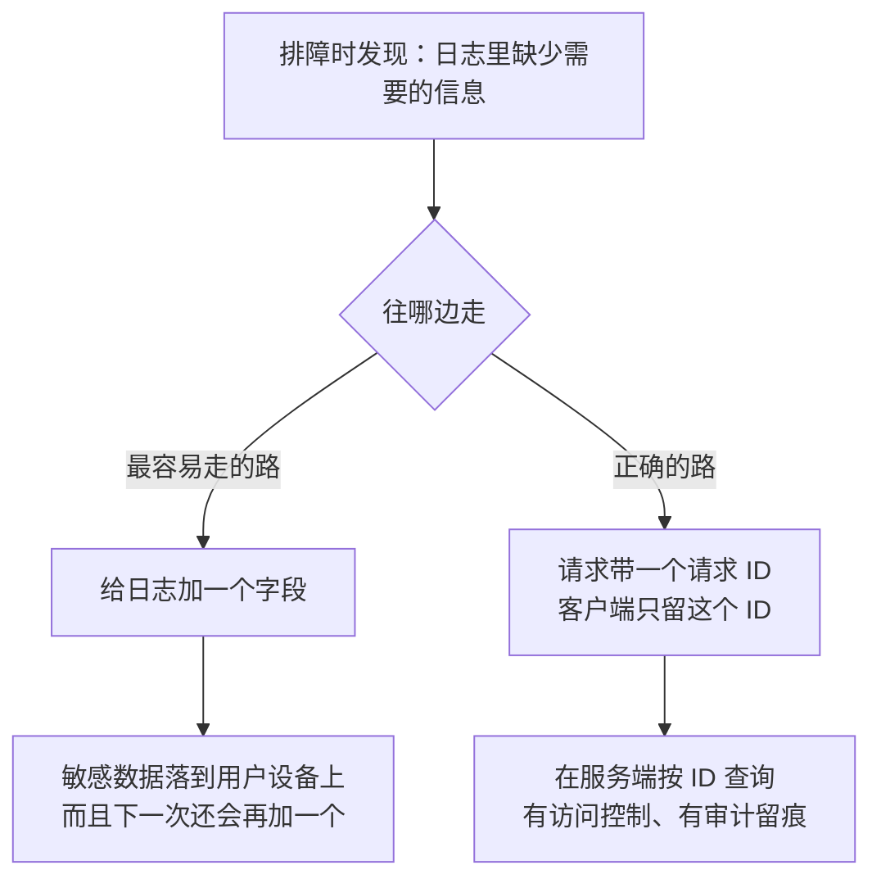

| 做法 | 敏感数据在哪 | 谁能看到 |
| --- | --- | --- |
| 把参数打进客户端日志 | **就在用户设备上** | 不可控——设备在谁手里、日志被谁导走，你永远不会知道 |
| **客户端只留请求 ID，去服务端查** | 只在受控的服务端 | **有访问控制、有审计记录** |

**关键差别不是"服务端更安全"，而是"服务端能回答'谁在什么时候查了什么'"。** 客户端日志做不到这一点：它一旦落到用户设备上，有没有被看到、被谁看到，没有任何记录。而服务端的每一次查询都留痕——**排障能力和可追责性可以同时拿到，在客户端日志上加字段则两样都拿不到。**

**请求 ID 自己也要按字段治理**：它必须能关联到一次请求，但**不能反推出用户身份或业务内容**。一个自增的、或者干脆就等于用户 ID 的"请求 ID"，等于把敏感信息换个名字继续放在日志里。

**这也正是字段清单必须"默认拒绝"的原因。** 如果新增字段是默认允许的，"排障方便"这个理由会一次次把敏感字段加回来，**而没有任何一个环节会拦一下**。"默认拒绝"才是逼出"用请求 ID 去服务端查"这条路的机制——**不要把它当成一道可以临时绕开的门槛。**

**还有一个常被忘掉的动作：处置历史日志。**

修法只管"从今往后"。但**修复之前已经写下的那些日志里，令牌是真实有效的**。如果审计发现历史日志确实包含过真实令牌，修复上线时应当同时做两件事：

1. **撤销**这段时间内可能出现在日志里的令牌与会话；
2. **排查异常使用**——用这段时间的访问日志比对，看有没有来自非正常来源的调用。

不做这两步，等于**把门锁上了，但钥匙还留在门外地上**。

**完成判据**

```bash
# 1. 反编译 release 产物，确认自己的日志符号已不存在
#    （注意：这一步查的是"有没有写入器"，不是"有没有 print"）
#    带上 --baseline：否则密钥指纹比对会被跳过（脚本会打印 SKIP 后仍返回 0）
python3 release_gate_scan.py app-release.apk --baseline known-bad-keys.txt

# 2. 真机上抓日志，确认不含令牌与请求体
adb logcat -c && adb shell am start -n com.sdmc.homewoo/.MainActivity
sleep 20 && adb logcat -d | python3 -c "
import sys, re
log = sys.stdin.read()
# 用真实令牌的前缀形态判断（此处用通用特征）
bad = re.findall(r'(accessToken|Authorization|signature|XHOME_SECRET)', log, re.I)
print('命中敏感字段名:', len(bad))
print('结论:', 'PASS' if not bad else 'FAIL')
"
```

**还有一条最容易在"开发方便"的名义下被牺牲的：开发版与正式版必须分家。**

素材把它写得很短——"开发版可启用详细日志，但**不得与正式版共用开关、上报目标或真实用户凭证**"——三个"不得"各对应一种真实的串台方式：

| 不得共用 | 共用会怎样 |
| --- | --- |
| **开关** | 一个 `DEBUG_LOG` 常量，开发时改成 `true` 忘了改回来；或者改的根本就是从正式版一起编译的那份配置 |
| **上报目标** | 开发版的详细日志流进了正式版的崩溃 / APM 平台——**那是一个有访问控制、有导出、有留存策略的系统**，等于把 7.1 的泄露路径原样复制了一条到生产链路 |
| **真实用户凭证** | 最严重的一条：开发版连着测试后端，却用了真实账号的令牌 |

**所以"开发版可以放开日志"这句话是有前提的**：它必须是一个在**构建产物层面**就和正式版分开的东西——不同的开关常量、不同的上报 endpoint、不同的账号体系。这三样在 8.7 的构建变体里统一解决。**只要两者还共用一个包，白名单就是唯一的那道防线。**

**边界（这条方案防不住什么）**

- **防不住已泄露的历史令牌。** 这要靠 8.3 的服务端防重放和 8.4 的令牌轮换。
- **防不住攻击者用 Frida 之类的工具在运行时从内存里读。** 客户端加固只能提高成本，不能消除可能。
- **白名单也会漏。** 如果新的业务确实需要记一个字段，开发者会去改 `ApiLogRecord`——这时必须有人 review。**方案的价值在于把"悄悄泄露"变成"显式评审"。**

**Flutter 侧改完了，还有一层：iOS 原生日志**

前面讲的是 Dart 侧的打印。但一个 Flutter App 的日志至少有三条独立出路，**堵住一条不等于堵住三条**：

| 出路 | 谁在写 | 8.2 的白名单管得到吗 |
| --- | --- | --- |
| Dart `print` / `debugPrint` | Flutter 框架 | 管得到 |
| `NSLog` / `print`（Swift / ObjC） | 原生插件、三方 SDK | **管不到** |
| `os_log` / `Logger`（统一日志系统） | 原生插件、系统框架 | **管不到** |

**Apple 为第三类提供了专门机制：隐私标记。** 文档写得很直接——"Because people have access to log messages that your app generates, use the privacy options to hide potentially sensitive information"：

```swift
// 用 OSLogPrivacy 的 .private / .sensitive 标记动态值
import os

let logger = Logger(subsystem: "com.sdmc.wallplanner.ios", category: "network")

let token = "…"           // String：默认会被脱敏
let userId = 100234       // Int：默认不会被脱敏

// 默认 .auto：按值的类型决定
logger.log("token=\(token)")                      // → token=<private>
logger.log("userId=\(userId)")                    // → userId=100234
                                                  //   ⚠️ 标量默认不脱敏，会原样落盘

// 显式标记：不受类型影响，一律脱敏
logger.log("token=\(token, privacy: .private)")   // → token=<private>
logger.log("userId=\(userId, privacy: .private)") // → userId=<private>
```

**这里有一个很容易搞反的点，必须先说清楚：`.private` 是"永远脱敏"，不是"看类型脱敏"。**

Apple 把四个隐私选项的定义写得很直白，直接对照：

| 选项 | 官方定义 | 实际效果 |
| --- | --- | --- |
| `.auto`（**不写 privacy 参数时的默认值**） | "let the system determine whether to redact or display a value"——按值的**类型**自行决定 | **由系统按类型判断** |
| `.private` | "**always** redact the interpolated value" | **一定脱敏** |
| `.sensitive` | "always redact interpolated values that contain sensitive information"，文档注明**行为与 `.private` 完全相同** | **一定脱敏** |
| `.public` | "**always** show the interpolated value" | **一定不脱敏** |

**"整数、浮点和布尔值不会被脱敏"说的是默认行为（`.auto`），不是 `.private` 的行为。** `.auto` 的定义原文就是"按类型决定"，这正是那句经验说法的来源；而 `.private` 只有一个字面意思——**永远脱敏**，与类型无关。

这一点搞反的后果很实际：有人据此认为"`.private` 反正管不住 `Int`，那还不如不写"，而正确的结论恰好相反——**正因为默认值会按类型放过一部分标量，才更要把敏感字段显式标成 `.private`。**

```swift
// 片段：依赖宿主工程的 logger 与 uid，单独复制出去编译不了。
// 本块只对比"写不写 privacy 参数"这一点差别。
//
// 反例：不写 privacy 参数 → 走默认的 .auto，由系统按类型决定
// 整数、浮点、布尔这类标量存在被原样记录的可能
logger.log("uid=\(uid)")

// 正例：显式 .private → 无论什么类型，都会被统一占位串替代
logger.log("uid=\(uid, privacy: .private)")
```

**所以正确的定位是：** 显式写 `.private` 是"确保不留明文"的**底线要求**，但它不是"可以用它来记录凭证"的许可——凭证应该在更前面一步（产生日志之前）就不进入日志，那是本节白名单的职责。**两者是叠加关系，不是替代关系。**

**完成判据要加一条：** 用 `log stream` / Console.app 抓真机日志，走一遍登录、令牌刷新、日历读写，确认日志里没有明文令牌。**注意 Dart 侧的白名单测试抓不到原生 SDK 的日志，这两条必须分别测。**

来源：[`OSLogPrivacy`](https://developer.apple.com/documentation/os/oslogprivacy)、[Generating Log Messages from Your Code](https://developer.apple.com/documentation/os/generating-log-messages-from-your-code)。

**边界**

- **隐私标记只覆盖走统一日志系统的调用。** 直接写文件、写 Crashlytics 自定义键、自带上报 SDK 的路径不受它约束。
- **脱敏之后仍然「可关联」。** 默认的 `.private` 用统一占位串替代原值，看不出内容；但如果改用 `.private(mask: .hash)`，日志里会出现原值的哈希——**同一原值产生同一哈希**，可以据此把多条日志串起来。这是排查问题时有用的性质，也意味着**哈希本身不等于安全**：低熵的值（比如自增的用户 ID）可以被穷举反推。


### 8.3 服务端防重放：三件套缺一不可

这是**唯一能让已经泄露出去的请求材料失效**的措施，所以优先级最高。

**为什么"有签名"不等于"防重放"**

第 7 章实测到的一个组合值得反复强调：

| 测试 | 结果 | 含义 |
| --- | --- | --- |
| 改请求体 + 旧签名 | **401** | 签名**有效**，完整性校验工作正常 |
| 原样重放 | **200** | 完全没有防重放 |

**签名回答的是"这条消息是不是持有密钥的人发的"，它不回答"这条消息是不是第一次发"。**

**完整方案**

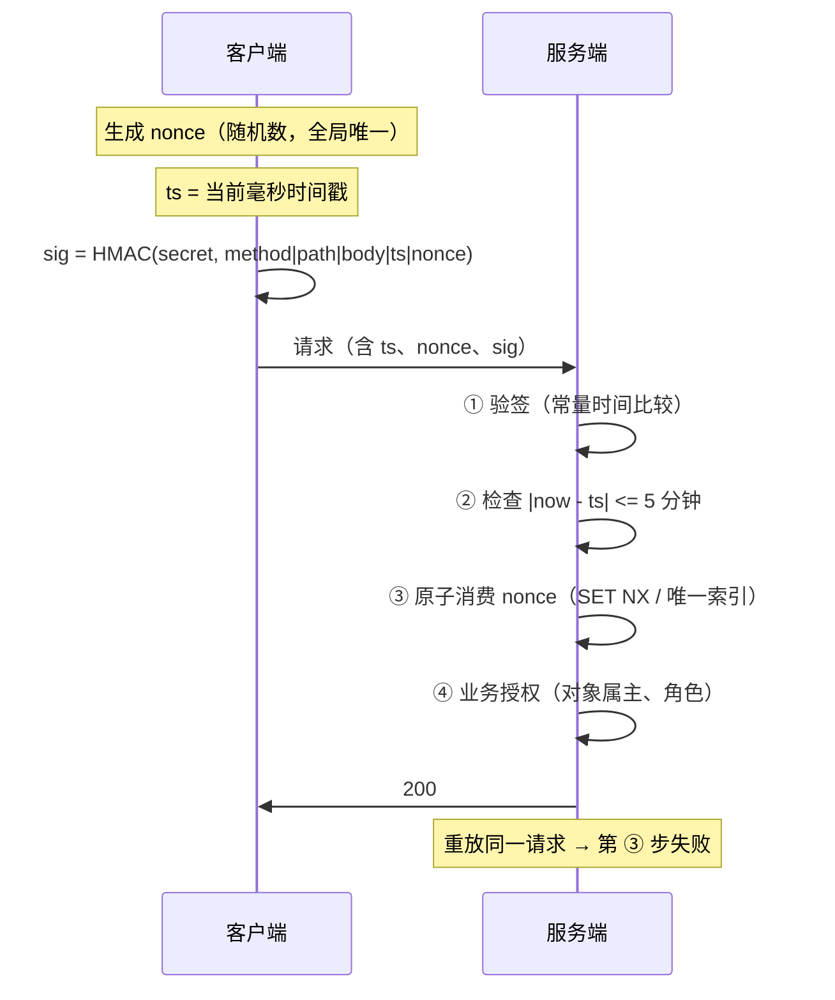

**四个数字必须记牢：**

| 项 | 要求 | 漏了会怎样 |
| --- | --- | --- |
| **nonce 必须进签名** | 签名的规范串里要有 nonce | 攻击者改个 nonce 就绕过所有去重 |
| **去重必须原子** | `SET NX EX` 或数据库唯一索引 | "先查再写"在并发下会双放行 |
| **去重记录存活 ≥ 时间窗** | TTL 不能短于时间窗 | 记录过期后旧请求复活 |
| **时间窗不能省** | 即使有去重也要有 | 见上一条 |

**可运行验证：四种写法，哪些真的防得住**

下面的脚本用最小实现把"看起来做了"和"真的做了"的差别演示出来。**只依赖标准库，可直接运行：**

```bash
python3 replay_defense_demo.py
```

```python
#!/usr/bin/env python3
# -*- coding: utf-8 -*-
"""防重放校验顺序的可运行演示（仅用标准库，不联网）。

目的：用四段最小实现，演示"防重放三件套"里哪些写法是真有效的、
哪些写法看起来做了、实际仍然放行重放。

运行：python3 replay_defense_demo.py
输出：每个用例打印 期望结果 / 实际结果 / 是否通过。
"""

import hashlib
import hmac
import threading
import time

SECRET = b"demo-secret-not-a-real-key"   # 演示用；真实系统里这把密钥必须在服务端
WINDOW_MS = 5 * 60 * 1000                # 时间戳有效期 ±5 分钟


def sign(method, path, body, ts, nonce):
    """把所有"服务端必须校验的东西"都算进签名。

    注意 ts 与 nonce 都在签名覆盖范围内——否则攻击者可以只改这两个值、
    保留原签名，去重与时间窗就都失效了。
    """
    canonical = f"{method}\n{path}\n{body}\n{ts}\n{nonce}".encode()
    return hmac.new(SECRET, canonical, hashlib.sha256).hexdigest()


def make_request(method="POST", path="/calendar/event/create", body='{"title":"x"}',
                 ts=None, nonce="n-0001"):
    ts = ts if ts is not None else int(time.time() * 1000)
    return {
        "method": method, "path": path, "body": body,
        "ts": ts, "nonce": nonce,
        "sig": sign(method, path, body, ts, nonce),
    }


def replay(req, **overrides):
    """原样复制一份请求——攻击者不改任何内容。"""
    r = dict(req)
    r.update(overrides)
    return r


# ---------------------------------------------------------------- 实现 A：正确
class CorrectServer:
    """顺序：验签 → 时间窗 → 原子消费 nonce → 业务授权（即下面的 ①②③④）。"""

    def __init__(self, next_nonce=None):
        self._used = {}                      # 生产中应为 Redis SET NX EX 或数据库唯一索引
        self._lock = threading.Lock()
        self._next_nonce = next_nonce        # 注入点：用于演示下面的竞态

    def handle(self, req):
        # ① 先验签：确认这条消息确实由持有密钥的一方签发
        expect = sign(req["method"], req["path"], req["body"], req["ts"], req["nonce"])
        if not hmac.compare_digest(expect, req["sig"]):
            return "REJECT", "bad_signature"

        # ② 时间窗：限制重放的时间范围
        if abs(int(time.time() * 1000) - req["ts"]) > WINDOW_MS:
            return "REJECT", "timestamp_out_of_window"

        # ③ 原子消费 nonce：并发下也只有一个能成功
        key = f"rp:{req['nonce']}"
        with self._lock:
            if self._next_nonce is not None:
                self._next_nonce()           # 模拟"检查"与"写入"之间被打断
            if key in self._used:
                return "REJECT", "duplicate_nonce"
            # 记录的存活时间必须 >= 时间窗，否则记录过期后旧请求又能重放
            self._used[key] = time.time() + (WINDOW_MS / 1000.0) + 60

        # ④ 到这里才做业务授权（演示省略）
        return "ACCEPT", "ok"


# ------------------------------------------------- 实现 B：只验签，没有防重放
class SignatureOnlyServer:
    """签名有效就放行——这正是本项目攻击链 01 遇到的服务端行为。"""

    def handle(self, req):
        expect = sign(req["method"], req["path"], req["body"], req["ts"], req["nonce"])
        if not hmac.compare_digest(expect, req["sig"]):
            return "REJECT", "bad_signature"
        return "ACCEPT", "ok"


# ------------------------------------------------- 实现 C：有 nonce 但没时间窗
class NoTimestampWindowServer:
    """去重记录会过期，又没有时间窗兜底 → 记录过期后同一请求可以再来一次。"""

    def __init__(self):
        self._used = set()

    def handle(self, req):
        expect = sign(req["method"], req["path"], req["body"], req["ts"], req["nonce"])
        if not hmac.compare_digest(expect, req["sig"]):
            return "REJECT", "bad_signature"
        if req["nonce"] in self._used:
            return "REJECT", "duplicate_nonce"
        self._used.add(req["nonce"])
        return "ACCEPT", "ok"

    def forget(self, nonce):
        """模拟去重记录按 TTL 过期。"""
        self._used.discard(nonce)


# ------------------------------------------- 实现 D：nonce 没被签名覆盖（隐蔽错误）
class NonceOutsideSignatureServer:
    """nonce 不参与签名 → 攻击者改 nonce 就能绕过任何去重。"""

    def __init__(self):
        self._used = set()

    def handle(self, req):
        # 验签时故意不包含 nonce
        canonical = f"{req['method']}\n{req['path']}\n{req['body']}\n{req['ts']}".encode()
        expect = hmac.new(SECRET, canonical, hashlib.sha256).hexdigest()
        if not hmac.compare_digest(expect, req["sig"]):
            return "REJECT", "bad_signature"
        if req["nonce"] in self._used:
            return "REJECT", "duplicate_nonce"
        self._used.add(req["nonce"])
        return "ACCEPT", "ok"


# ------------------------------------------------------------------ 用例执行
def check(name, expect, got):
    ok = "PASS" if expect == got else "FAIL"
    print(f"[{ok}] {name}")
    print(f"        期望={expect}  实际={got}")
    return ok == "PASS"


def main():
    results = []

    # 用例 1：正确实现——原样重放必须被拒
    srv = CorrectServer()
    req = make_request(nonce="n-correct")
    first = srv.handle(req)[0]
    second = srv.handle(replay(req))[0]
    results.append(check("正确实现：首次接受、原样重放被拒", ("ACCEPT", "REJECT"),
                         (first, second)))

    # 用例 2：只验签——重放被接受（攻击链 01 的成因）
    srv = SignatureOnlyServer()
    req = make_request(nonce="n-signonly")
    results.append(check("只验签：原样重放被接受（这就是被攻破的那种实现）", ("ACCEPT", "ACCEPT"),
                         (srv.handle(req)[0], srv.handle(replay(req))[0])))

    # 用例 3：改请求体后复用旧签名——验签必须拦住
    srv = CorrectServer()
    req = make_request(nonce="n-tamper")
    tampered = replay(req, body='{"title":"tampered"}')
    results.append(check("改请求体+旧签名：被拒（签名覆盖了请求体）", "REJECT",
                         srv.handle(tampered)[0]))

    # 用例 4：nonce 不在签名覆盖范围内——换个 nonce 就能重放
    # 注意这里必须构造一份"签名本身就不含 nonce"的请求：
    # 客户端与服务端对"签什么"的口径必须一致，这正是这类缺陷的成因。
    srv = NonceOutsideSignatureServer()
    req = make_request(nonce="n-outside")
    req["sig"] = hmac.new(                               # 重算：签名只覆盖 method/path/body/ts
        SECRET,
        f"{req['method']}\n{req['path']}\n{req['body']}\n{req['ts']}".encode(),
        hashlib.sha256,
    ).hexdigest()
    first = srv.handle(req)[0]
    second = srv.handle(replay(req, nonce="n-outside-2"))[0]
    results.append(check("nonce 未参与签名：改个 nonce 就能重放", ("ACCEPT", "ACCEPT"),
                         (first, second)))

    # 用例 5：去重记录过期后又没有时间窗 —— 旧请求可以再来一遍
    srv = NoTimestampWindowServer()
    old = make_request(nonce="n-expire", ts=int(time.time() * 1000) - 3 * 24 * 3600 * 1000)
    first = srv.handle(old)[0]
    srv.forget("n-expire")                    # 模拟 TTL 到期
    second = srv.handle(replay(old, nonce="n-expire"))[0]
    results.append(check("去重记录过期且无时间窗：3 天前的请求又被接受", ("ACCEPT", "ACCEPT"),
                         (first, second)))

    # 用例 6：正确实现里，超窗请求即使 nonce 全新也被拒
    srv = CorrectServer()
    old = make_request(nonce="n-old", ts=int(time.time() * 1000) - 10 * 60 * 1000)
    results.append(check("正确实现：超出 ±5 分钟窗口的请求被拒", "REJECT",
                         srv.handle(old)[0]))

    # 用例 7：并发重放——"先查再写"的两步实现在这里会双放行
    class CheckThenSetServer(CorrectServer):
        """把原子消费拆成"先查、再写"两步。"""

        def handle(self, req):
            expect = sign(req["method"], req["path"], req["body"], req["ts"], req["nonce"])
            if not hmac.compare_digest(expect, req["sig"]):
                return "REJECT", "bad_signature"
            key = f"rp:{req['nonce']}"
            if key in self._used:                       # ← 检查
                return "REJECT", "duplicate_nonce"
            time.sleep(0.01)                            # ← 两步之间的时间窗（生产中是一次网络往返）
            self._used[key] = time.time() + 360       # ← 写入
            return "ACCEPT", "ok"

    srv = CheckThenSetServer()
    req = make_request(nonce="n-race")
    out = []
    barrier = threading.Barrier(2)

    def worker():
        barrier.wait()                                  # 让两个线程同时进入
        out.append(srv.handle(req)[0])

    ts = [threading.Thread(target=worker) for _ in range(2)]
    for t in ts:
        t.start()
    for t in ts:
        t.join()
    accepted = out.count("ACCEPT")
    results.append(check("两步式\"先查再写\"：并发下同一 nonce 被放行两次",
                         True, accepted == 2))

    print()
    print(f"合计 {len(results)} 项，通过 {sum(results)} 项，失败 {len(results) - sum(results)} 项")
    return 0 if all(results) else 1


if __name__ == "__main__":
    raise SystemExit(main())
```

**它证明了什么（对应七个用例）：**

| 用例 | 验证的命题 | 结论 |
| --- | --- | --- |
| 1 | 正确实现能拒绝原样重放 | ✅ |
| 2 | **只验签的实现会放行重放**——这就是本项目被攻破的成因 | ⚠️ 反例 |
| 3 | 改请求体后旧签名失效（说明签名机制本身有效） | ✅ |
| 4 | nonce 不进签名 → 改 nonce 即可绕过去重 | ⚠️ 反例 |
| 5 | 去重记录过期又无时间窗 → 3 天前的请求复活 | ⚠️ 反例 |
| 6 | 正确实现能拒绝超出 ±5 分钟窗口的请求 | ✅ |
| 7 | **"先查再写"在并发下让同一 nonce 被放行两次** | ⚠️ 反例 |

**用例 7 值得单独说：** 它用两个线程加一个 `threading.Barrier` 让两个请求同时进入处理函数。两步式实现（先 `if key in used` 再 `used[key] = ...`）在中间那 10 毫秒（生产中是一次数据库往返）里被另一个线程穿插，**两个请求都通过了检查**。

> **这就是为什么"去重"必须说"原子去重"。** 一句"我们做了 nonce 去重"，如果不指定原子性，在并发下等于没做。

**服务端参考实现（Redis）**

```python
# server/replay_guard.py
#
# 依赖：redis-py（pip install redis）
# 关键点全部集中在 consume() 一个函数里。
import time
import redis

WINDOW_SECONDS = 300          # 时间窗 ±5 分钟
NONCE_TTL_SECONDS = 600       # 必须 >= 时间窗，留一倍余量


class ReplayGuard:
    def __init__(self, client: "redis.Redis", secret: bytes):
        self._r = client
        self._secret = secret

    def check_timestamp(self, ts_ms: int) -> bool:
        """时间窗校验。放在验签之后，避免为无效请求花掉一次 Redis 往返。"""
        now_ms = int(time.time() * 1000)
        return abs(now_ms - ts_ms) <= WINDOW_SECONDS * 1000

    def consume(self, nonce: str) -> bool:
        """原子消费 nonce。返回 True 表示这是第一次见到它。

        用 SET key value NX EX ttl 一条命令完成"检查+写入"——
        这是原子性的来源。**不要拆成 GET 然后再 SET。**
        """
        key = f"rp:{nonce}"
        # nx=True: 仅当键不存在时才设置（这就是"检查"）
        # ex=...: 同时设置过期（这就是"写入"与"清理"）
        acquired = self._r.set(key, "1", nx=True, ex=NONCE_TTL_SECONDS)
        return bool(acquired)

    def verify(self, method, path, body, ts_ms, nonce, sig) -> tuple[bool, str]:
        """返回 (是否通过, 原因)。原因用于日志与监控，不要回传给客户端。"""
        import hmac as _hmac

        # ① 验签：规范串必须与客户端逐字节一致
        canonical = f"{method}\n{path}\n{body}\n{ts_ms}\n{nonce}".encode()
        expect = _hmac.new(self._secret, canonical, __import__("hashlib").sha256).hexdigest()
        # 用 compare_digest 而不是 ==：避免通过响应时间逐字节猜签名
        if not _hmac.compare_digest(expect, sig):
            return False, "bad_signature"

        # ② 时间窗
        if not self.check_timestamp(ts_ms):
            return False, "timestamp_out_of_window"

        # ③ 原子消费
        if not self.consume(nonce):
            return False, "duplicate_nonce"

        return True, "ok"
```

完整调用顺序（顺序本身就是设计）：

```python
# 片段：依赖宿主工程的 ReplayGuard、redis_client、SECRET、req、
# raw_body、metrics、authorize 与 Response，单独复制出去跑不了。
# 本块只演示四步的**顺序**。
guard = ReplayGuard(redis_client, SECRET)

ok, reason = guard.verify(
    method=req.method, path=req.path, body=raw_body,
    ts_ms=req.headers["X-Ts"], nonce=req.headers["X-Nonce"],
    sig=req.headers["X-Sig"],
)
if not ok:
    # ⚠️ 不要回传 reason —— 它会告诉攻击者"你的签名是对的，只是重放了"
    metrics.incr(f"replay_guard.{reason}")
    return Response(status=401)

# ④ 到这里才做业务授权（对象属主、角色、范围）
if not authorize(req.user, req.path, raw_body):
    return Response(status=403)
```

**顺序为什么是这样：**

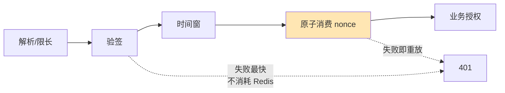

- **验签放最前**：最便宜，且能挡掉所有伪造请求，不浪费 Redis 往返；
- **消费 nonce 必须早于业务授权**：如果先做授权再做去重，那么"授权失败"的请求不会被记录，攻击者可以用同一个 nonce 反复试探授权逻辑。

**完成判据**

```bash
# 服务端应能复现这组结果（用测试账号，测试环境）
# 1. 原样重放同一请求        → 第二次必须 401
# 2. 改 nonce 保留原签名      → 必须 401（证明 nonce 进了签名）
# 3. 改时间戳保留原签名       → 必须 401
# 4. 并发发 20 个相同 nonce   → 只能有 1 个成功
```

第 4 条是很多实现会翻车的地方，建议做成常驻的回归用例。

**边界**

- **防不住"首次"请求。** 如果攻击者拿到的是**还没发过的**材料（比如能自己构造签名），那第一次就是合法的——这要靠 8.4 解决。
- **需要服务端与客户端同时改协议。** 客户端的签名规范串必须加上 `ts` 与 `nonce`；**这是灰度发布，不能一次性切**。
- **时钟偏移会误伤。** 客户端时间不准会导致大量 401。建议客户端先用服务端时间校准，或在首个响应里回传服务端时间。


### 8.4 密钥与凭证：从"共享密钥"到"设备级凭证"

7.2 的结论是：**4 把密钥随包发布，Android 与 iOS 逐字节一致，按已泄露处置。**

**先清点，再谈保护**

在选任何存储方案之前，有一件事必须先做：**把 App 实际持久化了什么，一份一份列出来。**

**为什么不能跳过：** 最常见的错误是"引入了 `flutter_secure_storage`，所以令牌是安全的"。这句话里藏着两个没被检验的假设——插件真的用在了**所有**秘密上？用的时候选的是哪一档可访问级别？**"引入了某个库"和"所有秘密都进了那个库"，是两件事。** 前者是依赖声明，后者才是事实。

清点的对象（这张清单本身就容易漏）：

| 位置 | 典型内容 | 容易漏掉的点 |
| --- | --- | --- |
| Keychain / Keystore | 访问令牌、刷新令牌、设备私钥 | 同一个 App 里可能有**多个** service / alias，只清了一个 |
| SQLite 主库 | 家庭、日历、设备缓存 | — |
| **SQLite 的 `-wal` / `-shm`** | **与主库同源的数据** | 主库删了、WAL 还在；备份时照样被带走 |
| SharedPreferences / UserDefaults | 用户 ID、环境标记、功能开关 | 常被当成"不敏感"而漏掉 |
| 缓存目录 | 图片、接口响应 | 响应体里可能带令牌 |
| WebView 存储 | Cookie、localStorage | H5 登录态的令牌经常落在这里 |
| 容器内普通文件 | 导出的日志、离线诊断包 | 见 8.2 里"副本面"那一节 |

**每一行要填满四列**，缺任何一列，这条就不算清完：

```text
位置 | 存了什么 | 保留多久 | 退出登录时怎么处理
```

**`-wal` / `-shm` 值得单独说：** 这两个文件是 SQLite 的预写日志与共享内存文件，**内容与主库同源**。"我删了主库"不等于"数据没了"——它们躺在同一个目录里，一样会被备份带走、一样会被取证工具读到。要处理就连它们一起处理。

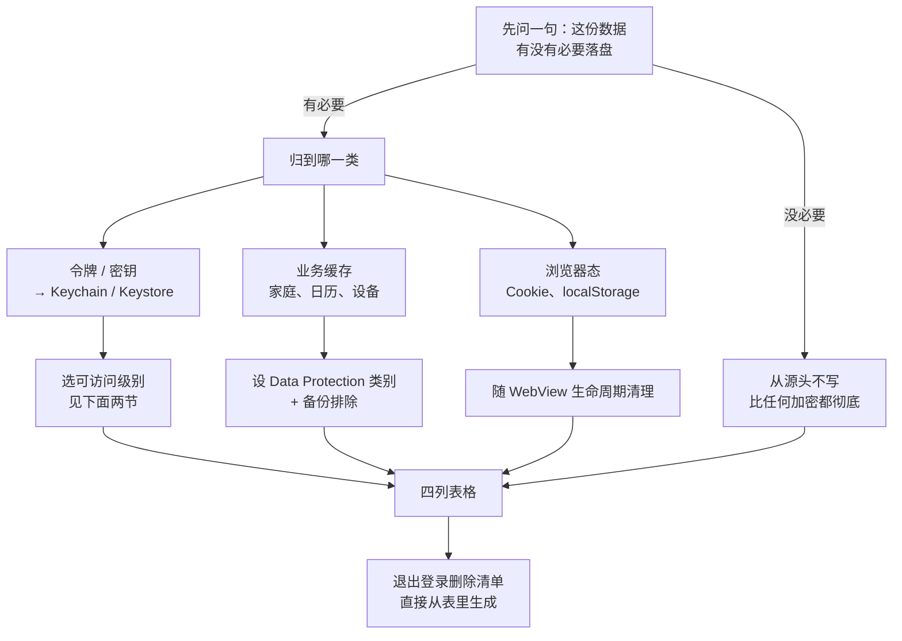

图里最后一步是关键：**删除清单是从清点表里生成的，不是凭印象列几个 key。** 凭印象删，漏掉的那个往往就是 `-wal`，或者某个早就没人记得的 service 名。

清点的产出有三样，缺一不可：

1. **一张填满四列的表**——这是后面所有决定的依据；
2. **一张"不存"名单**——清点时通常会揪出几样**根本不该落盘**的东西（完整令牌、完整响应体、明文手机号），它们应该从写入端就消失；
3. **退出登录的删除清单**——直接由第 1 张表生成。

从下一节起，讲的就是"表里那些**必须存**的东西，各自该用什么保护"。

**为什么"换成设备级密钥"是唯一的根本解**

| 方案 | 泄露一把的后果 | 是否可轮换 | 结论 |
| --- | --- | --- | --- |
| 继续用共享密钥（现状） | **全部用户**受影响 | 需发版 | ❌ |
| 共享密钥 + 定期轮换 | 轮换窗口内**全部用户** | 可，但需发版且窗口内仍暴露 | ⚠️ 过渡 |
| **设备级密钥** | **只有一台设备** | 不需要——每台本来就不同 | ✅ |

核心区别在于**爆炸半径**：共享密钥的泄露是"全量"，设备级密钥的泄露是"单点"。

**Android：密钥不出安全硬件**

```kotlin
// android/app/src/main/kotlin/com/sdmc/homewoo/crypto/DeviceKeyStore.kt
//
// 用 Android Keystore 生成**不可导出**的设备密钥。
// 让密钥"不可导出"的是 provider 本身（AndroidKeyStore）：
// 密钥材料由它持有，应用只拿得到句柄，getEncoded() 取不到私钥。
// 注意下面这些参数管的是"这把钥匙能干什么、用之前要不要验身份"，
// 不是"密钥放在哪"——这个区别本节末尾专门澄清。
package com.sdmc.homewoo.crypto

import android.security.keystore.KeyGenParameterSpec
import android.security.keystore.KeyProperties
import java.security.KeyPairGenerator
import java.security.KeyStore
import java.security.Signature

object DeviceKeyStore {
    private const val ALIAS = "homewoo_device_key_v1"
    private const val PROVIDER = "AndroidKeyStore"

    /** 取得（或首次生成）设备密钥。
     *
     * 注意 KeyPairGenerator 用的是 "EC" + AndroidKeyStore provider。
     *
     * AOSP 对这类密钥的说法是"**不可访问**"，而不是"永不离开安全硬件"——
     * 源码里的原话（KeyGenParameterSpec.java, android15-release）：
     *
     *   "NOTE: The key material of the generated symmetric and private keys
     *    is not accessible. The key material of the public keys is accessible."
     *
     * 也就是说：拿不到密钥材料本身，只能用它的句柄请求它做签名运算。
     * 但**这不等于密钥一定在 TEE/StrongBox 里**——详见本节末尾的说明。
     */
    fun getOrCreateKey(): java.security.KeyPair {
        val ks = KeyStore.getInstance(PROVIDER).apply { load(null) }
        (ks.getEntry(ALIAS, null) as? KeyStore.PrivateKeyEntry)?.let {
            return java.security.KeyPair(it.certificate.publicKey, it.privateKey)
        }

        val gen = KeyPairGenerator.getInstance(
            KeyProperties.KEY_ALGORITHM_EC, PROVIDER
        )
        gen.initialize(
            KeyGenParameterSpec.Builder(
                ALIAS,
                KeyProperties.PURPOSE_SIGN or KeyProperties.PURPOSE_VERIFY,
            )
                // 只允许 SHA-256 摘要，避免被用作其他用途
                .setDigests(KeyProperties.DIGEST_SHA256)
                // 不要求用户认证：设备解锁后即可用，避免每次请求弹指纹。
                // 若业务能接受，改成 true 会显著提高安全性。
                .setUserAuthenticationRequired(false)
                .build()
        )
        val kp = gen.generateKeyPair()
        return kp
    }

    /** 用设备私钥对挑战串签名。私钥材料不可访问，只能请求它代做运算。 */
    fun sign(challenge: ByteArray): ByteArray {
        val kp = getOrCreateKey()
        return Signature.getInstance("SHA256withECDSA").run {
            initSign(kp.private)
            update(challenge)
            sign()
        }
    }
}
```

**关键性质：** 密钥材料**不可访问**——`getEncoded()` 拿不到它，只能通过句柄请求它做签名运算。这跟"把密钥藏在代码里"是完全不同量级的方案。

**但这里有一个必须澄清的边界，很容易被写成过度承诺：**

> AOSP 从没说过"密钥永不离开安全硬件"。

源码里用的是 "**not accessible**"（不可访问），这是一个**比"在安全硬件里"更弱、但也更无条件成立**的表述。原因是 Keystore **允许软件实现**的密钥——这种情况下，密钥的 attestation 证书链会是 "rooted at an untrusted certificate"。

| 说法 | 是否成立 | 依据 |
| --- | --- | --- |
| 密钥材料不可访问 | ✅ | `KeyGenParameterSpec` 类级注释原文 |
| 密钥一定在 TEE / StrongBox 中 | ❌ | 取决于设备；软件实现是允许的 |

**所以要确认密钥真的在安全硬件里，得去验密钥的 attestation 证书链**——这也正是判断"这台设备是否值得信任"的入口（与 8.5 的完整性校验是同一套思路：**由服务端判定，而不是由客户端自称**）。

```java
// KeyGenParameterSpec.java (AOSP frameworks/base, android15-release, 第 100-101 行)
// 源码链接：
// https://github.com/aosp-mirror/platform_frameworks_base/blob/cc8bb19595c661f5cf42f330457000e643c67d1b/keystore/java/android/security/keystore/KeyGenParameterSpec.java#L100-L101

// 下面是 javadoc 原文。注意它说的是「密钥材料**不可读**」，
// 而不是「密钥不会被提取」——这两件事差着一整个攻击面。
// 在 Root 设备上，攻击者不需要读密钥材料，直接调用它就行。
 * <p>NOTE: The key material of the generated symmetric and private keys is not accessible. The key
 * material of the public keys is accessible.
```

**补一个场景：确需离线加密本地数据时。** 上面的设备密钥讲的是"给服务端证明身份"，还有一类密钥是"给本地数据加密"。素材对这一类的说法很具体，值得照做：

| 要点 | 不这么做会怎样 |
| --- | --- |
| 用 **Keystore 为该安装生成不可导出的设备级密钥** | 密钥又回到"藏在代码里"，就是本节开头那个问题 |
| 用**具备认证的加密模式**（如 **AES-GCM**） | CBC 之类的模式没有完整性保护，密文可被篡改而不被发现；GCM 的认证标签能挡住 |
| **备份要排除**（见 8.9） | 密文跟着云备份走了，密钥却没走 |
| **卸载 / 换机 / 密钥失效要有重建策略** | 密钥没了，密文就是一堆读不出来的字节 |

**这一段有个必须写清楚的边界：本地加密保护的是"静态数据"，它替代不了 TLS，也替代不了用户认证。**

素材专门点了一句，因为"既然我们已经有 AES 了"这个念头会自然衍生出两种很糟的用法：

| 反模式 | 为什么它不是"更安全"，而是更糟 |
| --- | --- |
| **自己写一套"全局 AES 加密请求体"当作传输加密** | 传输层要解决的是"链路上有没有人在看、对面是不是真的那个服务器"——那是 TLS 的活。自研的对称加密**没有身份认证**：你加密给了"某个持有同一密钥的东西"，但没办法确认它是服务端；密钥还在客户端里，攻击者拿得到 |
| **用"客户端能解开某段密文"当作身份证明** | 这只能证明"它持有密钥"，而密钥是从包里读出来的。**能被客户端解开的，就能被任何拿到客户端的人解开**——它不是认证，是共享口令的另一种写法 |

**正确的分工是三件事各归各位：** 传输保密归 **TLS**；身份认证归**用户令牌 + 8.4 的设备密钥**；本地存储的机密性才归 **AES-GCM**。**这三样互不替代**——本文 8.4 讲的本地加密，只负责第三样。

**最后一条是真会踩的坑，说清楚：不要把密文迁移到没有原密钥的新设备上，还期待它能解密。** Keystore 里的密钥在卸载时就被销毁了，换机更是从来不跟随——**所以备份里存密文是没有意义的，要么连密钥一起排除、要么就接受"换机后这份数据重建"。** 8.9 的 `data_extraction_rules.xml` 把整个应用目录都排除掉，正是这个原因。

**iOS：`ThisDeviceOnly` 才是关键那一档**

Keychain 的可访问性等级决定了"备份/迁移时会发生什么"。Apple 的文档明确说明：

> 只有标记为 `ThisDeviceOnly` 的条目 **do not migrate to a new device**；而 `kSecAttrAccessibleAfterFirstUnlock` 等**可迁移**的等级，只有在**加密备份**中才会随备份迁移。
>
> —— [`kSecAttrAccessibleWhenUnlockedThisDeviceOnly`](https://developer.apple.com/documentation/security/ksecattraccessiblewhenunlockedthisdeviceonly)，Apple Developer Documentation
>
> 原文：*"Items with this attribute **do not** migrate to a new device. Thus, after restoring from a backup of a different device, these items will not be present."*

这意味着选错等级会有一个很隐蔽的后果：**密钥跟着备份跑到新设备上**——本该"每设备一把"的东西，变成了"每个备份一份"。

**"不迁移"只是一维，另一维是"什么时候能读到"**

素材那句"**根据前后台使用选择 `kSecAttrAccessible` 类别**"点的是另一半。上面讲的 `ThisDeviceOnly` 决定**迁移行为**，而每个类别同时还规定了**这段数据在什么状态下可以被读**：是"设备一解锁就能读"，还是"开机后首次解锁起，**锁屏时也能读**"。

这两维正交，所以是个 2×2：

| | **只在解锁后可读**（前台） | **锁屏时也可读**（后台） |
| --- | --- | --- |
| **不迁移**（`ThisDeviceOnly`） | `kSecAttrAccessibleWhenUnlockedThisDeviceOnly` ← **前台凭证的默认选择** | `kSecAttrAccessibleAfterFirstUnlockThisDeviceOnly` ← **确需后台处理时才用** |
| **可迁移**（随加密备份） | `kSecAttrAccessibleWhenUnlocked` | `kSecAttrAccessibleAfterFirstUnlock` |

**两个方向的默认选择不一样：迁移那一维默认取"不迁移"，读取时机那一维默认取"只在解锁后"。** 后者常被搞反——因为 Flutter 侧的后台任务、推送处理、后台刷新都要求在锁屏时也能拿到令牌，于是有人图省事，把所有凭证都放进 `AfterFirstUnlock`。Apple 对这两个类别的推荐语恰好是一对：

> `kSecAttrAccessibleWhenUnlockedThisDeviceOnly`——*"This is recommended for items that need to be accessible **only while the application is in the foreground**."*
>
> `kSecAttrAccessibleAfterFirstUnlockThisDeviceOnly`——*"After the first unlock, the data remains accessible until the next restart. This is recommended for items that need to be accessed by **background applications**."*
>
> —— [`kSecAttrAccessibleWhenUnlockedThisDeviceOnly`](https://developer.apple.com/documentation/security/ksecattraccessiblewhenunlockedthisdeviceonly)、[`kSecAttrAccessibleAfterFirstUnlockThisDeviceOnly`](https://developer.apple.com/documentation/security/ksecattraccessibleafterfirstunlockthisdeviceonly)，Apple Developer Documentation

**从"解锁后可读"放宽到"锁屏也可读"，是主动撤掉一道门槛**，所以素材用的词是"**确需**"：先问这个令牌是不是真的要在锁屏/后台被读到，**答不上来就别放宽**。

**而且放宽绑定的是"这个令牌"，不是"这个 SDK"。** 素材还提了半句"**及更小权限**"——确需后台处理的往往只是刷新令牌，**那就只把刷新令牌放 `AfterFirstUnlock`，访问令牌仍留在前台档**。整包一起放宽是最省事、也最亏的做法：多放进去的每一个凭证，都白白损失了"锁屏期间读不到"这层保护。

**还有一档是"必须设了密码才存在"**

`kSecAttrAccessibleWhenPasscodeSetThisDeviceOnly` 值得单独点出来，因为它的行为和其他档都不一样——Apple 的原话是：

> *"No items can be stored in this class on devices **without a passcode**. Disabling the device passcode causes **all items in this class to be deleted**."*
>
> —— [`kSecAttrAccessibleWhenPasscodeSetThisDeviceOnly`](https://developer.apple.com/documentation/security/ksecattraccessiblewhenpasscodesetthisdeviceonly)，Apple Developer Documentation

**"用户关掉锁屏密码，这一档的数据就整批消失"**——这是特性不是 bug，它保证了"没有密码的设备上不存在这份数据"。但它同时意味着**业务代码必须能处理"读不到"这件事**：换到这一档之前，先确认凭证丢了之后的降级路径是"重新登录"，而不是白屏或者崩溃。高价值凭证（比如免密支付授权）用它很合适；普通会话令牌用它，用户关掉密码就被强制登出，体验上未必划算。

```swift
// ios/Runner/Crypto/DeviceKeyStore.swift
//
// 用 Secure Enclave 生成设备私钥，并显式指定 ThisDeviceOnly。
import Foundation
import Security
import CryptoKit

enum DeviceKeyStore {
    private static let tag = "com.sdmc.homewoo.devicekey.v1".data(using: .utf8)!
    private static let account = "homewoo_device_key_v1"

    /// 取得（或首次生成）设备私钥。
    ///
    /// 用 SecureEnclave.P256（而非普通 P256）：
    /// 私钥由安全隔区持有，且 **ThisDeviceOnly + 不可迁移**是硬性行为。
    static func privateKey() throws -> SecureEnclave.P256.Signing.PrivateKey {
        // 先查 Keychain 里是否已有
        let query: [String: Any] = [
            kSecClass as String: kSecClassGenericPassword,
            kSecAttrAccount as String: account,
            // ⚠️ 这一行是重点：设备绑定，不随备份迁移
            // 设备绑定 + 只在解锁后可读：这是前台凭证的正确默认值。
            // 设备密钥从不需要在锁屏时被读到，所以不放宽到 AfterFirstUnlock。
            kSecAttrAccessible as String: kSecAttrAccessibleWhenUnlockedThisDeviceOnly,
            kSecReturnData as String: true,
        ]
        var item: CFTypeRef?
        if SecItemCopyMatching(query as CFDictionary, &item) == errSecSuccess,
           let data = item as? Data {
            return try SecureEnclave.P256.Signing.PrivateKey(
                dataRepresentation: data
            )
        }

        // 首次：在 Secure Enclave 内生成
        let key = try SecureEnclave.P256.Signing.PrivateKey()

        // 只把 **数据表示**（本身已被 Secure Enclave 包装）存进 Keychain，
        // 并且仍然带 ThisDeviceOnly —— 两道保险
        let add: [String: Any] = [
            kSecClass as String: kSecClassGenericPassword,
            kSecAttrAccount as String: account,
            kSecValueData as String: key.dataRepresentation,
            kSecAttrAccessible as String: kSecAttrAccessibleWhenUnlockedThisDeviceOnly,
        ]
        SecItemDelete(query as CFDictionary)   // 幂等：先删后加
        let status = SecItemAdd(add as CFDictionary, nil)
        guard status == errSecSuccess else {
            throw NSError(domain: NSOSStatusErrorDomain, code: Int(status))
        }
        return key
    }
}
```

**文件也要排除备份。** Apple 文档里有一句很容易被漏掉的注意事项：

> "**Set this property each time you save a file** because some common file operations cause this property to reset to `false`"
>
> —— [`isExcludedFromBackupKey`](https://developer.apple.com/documentation/foundation/urlresourcekey/isexcludedfrombackupkey)，Apple Developer Documentation

注意它的意思是"**每次保存文件时都要重设**"，而不是只有恢复之后才需要。原因是某些常见的文件操作会把该属性重置——所以把它写进"保存文件"的统一封装里，而不是只设一次。

**数据保护的默认档位也值得知道：** iOS 默认的文件数据保护等级是 `NSFileProtectionCompleteUntilFirstUserAuthentication`（首次解锁后即可访问），记录在 Apple 的 Platform Security 指南的 [Data Protection overview](https://support.apple.com/guide/security/data-protection-overview-secf6276da8a/web) 一节；该档位的具体行为可对照 [`FileProtectionType.completeUntilFirstUserAuthentication`](https://developer.apple.com/documentation/foundation/fileprotectiontype/completeuntilfirstuserauthentication)。这个档位意味着**设备重启后只要用户解锁过一次，文件就不再受保护**——如果需要更强，得显式提升到 `NSFileProtectionComplete`。

**退出登录：删本地 + 撤服务端，两件事都要做**

凭证治理里有一个动作小、但漏了就等于前面都白做的环节：**退出登录**。

`ThisDeviceOnly` 解决的是"密钥不跟着备份走"，它**不解决**"这个令牌还能不能用"。很多实现里，退出登录只做了前半截：

| 只做了前半截 | 后果 |
| --- | --- |
| 清掉本地 Keychain / SharedPreferences | 令牌**仍然有效**——它已经在别处被复制过，或者被日志/备份带走过 |
| App 再打开时没登录态，看起来"退出了" | 服务端并不知道要拒绝谁，攻击者手上的那份照用不误 |

正确的做法是两件事**都做，且以服务端为准**：

1. **服务端撤销会话**：把该会话对应的令牌（含刷新令牌）标记为失效，并让它在所有设备上立即不可用。
2. **客户端删除本地项**：清 Keychain 里的令牌、清缓存里的家庭/日历数据、清 WebView 存储——**删除的清单要以 8.4 开头那份"实际持久化数据清点"为准**，不是凭印象删几个 key。

顺序也有讲究：**先请求服务端撤销，成功后再清本地**。反过来的话，本地凭证已经删了，撤销请求就发不出去，服务端那份会话会一直挂着，直到自然过期。

**完成判据里那条要这么写才有效：** 退出登录后，拿退出前抓到的令牌**手工重放一次请求，必须失败**。只验证"App 里看不到登录态了"是不够的——那只证明了本地删干净了，没证明服务端不认它了。

**迁移路径（不能一次性切）**

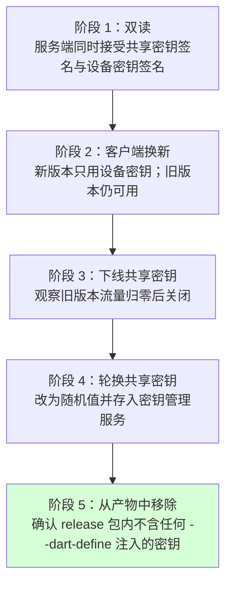

**阶段 4 的位置很关键：** 即使在阶段 3 之后共享密钥"看起来没用了"，也**必须轮换**——因为旧的 4 个值已经在外部存在了，只要服务端还认，风险就还在。

**令牌轮换：把"泄露之后还能用多久"压到最短**

8.2 讲"降低泄露后的可用性"时留下半句话：**访问令牌短时、刷新令牌可轮换和撤销**。前面几节解决的是"令牌存在哪儿、传输经不经手"，这一节解决的是——**令牌已经被复制走之后，它还能用多久**。

**这两件事是独立的。** 存储做对了，日志里照样可能有一份副本（7.1、8.2）；网络做对了，用户在测试机上装个抓包证书照样可能有一份。**既然副本无法根除，就让副本尽快失效。**

三件事，缺一不可：

| 做法 | 不做的后果 |
| --- | --- |
| **访问令牌短时**（分钟级，如 15 分钟） | 一份被抓到的 access token 可以连续用几个月 |
| **刷新令牌一次一换**（每次刷新签发新的，旧的立即失效） | 刷新令牌等同于永久凭证 |
| **旧的刷新令牌再次出现 → 撤销整个令牌族** | 攻击者与正常客户端长期并行使用，双方都不知道 |

第三条最容易被省掉，也最有价值。它的推理只有一句：**正常客户端每次刷新都会把旧令牌丢掉，所以旧令牌再次出现，只可能意味着有人复制了它。**

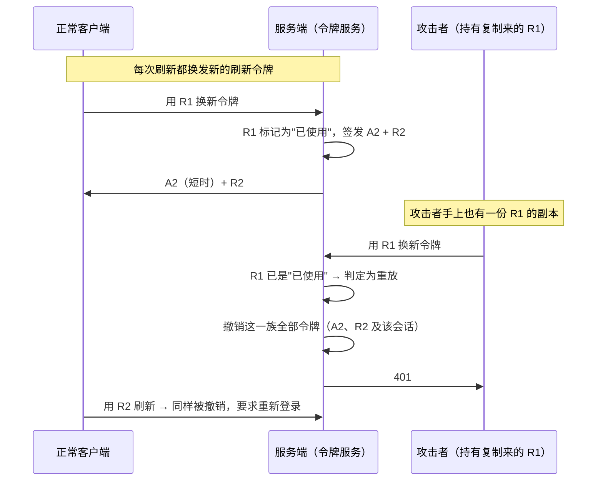

**注意最后一步：真正的用户也会被踢下线。** 这是**有意的**——一旦发现重放，服务端无法区分"谁是攻击者、谁是本人"，只能把这一族全部作废，让用户重新登录一次。**用一次可接受的体验代价，换掉"攻击者可以无限期潜伏"这种可能。**

服务端要存的是刷新令牌的**哈希**而不是它本身，理由和存密码一样：令牌库泄露时，攻击者不该直接拿到可用令牌。同时刷新令牌要绑定**用户 + 设备 + 会话**，撤销按设备粒度生效——这正是上面"退出登录"那一节需要的底层能力。

**边界**

- **轮换挡不住"跑得比正常客户端快"的攻击者。** 如果攻击者拿到刷新令牌后立刻刷新、并在用户下次刷新之前一直保持领先，重放检测不会触发。**这就是访问令牌必须短时的原因——两道措施互补，只做一道等于没做。**
- **轮换不消除泄露源。** 它缩短的是窗口，不是堵住泄露路径；8.2 停止记录凭证仍然是第一位的。
- **同一用户的多台设备要各自独立成族。** 否则一台设备触发重放会让全部设备被踢，误伤面太大。

**完成判据**

```bash
# 1. 包内不再出现已知指纹（详见 8.8 的门槛脚本）
python3 release_gate_scan.py app-release.apk --baseline known-bad-keys.txt
#    期望：PASS 未命中 N 条已知指纹
```

```text
2. 换设备测试：
   - 备份 A 设备 → 恢复到 B 设备 → B 设备上的既有会话必须失效
   - 若 B 设备能直接复用 A 的会话，说明凭证是可迁移的 → 回到本节的等级设置检查
3. 卸载重装后，设备密钥应重新生成（旧密钥不可恢复）
4. 用同一个刷新令牌请求两次：第二次必须失败，**且该用户该会话的全部令牌
   同时失效**（不是只拒绝第二次）
5. 拿一份 30 分钟前的访问令牌去调接口：必须失败（访问令牌短时）
6. 服务端存储里搜不到完整的刷新令牌明文：只有哈希
7. 退出登录后，拿退出前的刷新令牌手工重放：必须失败
   （与上面"退出登录"那一节的判据是同一条，两头都要验）
```

**边界**

- **设备密钥防不住"同一台设备上的攻击者"。** 它能防的是"把密钥复制到别的机器上批量滥用"。
- **`--dart-define` 不是密钥管理。** 它是编译期常量传递方式——Dart 文档说得很清楚，这些值"**accessed and evaluated at compile time**"（https://dart.dev/libraries/core/environment-declarations），SDK 源码进一步补充："most ahead-of-time compiled platforms will not have this information"（[dart-lang/sdk 3.13.5 `string.dart` 第 182-183 行](https://github.com/dart-lang/sdk/blob/3.13.5/sdk/lib/core/string.dart#L182-L183)）。**AOT 二进制读不到编译器选项，所以常量必然被固化进产物。**
- **Android 上并非所有设备都有 StrongBox。** 较老设备可能只有 TEE，甚至只有软件实现。可用 `KeyProperties.STRENGTH_STRONGBOX` 检测，但**检测结果只能用于提升要求，不能用于降低要求**。
- **混淆不能替代密钥管理——这一点 Flutter 官方文档自己就写明了：**

  > "**It is a poor security practice to store secrets in an app.** Obfuscating your code does not encrypt resources nor does it protect against reverse engineering. **It only renames symbols** with more obscure names."
  >
  > —— https://docs.flutter.dev/deployment/obfuscate

  这段话直接否掉了"加了混淆所以密钥安全了"这个想法。**混淆改的是符号名，不是数据**——密钥作为数据留在产物里，混淆之后照样能搜到。

**再往前一步：让每个设备有自己的身份（设备级请求签名）**

8.4 前半段解决的是"共享密钥"，但它只把全局秘密换成了设备密钥，**没有让服务端知道"这次请求确实来自这台被授权的设备"**。要走到那一步，需要设备级请求签名。

**和 TLS 客户端证书的区别：** 不依赖服务端 PKI，私钥由设备自己生成、公钥在**已登录的会话里**注册上来，服务端把公钥绑定到账号+设备。

```mermaid
sequenceDiagram
    participant A as App（设备私钥）
    participant S as 服务端
    Note over A,S: 一、注册（只做一次，需已登录）
    A->>A: Keystore / Secure Enclave 生成不可导出密钥对
    A->>S: 公钥 + 设备标识（走已认证会话）
    S->>S: 公钥绑定到 账号 + 设备，记状态为"有效"
    Note over A,S: 二、签名请求（每次敏感操作）
    A->>S: 请求挑战
    S->>A: 一次性 challenge
    A->>A: 签名(方法 + 路径 + 正文摘要 + challenge + 时间 + 操作 ID)
    A->>S: 请求 + 签名
    S->>S: 验签 + 挑战一次性消费 + 对象权限 + 撤销状态
    S->>A: 200 / 403
```

**签名的内容必须覆盖"这次操作本身"，否则可以被搬用。** 至少要签入：

| 签入项 | 不签会怎样 |
| --- | --- |
| 规范化的**方法 + 路径** | 攻击者把同一个正文换个路径重放 |
| **正文摘要** | 正文被改写而签名仍然有效 |
| 服务端下发的**挑战** | 抓到一个签名后可无限复用（与 8.3 的 nonce 是同一件事） |
| **时间戳 / 幂等键（操作 ID）** | 无法判断新鲜度，也无法做幂等 |

**最后一行里的"操作 ID"值得单独说一句——它就是幂等键。** 素材把"高风险写操作有幂等键 / 一次性挑战"列为独立要求，因为这类操作（支付、解绑、删除、改归属）**重放一次的代价不是"多一次请求"，而是"多做一遍"**。做法是让请求带一个服务端能识别为"同一件事"的 ID，即使被重发，服务端也认得出"这件事已经做过了"。

**幂等键和 8.3 的防重放不是一回事，不能互相替代：**

| | 防重放（8.3 的 nonce / 挑战） | 幂等键 |
| --- | --- | --- |
| 挡的是 | **攻击者**故意重发 | **网络与客户端**的无意重试 |
| 第二次请求 | **直接拒绝** | 返回**第一次的结果**，不再执行一遍 |
| 为什么不能省 | 省了它，重放攻击畅通无阻 | 省了它，用户网络抖动重试一次就会看到"失败"，而服务端其实已经做过了——**这是数据不一致，不是安全问题，但同样要修** |

**两者要一起做，各管各的：nonce 挡住"同一次请求"，幂等键挡住"同一件事"。** 只做防重放，正常用户的合法重试会被当成攻击拦掉；只做幂等键，攻击者换一个新的操作 ID 就能无限重发——**"新的"恰恰是幂等键不拦的那种。**

**完成判据**

```text
1. 换一台设备的私钥去签同一个请求：必须被拒
2. 同一个挑战用第二次：必须被拒
3. 签名有效但正文被改：必须被拒
4. 已撤销的设备再签：必须被拒
5. 同一个幂等键提交两次高风险写操作
   → 第二次返回**第一次的结果**，且服务端**只执行了一次**
   （查库确认，不是看响应码）
6. 用同一个 nonce、换一个新的幂等键再提交 → 仍然必须被拒
   （证明幂等键没有把防重放顶掉）
7. 未注册公钥的账号发起：必须被拒
```

**边界**

- **设备私钥 ≠ 用户身份。** 它证明的是"这台设备的这个密钥参与了这次请求"，不是"操作人是账号本人"。服务端仍须独立校验用户、对象归属与风险状态。
- **设备被完全控制时，攻击者仍然可以调用这台设备的签名能力。** 签名提高的是"复制私钥到别处"的成本，不是"阻止本机被滥用"。这与 8.5 的完整性校验是同一条边界。
- **公钥注册必须走已认证会话。** 否则攻击者可以注册自己的公钥，整套机制立刻失效。
- **必须支持撤销与轮换**——设备丢失、换机、密钥泄露都要有路径，且撤销要在服务端生效。

### 8.5 完整性校验：让服务端能区分真包与改包

7.3 的攻击链 02/03 能成立的根本原因是：**服务端无法区分请求来自官方包还是重打包后的包。**

**为什么必须在服务端做**

Apple 的文档里有一句话，把这件事的道理说得最清楚：

> "**You can't rely on your app's logic to perform security checks on itself because a compromised app can falsify the results.**"
>
> —— [Establishing your app's integrity](https://developer.apple.com/documentation/devicecheck/establishing-your-app-s-integrity)，Apple Developer Documentation

这句话直接否定了"在客户端做自检"的思路。任何在客户端里的校验代码，攻击者改包时顺手删掉即可。**校验必须由服务端发起、服务端判定。**

Apple 同时给了一个诚实的边界说明：

> "App Attest **can't definitively pinpoint a device with a compromised operating system**"
>
> —— [DeviceCheck](https://developer.apple.com/documentation/devicecheck)，Apple Developer Documentation

也就是说 App Attest 增强的是"这是不是真机、是不是真 App"，**不是**"这台设备是否被 Root/Jailbreak"。用它来做 Root 检测会误判。

**基本流程（两端同构）**

```mermaid
sequenceDiagram
    participant A as App
    participant S as 服务端
    participant V as 平台校验服务
    A->>S: 请求挑战（一次性，短有效期）
    S->>A: challenge
    A->>A: 用设备密钥对 challenge 签名<br/>（可选：把请求体摘要也放进签名）
    A->>S: 请求 + 签名 + 平台完整性令牌
    S->>V: 校验令牌（服务端到服务端）
    V->>S: 判定结果
    S->>S: 判定 + 挑战一次性消费 + 业务授权
    S->>A: 200
```

**关键设计：把请求内容绑进校验**

这是最容易被做错的一环。如果校验只证明"这是个真包"，那么攻击者可以：

1. 用真包取一个有效令牌；
2. 用改包发业务请求，把真包的令牌附上。

**防御方法**是把请求内容的摘要绑进校验。Android Play Integrity 提供了 `requestHash` 字段用于这个目的——**把请求体（或规范化后的请求摘要）的哈希放进去，服务端校验时比对**。

**这一点在实现时有几个必须注意的地方：**

| 注意项 | 说明 |
| --- | --- |
| **`requestHash` 绑定的是请求内容，不是会话** | 不要用它当会话令牌 |
| **必须在服务端比对** | 客户端传什么都要服务端重新算一遍 |
| **要覆盖体，也要覆盖方法+路径** | 否则攻击者可以把同一个体的请求换个路径重放 |
| **和 8.3 的 nonce 一起用** | 完整性解决"是不是真包"，防重放解决"是不是第一次" |

**另外，`requestHash` 只是服务端要核对的四项之一，别只核它。** 素材把这件事写全了——服务端解码令牌后要对齐的是：

| 要核对的 | 不核会怎样 |
| --- | --- |
| **包名** | 一个发给**别的 App** 的合法令牌，被拿来打你的后端——令牌是真的，只是不属于这里 |
| **签名认可结果** | 只看"有没有令牌"而不看"令牌里的完整性结论是什么"，等于把"设备被篡改"的结论也照单全收 |
| **时间 / 请求细节** | 令牌的新鲜度没人管，一个很旧的、结论正确的令牌可以一直用 |
| **`requestHash` 与实际请求一致** | 就是上面这一整段讲的内容 |

**判据要写成一个整体：** 四项**全部**通过才放行——不是"`requestHash` 对了就行"。这四项防的是四种不同的错配（**不是你的包 / 你的包但结论是坏的 / 是好包但是旧的 / 是好包但是另一个请求**），少核一项，那一类的攻击就与令牌无关地整个放行。

**服务端该怎么做，Google 有一份官方示例可以直接对照：**

```javascript
// bank.controller.js (android/security-samples, 提交 2ea592a3, 第 49-61 行)
// 源码链接：
// https://github.com/android/security-samples/blob/2ea592a337032cdec930b122415019aa1ff79428/PlayIntegrityAPI/node-server/src/features/bank/bank.controller.js#L49-L61

        // 校验内容绑定：把请求体绑进 Play Integrity 令牌。
        // Verify Content Binding
        // 令牌里带的 requestHash —— 由客户端算好放进令牌的。
        const tokenRequestHash = tokenPayload.requestDetails?.requestHash;
        // 注意：payload 取的是**服务端收到的 body**，
        // 不是客户端另行传过来的什么摘要。
        const payload = req.body;
        try {
            // 服务端自己重新算一遍请求体哈希。
            const serverRequestHash = cryptoService.computePayloadHash(payload);
            // 与令牌里的值不一致 → 正文被改过，拒绝。
            if (serverRequestHash !== tokenRequestHash) {
                return res.status(StatusCodes.FORBIDDEN).json({
                    status: "ERROR", error_code: "REQUEST_TAMPERED", message: "The request payload has been altered."
                });
            }
        // 哈希计算本身出错时交给统一错误处理，不吞掉。
        } catch (error) {
            next(error);
        }
```

**这段是整个设计的核心：** 服务端**自己重新算一遍**请求体的哈希，再和令牌里带的 `requestHash` 比。注意 `computePayloadHash(payload)` 用的是**服务端收到的 body**——不是客户端传过来的什么摘要。外围的 `try / catch` 也不是装饰：**哈希计算本身出错时交给统一错误处理，不能当成「校验通过」放过去。**

> **平台令牌的字段名与校验接口会随平台更新变化，实现时必须以官方文档为准。** 上面这份官方示例的定位是 "best practices for token handling and server-side verification"，可以直接作为实现的起点。

**顺带记一个排查技巧：** Android 的接口文档站从内网不一定打得开，但 **AOSP 源码在 GitHub 上是公开可查的**。遇到"这个属性到底默认值是什么""这个 API 是什么时候引入的"这类问题，去读源码往往比等文档更快、也更可靠（本文 7.3 与 8.9 的几处结论就是这么核对的）。

**iOS 侧的对应机制：App Attest 的两个阶段**

Android 有 Play Integrity，iOS 对应的能力是 **App Attest**。两者目标相同，但流程**不是一个请求就完事**——这一点经常在方案里被简化掉：

| 阶段 | 什么时候做 | 服务端要做什么 |
| --- | --- | --- |
| **Attestation** | 每台设备**一次**（注册时） | 用一次性挑战验证证明，把**公钥与状态**保存进设备/用户记录 |
| **Assertion** | 每次敏感请求 | 验签 + **校验计数器** + 校验挑战 + 校验对象权限 |

**计数器（counter）这一列是最容易被漏掉的。** 它是 App Attest 提供的**防重放**能力：每次 Assertion 都带一个单调递增的计数器，服务端必须校验它**严格递增**。少了这一步，一条被录下来的合法 Assertion 可以被无限重放——**签名确实验过了，但它代表的是一个旧操作。**

这跟 8.3 是同一个道理：**签名有效 ≠ 这次请求是新的。** 8.3 用"时间戳 + nonce + 原子消费"解决，App Attest 用计数器解决，两条路各有各的适用面。

**完成判据要覆盖的反例**（这些不是"试试看"，是必须逐条验的）：

```text
1. 错误 App ID / Team ID 的证明   → 必须拒绝
2. 无效 Attestation               → 必须拒绝
3. 错误的挑战（不是本次下发的）   → 必须拒绝
4. 重放同一条 Assertion           → 必须拒绝（计数器没有递增）
5. 改写 Assertion 的内容          → 必须拒绝（验签失败）
6. 已撤销的实例                   → 必须拒绝
```

**降级策略必须写下来，而不是"到时候再说"。** App Attest 依赖设备与系统能力，老设备、越狱设备、CI 环境都可能拿不到。**对不支持或暂时不可用的设备，要有一份明确的、记录在案的降级/风控策略**——走二次验证、降低额度、还是只允许读，选一个并写清楚。**"没写"的默认结果一定是"全放行"**，因为上线后那个报错会被当成 bug 修掉。

**边界：** App Attest 证明的是 **App 实例的来源**，不证明**操作人是谁**，也不证明**这个对象归不归他**。受控设备上，攻击者用真实 App 照样能发起恶意操作。所以它必须和"服务端按用户 × 对象授权"叠在一起用，**替代不了后者**。

**分层策略（不要一刀切）**

把所有接口都加上严格校验，会导致老设备、模拟器、企业内部测试全部不可用。建议分三档：

| 接口类型 | 策略 | 说明 |
| --- | --- | --- |
| 登录 / 绑定设备 | **强制** | 一次性的高风险动作，值得付出兼容成本 |
| 写操作（增删改） | **强制** | 攻击链 01 的落点 |
| 敏感读（家庭、设备列表） | 软失败 | 校验失败降级为"需要二次验证" |
| 公开读（公告、帮助） | 不校验 | 无收益 |

**软失败的设计要点：** 校验不通过时**不要返回明确错误**——那等于告诉攻击者"你被检测到了"。改成要求重新登录或二次验证，让攻击成本上升而攻击者不知道原因。

**但有一类用户，上面这套是按不住的：不走 Google Play 分发的那部分。**

素材专门点了这一条，因为它最容易被当成"以后再说"。**Play Integrity 的前提是"这个包经 Google Play 分发"**——一个从官网、第三方市场或直接侧载安装的版本，**根本没有 Play 的签名认可结果可查**。而本文第 1 章讲的攻击链，走的恰恰就是侧载这条路（正文里写明"需要用户实际安装仿冒包"）。

**所以"非 Play 渠道"不是一个可以留白的格子，得二选一，并且写下来：**

| 选择 | 具体做什么 |
| --- | --- |
| **仍要识别** | 走**自己的设备 / 应用注册**——就是 8.4 那套设备公钥注册，**自建分发渠道也能用**；再叠加风险策略（异常聚集、异地、频次）作为第二道 |
| **不识别** | 明确写下"这部分用户不做完整性判定"，**并把服务端的授权收得更紧**（该要二次验证的照要），而不是默认"和官方包一样可信" |

**最糟的是第三种：没想过。** 它的典型表现是完整性校验对侧载包**永远返回失败**——于是要么整批误伤合法用户，要么运维为了止损把校验整体关掉，**而后者会让官方包也一起失去保护**。这和 8.8 讲的"门槛被训练成看到红灯就绕过"是同一个形状：**一道永远亮着的红灯，最后一定会被摘掉。**

**完成判据**

```text
1. 用官方包：所有接口正常
2. 用重打包包（攻击链 02 复现包）：写操作必须被拒绝
3. 用官方包但改动请求体：必须被拒绝（验证 requestHash 生效）
4. iOS（App Attest）：重放同一条 Assertion 必须被拒（计数器未递增）；
   错误 Team ID 的证明必须被拒
5. 弱网/超时场景：校验服务不可用时，策略必须是"拒绝写操作"
   —— 这一点经常被写成"降级放行"，等于给攻击者一个断网就能绕过的开关
```

**边界**

- **需要服务端与客户端同时改造**，且需要接入平台服务（有配额与成本）。
- **模拟器与 CI 环境需要单独的策略**，否则自动化测试会全线失败。
- **不能当作 Root 检测用**（见上文 Apple 的说明）。
- **会提高老设备/无 GMS 设备的门槛。** 国内市场需要另找方案或接受降级。


### 8.6 外部入口：`route` 白名单 + OAuth 回调

7.4 的结论是"入口已实测可达，利用未证实"。这一节给出把"未证实"变成"已防住"的具体做法。

**三件套各自防什么**

| 机制 | 防的攻击 | 不防的攻击 |
| --- | --- | --- |
| **`state`** | CSRF：别人构造的授权响应被塞给受害者 | 参数泄露（`state` 本身会出现在 URL 里） |
| **PKCE** | 授权码被截获后兑换（码绑定到 verifier） | 授权码被构造 |
| **一次性事务记录** | 重放已用过的回调 | — |

**三者缺一不可**，因为它们防的是不同的东西。只做 `state` 是很多实现的现状。

**`state` 必须是"服务端生成、服务端校验、一次一用"**

```dart
// lib/features/auth/oauth_transaction.dart
//
// OAuth 授权事务：把"发起授权"和"接收回调"绑定起来。
//
// 核心思想：回调不是"一条消息"，而是"一次事务的收尾"。
// 事务不存在、已用过、或对不上，回调一律作废。
import 'dart:convert';
import 'dart:math';
import 'package:crypto/crypto.dart'; // 需在 pubspec.yaml 的 dependencies 中加入 crypto

class OAuthTransaction {
  OAuthTransaction({
    required this.state,
    required this.codeVerifier,
    required this.createdAt,
  });

  /// 服务端生成并下发的随机值。**不接受客户端自造的值。**
  final String state;

  /// PKCE 的 code_verifier。**只存在内存里，绝不进 URL。**
  final String codeVerifier;

  final DateTime createdAt;

  /// PKCE 的 code_challenge。
  ///
  /// RFC 7636 定义的变换是：
  ///   code_challenge = BASE64URL-ENCODE( SHA256( ASCII(code_verifier) ) )
  ///
  /// 配合授权请求里的 code_challenge_method=S256 使用。
  String get codeChallenge {
    final digest = sha256.convert(ascii.encode(codeVerifier));
    // base64url 编码后要去掉尾部的 '=' 填充，这是 RFC 7636 的要求
    return base64Url.encode(digest.bytes).replaceAll('=', '');
  }

  /// 事务有效期。过期即作废，防止"很久以后才回来的回调"。
  bool get isExpired =>
      DateTime.now().difference(createdAt) > const Duration(minutes: 10);

  /// 生成高熵随机串。
  ///
  /// ⚠️ 用 Random.secure()，不要用 Random() —— 后者是可预测的伪随机。
  static String randomToken([int bytes = 32]) {
    final rnd = Random.secure();
    final values = List<int>.generate(bytes, (_) => rnd.nextInt(256));
    return base64Url.encode(values).replaceAll('=', '');
  }
}
```

```dart
// lib/features/auth/oauth_controller.dart
//
// 片段：OAuthTransaction 来自上一块（实际工程里在
// lib/features/auth/oauth_transaction.dart）；AuthApi 是你们自己的
// 接口客户端，这里只声明本片段用到的三个方法。不能单独编译。
import 'oauth_transaction.dart';

/// 宿主工程里的接口客户端。只列出本片段用到的方法。
abstract class AuthApi {
  /// 由服务端生成并下发 state（**不接受客户端自造的值**）
  Future<String> issueOAuthState();

  /// OAuth 客户端 ID
  Future<String> clientId();

  /// 把 code + verifier 一起交给服务端兑换
  Future<void> exchangeCode({required String code, required String codeVerifier});
}

class OAuthController {
  OAuthController(this._api);

  final AuthApi _api;

  /// 内存中的待处理事务表。
  ///
  /// ⚠️ **不要持久化到磁盘。** 一次事务的生命周期只有几分钟，
  /// 持久化只会让"进程被杀后重启"变成一个可被利用的状态。
  final Map<String, OAuthTransaction> _pending = {};

  /// 第一步：发起授权。
  Future<Uri> beginAuthorization() async {
    // state 由服务端下发——这样服务端也能校验"这个 state 是不是我发的"
    final state = await _api.issueOAuthState();

    final verifier = OAuthTransaction.randomToken(32);
    final tx = OAuthTransaction(
      state: state,
      codeVerifier: verifier,
      createdAt: DateTime.now(),
    );
    _pending[state] = tx;

    return Uri.https('accounts.google.com', '/o/oauth2/v2/auth', {
      'client_id': await _api.clientId(),
      'redirect_uri': 'homewoo://calendar/google/complete',
      'response_type': 'code',
      'scope': 'https://www.googleapis.com/auth/calendar',
      'state': state,                     // CSRF 防护
      'code_challenge': tx.codeChallenge,      // PKCE
      'code_challenge_method': 'S256',
    });
  }

  /// 第二步：处理回调。
  ///
  /// 这是整个流程的收口——**每一个失败分支都必须提前返回**。
  Future<void> handleCallback(Uri callback) async {
    final state = callback.queryParameters['state'];
    final code = callback.queryParameters['code'];

    // ① 参数完整性
    if (state == null || code == null) {
      throw const OAuthException('缺少 state 或 code');
    }

    // ② 一次性取出：**取出即消费**。
    //
    // ⚠️ 顺序很重要：用 remove 的返回值做判断，让「取出」与「消费」
    // 成为同一个动作。如果写成"先查出再校验、最后才删除"，那么
    // 校验失败的请求不会消费掉事务，攻击者可以对同一个 state 反复试。
    final tx = _pending.remove(state);
    if (tx == null) {
      // 没发起过，或已经被用掉了——两种情况都作废
      throw const OAuthException('未知或已使用过的 state：该授权不是本应用发起的');
    }

    // ③ 时效
    if (tx.isExpired) {
      throw const OAuthException('事务已过期');
    }

    // ④ 交给服务端兑换：code + verifier 一起送，
    //    服务端校验 verifier 与之前的 code_challenge 是否匹配
    await _api.exchangeCode(code: code, codeVerifier: tx.codeVerifier);
  }
}

class OAuthException implements Exception {
  const OAuthException(this.message);
  final String message;
  @override
  String toString() => 'OAuthException: $message';
}
```

**为什么"取出即消费"：** 关键在于把「取出」和「消费」合并成 `remove` 这一个动作。只要事务被取走，无论后续哪一步校验失败、无论请求成功还是抛异常，它都回不到 `_pending` 里了——**攻击者没有第二次机会**。反过来，如果写成先校验、通过后才删除，那么校验失败的路径就不会消费事务，同一个 `state` 可以被反复试探。

**iOS 上还有一个额外手段**

如果 App 用 `ASWebAuthenticationSession` 发起授权，Apple 文档给出了一个直接针对"多 App 抢同一个回调 Scheme"的保证：

> "**ASWebAuthenticationSession ensures that only the calling app's session receives the authentication callback, even when more than one app registers the same callback URL scheme**"
>
> —— [`ASWebAuthenticationSession`](https://developer.apple.com/documentation/authenticationservices/aswebauthenticationsession)，Apple Developer Documentation

这正好对应 7.4 里"回调可被外部触发"的问题：**用 `ASWebAuthenticationSession` 发起授权，回调就只会回到发起它的那个 App 会话**，而不是被任意注册了同名 Scheme 的 App 截走。

**注意这里的边界：** 这条保证针对的是"发起授权的**会话**"，而 7.4 那条 ADB 命令是**外部直接 `am start` 一个 Intent**。两者不是同一个入口——所以 `ASWebAuthenticationSession` 是必要的，但**不能替代 8.6 的事务校验**。

**回调方式能改，但**不能贸然删旧的 Scheme****

素材在这里有一句提醒，方向和本节整体相反，所以单独列出来：**Google 登录 SDK 的既有 Scheme 不应在未完成兼容设计前直接删除。**

原因是回调 Scheme 的迁移有一个绕不开的时间窗：

```mermaid
flowchart TD
    A["已经发出的授权请求<br/>还在用户浏览器里"] --> B{"此刻把旧 Scheme 删掉"}
    B -->|删了| C["授权完成后回调无处可去<br/>用户卡在浏览器里，登录/绑定彻底失败"]
    B -->|保留| D["旧 Scheme 继续接回调<br/>同时新方案并行上线"]
    D --> E["等旧版客户端占比归零<br/>再下线旧 Scheme"]
```

**这和 8.4 迁移路径里的"双读"是同一个套路**：旧的先留着、新的并行上，等观察面归零再关。**区别是这里关不掉的风险更直接**——删早了不是"安全性差一点"，而是**已经走到一半的用户直接失败**。

具体到两种回调：

| 回调 | 迁移建议 |
| --- | --- |
| 日历 OAuth | 优先评估 `ASWebAuthenticationSession` 的会话保护，或迁移到受域名控制的 Universal Links |
| **Google 登录 SDK 的 Scheme** | **先别动**。它是 SDK 的既有约定，删除前必须完成兼容设计 |

**迁移到 Universal Links 也不是换个 Scheme 就完事**：需要 App 的 Associated Domains 权限、域名上的关联文件、以及 **OAuth 提供方那边同步改允许的重定向 URI**——三样缺一，回调就断。而且**即使用了 Universal Links，`state`、PKCE 与服务端对象授权一个都不能少**（见本节的完成判据）。

**iOS 原生侧：让 `SceneDelegate` 先挡一道**

`ASWebAuthenticationSession` 保护的是"发起授权的那个会话"。但 App 收到 URI 的路径不止这一条：冷启动、外部 App 直接 `openURL`、Universal Links 都会先落到原生层。**而原生层最常见的写法，是把 `URL` 直接转成字符串丢给 Flutter。**

**"先落到原生层"是机会，不是负担。** 原生层可以在**进入 Dart 之前**把形状不对的 URI 直接丢掉——不是"交给 Flutter 再判断"，而是**根本不递进去**。Apple 在自定义 URL Scheme 的文档里把这条写得很直白：

> "URL schemes offer a potential attack vector into your app, so make sure to **validate all URL parameters and discard any malformed URLs**. … When testing your URL-handling code, make sure your **test cases include improperly formatted URLs**."
>
> —— [Defining a custom URL scheme for your app](https://developer.apple.com/documentation/xcode/defining-a-custom-url-scheme-for-your-app)，Apple Developer Documentation

**先搞清楚回调会走哪个方法。** Apple 在同一份文档里写明了分发规则：

> "The system delivers the URL to your app by calling your app delegate's `application(_:open:options:)` method. … **If your app has opted into scenes**, and your app isn't running, the system delivers the URL to the `scene(_:willConnectTo:options:)` delegate method after launch, and to `scene(_:openURLContexts:)` when your app opens a URL while running or suspended in memory."

也就是说，**启用 Scene 之后，冷启动和热启动是两个不同的入口，两个都要接**。下面两段一起看：

```swift
// ios/Runner/CallbackRoute.swift
import Foundation

/// 原生侧的 URI 准入器：**在交给 Flutter 之前**先做形状校验。
///
/// 它只判断"这个 URI 的形状是否符合预期"——
/// Scheme / Host / Path / 参数名 / 长度。
/// **它不判断这次回调是否属于当前用户亲自发起的事务**，
/// 那是服务端消费 state 时的事（见本节正文的三件套）。
enum CallbackRoute {
    case calendarOAuth(code: String, state: String)

    /// 只认这一种形状（与 `oauth_controller.dart` 里登记的 redirect_uri、
    /// 以及 Android 侧 Manifest 的 intent-filter 必须完全一致）：
    ///     homewoo://calendar/google/complete?code=<...>&state=<...>
    ///
    /// 未知的 scheme / host / path、未预期的参数名、重复参数、
    /// 空值或超长取值，一律返回 nil。
    static func parse(_ url: URL) -> CallbackRoute? {
        guard url.scheme?.lowercased() == "homewoo",
              url.host?.lowercased() == "calendar",
              url.path == "/google/complete",
              let comps = URLComponents(url: url, resolvingAgainstBaseURL: false),
              let items = comps.queryItems
        else { return nil }

        var code: String?
        var state: String?

        for item in items {
            switch item.name {
            case "code":
                // 同一个参数名出现两次时，不同的解析实现可能取不同的那一个。
                // 这类歧义必须在准入阶段就拒掉，不能留给下游去猜。
                guard code == nil, let v = item.value, !v.isEmpty, v.count <= 2048
                else { return nil }
                code = v
            case "state":
                guard state == nil, let v = item.value, !v.isEmpty, v.count <= 256
                else { return nil }
                state = v
            default:
                // 未预期的参数：拒绝，而不是忽略
                return nil
            }
        }

        guard let c = code, let s = state else { return nil }
        return .calendarOAuth(code: c, state: s)
    }
}
```

```swift
// ios/Runner/SceneDelegate.swift
import Flutter
import UIKit

class SceneDelegate: UIResponder, UIWindowSceneDelegate {
    var window: UIWindow?

    /// 冷启动：App 没在运行时被 URI 唤起，URL 从连接选项里来
    func scene(_ scene: UIScene,
               willConnectTo session: UISceneSession,
               options connectionOptions: UIScene.ConnectionOptions) {
        if let ctx = connectionOptions.urlContexts.first {
            handle(ctx.url)
        }
    }

    /// 热启动：App 已在运行（或挂在内存里）时收到 URI
    func scene(_ scene: UIScene, openURLContexts contexts: Set<UIOpenURLContext>) {
        for ctx in contexts { handle(ctx.url) }
    }

    private func handle(_ url: URL) {
        guard let route = CallbackRoute.parse(url) else {
            // 形状不合法：**不递进 Flutter**，直接丢弃。
            // 日志里也不记原始 URL——它本身可能带着 code 和 state（见 8.2）。
            NSLog("rejected malformed callback uri")
            return
        }
        switch route {
        case let .calendarOAuth(code, state):
            // 只把**解析后的结构化字段**交给 Flutter，
            // 不把原始 URL 字符串透传下去——下游拿不到它，就没法误用它。
            CallbackBridge.shared.deliverCalendarOAuth(code: code, state: state)
        }
    }
}
```

**这里有两个容易踩的点。**

1. **冷启动和热启动是两个入口。** 只在 AppDelegate 里写了处理逻辑、却没有接 Scene 委托的工程，会出现"冷启动收不到回调、热启动才收到"这类看起来像玄学的问题。Apple 文档里那句话就是分发规则本身，按它把两个方法都接上。
2. **原生校验通过 ≠ 这是个合法回调。** 上面这段代码只证明"形状对"。攻击者完全可以构造出形状完全正确的 URI——**真正把它与"用户亲自发起的那一次授权"绑起来的，仍然是服务端的 `state` 一次性消费和 PKCE**。原生这一层的价值在于：未知 scheme、畸形参数、重复参数这些噪声**根本进不到 Dart 层**，后面必须处理的面就小了一圈。

（`CallbackBridge.shared` 是示意占位——你们的工程里可能是一个 `MethodChannel`，也可能直接用 Flutter 的深链入口。**要点是"传结构化字段、不传原始串"这个选择**，而不是用哪种桥。）

**Android 上：把 App Links 做实**

`homewoo://` 这种自定义 Scheme 在 Android 上**任何 App 都能注册**。更可靠的是 App Links（`https://` 域名 + `assetlinks.json` 数字资产链接）。

**一个必须澄清的说法：** 不要写"App Links 是密码学验证的"。Apple/Google 的文档里都没有这个表述。可以准确地说的是：

> App Links 要求域名持有者在 `https://<域名>/.well-known/assetlinks.json` 发布与 App 签名证书匹配的指纹，系统通过 **HTTPS（证书有效、无重定向）** 取回该文件并比对签名指纹。因此**只有域名持有者才能发布这个文件**。

iOS 的 AASA（`apple-app-site-association`）同理，还需要 Apple 签发的关联域权限（associated domains entitlement）。**额外注意：** iOS 14+ / macOS 11+ 会经由 Apple 的 CDN 获取 AASA，而不是直连源站——这会带来缓存延迟，排查时要考虑进去。

**外部路由：`route` 也是不可信输入**

上面三件套管的是"回调能不能被伪造"。但攻击链 04 还有另一半，位置更靠前：**外部可以直接让 App 打开某个内部页面**，根本不需要伪造回调。

7.4 那条 ADB 命令之所以能打通，是因为 `MainActivity` 作为启动入口**必须**导出，而它把传进来的字符串直接当成了 Flutter 的初始路由。

**这里最容易犯的错，是把"已经进了 Flutter"当成"已经是可信输入"。** Dart 代码确实跑在 App 进程里，但它拿到的那个字符串来自 Intent——**来源在 App 之外**。进程内的语言，不等于进程内的信任。

修法分两步，缺一不可。

**第一步：外部输入先过统一解析器，产出结构化意图，而不是把原始字符串直接交给路由。**

```dart
// lib/core/deeplink/external_intent_parser.dart
// 依赖：仅 dart:core（标准库），可直接 `dart run external_intent_parser.dart` 验证。
//
// 这个类的唯一职责：把**来源不可信**的字符串，翻译成一个受控的意图对象。
// 它自己不做路由跳转——跳转由调用方根据返回的意图决定。
// 把「解析」和「决策」分开的好处是：白名单只有这一处，
// 不会散落到各个页面里，改动时也不会漏掉某个入口。

/// 允许**外部直接打开**的路由前缀白名单。
///
/// 这份清单必须短，而且只放「本来就要给外部看」的目标：
/// 分享落地页、活动页这一类。任何涉及家庭、设备、订单、账户的页面
/// 都不应该出现在这里——那些必须走「已登录 + 服务端对象授权」，
/// 靠白名单挡住入口只能降低暴露面，**替代不了服务端的对象校验**。
const List<String> allowedExternalPrefixes = <String>[
  '/share/',
  '/promo/',
];

/// 单个参数值的长度上限。超长参数是典型的探测手法，
/// 也是绕过朴素正则的常见载体。
const int maxParamLength = 256;

/// 整个输入串的长度上限。先卡总量，后面每一步才不用处理巨型字符串。
const int maxInputLength = 2048;

/// 解析结果：外部输入只可能变成这两种之一。
sealed class ExternalIntent {
  const ExternalIntent();
}

/// 允许跳转：已经解析成受控路径 + 受限参数。
class AllowedRoute extends ExternalIntent {
  const AllowedRoute(this.path, this.params);

  final String path;
  final Map<String, String> params;

  @override
  String toString() => 'AllowedRoute($path, $params)';
}

/// 拒绝跳转：带上拒绝原因，便于埋点观察是否有人在探测。
class RejectedRoute extends ExternalIntent {
  const RejectedRoute(this.reason);

  final String reason;

  @override
  String toString() => 'RejectedRoute($reason)';
}

/// 控制字符：NUL（\u0000）可用来截断字符串，CR/LF（\u000D\u000A）可用来做日志注入。
final RegExp _controlChars = RegExp(r'[\u0000-\u001F\u007F]');

/// 一次解码后**仍然**存在的百分号转义，说明原文是双重编码。
final RegExp _stillEncoded = RegExp(r'%[0-9A-Fa-f]{2}');

ExternalIntent parseExternalInput(String? raw) {
  // 1) 空值、超长，直接拒。
  if (raw == null || raw.isEmpty) {
    return const RejectedRoute('empty');
  }
  if (raw.length > maxInputLength) {
    return const RejectedRoute('too_long');
  }

  // 2) 解码**之前**先查一遍控制字符。
  //    解码可能**制造**出新的控制字符（`%0a` → 换行），所以下面还要再查一遍。
  if (_controlChars.hasMatch(raw)) {
    return const RejectedRoute('control_char');
  }

  // 3) 解码。规矩是：**本函数只解一次，下游不得再解**。
  //    双重编码（`%252F` → `%2F` → `/`）之所以能绕过白名单，
  //    靠的就是「这里解一次、那里又解一次」，两边看到的字符串不一致。
  //    只解一次 + 下面这条检查，就把这条路堵死了。
  String decoded;
  try {
    decoded = Uri.decodeComponent(raw);
  } on ArgumentError {
    return const RejectedRoute('malformed_escape');
  }

  if (_controlChars.hasMatch(decoded)) {
    return const RejectedRoute('control_char_after_decode');
  }

  // 4) 一次解码后还有 `%XX`，说明是双重编码，直接拒——
  //    不去猜「再解一次会不会变成合法路径」，猜就是漏洞的来源。
  if (_stillEncoded.hasMatch(decoded)) {
    return const RejectedRoute('double_encoded');
  }

  // 5) 必须是站内**相对**路径。
  //    带 scheme 的（`http://`、`javascript:`、`file://`）一律拒绝——
  //    那是「借 App 去打外部目标」，属于另一个风险面。
  //    以 `//` 开头的也拒：浏览器/WebView 语义里它是**协议相对 URL**，
  //    看起来像相对路径，实际指向外部主机。
  if (decoded.contains('://') || decoded.startsWith('//')) {
    return const RejectedRoute('absolute_or_scheme');
  }
  if (!decoded.startsWith('/')) {
    return const RejectedRoute('not_relative');
  }

  // 6) 先归一化再比对白名单。
  //    `/share/a/../../admin` 的**字面**前缀是 `/share/`，
  //    不归一化就会放行——归一化后它变成 `/admin`，白名单自然拦下。
  final Uri uri;
  try {
    uri = Uri.parse(decoded);
  } on FormatException {
    return const RejectedRoute('unparsable');
  }
  final String path = uri.normalizePath().path;

  // 7) 白名单比对：
  //    · 比的是**归一化后的 path**，不是整串——否则
  //      `/admin?next=/share/x` 会因为带上了查询串而被误放行；
  //    · 用 startsWith 而不是 contains——`contains('/share/')` 同样会
  //      把上面那个例子放过去。
  final bool allowed = allowedExternalPrefixes.any(path.startsWith);
  if (!allowed) {
    return const RejectedRoute('not_whitelisted');
  }

  // 8) 参数逐项校验。
  final Map<String, String> params = <String, String>{};
  for (final MapEntry<String, String> e in uri.queryParameters.entries) {
    if (e.value.length > maxParamLength) {
      return RejectedRoute('param_too_long:${e.key}');
    }
    params[e.key] = e.value;
  }

  // 9) 注意这里返回的是**结构化结果**，而不是让调用方拿着原始字符串
  //    再去 pushNamed。参数只当数据用，**不得用来拼出目标路由**：
  //    `/share/x?next=/settings/device` 里那个 next 若被拿去跳转，
  //    白名单就形同虚设。
  return AllowedRoute(path, params);
}

void main() {
  // 每条用例都是「输入 → 期望的拒绝原因或放行结果」。
  // 用例的构成：前 2 条是正常业务（应当放行），
  // 后 8 条是攻击载荷（应当被拒，覆盖 5 种不同的拒绝原因）。
  final List<(String, String)> cases = <(String, String)>[
    ('/share/abc', 'AllowedRoute(/share/abc, {})'),
    ('/promo/summer?from=push', 'AllowedRoute(/promo/summer, {from: push})'),
    ('/admin/users', 'RejectedRoute(not_whitelisted)'),
    ('/share/../../admin', 'RejectedRoute(not_whitelisted)'),
    ('/admin?next=/share/x', 'RejectedRoute(not_whitelisted)'),
    ('/share/%252Fadmin', 'RejectedRoute(double_encoded)'),
    ('//evil.example.com', 'RejectedRoute(absolute_or_scheme)'),
    ('https://evil.example.com', 'RejectedRoute(absolute_or_scheme)'),
    ('/share/a%0aX-Injected: 1', 'RejectedRoute(control_char_after_decode)'),
    ('settings/device', 'RejectedRoute(not_relative)'),
  ];

  int passed = 0;
  for (final (String input, String want) in cases) {
    final ExternalIntent got = parseExternalInput(input);
    final bool ok = got.toString() == want;
    if (ok) {
      passed++;
    }
    print('${ok ? "PASS" : "FAIL"}  ${input.padRight(30)} → $got'
        '${ok ? "" : "   （期望 $want）"}');
  }
  print('');
  print('合计 ${cases.length} 项，通过 $passed 项，失败 ${cases.length - passed} 项');
}
```

上面这段代码可以单独存成 `external_intent_parser.dart` 直接跑（`dart run external_intent_parser.dart`），10 条用例是 **2 条正常业务 + 8 条攻击载荷**（8 条覆盖 5 种不同的拒绝原因：未命中白名单、双重编码、绝对地址、解码后出现控制字符、非相对路径）。几个设计上必须说清楚的点：

| 处理 | 挡的是什么 | 不这么做会怎样 |
| --- | --- | --- |
| 只解码**一次** | 双重编码 `%252F` → `%2F` → `/` | 两处各解一次，看到的字符串不一致，白名单被绕过 |
| 解码**后**再查一遍控制字符 | `%0a` → 换行 | 解码前查过就放心了，而控制字符是解码**制造**出来的 |
| 先 `normalizePath()` 再比白名单 | `/share/../../admin` | 字面前缀确实是 `/share/`，不归一化就放行 |
| 比的是 `path`，不是整串 | `/admin?next=/share/x` | 整串以 `/admin` 开头没问题，但换个写法就能骗过 `contains` |
| 用 `startsWith` 而非 `contains` | 把白名单当成"串里出现过" | `contains('/share/')` 会把 `?next=/share/x` 判成合法 |

**第二步：白名单不等于授权。** 这一步比第一步更容易被忽略。

路由白名单只做一件事：**让外部无法直接选中内部敏感目标**。它管不了"这个用户能不能看这个对象"。素材里那句话值得原样记住——**隐藏页面或路由白名单只能降低暴露，不能代替服务端对象授权**。

具体说，涉及家庭、日历、设备、订单的**每一次读写**，都要由后端按"当前用户 × 目标对象"的关系判定，而不是因为"请求是从 App 内某个页面发出的"就放行。

**素材在对象清单之外还点了一个动作名：取消绑定（解绑）。** 值得单独拎出来，因为**"解绑"是一次"改归属"的写操作，而"改归属"往往被当成"删除一条记录"来写**——后者只校验"这条记录属不属于我"，前者还要校验"我要把它改成谁的"。漏掉后半句的后果是：**把自己的设备解绑，却挂到了别人的账号上**（或反过来，把别人的设备从你的账号里解绑）。所以解绑接口的鉴权**必须落在"操作前归属"和"操作后归属"两端**，只查一端等于没查。

**素材把授权的输入列了四样：登录态、用户、设备注册状态、目标对象。前两样和后一样是常规做法，第三样最容易被漏掉。**

"设备注册状态"指的是 8.4 里那套设备公钥注册——服务端**收了公钥，就得把它用在授权判定上**，而不是只当成一道额外的签名校验：

| 只看"用户 × 目标对象" | 把"设备注册状态"也作为输入 |
| --- | --- |
| 用户在旧设备上换了机 / 把设备远程下线，但旧令牌还在有效期内——**它照样能用** | 服务端查到这台设备的注册已注销、或密钥已轮换过 → **直接拒绝**，不必等令牌过期 |
| "这台设备是不是我们注册过的"和"这个用户有没有权限"是两个问题，只答后一个就放行了 | 两个问题分开答，**任一不满足即拒** |

**这两件事的区别在"什么时候生效"：** 令牌撤销要等有效期、要等服务端会话失效；而设备注册状态是**立刻**的——这正是 8.4 里"设备级密钥"除了"证明身份"之外的另一半价值。**注册了却不拿它做判定，等于白注册。**

**完成判据：** 注销某台设备之后，**用该账号一个仍然有效的令牌、从这台设备发起请求，必须被拒**——而不是"等令牌过期就好了"。

**写操作的授权清单里还有一项容易被漏掉：金额。** 素材把写操作的检查项列成"用户、对象、**金额** / 设备归属及重放"——前两样和重放前面都讲了，金额单独拎出来说，因为它有一个很典型的错法：

| 错法 | 后果 |
| --- | --- |
| 前端算好金额传给服务端，服务端照着扣 | **改了客户端就能改价格**。而且这不是"客户端被攻破"这种高级场景——它就是最普通的参数篡改 |
| 服务端信任"订单已存在"就放行 | 订单里的金额能不能被改，取决于下单之后有没有人再校验过它 |

**正确做法是服务端按商品 / 套餐 / 权益重新算一遍金额，与客户端传来的对不上就拒。** 客户端传来的金额只能用来说明"用户看到的是多少"（用于对账与争议处理），**不能用来决定"实际扣多少"**。这与本节开头那条是同一个道理：**能决定结果的量，必须来自服务端自己的计算，而不是来自请求。**

**设备归属同理**——把设备绑到某个账号、或从某个账号解绑，属主判定只能来自服务端的绑定关系，不能来自请求里写的 `ownerId`（见本节"取消绑定"那一段）。

**客户端这一侧也有一条配套动作：登录态失效时统一转登录。** 素材把它和"页面与接口两处都做权限判断"写在同一句里，因为两者是一件事的两头——服务端说"这个令牌不认了"，客户端就必须**统一地**回到登录态，而不是各页面各写各的：

| 错误做法 | 后果 |
| --- | --- |
| 某个页面拿到 401 后静默用缓存渲染 | 用户以为还登着，看到的是本地的旧数据，**而真正的失效被藏起来了** |
| 有的页面转登录、有的页面只弹个 toast | 失效处理不一致，安全上无法收敛，测试也覆盖不全 |
| 只有部分接口做了 401 拦截 | 漏掉的那个接口成了"看起来还能用"的缺口 |

**做法是在网络的统一出口处拦截**（与 8.2 的白名单拦截器同一个位置）：识别到"登录态失效"这一类响应，就清本地会话并统一跳登录页——**页面上不再各自判断**。这样"令牌被撤销了"这件事在客户端只有一个出口，服务端 8.4 的撤销才能真正生效。这也正是 8.5 存在的理由之一：客户端说"我是正式 App"要靠服务端验，客户端说"这个对象是我的"同样要靠服务端验。

```mermaid
flowchart TD
    A["外部输入<br/>Intent extra / deep link / 推送 payload"] --> B{"长度与空值"}
    B -->|超限或为空| R["RejectedRoute<br/>记录拒绝原因，便于埋点"]
    B -->|通过| C{"控制字符<br/>（解码前）"}
    C -->|命中| R
    C -->|通过| D["解码一次<br/>仅此一次"]
    D --> E{"解码后复查<br/>控制字符 + 是否仍有 %XX"}
    E -->|命中| R
    E -->|通过| F{"是站内相对路径吗<br/>拒 scheme 与 //"}
    F -->|否| R
    F -->|是| G["normalizePath<br/>消掉 .. 段落"]
    G --> H{"归一化后的 path<br/>是否命中白名单前缀"}
    H -->|否| R
    H -->|是| I["逐项校验参数长度"]
    I --> J["AllowedRoute<br/>结构化结果，不是原始字符串"]
    J --> K["调用方按意图跳转<br/>参数只当数据，不拼路由"]
    K --> L["服务端按<br/>用户 × 对象 再判一次"]
```

图里最后一步是刻意画上的：**路由校验到此为止，授权从服务端重新开始。** 把这两件事画在同一条链上，是为了避免"客户端过了白名单，服务端就免检"这种想当然。

**签发 `state` 时，服务端要一并存下三样**

前面讲的 `state` 都在解决"防伪造、防重放"。素材还点了它的另一半用途：**这条 `state` 记录本身就是这次授权的"意图存档"**——服务端在**发起时**存下三样，回调时逐样比对：

| 发起时存下 | 回调时用来挡什么 |
| --- | --- |
| **预期的 `redirect_uri`** | 授权码被引到别的回调地址（就是本节开头"回调地址可被替换"那个问题） |
| **发起时间** | 超过时效的授权码被拿来兑换 |
| **待绑定对象**（这次登录 / 绑定的是谁） | **回调参数直接指定要登录或绑定的用户** |

**最后一条最容易被漏掉，危害也最直接。** 如果"绑定到哪个用户"由回调参数决定，那么攻击者只要能构造一次回调，就能把**自己的授权绑到别人的账号上**（或反过来）。`state` 在这里的作用不是"防伪造"，而是**"意图只能由服务端在发起时确定；回调只能确认它，不能改写它"**。

**判据要写成否定式：** 回调里**额外携带** `userId=` 之类的参数时，服务端必须**忽略**它——而不是"我们没这么写过"。这和本节前面"参数只当数据用，不得用来拼出目标路由"是同一条原则的两端：**客户端不拿参数决定去哪，服务端不拿参数决定给谁。**

**完成判据**

```text
1. 用伪造的 state 发回调 → App 必须报"未知的 state"，且不发起任何网络请求
2. 同一 state 发两次        → 第二次必须失败（一次性）
3. 超过 10 分钟再发         → 必须失败（时效）
4. 用真 state 但改 code     → 服务端兑换必须失败（PKCE 的 verifier 不匹配）
5. 检查日志/崩溃上报中不含 state 与 code 的完整值
6. `am start` 带 route=/admin/users  → 必须落到「未授权」，而不是打开该页面
7. /share/../../admin              → 必须归一化后拒掉，不能因字面前缀是 /share/ 而放行
8. /share/%252Fadmin               → 必须按双重编码拒绝
9. 换一个不属于自己的对象 ID 请求   → 服务端必须拒绝（白名单管不到这一步）
10. 装一个注册了同 Scheme 的**竞争 App**，核对回调实际分发给了谁
    （Android 与 iOS 都要测；Google 登录与日历授权分别测）
11. iOS 冷启动与热启动**各测一次**：发一个路径对但多带一个参数的 URI
    （如 homewoo://calendar/google/complete?code=x&state=y&extra=1），
    App 必须在原生层就丢弃——Flutter 侧收不到任何回调，
    日志里也不出现原始 URL
12. 回调里额外带 userId=… / 目标对象参数（**假设它已通过前端的关卡**）
    → 服务端必须忽略：要登录或绑定哪个用户，只能取自发起时存下的
      state 记录，不能取自回调参数
    ——这一条测的是服务端，第 11 条测的是客户端，两条都要有
```

**边界**

- **`state` 存在内存里，进程被杀就丢。** 这是有意的取舍——用户体验上表现为"授权中途切走再回来要重新授权"，安全性上避免了持久化状态被利用。
- **服务端的 `code_challenge` 存储必须与 state 关联**，且同样要一次性消费。
- **这套机制防不住已经拿到有效授权码的攻击者**——那是 8.5 完整性校验的范围。


### 8.7 构建变体：让测试环境进不了生产包

7.5 与 7.6 的根因是同一个：**测试用的东西和生产用的东西在同一个包里。**

**根因与修法**

| 现状 | 问题 |
| --- | --- |
| 四套环境地址都在同一份代码里 | 靠运行时切换器选择 |
| Mock 通路的开关是持久化偏好 | 一旦打开，重启仍然有效 |
| 隐藏手势能触发切换 | 用户侧可达 |

**修法的核心是"把运行时选择改成编译期选择"**——让生产包里**不存在**测试环境地址，而不是"存在但默认不用"。

```dart
// lib/core/config/api_environment.dart
//
// 编译期环境配置。
//
// 关键设计：**没有 setter，没有运行时切换，没有默认值兜底到非生产环境。**
import 'package:flutter/foundation.dart';   // kReleaseMode

/// 环境枚举。注意这里**没有**"未知"或"默认"档——
/// 不允许"没配就用某个值"这种兜底。
enum ApiEnvironment {
  prod('https://cloud-api.sdmc.tv/cloud/v5.0/'),
  dev('https://xhome-dev.sdmc.tv:18443/aihome/cloud-api/cloud/v5.0/'),
  test('https://xhome-test.sdmc.tv:18443/cloud-api/cloud/v5.0/'),
  uat('https://xhome-uat.sdmc.tv:18443/XHome-dev/cloud/v5.0/');

  const ApiEnvironment(this.baseUrl);
  final String baseUrl;
}

/// 从编译期开关注入。
///
/// 用法：
///   flutter build apk --release --dart-define-from-file=cfg/prod.json
///
/// cfg/prod.json 内容：{ "APP_ENV": "prod" }
const _envName = String.fromEnvironment('APP_ENV');

class ApiConfig {
  /// 计算 baseUrl。
  ///
  /// 每个失败分支都必须抛，没有"回退到默认值"这一项：
  /// 回退到默认值就是"配错了也能跑"，那正是 7.5 的成因。
  static String get baseUrl {
    // ⚠️ 这里必须是普通 `if`，**不能写成 `assert`**。
    //
    // assert 在 release / AOT 构建里会被整个丢掉（官方口径：
    // "assertions are ignored"）。把守门条件放进 assert，
    // 等于在最需要它的那个构建里**恰好不执行**——实测见下方。
    if (kReleaseMode && _envName != 'prod') {
      throw StateError('release 构建禁止使用 APP_ENV=$_envName');
    }

    switch (_envName) {
      case 'prod':
        return ApiEnvironment.prod.baseUrl;
      case 'dev':
        return ApiEnvironment.dev.baseUrl;
      case 'test':
        return ApiEnvironment.test.baseUrl;
      case 'uat':
        return ApiEnvironment.uat.baseUrl;
      case '':
        // 没有配置。开发时给个明确的报错，不要静默兜底。
        throw StateError(
          'APP_ENV 未设置。请使用 --dart-define-from-file 指定环境配置文件。',
        );
      default:
        throw StateError('未知的 APP_ENV: $_envName');
    }
  }
}
```

**先说清这段代码能做什么、不能做什么：它挡不住"打出一个坏包"。** Dart 没有"编译期报错"这种能力——`--dart-define` 传什么值，`dart compile exe` / `flutter build` 都会成功。这道守卫真正拦下的，是**坏包第一次读 `baseUrl` 的那一刻**。

**这件事我们实测过**，因为直觉上极容易写反（Dart SDK 3.13.0；用 `bool.fromEnvironment('dart.vm.product')` 代替 `kReleaseMode`，语义相同）：

| 守卫写法 | `dart compile exe --define=APP_ENV=dev` | 运行产物 |
| --- | --- | --- |
| 写在 `assert` 里 | **成功，退出码 0** | 打印 `release=true  guard=false`，`baseUrl=` **dev 地址**，退出码 0 |
| 写成 `if` + `throw` | 成功，退出码 0 | 抛 `StateError`，退出码 255（终端上打印的是 `Unhandled exception:` 和 `Bad state: release 构建禁止使用 APP_ENV=dev` 两行） |

**第一行就是本文反复讲的那类失败：检查写了，看着也对，偏偏在唯一需要它的构建里不生效。** 一个不起眼的细节是——那个守卫常量**确实**算出来是 `false`，可它被 `assert` 带着一起裁掉了，没有任何人看。**"常量折叠 + 死代码裁剪"不会把配置分支裁成错误路径，它只是把守卫本身裁没了。**

**第二行也没有好到哪去：** 它挡不住坏包被构建出来，只能保证坏包**一用就炸**，而不是安静地连着 dev 环境跑。**"炸"比"静默"好，但仍然不是"不可能发生"。**

> **所以真正的强制力在构建脚本（CI）和产物门槛，不在 Dart 代码里。** 这段代码的定位是**最后一道兜底**。要证明"包里没有 dev 地址"，唯一可靠的办法是**打开产物搜一遍**——这正是 8.8 门槛脚本在做的事。

**强制力在构建脚本**

```bash
#!/usr/bin/env bash
# scripts/build_release.sh
#
# release 构建入口。所有 release 包必须走这个脚本，
# 不允许开发者直接敲 flutter build。
set -euo pipefail

ENV="${1:-}"
case "$ENV" in
  prod|uat|test|dev) ;;
  *) echo "用法: $0 <prod|uat|test|dev>"; exit 2 ;;
esac

# 生产包必须显式传 prod。写错一个字母就构建失败，
# 而不是"默默用了 dev 的地址"。
if [ "$ENV" != "prod" ] && [ "${ALLOW_NON_PROD_RELEASE:-}" != "1" ]; then
  echo "拒绝：非生产环境不允许出 release 包。"
  echo "若确需出包（例如内测），显式设置 ALLOW_NON_PROD_RELEASE=1。"
  exit 3
fi

# 先把环境配置文件生成出来，再传给 flutter。
# 用 --dart-define-from-file 而不是一长串 --dart-define：
# 配置文件可以被 CI 校验，命令行参数不行。
CFG="$(mktemp)"
trap 'rm -f "$CFG"' EXIT
python3 - "$ENV" > "$CFG" <<'PYEOF'
import json, sys
print(json.dumps({"APP_ENV": sys.argv[1]}))
PYEOF

flutter build apk --release \
  --dart-define-from-file="$CFG" \
  --obfuscate \
  --split-debug-info=build/symbols

# 构建完立刻过门槛，不通过就整条流水线失败。
#
# ⚠️ --baseline 必须带上。不带它，脚本会打印一行 SKIP 后以 0 退出——
# 凭据检查等于没做。"门槛静默降级成不检查"是最危险的一种失效：
# 流水线是绿的，但那一项根本没跑。
python3 scripts/release_gate_scan.py \
  build/app/outputs/flutter-apk/app-release.apk \
  --baseline scripts/known-bad-keys.txt
```

**把"开关"从产物里彻底删掉**

仅仅"默认关闭"是不够的——7.6 的 Mock 开关是**持久化**的，只要有代码在，就存在被打开的可能。

| 做法 | 是否可接受 | 原因 |
| --- | --- | --- |
| 默认关闭，用户可开 | ❌ | 持久化状态可被诱导开启 |
| 隐藏手势开启 | ❌ | 手势会被逆向出来 |
| 仅 debug 构建编译进去 | ✅ | 生产包里**不存在**这段代码 |
| 独立的 flavor 产物 | ✅ | 连入口都不在同一个包里 |

**先看一个看起来可行、实际不行的做法。** Dart 有条件导入语法，直觉上正是为这件事设计的：

```dart
// ✗ 错误示范：这样写，Mock 照样会进 release 包
import 'calendar_repository_real.dart'
    if (dart.library.io) 'calendar_repository_mock.dart'
    as impl;
```

这段代码**能通过 `dart analyze`，但两个地方都是错的**。实测方式：两个分支各导出一个 `const String BRANCH`，分别用 `dart run`（JIT）与 `dart compile exe`（AOT / product 模式）编译运行，结果如下（Dart SDK 3.13.0）：

| 条件写法 | `dart analyze` | `dart run`（JIT） | `dart compile exe`（AOT / product） |
| --- | --- | --- | --- |
| `if (dart.library.io)` | 通过 | 选中 mock 分支 | 选中 mock 分支 |
| `if (dart.vm.product)` | **通过** | 选中 real 分支 | **仍然选中 real 分支** |

1. **`dart.library.io` 在 Android 和 iOS 上都是 `true`。** 它问的是"当前平台有没有 `dart:io`"，而两个移动平台都有——所以它永远选后面那一支，**根本区分不出 debug 和 release**。它真正的用途是 Web 与移动端分流（比如 `if (dart.library.html)`）。
2. **`if (dart.vm.product)` 编译器不认，但也不报错。** 实测 product 模式下 `const bool.fromEnvironment('dart.vm.product')` 确实是 `true`，可导入条件依然走了默认分支。**这是最危险的一类失败**：分析器输出 "No issues found"，代码看着完全正确，而 Mock 一行不少地全进了 release 包。

> **所以完成判据不能写成"我用了条件导入"。** 要回到 8.8 的门槛脚本，直接在产物里搜 Mock 的类名——**看产物，不看源码写法。**

**可行的做法是把入口拆开，让 release 入口根本不引用 Mock。**

> **下面这几块是工程片段，不是自包含示例。** 它们依赖宿主工程里的 `CalendarEvent`、`CalendarApi`、`HomewooApp` 等类型，**单独复制出去编译不了**——那几个类型不属于本节要讲的东西，就不在这里铺开了。**本章开头那一段**写法约定里"代码可直接运行"针对的是**自包含**示例。凡是**依赖宿主工程、不能单独编译**的块，要么显式标注"片段"二字，要么在首行用工程路径头交代它属于哪个文件；**只是缺一个 SDK 依赖（如 `package:flutter`）、本身自洽的块不在此列**——标成"片段"反而是错的。本文中自包含、可直接 `dart run` 的 Dart 示例是 8.6 的 `external_intent_parser.dart`，那一块标了运行方式。

```dart
// lib/features/calendar/data/calendar_repository.dart
//
// 片段：依赖宿主工程的 CalendarEvent 类型，不能单独编译。
//
// 这里只放接口。真实实现与 Mock 实现各自一个文件，互不引用。
abstract class CalendarRepository {
  Future<List<CalendarEvent>> list();
}
```

```dart
// lib/features/calendar/data/calendar_repository_real.dart
//
// 片段：依赖宿主工程的 CalendarApi 与 CalendarEvent，不能单独编译。
import 'calendar_repository.dart';

/// 真实实现：release 入口只引用这个文件。
class RealCalendarRepository implements CalendarRepository {
  const RealCalendarRepository(this._api);

  final CalendarApi _api;

  @override
  Future<List<CalendarEvent>> list() async {
    // 走真实的 HTTP 通路，没有"开关一开就换数据源"这种分支
    final raw = await _api.getJson('/api/calendar/events');
    return (raw as List).map(CalendarEvent.fromJson).toList();
  }
}
```

```dart
// lib/features/calendar/data/calendar_repository_mock.dart
//
// 片段：依赖宿主工程的 CalendarEvent，不能单独编译。
import 'calendar_repository.dart';

/// Mock 实现：**只被开发入口引用**。
/// release 入口里没有一行提到它，AOT 做可达性分析时不会把它算进程序。
class MockCalendarRepository implements CalendarRepository {
  const MockCalendarRepository();

  @override
  Future<List<CalendarEvent>> list() async => const [
        CalendarEvent(id: 'demo-1', title: '演示日程'),
      ];
}
```

```dart
// lib/main_prod.dart —— release 入口（**不 import 任何 mock 文件**）
//
// 片段：依赖宿主工程的 HomewooApp 与 CalendarApi，不能单独编译。
import 'package:flutter/material.dart';

import 'features/calendar/data/calendar_repository_real.dart';

void main() {
  // 参数要和上面 RealCalendarRepository 的构造函数对得上（它需要一个 CalendarApi）
  runApp(HomewooApp(repository: RealCalendarRepository(CalendarApi())));
}
```

```dart
// lib/main_dev.dart —— 开发入口（release 构建**用不到**这个文件）
//
// 片段：依赖宿主工程的 HomewooApp，不能单独编译。
import 'package:flutter/material.dart';

import 'features/calendar/data/calendar_repository_mock.dart';

void main() {
  runApp(HomewooApp(repository: const MockCalendarRepository()));
}
```

```bash
# 发布构建显式指定入口：程序从 main_prod.dart 出发，
# 不可达的 mock 文件连编译都不参与
flutter build apk --release -t lib/main_prod.dart
```

**落到目录结构上就是这样：**

```text
lib/
  main_prod.dart     ← release 入口，只 import 真实实现
  main_dev.dart      ← 开发入口，允许 import Mock 模块
  features/
    calendar/
      data/
        calendar_repository_real.dart
        calendar_repository_mock.dart   ← 只被 main_dev.dart 引用
```

**为什么这比"运行时开关"可靠：** AOT 编译做的是**可达性裁剪**。`main_prod.dart` 不引用 Mock 模块，Mock 的代码就不会进入产物——**不是"不执行"，是"不存在"。** 这也可以在 8.8 的门槛里被机械验证。

**最后一道闸门在服务端：拒绝一切模拟材料**

上面讲的都是"别让模拟通路进包"。但**包里的门槛是会被绕过的**——重打包、动态调试、或者某次构建没走 CI 而漏扫，都能让模拟代码重新出现在生产客户端上。所以还需要一个**不依赖客户端的**判据：

**服务端必须拒绝任何模拟身份材料。**

| 送上门的东西 | 服务端该怎么做 |
| --- | --- |
| `mockAttempt=` 之类的参数 | **不认**——它不是提供方返回的结果 |
| 测试用户标识 | **不认**——不能替代正式提供方的用户信息 |
| 测试签名 / 模拟提供方的凭证 | **不认**——签名要来自真实提供方 |
| 模拟授权服务签发的授权码 | **不认**——兑换必须走真实提供方 |

**正面的判据是这一句：** 生产的 OAuth 交换必须同时满足——**结果来自真实提供方 + `state` 是当前用户的 + PKCE 校验通过 + 一次性事务证明有效**。四者缺一，交换就不成立。这是 8.6 讲的三件套在服务端的落地形式：**模拟材料之所以没用，不是因为它被"识别"了，而是因为它凑不齐这四个条件。**

**如果模拟路径曾经被生产服务器接受过，还要回头查一遍：** 审计相关账号的绑定关系与令牌，撤销异常状态，并修掉服务端那条规则——**否则改完客户端，服务端那扇门还开着。**

**iOS 侧：同样的隔离，要靠另一套机制**

上面讲的 flavor 是 Android 的机制。**iOS 没有 flavor**，同样的隔离得靠几样东西组合出来，少一样就漏一条路：

| 要隔离的东西 | Android 的做法 | iOS 的做法 |
| --- | --- | --- |
| 编译入口 | `--flavor` 选择 Dart 入口 | **Build Configuration**（Debug / Release / 自定义）+ Scheme |
| 应用身份 | `applicationIdSuffix` | **Bundle ID**（必须与正式版不同） |
| 签名与分发 | 不同 keystore | **Provisioning Profile** + **分发渠道** |
| 后端地址 | `--dart-define` | 同样 `--dart-define`，但取值随 Configuration 走 |

**Bundle ID 这一条最容易被省掉**，而省掉它会同时踩两个坑：

1. **两者不能共存**——装了一个就顶掉另一个，测试时反复覆盖；
2. **共享 Keychain 访问组**——iOS 的 Keychain 条目按访问组隔离，而访问组与 Bundle ID 相关。**同 Bundle ID 意味着开发版写进去的令牌和正式版的令牌躺在同一个格子里。**

第 2 条是实打实的安全问题：用开发版（可能连着测试环境、可能带着调试工具）写进去的凭证，正式版能读到，反过来也一样。**隔离了 Build Configuration 却不隔离 Bundle ID，等于门锁了、但两家人共用一把钥匙。**

**还要检查分发渠道。** TestFlight 构建与 App Store 构建应当是两套凭证、两套后端地址。用 TestFlight 包去连生产环境，是这类配置里最常见的串台方式。

**正式 IPA 里还有四样东西要清掉。** 它们不是"配置写对就行"，而是**要逐个从产物里确认消失**：

| 要清掉的东西 | 它是怎么进包的 |
| --- | --- |
| 环境切换菜单 | 开发时为了方便切环境留下的入口，没人记得删 |
| **持久化的环境键** | 见 8.8——写进 `UserDefaults` 之后它不会自己消失 |
| 测试域名 | 打包时没清干净的常量 |
| 开发证书 / 描述文件 | 签名配置用错了 |

**关于 `--dart-define`，有一句话必须说清楚：** 它经常被当成"把秘密编译进去"的手段，但**注入的内容会原样进入可分发产物**——`strings` 一下就能看到。**它是配置注入机制，不是秘密保护机制。** 凡是真的需要保密的东西，就不该走这条路，只能留在服务端。用 `--dart-define` 传后端地址是对的，用它传密钥是错的。

**数据和网络的流向：出口只留业务域名**

上面讲的都是"包里有什么"。但**即使包里只剩生产地址，也不能保证流量真的只去生产地址**——运行时还可能因为配置失误、第三方 SDK 回调、或某段没被扫描到的代码，把带生产凭证的请求发到一个非生产目的地。

**出口侧限制是这条链上最后一道、也是唯一不依赖客户端自觉的一道。** 生产出口网关或代理**只放行已批准的域名**：

| 要限制的 | 做法 |
| --- | --- |
| 出口域名白名单 | 生产网关/代理**仅允许业务域名**及必需的第三方域名 |
| 测试系统接收的数据 | **禁止接收真实用户敏感数据**（这条比"禁止外流"更靠前） |
| 判据 | **运行时所有正式流程只访问经批准的生产域名**——不是"包里只有生产域名"，是"实际只发往生产域名" |

**注意这两句话的区别。** "包内不出现非生产域名"是**静态**检查，用 8.8 的门槛脚本就能做；"正式流程只访问生产域名"是**运行时**断言，要靠出口日志比对。前者通过、后者不通过是完全可能的——**一个被硬编码在原生库里的地址就能绕过前者。**

**如果历史上已经混用过，光改配置是不够的。** 这种事常出现在早期开发阶段：测试环境连着生产的令牌，或者两个环境共用同一把签名密钥。**已经发生过的混用不会因为今天改了配置就消失**，处置要覆盖四件事：

1. **查日志和审计记录**——确认混用的时间范围与影响面，而不是凭印象判断"应该没发生过"；
2. **撤销受影响的令牌**——那段时间在非生产环境出现过、且仍然有效的令牌；
3. **轮换共享密钥**——如果两环境确认共用过同一把密钥，它必须换掉（理由同 8.4：密钥一旦离开过边界，就按已泄露处置）；
4. **清理测试数据**——从非生产环境里清掉不该出现在那里的真实数据。

**这四条的顺序不能颠倒**，先撤销再轮换——反过来做，中间那段时间里旧令牌仍然有效。

**完成判据**

```bash
# 1. 生产包里不出现任何非生产域名
python3 scripts/release_gate_scan.py app-release.apk --baseline scripts/known-bad-keys.txt
#    期望：不得命中"非生产环境地址"与"环境切换入口"两类

# 2. 生产包里不出现 Mock 相关符号
#    期望：不得命中"模拟数据通路"类

# 3. 手工确认：安装生产包，尝试各种隐藏手势，环境不可切换

# 4. 交叉调用：生产令牌打测试网关、测试令牌打生产网关，两个方向都必须被拒
#    （只测一个方向是常见疏漏——两个网关的校验规则未必对称）

# 5. 出口侧：从生产网关的访问日志确认，正式流程实际只发往已批准的域名。
#    这一步不能用"包内扫描"替代，见上文说明。

# 6. 若历史上混用过：确认令牌已撤销、共享密钥已轮换、测试数据已清理，
#    并留下审计记录
```

**边界**

- **需要重新梳理构建流程。** 如果现在所有构建都走同一个命令，改造会牵涉 CI 配置与本地脚本。
- **flavor 会增加构建产物数量**（每个环境一套），需要同步更新分发流程。
- **不能只靠客户端。** 如果非生产环境本身防护薄弱、且能访问生产数据，那么"关掉客户端入口"只是减少暴露面。**非生产环境也必须按生产标准做隔离与鉴权。**

**客户端删干净了，服务端还是同一套身份体系——根因没消除**

这是本节最重要的一条，也是最容易被跳过的一条。7.8 的问题描述里写着"开发、测试、预发地址出现在生产包中"，但它真正的危害不在这几个字符串本身，而在于：**攻击者改掉包里的目标域名之后，原令牌还能被另一个环境认可。**

删字符串只能减少"误切环境"，**不能阻止"恶意切环境"**。所以必须做后端硬隔离：

```mermaid
flowchart LR
    subgraph PROD["生产环境独立身份体系"]
        P1["独立用户库"]
        P2["iss = prod"]
        P3["aud = prod-api"]
        P4["独立签名密钥"]
    end
    subgraph TEST["测试环境独立身份体系"]
        T1["独立用户库 / 严格分区"]
        T2["iss = test"]
        T3["aud = test-api"]
        T4["独立签名密钥"]
    end
    GW["网关：先验签，再查 iss / aud / 有效期 / 环境归属"]
    PROD --> GW
    TEST --> GW
    GW -->|"生产令牌打测试网关"| X1["拒绝"]
    GW -->|"测试令牌打生产网关"| X2["拒绝"]
```

**要分开的不止是域名，至少这七样都要独立：**

| 项 | 说明 |
| --- | --- |
| **用户库** | 各环境独立，或至少严格分区；非生产系统不得接收真实用户敏感数据 |
| **`iss`（令牌发行者）** | 生产签发的令牌，`iss` 就不该等于测试环境 |
| **`aud`（受众）** | 同一个令牌不能既被生产接受、又被测试接受 |
| **签名密钥** | 环境间不共用，否则测试环境能伪造生产令牌 |
| **API Key / OAuth 客户端** | 各自登记，回调地址也各走各的 |
| **回调地址** | 与 8.6 的 OAuth 事务校验配合，跨环境不得串用 |
| **权限域（scope）** | 各环境允许申请的权限集合分开——**测试客户端申请不到生产才有的高权限作用域** |

**网关的检查顺序很关键：** 验签通过**不等于**放行——验签只证明"这令牌是我们体系签的"，还要继续检查 `iss`、`aud`、有效期和环境归属。**只验签不查 `aud`，两个环境的令牌就是互通的。**

**`iss` / `aud` 之外还有一道，是权限域那道。** 上面前六样回答的都是"这个令牌**属不属于**本环境"，**没有一条在管"这个令牌**有没有资格做这件事**"**——那是作用域校验。两者是独立的失败模式：

| 只做前六样，会发生什么 | 加了权限域校验之后 |
| --- | --- |
| 一个测试环境签发的**低权限**令牌，只要 `iss`/`aud` 对得上就能调生产的高权限接口——**环境隔离做到了，权限隔离没做** | 网关按**本环境的允许作用域集合**校验令牌携带的 scope，越权即拒 |
| 测试用的 OAuth 客户端注册时把生产的全部作用域都勾上，于是测试环境天然能拿到生产级权限 | 客户端注册时就限定作用域集合，**测试客户端根本申请不到** |

**这两条要一起做**：只在网关查作用域，客户端那边还是能申请到；只在客户端限制，一个已经签发出去的老令牌仍然带着高权限。**"申请不到"和"用不了"是两道不同的门。**

**完成判据**

```text
1. 拿生产令牌请求测试网关：必须被拒
2. 拿测试令牌请求生产网关：必须被拒
3. 生产与测试的用户 ID、设备注册记录不得跨环境串用
4. OAuth 回调、回调地址不得跨环境使用
5. 测试环境的 OAuth 客户端在其注册配置里**申请不到**生产才有的高权限作用域
6. 拿一个作用域不足的令牌去调高权限接口：网关必须**按作用域拒绝**
   ——只验 iss / aud 是不够的
```

**边界**

- **需要服务端与运维一起改**，不是客户端团队能单独完成的——这条要写进排期，否则会被默认忽略。
- **新增环境、灰度域名、紧急切流都要走同一套发布与网关审查流程**，否则隔离会被一次"临时开个域名"绕过。


### 8.8 发布门槛：把上面的修复变成自动化的闸门

前面每一条都写了"完成判据"。**但如果这些判据只写在文档里，下一次构建就会把它们忘掉。**

这一节把判据变成 CI 里的一道闸门：**产物里出现任何一个不该出现的标记，直接失败。**

**先纠正一个写错的判据**

文章前面的版本里曾经写过这样一条门槛：

> ❌ "对构建产物做 32 位常量扫描，命中即失败。"

**这条判据是错的，会把正常的包全部拦下来。**

原因见 7.2 的实测数据：一个正常的 Dart AOT 快照里，**长度恰为 32 的字母数字连续段有 123 个**（其中 112 个是可读的 Dart 类名与 Provider 名）。"命中即失败"等于让 CI 永久红灯。

**可用的判据只有一个方向：与已知的坏指纹比对。**

| 判据 | 可行性 | 说明 |
| --- | --- | --- |
| 存在 32 位常量 → 失败 | ❌ | 正常包有 123 个，永久误报 |
| 常量数量异常 → 告警 | ⚠️ | 只能作趋势参考，不能作门槛 |
| **命中已知密钥指纹 → 失败** | ✅ | 精确、可复现、零误报 |
| **命中特定符号/域名/危险配置 → 失败** | ✅ | 见下方八类标记 |

**可运行的门槛脚本**

```bash
# 基本用法
python3 release_gate_scan.py app-release.apk

# 带已知密钥基线比对（用于确认已轮换的密钥没有回到产物里）
python3 release_gate_scan.py app-release.apk --baseline known-bad-keys.txt

# iOS 产物同理
python3 release_gate_scan.py Homewoo.ipa --baseline known-bad-keys.txt
```

**退出码约定：`0` 通过，`1` 命中阻断项，`2` 产物缺失。** 这样可以直接接进任何 CI：

```yaml
# .github/workflows/release.yml（节选）
- name: 发布门槛
  run: |
    python3 scripts/release_gate_scan.py \
      build/app/outputs/flutter-apk/app-release.apk \
      --baseline scripts/known-bad-keys.txt
  # 非 0 退出码会让这一步失败，从而阻断整个流水线
```

```python
#!/usr/bin/env python3
# -*- coding: utf-8 -*-
"""发布产物门槛扫描：在流水线里对**最终产物**做标记检查，命中即失败。

与"评估助手"的分工：
- 评估助手回答"这个包里有什么"（信息收集，永远返回 0）；
- 本脚本回答"这个包能不能发"（门槛，命中 BLOCK 标记就返回非 0）。

用法：
    python3 release_gate_scan.py app-release.apk
    python3 release_gate_scan.py Homewoo.ipa
    python3 release_gate_scan.py app-release.apk --baseline known-bad-keys.txt

只读，不联网，不修改输入文件。
"""

import argparse
import collections
import pathlib
import re
import sys
import zipfile

# 命中任意一条即阻断发版。
# 每一条都对应"某一类问题一旦回到产物里就说明构建配置回退了"。
BLOCK_MARKERS = {
    "非生产环境地址": (
        b"xhome-dev.sdmc.tv",
        b"xhome-test.sdmc.tv",
        b"xhome-uat.sdmc.tv",
    ),
    "环境切换入口": (
        b"_handleEnvironmentUnlockTap",
        b"_showEnvironmentSheet",
        b"Switch environment",
        b"homewoo_xhome_environment",
        b"_persistNativeEnvironment",
        b"_restartForEnvironment",
    ),
    "模拟数据通路": (
        b"wall_planner_calendar_mock_enabled",
        b"CalendarMockHttpClient",
        b"MockCalendarRepository",
        b"FakeAppDatabase",
        b"mock_api_",
    ),
    # iOS 侧的模拟授权路径。这三条是**字符串字面量**，比 Dart 符号名可靠：
    # 模拟 OAuth 的实现即使被改名、被 tree-shake，这几个前缀也会留在产物里。
    "模拟 OAuth 身份": (
        b"mock-oauth-attempt-",
        b"mock-google-oauth-",
        b"mockAttempt=",
    ),
    "调试组件": (
        b"dev.flutter_debug_kit/system_proxy",
        b"flutter_debug_kit",
        b"integration_test",
    ),
    "客户端敏感日志": (
        b"_writeXHomeLogToDebugConsole",
        b"_logApiRequest",
        b"_logApiExchange",
    ),
    "共享密钥配置项": (
        b"XHOME_SECRET_KEY",
        b"--dart-define",
    ),
    # ---- 下面这一条只在 iOS 的 **App 主 Info.plist** 上判定 ----
    # 限定成员的理由见 CATEGORY_MEMBER_FILTER 的注释：不是"少报警"，
    # 而是 ATS 本来就只由主 bundle 的 Info.plist 生效。
    "iOS ATS 全局放宽": (
        # 这里必须用正则而不是子串包含：
        # `NSAllowsArbitraryLoads` 是 `NSAllowsArbitraryLoadsInWebContent` 的前缀，
        # 用 `in` 判断会把"只放宽 WebView"误判成"全局放宽全局网络"。
        # 两者的风险差一个数量级，不能混为一谈。
        #
        # **这个元组里只能有上面这一条。** 元组内的模式之间是"或"的关系
        # （见 scan_markers：任一条命中即计为该类目命中，也就是阻断发版）——
        # 再补一条 `NSAllowsArbitraryLoadsInWebContent` 进来，
        # 那个负向先行断言就被整个抵消了：**只要配了 WebView 例外就必然 FAIL**，
        # 恰好变成这句注释要避免的结果。这不是推演，是实测踩到的。
        #
        # 另外这条**只在 App 主 Info.plist 上判定**，见 CATEGORY_MEMBER_FILTER。
        re.compile(rb"NSAllowsArbitraryLoads(?!InWebContent)"),
    ),
    # 注意：**不把自定义 URL Scheme 本身列为阻断项**。
    # `homewoo` 这个 scheme 是 App OAuth 回调所必需的，存在是正常的；
    # 7.x 的问题是"回调没有来源校验"，那是服务端与客户端逻辑要解决的，
    # 不是一个"产物里有没有这个字符串"能判断的。门槛不能把正常配置判成失败。
}

# 承载业务逻辑与配置的成员。两条规矩：
#
# 1. **按平台分开要求。** 一个包里不可能同时有 APK 成员和 IPA 成员，
#    混在一张表里必然"永远缺一半"，而缺的那一半恰好就是 iOS 侧的检查。
# 2. **用模式匹配，不写死路径。** 这里踩过一个很隐蔽的坑：
#    IPA 里实际是 `Payload/Runner.app/...`（App 名由 Xcode target 决定），
#    而脚本原先写死成 `Payload/Homewoo.app/...`，于是那两项**一次都没匹配上**，
#    iOS 的 ATS / URL Scheme 检查静默地从未执行，脚本却照常打印"已扫描"。
#    模式匹配 + 下面的缺失检查，就是让这种静默跳过变成硬失败。
REQUIRED_MEMBERS = {
    "apk": (
        re.compile(r"^lib/[^/]+/libapp\.so$"),
        re.compile(r"^classes\d*\.dex$"),
        re.compile(r"^AndroidManifest\.xml$"),
    ),
    "ipa": (
        re.compile(r"^Payload/[^/]+\.app/Frameworks/App\.framework/App$"),
        re.compile(r"^Payload/[^/]+\.app/Info\.plist$"),
    ),
}

# 除必查项外，**存在就顺带扫描**的成员：不存在不算失败。
#
# 为什么必须单列一张表，而不是塞进 REQUIRED_MEMBERS：
# 两者的语义相反——REQUIRED_MEMBERS 是"缺了就硬失败"（防止包结构变了、
# 检查被静默跳过），这里要的是"有就看、没有也正常"。
#
# 加这张表的起因是一个真实的漏检：iOS 的调试插件是独立 framework，
# `flutter_debug_kit` / `integration_test` 这些字符串落在
#   Payload/<X>.app/Runner
#   Payload/<X>.app/Frameworks/<插件>.framework/<可执行文件>
# 里，**既不在** App.framework/App（Dart AOT），**也不在** Info.plist。
# 而原先只读这两项，于是"调试组件"这一类在 iOS 上永远不可能命中——
# 脚本照常打印"已扫描"，检查却一次都没真正执行过。
# 这与下面 REQUIRED_MEMBERS 注释里记录的那次教训是同一个失败模式。
EXTRA_SCAN_MEMBERS = {
    "ipa": (
        re.compile(r"^Payload/[^/]+\.app/Runner$"),
        re.compile(r"^Payload/[^/]+\.app/Frameworks/[^/]+\.framework/[^/]+$"),
    ),
}

# 有些类目**只在特定成员上才有意义**：(平台, 成员路径模式)。
#
# 起因是一次实测：这一类目在**一个 ATS 键都没配的包上照样 FAIL**。
# Flutter 引擎的二进制里带着 `NSAllowsArbitraryLoads` 这个 NUL 结尾的 C 字符串
# （真实产物里 `Flutter.framework/Flutter` 偏移 8252311，上下文形如
# b'reHTTPLoads\x00NSAllowsArbitraryLoads\x00%@/%@\x00package'），
# 于是负向先行断言读到的是后面的 `\x00` 而不是 `I`，照常命中。
# 真实 Homewoo.ipa 里这一类目命中 4 处，**只有 1 处在 plist**，
# 另 3 处是 `Runner` / `GTMSessionFetcher` / `Flutter.framework/Flutter` 三个二进制。
# 结论是 iOS 侧的门槛**永远 FAIL**——而"永远亮着的红灯"的归宿是被整体摘掉。
#
# **为什么限定成员不是"降低门槛"：** ATS 是系统读 **App 主 bundle 的 Info.plist**
# 才生效的配置，二进制里出现同名字符串不产生任何放宽效果。
# 判据本来就该落在那一个成员上。
#
# **为什么不用 `Flutter|GTMSessionFetcher` 硬编码豁免：** 引擎版本一变路径就变，
# 豁免会悄悄失效，退化成"静默漏检"——这个脚本已经栽过两次的坑。
#
# ⚠️ 按成员过滤会新开一条静默跳过的口子（"该类目一次都没执行过，脚本却照常
# 打印已扫描"）。所以 main() 里配了一道自检：同一平台上没有任何成员匹配该模式
# 时**直接判失败**。见 scope_missing。
CATEGORY_MEMBER_FILTER = {
    # Android 没有 Info.plist，这一类目在 APK 上恒不适用——不做自检。
    "iOS ATS 全局放宽": ("ipa", re.compile(r"^Payload/[^/]+\.app/Info\.plist$")),
}

# 单个成员超过这个大小就不读进来（避免把整包读进内存）。
# 插件 framework 都在几百 KB 量级，正常不会触顶。
MAX_MEMBER_BYTES = 64 * 1024 * 1024

KEY_LEN = 32
# 前后都加"非字母数字"断言：只认**长度恰为 32** 的极大连续段。
#
# 这个口径必须写死。对同一份 libapp.so 的实测差异：
#   本脚本（前后断言，只认长度恰为 32 的段）   → 123 个
#   不加断言（[A-Za-z0-9]{32}，不重叠切片，再去重） → 877 个（去重前 1213）
#   前瞻式滑动窗口（(?=([A-Za-z0-9]{32}))）     → 8813 个
# 评估报告用的是第一种，门槛脚本必须与它同一口径，否则两个数字对不上。
#
# ⚠️ "不重叠切片"和"滑动窗口"不是一回事，别混着叫：
#   不加断言时 re.findall 是**不重叠**的，一个 64 字符的长串只切出 2 段；
#   要写成前瞻才是真滑动窗口，而那个口径是 8813，既不是 877 也不是 123。
KEY_RE = re.compile(rb"(?<![A-Za-z0-9])[A-Za-z0-9]{%d}(?![A-Za-z0-9])" % KEY_LEN)


def detect_platform(names):
    """按包内成员判断这是 APK 还是 IPA。"""
    if any(n.startswith("Payload/") for n in names):
        return "ipa"
    if "AndroidManifest.xml" in names or any(
            re.match(r"^classes\d*\.dex$", n) for n in names):
        return "apk"
    return "unknown"


def read_members(path: pathlib.Path):
    """返回 (成员→内容, 缺失的必查项, 平台)。

    缺失项**不会**被静默跳过——它会被 main() 计入失败。
    只读关键成员，避免把整包读进内存。
    """
    out = {}
    with zipfile.ZipFile(path) as z:
        names = z.namelist()
        nameset = set(names)
        platform = detect_platform(nameset)
        missing = []
        for pat in REQUIRED_MEMBERS.get(platform, ()):
            hit = [n for n in names if pat.match(n)]
            if not hit:
                missing.append(pat.pattern)
                continue
            for n in hit:
                out[n] = z.read(n)
        # 顺带扫描项：存在才读，缺失不计入 missing。
        for pat in EXTRA_SCAN_MEMBERS.get(platform, ()):
            for n in names:
                if not pat.match(n) or n in out:
                    continue
                if z.getinfo(n).file_size > MAX_MEMBER_BYTES:
                    continue
                out[n] = z.read(n)
    return out, missing, platform


def scan_markers(members, platform):
    """逐成员匹配阻断标记。

    needle 可以是 bytes 字面量，也可以是编译好的正则。
    需要正则的那几条，是为了表达"匹配 A、但不匹配 B"——
    纯子串包含做不到这件事，而 A 是 B 的前缀时恰好就必须这么做。

    带成员限定的类目（CATEGORY_MEMBER_FILTER）只在其限定的成员上判定；
    限定是否"真的落到过成员上"由 main() 的 scope_missing 自检兜底。
    """
    hits = collections.OrderedDict()
    for member, blob in members.items():
        for category, needles in BLOCK_MARKERS.items():
            scope = CATEGORY_MEMBER_FILTER.get(category)
            if scope is not None:
                scope_platform, scope_pat = scope
                if platform == scope_platform and not scope_pat.match(member):
                    continue
            found = []
            for n in needles:
                if isinstance(n, re.Pattern):
                    if n.search(blob):
                        found.append(n.pattern.decode("utf-8", "replace"))
                elif n in blob:
                    found.append(n.decode())
            if found:
                hits.setdefault(category, []).append((member, sorted(found)))
    return hits


ELLIPSES = ("…", "...")      # … 与 ...


def parse_fingerprint(spec):
    """把 "ABCD…WXYZ" 解析成 ("ABCD", "WXYZ")。

    为什么要解析而不是直接拼一个同长度的字符串来比对：
    基线文件是人手写的，首尾长度**可能不统一**——实测中就有一条
    写成了 5 位尾串（其余为 4 位）。若按固定长度拼串比对，
    那一条会被**静默漏掉**：脚本报"未命中"，而密钥其实还在包里。

    静默漏检比误报危险得多，所以这里改成 startswith/endswith 双端匹配，
    对首尾长度不敏感。
    """
    for ell in ELLIPSES:
        if ell in spec:
            head, _, tail = spec.partition(ell)
            head, tail = head.strip(), tail.strip()
            if not head or not tail:
                raise ValueError(f"指纹格式不完整：{spec!r}")
            if len(head) + len(tail) > KEY_LEN:
                raise ValueError(
                    f"指纹首尾总长 {len(head)}+{len(tail)} 超过 {KEY_LEN}，"
                    f"双端匹配会因重叠而误判：{spec!r}")
            return head, tail
    raise ValueError(f"指纹缺少省略号（… 或 ...）：{spec!r}")


def scan_key_candidates(members, baseline):
    """32 位常量扫描。

    注意：**不能把"存在 32 位常量"当作失败条件**——Dart AOT 快照里
    本来就有大量 32 字符的类名与 Provider 名（实测 123 个）。
    真正可用的判据是**与已知的共享密钥指纹比对**：只有命中已知指纹才算回退。
    """
    counts = {}
    matched = []
    parsed = []
    for spec in sorted(baseline):
        try:
            parsed.append((spec, *parse_fingerprint(spec)))
        except ValueError as e:
            raise SystemExit(f"基线文件有误：{e}")

    for member, blob in members.items():
        cands = {m.group().decode() for m in KEY_RE.finditer(blob)}
        counts[member] = len(cands)
        for c in cands:
            for spec, head, tail in parsed:
                if c.startswith(head) and c.endswith(tail):
                    matched.append((member, spec))
    return counts, matched


def main():
    ap = argparse.ArgumentParser()
    ap.add_argument("artifact", type=pathlib.Path)
    ap.add_argument("--baseline", type=pathlib.Path,
                    help="已知共享密钥的指纹清单（每行一个 首4位…末4位），用于回归比对")
    args = ap.parse_args()

    if not args.artifact.exists():
        print(f"ARTIFACT_MISSING {args.artifact}")
        return 2

    baseline = set()
    if args.baseline and args.baseline.exists():
        baseline = {ln.strip() for ln in
                    args.baseline.read_text(encoding="utf-8").splitlines() if ln.strip()}

    members, missing, platform = read_members(args.artifact)
    print(f"ARTIFACT={args.artifact}")
    print(f"PLATFORM={platform}")
    print(f"SCANNED_MEMBERS={len(members)}")
    if missing:
        # 这里必须是硬失败：包结构一变，检查就会"什么都没查到"，
        # 而"什么都没查到"看起来和"干净"一模一样——静默跳过等于没有门槛。
        print("FAIL 缺失必查成员（包结构可能已变，门槛需要重新核对）：")
        for p in missing:
            print(f"       {p}")
    if platform == "unknown":
        print("FAIL 无法判断产物类型（既不像 APK 也不像 IPA）")

    # 带成员限定的类目必须**真的落到过成员上**。否则就是"脚本打印已扫描、
    # 检查却一次都没执行"——这种静默跳过与"包很干净"在输出上长得一模一样，
    # 是 REQUIRED_MEMBERS 那段注释里记录过的同一个失败模式。
    scope_missing = [
        cat for cat, (plat, pat) in CATEGORY_MEMBER_FILTER.items()
        if plat == platform and not any(pat.match(n) for n in members)
    ]

    hits = scan_markers(members, platform)
    counts, matched = scan_key_candidates(members, baseline)

    print()
    print("== 阻断标记 ==")
    if scope_missing:
        print("FAIL 以下类目的成员限定一次都没匹配上（检查等于没执行）：")
        for cat in scope_missing:
            print(f"       {cat}  ←  {CATEGORY_MEMBER_FILTER[cat][1].pattern}")
    if not hits:
        print("PASS 未命中任何阻断标记")
    for category, items in hits.items():
        print(f"FAIL [{category}]")
        for member, found in items:
            for f in found:
                print(f"       {member}  ←  {f}")

    print()
    print("== 32 位常量回退检查 ==")
    for member, n in counts.items():
        print(f"       {member}: {n} 个候选")
    if baseline:
        if matched:
            print("FAIL 命中已知共享密钥指纹：")
            for member, fp in matched:
                print(f"       {member}  ←  {fp}")
        else:
            print(f"PASS 未命中 {len(baseline)} 条已知指纹")
    else:
        print("SKIP 未提供 --baseline，无法做指纹比对（提供后才有判据）")

    failed = (bool(hits) or bool(matched) or bool(missing)
              or bool(scope_missing) or platform == "unknown")
    print()
    print(f"GATE_RESULT={'FAIL' if failed else 'PASS'}")
    return 1 if failed else 0


if __name__ == "__main__":
    raise SystemExit(main())
```

**八类阻断标记及其对应的问题**

| 类别 | 代表标记 | 对应 7.x | 命中说明 |
| --- | --- | --- | --- |
| 非生产环境地址 | `xhome-dev.sdmc.tv` 等 | 7.5 | 环境隔离回退了 |
| 环境切换入口 | `_handleEnvironmentUnlockTap` 等 | 7.5 | 切换器又被打进包了 |
| 模拟数据通路 | `wall_planner_calendar_mock_enabled` 等 | 7.6 | Mock 代码重新进入产物 |
| 调试组件 | `flutter_debug_kit`、`integration_test` | 7.6 | 调试插件被重新引入 |
| 客户端敏感日志 | `_writeXHomeLogToDebugConsole` 等 | 7.1 | 日志写入器回来了 |
| 共享密钥配置项 | `XHOME_SECRET_KEY`、`--dart-define` | 7.2 | 密钥注入路径回来了 |
| **iOS ATS 全局放宽** | `NSAllowsArbitraryLoads` | **7.10** | iOS 的网络校验被整体关掉了 |
| 模拟 OAuth 身份 | `mock-oauth-attempt-`、`mock-google-oauth-`、`mockAttempt=` | **7.6** | 模拟授权路径重新进包 |

**这八条里只有「iOS ATS 全局放宽」是 iOS 独有的**（上表**第 7 行**，不是最后一行——最后一行「模拟 OAuth 身份」命中的是 Dart AOT 的 `App.framework/App`）。它也是**唯一一条只在 App 主 `Info.plist` 上判定**的——这正是门槛必须把 plist 一起读进来的原因：**只扫 Dart 快照的脚本，在 iOS 上等于漏掉了网络配置这一整块**。

> **"只在 plist 上判定"不是图省事，是实测逼出来的。**
>
> 早先的脚本对所有成员一视同仁地扫，结果**在一个 plist 里一个 ATS 键都没配的包上也会 FAIL**——因为 Flutter 引擎二进制 `Flutter.framework/Flutter` 里带着 `NSAllowsArbitraryLoads` 这个 NUL 结尾的 C 字符串（实测偏移 8252311），负向先行断言读到的是后面的 `\x00` 而不是 `I`，于是照常命中。真实产物里这一类目共命中 4 处，**只有 1 处在 plist**，另 3 处是 `Runner`、`GTMSessionFetcher`、`Flutter.framework/Flutter` 三个二进制。
>
> **这类"永远亮着的红灯"比漏判更危险**——上面 8.5 说过它的归宿：被整体摘掉。而摘掉之后，真正的全局放宽也就一起没人看了。
>
> **限定到 plist 为什么不会漏东西：** ATS 是系统读 **App 主 bundle 的 `Info.plist`** 才生效的配置，二进制里出现同名字符串**不产生任何放宽效果**。判据本来就该落在那一个成员上。
>
> **但按成员过滤会新开一条静默跳过的口子**（"该类目一次都没执行，脚本却照常打印已扫描"）。所以脚本对带成员限定的类目再加一道自检：**同一平台上没有任何成员匹配该限定条件时，直接判失败**，而不是安静跳过。

> **这一条为什么必须用正则而不是子串包含：** `NSAllowsArbitraryLoads` 恰好是 `NSAllowsArbitraryLoadsInWebContent` 的**前缀**。用 `in` 判断的话，"只放宽 WebView 内加载"这种风险小得多的配置，会被误报成"全局关闭 ATS"。两者的风险差一个数量级，**门槛把正常配置判成失败，比漏判更糟——它会训练出"看到红灯就绕过"的习惯。** 所以这里写成 `NSAllowsArbitraryLoads(?!InWebContent)`。

**反过来，自定义 URL Scheme 没有被列为阻断项**：`homewoo` 这个 scheme 是 OAuth 回调所必需的，存在是正常的。7.x 的问题是"回调没有来源校验"，那是客户端与服务端逻辑要解决的，**不是一个"产物里有没有这个字符串"能判断的**。

**门槛挡住了测试组件，但"线上要能诊断"这个需求是真的**

`flutter_debug_kit`、`integration_test` 这类标记被门槛挡在门外，是对的。**但挡住之后会遇到一个真实的问题：正式包出故障了，拿什么排查？**

素材对这一步给了明确答案：**确需在正式发布中保留诊断能力时，做一个单独受认证、最小字段的正式实现，不复用测试插件。**

| 做法 | 问题 |
| --- | --- |
| ❌ 把 `flutter_debug_kit` 留在正式包里"以备不时之需" | 它带的是**网络代理通道**与完整调试能力——这是给攻击者留的，不是给自己留的 |
| ❌ 需要时临时把测试包发给用户复现 | 等于把一个未受控的构建交到用户手上 |
| ✅ **另做一个正式诊断通道** | 下面三条是它与测试插件的区别 |

**"正式实现"要和测试插件划清三条界限：**

1. **受认证**——诊断通道本身要走**正式的用户认证**（登录态 + 8.4 的设备注册状态），不是"知道一个隐藏入口就能开"；
2. **最小字段**——上报的内容遵循 7.1 的字段清单，**默认拒绝**，不是"把调试信息整个打包上传"；
3. **可关闭、可审计**——它走的仍然是 8.10 的权限与 7.1 的日志面，**用户能知道、服务端有记录**。

**这三条合起来才叫"正式实现"**：它和测试插件的差别不是"功能少一点"，而是**它本身就受本文前面所有约束的管辖**。反过来说——**如果一个诊断通道做不到这三条，那就不是"正式实现"，只是换了个名字的测试插件**，门槛脚本迟早会（也应该）把它拦下来。

**这也解释了为什么门槛要拦的是"这个插件"，而不是"诊断能力"**：能力本身不是问题，**没有受控的实现方式才是。**

**为什么门槛要扫描 `libapp.so` 而不只是 `classes.dex`**

因为业务逻辑在 **Dart AOT 快照**里。第 7 章的所有关键证据（密钥、环境地址、Mock 符号、日志写入器）**都在 `lib/arm64-v8a/libapp.so` 中**，Java 层只有插件注册的痕迹。

**只扫 `classes.dex` 是一条会漏掉绝大部分问题的捷径。** 脚本默认覆盖：

```text
# Android 产物（APK）——按模式匹配，不写死路径
lib/<abi>/libapp.so              ← 主战场（arm64-v8a / armeabi-v7a 都覆盖）
classes*.dex                     ← Java 层（插件注册、注入痕迹）
AndroidManifest.xml              ← 导出组件、备份配置

# iOS 产物（IPA）——同样按模式匹配
Payload/<AppName>.app/Frameworks/App.framework/App   ← iOS 的 AOT 快照
Payload/<AppName>.app/Info.plist                     ← iOS 的 ATS 与回调配置
```

> **这里有一个非常隐蔽的坑，值得单独讲：成员路径不能写死。**
>
> 最初的版本把 iOS 成员写成 `Payload/Homewoo.app/...`——看起来合理，
> 因为 App 就叫 Homewoo。**但 IPA 里的目录名不是产品名，是 Xcode 的 target 名**，
> 本项目里它是 `Runner`。于是这两项**一次都没匹配上**：
>
> - 脚本照常打印 `SCANNED_MEMBERS=1`（只有 AOT 快照被读到），
>   而"少读了一个成员"和"这个成员很干净"在输出上**长得一模一样**；
> - iOS 的 ATS 检查因此**从未执行过**，真实 IPA 里 `NSAllowsArbitraryLoads = True`
>   就一直没被拦下来。
>
> 修法有两步，缺一不可：**路径改成模式匹配**（`Payload/<AppName>.app/...`），
> **再加上"必查成员缺失即失败"**。只做第一步，换个 target 名还会再犯一次。
>
> **这条经验可以推广成一句话：门槛脚本里，"没查到"必须和"查过了、很干净"在输出上区分开。** 否则任何一次路径写错、包结构变更，都会伪装成"通过"。

**常量扫描的口径必须与评估报告一致**

脚本里的正则是这样写的：

```python
# 摘自本文 8.8 的门槛脚本 release_gate_scan.py（`re` 的 import 在那个脚本里）。
# 单行摘录，不能单独运行——放在这里只是为了把正则本身放大给人看。
KEY_RE = re.compile(rb"(?<![A-Za-z0-9])[A-Za-z0-9]{32}(?![A-Za-z0-9])")
```

**那两个前后断言不是装饰，它们决定了数字。** 去掉断言（只用 `[A-Za-z0-9]{32}`），同一份 `libapp.so` 会报出 **877** 个候选而不是 **123** 个。实测下来是这么来的：长度 ≥32 的连续段共 **1033** 个（其中**恰为 32 的只有 163 个**），把这一段按每 32 字符切一次，得 **1213** 个片段，去重后 **877** 个。

> **注意这里的切片是「不重叠」的。** 若改用前瞻写成真正的滑动窗口（`(?=([A-Za-z0-9]{32}))`），一个 64 字符的长串才会被切成 33 个重叠候选——而那个口径去重后是 **8813** 个，又是另一个数字了。**「不重叠切片」和「滑动窗口」不是同一件事，别混着用。**

**门槛脚本必须与评估报告用同一个口径**，否则会出现"报告说 123、工具说 877、两边都没错但谁也说服不了谁"的局面。这属于工程细节，但它决定了结论能不能被复核。

**指纹比对必须对首尾长度不敏感**

基线文件是人手写的，首尾长度**可能不统一**：现有的四条基线里，有三条写的是"首 4 位 + 末 4 位"，有一条写的是"首 4 位 + **末 5 位**"。

如果比对逻辑是"把候选按固定长度拼成 `首4…末4` 再查表"，那么那条 5 位尾串的基线**永远匹配不上**——脚本会报"未命中"，而密钥其实还在包里。

> **这是最危险的一类失败：不是误报，是静默漏检。**

脚本因此改成解析基线再**双端匹配**（`startswith` + `endswith`），对首尾长度不敏感；同时校验"首尾总长不超过 32"，避免两端重叠造成误判。

**一个重要的使用提醒：门槛不等于评估**

| 工具 | 回答的问题 | 退出码 |
| --- | --- | --- |
| 评估助手 | "这个包里有什么" | **永远 0**（信息收集） |
| 门槛脚本 | "这个包能不能发" | 命中即非 0 |

**两者不能混用。** 用评估助手做 CI 门槛，流水线永远绿；用门槛脚本做人工分析，会丢失上下文。

**完成判据**

```bash
# 1. 在一个"已经修好"的包上跑，必须 PASS
python3 release_gate_scan.py app-release-fixed.apk --baseline known-bad-keys.txt

# 2. 故意用当前的（未修复）包跑，必须 FAIL
#    这证明门槛真的有判别力，而不是永远 PASS
python3 release_gate_scan.py app-arm64-v8a-release.apk --baseline known-bad-keys.txt
```

**第 2 条是关键：一个从没失败过的门槛，等于没有门槛。** 上线前必须先用已知有问题的产物验证它确实会拦。

**边界**

- **混淆会打掉一半标记，这件事必须提前知道。**

  Flutter 官方文档说得很直白：

  > "Obfuscation **hides function and class names** in your compiled Dart code, replacing each symbol with another symbol."

  > "Obfuscating your code **does not encrypt resources** nor does it protect against reverse engineering. **It only renames symbols** with more obscure names."

  > —— https://docs.flutter.dev/deployment/obfuscate

  **把这句话翻译成对门槛的影响：**

  | 标记类型 | 举例 | 开启 `--obfuscate` 后 |
  | --- | --- | --- |
  | **字符串字面量** | `xhome-dev.sdmc.tv`、`XHOME_SECRET_KEY`、`--dart-define` | ✅ 仍在（不是符号，不会被改名） |
  | **Dart 符号名** | `_writeXHomeLogToDebugConsole`、`CalendarMockHttpClient` | ❌ **被改名，扫不到** |

  **结论：门槛的标记清单应当尽量选字符串字面量，少依赖 Dart 符号名。** 本文的八类标记里，域名、配置项名、MethodChannel 名、以及 iOS 的 ATS 键名属于前者；`_handleEnvironmentUnlockTap`、`_logApiRequest` 这些属于后者。

  > **推论：不要因为"开了混淆"就认为标记清单可以不管了。** 混淆只改名，不改字符串——**它把"能被扫到"这件事打了个对折，而不是清零。**

- **它只做静态标记匹配，不做行为验证。** 通过了不代表安全，只代表"已知的这几类问题没有回来"。

- **基线文件本身要保护。** `known-bad-keys.txt` 里是密钥指纹（首 4 位 + 末 4 位），属于敏感信息，不要提交到公开仓库。

**关于候选数：123 与 63 的差异必须说清**

先说结论，免得读者被两个数字绕晕：

| 出处 | 数字 | 说明 |
| --- | --- | --- |
| 本节的实测复算 | **123 个** | 对 `libapp.so` 取**长度恰为 32** 的极大连续字母数字段（前后都不是字母数字）后去重 |
| 评估报告正文第 4 节 | 63 个候选 / 59 个 Dart 标识符 | 同一份包，但**该口径复现不出**（见下） |
| 评估报告自带的验证助手 | **123 个** | 与本节复算一致 |

**关于 63 这一行要多说一句：** 起草时这里写的是"口径更窄"，那是**推测，不是结论**。实际试过的几种口径——脚本同款正则得 123、把边界换成 `\b` 得 80——**没有一种能得到 63**。既然复现不出，就不该替它编一个解释。**能确定的只有两件事：123 可复现，63 复现不出。**

**也就是说：报告正文的 63 与报告自己脚本输出的 123 并不一致，而 123 是可复现的那个。** 差异来自扫描口径——`libapp.so` 是 Dart AOT 产物，字符串是连续排布的，取"极大连续段"和取"任意定长窗口"会得到不同的集合。本节脚本用的是前者，且与报告脚本逐字一致。

**这件事本身就是一条经验：** 评估结论里的每一个计数，都要能被一条具体的脚本复现；**报告正文与报告脚本对不上时，以脚本为准，并把差异写进报告**——否则回归门槛会建立在一个谁也说不清的数字上。

- 本节采用的 123 = **112 个可读 Dart 标识符 + 7 个纯十六进制串 + 4 个共享密钥**。
- 其中只有那 4 个能被指纹确认；其余 119 个是噪声，**门槛脚本不应对噪声报警**（这正是 8.8 用指纹而不是用"存在 32 位常量"做判据的原因）。


### 8.9 备份与网络配置

**备份：显式声明，不要依赖默认**

7.7 的结论是三项备份配置都未显式声明。修法是把它们**显式写出来**——即使写出来的值等于当前默认值，也要写。

**为什么"等于默认值也要写"？** 因为平台会引入**新的配置项**，而旧配置项在新版本上会退居次席。`dataExtractionRules` 就是这样一个例子——AOSP 的分支逻辑写得很清楚：

```java
// FullBackup.java (AOSP frameworks/base, android12-release, 第 579-615 行)
// 源码链接：
// https://github.com/aosp-mirror/platform_frameworks_base/blob/c53e71dc397de7486c9a8899f71598c3c3a18d44/core/java/android/app/backup/FullBackup.java#L579-L615

        private void parseSchemeForOperationType(@OperationType int operationType)
                throws PackageManager.NameNotFoundException, IOException, XmlPullParserException {
            String configSection = getConfigSectionForOperationType(operationType);
            if (configSection == null) {
                Slog.w(TAG, "Given operation type isn't supported by backup scheme: "
                        + operationType);
                return;
            }

            // 第一级：新配置存在就先试它。
            if (mDataExtractionRules != 0) {
                // New config is present. Use it if it has configuration for this operation
                // type.
                boolean isSectionPresent;
                try (XmlResourceParser parser = getParserForResource(mDataExtractionRules)) {
                    isSectionPresent = parseNewBackupSchemeFromXmlLocked(parser, configSection,
                            mExcludes, mIncludes);
                }
                // 新配置里**确实有**当前操作类型对应的 section 才会 return；
                // 只是「文件存在」还不够。
                if (isSectionPresent) {
                    // Found the relevant section in the new config, we will use it.
                    mIsUsingNewScheme = true;
                    return;
                }
            }

            // 中间还有一条容易漏掉的分支：**换机迁移（D2D）** 场景下，
            // 若 IGNORE_FULL_BACKUP_CONTENT_IN_D2D 这个兼容性开关已开启，
            // 直接结束，**根本不会走到下面的旧配置**。
            if (operationType == OperationType.MIGRATION
                    && CompatChanges.isChangeEnabled(IGNORE_FULL_BACKUP_CONTENT_IN_D2D)) {
                mIsUsingNewScheme = true;
                return;
            }

            // 第二级：只有上面都没 return，才回退到旧配置。
            if (mFullBackupContent != 0) {
                // Fall back to the old config.
                try (XmlResourceParser parser = getParserForResource(mFullBackupContent)) {
                    parseBackupSchemeFromXmlLocked(parser, mExcludes, mIncludes);
                }
            }
        }
```

**这段是"先新后旧"的两级回退，但不止两级。** 读源码能看出三个容易踩的点：

1. 第 588 行先试 `dataExtractionRules`，但**必须它里面真的有当前操作类型的 section** 才 `return`（第 596 行的 `isSectionPresent`）——只是"文件存在"不算数。
2. 中间还有一条几乎没人提到的分支（第 603-607 行）：**换机迁移（D2D）** 场景下，若 `IGNORE_FULL_BACKUP_CONTENT_IN_D2D` 这个兼容性开关已开启，方法直接结束，**根本不会走到旧配置**。也就是说在设备间迁移这条路径上，`fullBackupContent` 可能是完全不生效的。
3. 只有前两条都没 `return`，才会在第 609 行回退到 `fullBackupContent`。

**所以"只配一个"是有真实风险的**：只配 `fullBackupContent`，在新系统上可能根本不生效；只配 `dataExtractionRules`，在 Android 11 及以下又没有约束。**两个都要配，且要各自覆盖到。**

**素材还提醒了一种最容易漏的模式：跨平台迁移。**

上面三条分支——`cloud-backup`、`device-transfer`、D2D——管的都是 **Android 到 Android**。但用户换机不一定这么走：厂商的换机助手、第三方迁移工具、甚至从 iOS 迁到 Android 的工具，**各有各的取数路径**。你的备份规则配得再干净，也管不到别人用什么方式搬你的数据。

**所以"规则配全了"的判据不能只覆盖 Android 自带的三条分支，而要落到"项目声明支持的每一种迁移方式"上：**

| 情况 | 该做什么 |
| --- | --- |
| 项目**声明支持**某种迁移（如厂商换机助手） | 与它一起**实测一次**：在目标设备上确认凭证与会话材料**没有**跟着过去 |
| 项目**不支持**某种迁移 | 在规则里**明确排除**，而不是"没想过" |

**"没测过"和"排除了"在配置里长得一模一样，这正是它危险的地方。** 判据要写成可执行的那一种：**换机后用新旧两台设备各发一次请求，旧设备的会话必须已经失效**——而不是"我们配了 `data-transfer` 规则"。这和本节开头那条一脉相承：**配置写对不等于数据没过去，要拿实际结果去验。**

（另一个佐证：`dataExtractionRules` 出现在 `android12-release` 的 `attrs_manifest.xml` 里，而**在 `android11-release` 中这个字符串完全不存在**——它是 API 31 新增的。）

```xml
<?xml version="1.0" encoding="utf-8"?>
<!-- android/app/src/main/AndroidManifest.xml
     四项配置都写在 <application> 的属性里。

     ⚠️ 注释只能出现在标签**之外**。写在开始标签内部（`<application` 和 `>` 之间）
     会让 aapt2 直接报 not well-formed——这段示例给的是完整可编译的写法。

     ① allowBackup="false"      关闭自动备份。一刀切：简单、可验证。
                                若业务确实需要备份（例如用户换机不想丢数据），
                                见下方"选择性备份"的方案。
     ② fullBackupContent         Android 11 及以下的备份规则。
                                即使 allowBackup=false 也显式声明，
                                避免有人在别处改回 true 时失去这层约束。
     ③ dataExtractionRules       Android 12+ 的备份与迁移规则。
                                Android 12 起 fullBackupContent 的作用被它取代，
                                两个都要配才能覆盖全部支持版本。
     ④ networkSecurityConfig     网络安全配置：默认全部走系统校验，
                                只在确有必要时放宽（见下方的 xml 文件）。 -->
<manifest xmlns:android="http://schemas.android.com/apk/res/android">
    <application
        android:name="${applicationName}"
        android:icon="@mipmap/ic_launcher"
        android:label="Homewoo"
        android:allowBackup="false"
        android:fullBackupContent="@xml/backup_rules"
        android:dataExtractionRules="@xml/data_extraction_rules"
        android:networkSecurityConfig="@xml/network_security_config">
        <activity
            android:name=".MainActivity"
            android:exported="true"
            android:launchMode="singleTop"
            android:theme="@style/LaunchTheme"
            android:configChanges="orientation|keyboardHidden|keyboard|screenSize|smallestScreenSize|locale|layoutDirection|fontScale|screenLayout|density|uiMode"
            android:hardwareAccelerated="true"
            android:windowSoftInputMode="adjustResize">
            <intent-filter>
                <action android:name="android.intent.action.MAIN" />
                <category android:name="android.intent.category.LAUNCHER" />
            </intent-filter>
        </activity>
    </application>
</manifest>
```

**上面三个 `@xml/...` 是示例名字，不是让你照抄。** 素材专门提醒了这一句，因为它在真实工程里是个会直接构建失败的坑：**Manifest 里 `@xml/` 后面的名字，必须与 `res/xml/` 下真实存在的文件名逐字一致**；`android/app/src/main/res/xml/` 是 Flutter 工程的默认位置，**但如果工程配了 flavors 或有自定义源集，真实目录就不是这一个。**

**这不是风格问题，实测会构建失败**（`aapt2`，build-tools 34.0.0 + android-34）：

| `res/xml/` 下的实际情况 | `aapt2 link` 结果 |
| --- | --- |
| 没有这两个文件 | **退出码 1**：`error: resource xml/backup_rules (aka com.sdmc.homewoo.test:xml/backup_rules) not found.` |
| 有文件，但**名字对不上** | **退出码 1**，同上 |
| 两个文件都在，但 `backup_rules.xml` 内容是空的 `<full-backup-content/>` | **退出码 0，正常出包** |

**最后一行才是要记住的那条：构建通过只能证明"文件在"，证明不了"规则对"。** 一个什么都不排除的空规则文件，和一份排得干干净净的规则文件，在构建层面长得一模一样——**"没报错"和"受保护"在这里同样长得一模一样**（8.11 里那句话，在配置这一个层面上也成立）。规则到底排除了什么，只能靠 8.9 末尾那道门槛脚本去查。

```xml
<?xml version="1.0" encoding="utf-8"?>
<!-- android/app/src/main/res/xml/data_extraction_rules.xml
     Android 12+ (API 31+)：同时约束"云备份"与"设备迁移" -->
<data-extraction-rules>
    <!-- 云备份：整个应用目录都不备份 -->
    <cloud-backup>
        <exclude domain="root" />
        <exclude domain="file" />
        <exclude domain="database" />
        <exclude domain="sharedpref" />
        <!-- 显式排除安全存储目录（若使用了自定义目录） -->
        <exclude domain="external" />
    </cloud-backup>

    <!-- 设备迁移：这是"换机"场景，比云备份更值得警惕——
         因为它是点对点的，用户往往认为"只是把数据搬过去"。
         凭证类数据尤其不应该跟着走。 -->
    <device-transfer>
        <exclude domain="root" />
        <exclude domain="file" />
        <exclude domain="database" />
        <exclude domain="sharedpref" />
        <exclude domain="external" />
    </device-transfer>
</data-extraction-rules>
```

```xml
<?xml version="1.0" encoding="utf-8"?>
<!-- android/app/src/main/res/xml/backup_rules.xml
     Android 11 及以下 -->
<full-backup-content>
    <exclude domain="root" />
    <exclude domain="file" />
    <exclude domain="database" />
    <exclude domain="sharedpref" />
    <exclude domain="external" />
</full-backup-content>
```

上面 ④ 引用的那个文件，内容长这样——**它只做收紧，不做放宽**：

```xml
<?xml version="1.0" encoding="utf-8"?>
<!-- android/app/src/main/res/xml/network_security_config.xml -->
<network-security-config>
    <!-- 默认策略：禁止明文，信任系统 CA。

         这一行必须**显式写出来**，不能指望平台默认值：
         cleartextTrafficPermitted 在 API 24~27 上默认为 true，
         要到 API 28 才默认为 false。本项目的 minSdk 是 24，
         也就是说低版本设备上不写这一行就等于允许明文。 -->
    <base-config cleartextTrafficPermitted="false">
        <trust-anchors>
            <certificates src="system" />
            <!-- ✗ 不要加 <certificates src="user" />：
                 那等于信任用户自己安装的任意 CA，抓包工具立刻就能中间人。
                 调试期确实需要时，只写进 debug 源集，不进这份文件。 -->
        </trust-anchors>
    </base-config>

    <!-- 若确有需要放宽的域名（比如内网测试服务），用 domain-config
         限定到具体域名，**不要**把 base-config 全局放开：

         <domain-config cleartextTrafficPermitted="true">
             <domain includeSubdomains="false">10.0.0.5</domain>
         </domain-config>

         而且这类放宽应该只出现在 debug 变体里——见 8.7。 -->
</network-security-config>
```

**三份 XML 文件还有一个共同的、很容易被忽略的约束：`<?xml ... ?>` 声明必须在文件的第一个字节。** 在它前面放一行 `<!-- 文件路径 -->` 注释看着很自然，**但那不是合法的 XML**——`xmllint` 会直接报 `XML declaration allowed only at the start of the document`，aapt2 同样会拒绝。上面这几份文件里，路径注释都写在声明**之后**。

**这条和前面 manifest 那条是同一个知识点：XML 的位置规则不是排版问题。** 注释不能进开始标签内部，声明不能不在开头——两条都不影响"看起来对不对"，只影响"解析器认不认"。

**这份配置有个必须说清的边界：** Android 的网络策略约束的是**走受支持网络栈**的流量——`HttpURLConnection`、OkHttp、Cronet、WebView 等。**自己用 `Socket` 或原生库直接建的连接，策略可能只提供尽力而为的约束**（见 Android 素材原文与 [网络安全配置文档](https://developer.android.com/privacy-and-security/security-config)）。所以它不能替代流量测试：改完配置要**实际抓一遍包**，确认没有明文业务流量漏出去。

**如果业务确实需要备份用户数据**，改成白名单式（与 8.2 的日志同一个思路——**只列允许的，不列禁止的**）：

```xml
<!-- 选择性备份：只备份"丢了会让用户难受、但泄露了不致命"的东西 -->
<data-extraction-rules>
    <cloud-backup>
        <!-- 除下面这些，其余一律不备份 -->
        <include domain="file" path="user_preferences/" />
        <include domain="file" path="cached_icons/" />

        <!-- 凭证与设备标识一律排除，且不去列举"有哪些"——
             用 exclude 把所有可能放凭证的地方都堵上 -->
        <exclude domain="sharedpref" />
        <exclude domain="database" />
    </cloud-backup>
    <device-transfer>
        <!-- 换机时连偏好都不迁移：设备变了，凭证与偏好都应重新建立 -->
        <exclude domain="root" />
        <exclude domain="file" />
        <exclude domain="database" />
        <exclude domain="sharedpref" />
        <exclude domain="external" />
    </device-transfer>
</data-extraction-rules>
```

**第三条路：把敏感文件放进"永不备份"的目录**

`allowBackup="false"` 和"选择性备份"是两个极端。如果你只想保证**某一类文件**绝不进入备份，Android 提供了一个专门的目录：

```kotlin
// 片段：context 来自宿主工程，单独复制出去编译不了。
//
// 用 getNoBackupFilesDir()，而不是 getFilesDir()
val secretFile = File(context.noBackupFilesDir, "device_credentials.bin")
```

AOSP 的文档注释（`Context.java`, android12-release）：

> "Returns the absolute path to the directory on the filesystem similar to `getFilesDir()`. The difference is that **files placed under this directory will be excluded from automatic backup to remote storage.**"
>
> —— [`Context.java` (AOSP frameworks/base, android12-release, 第 1180-1182 行)](https://github.com/aosp-mirror/platform_frameworks_base/blob/c53e71dc397de7486c9a8899f71598c3c3a18d44/core/java/android/content/Context.java#L1180-L1182)

**关键在于：这个排除是"强制执行"的，不只是文档承诺。** 排除分两步落地，**第一步是"排除集合怎么来的"**——`BackupAgent.java` 里有一个专门的方法，把这几类目录拼成一个不可变集合：

```java
// BackupAgent.java (AOSP frameworks/base, android12-release, 第 558-564 行)
// 源码链接：
// https://github.com/aosp-mirror/platform_frameworks_base/blob/c53e71dc397de7486c9a8899f71598c3c3a18d44/core/java/android/app/backup/BackupAgent.java#L558-L564

    // 这个集合里的目录，会被从备份集合中**直接剔除**——
    // 不是「文档建议不要备份」，而是框架层面的强制排除。
    private Set<String> getExtraExcludeDirsIfAny(Context context) throws IOException {
        Set<String> excludedDirs = new HashSet<>();
        // 缓存目录：不备份，但系统可能随时清理。
        excludedDirs.add(context.getCacheDir().getCanonicalPath());
        // 代码缓存目录：同上。
        excludedDirs.add(context.getCodeCacheDir().getCanonicalPath());
        // 关键的一行：noBackupFilesDir 进排除集合。
        excludedDirs.add(context.getNoBackupFilesDir().getCanonicalPath());
        return Collections.unmodifiableSet(excludedDirs);
    }
```

**第二步是"排除在哪儿真正生效"。** 集合本身只是数据，真正拦住备份的是逐个成员的前缀匹配——**日志也打在这里**（上一段那个方法本身并不打日志）：

```java
// BackupAgent.java (AOSP frameworks/base, android12-release, 第 731-740 行)
// 源码链接：
// https://github.com/aosp-mirror/platform_frameworks_base/blob/c53e71dc397de7486c9a8899f71598c3c3a18d44/core/java/android/app/backup/BackupAgent.java#L731-L740

        // 逐个成员做前缀匹配：落在这几个目录下的，一律不备份。
        // 缓存、代码缓存、noBackup，以及设备加密存储下的同名目录，
        // 再加上 lib 目录，都在排除之列。
        if (filePath.startsWith(cacheDir)
                || filePath.startsWith(codeCacheDir)
                || filePath.startsWith(nbFilesDir)
                || filePath.startsWith(deviceCacheDir)
                || filePath.startsWith(deviceCodeCacheDir)
                || filePath.startsWith(deviceNbFilesDir)
                || filePath.startsWith(libDir)) {
            // 真正打日志的是这里——日志文字直接写明了这几个目录不备份。
            Log.w(TAG, "lib, cache, code_cache, and no_backup files are not backed up");
            return;
        }
```

**这一段值得单独看一眼的原因：** 它把"缓存、代码缓存、noBackup、设备加密存储下的同名目录、以及 `lib` 目录"全部列进了前缀匹配，**并且日志文字把这件事直接写了出来**——所以它不是一句文档承诺，而是每次备份扫描都会实际执行的判断。

**三个目录的对比，选哪个取决于你要什么：**

| 目录 | 会被备份吗 | 系统可能清理吗 | 适合放什么 |
| --- | --- | --- | --- |
| `getFilesDir()` | ✅ 会 | ❌ 不会 | 普通业务数据 |
| `getCacheDir()` | ❌ 不会 | ✅ **会** | 可重建的缓存 |
| `getNoBackupFilesDir()` | ❌ 不会 | ❌ 不会 | **设备凭证、密钥文件** |

**这就是为什么它比 `allowBackup="false"` 更精细：** 你可以让用户偏好设置正常备份（换机不丢），同时让设备凭证**绝不**跟着走。**凭证不放心的东西放这里，用户不心疼的东西留在 `filesDir`。**

**网络配置：不要用 `NSAllowsArbitraryLoads` 一刀切**

iOS 侧 7.10 的问题是 `NSAllowsArbitraryLoads=true`。Apple 文档里有一条很容易被忽略的规则：

> 在 **iOS 10 及以后**，如果 Info.plist 中同时存在其他 ATS 配置键（例如 `NSAllowsArbitraryLoadsInWebContent` 或 `NSAllowsLocalNetworking`），**`NSAllowsArbitraryLoads` 的值会被忽略**。
>
> —— [`NSAllowsArbitraryLoads`](https://developer.apple.com/documentation/bundleresources/information-property-list/nsapptransportsecurity/nsallowsarbitraryloads)，Apple Developer Documentation
>
> 原文：*"In iOS 10 and later and macOS 10.12 and later, the value of the `NSAllowsArbitraryLoads` key is ignored—and the default value of `NO` used instead—if any of the following keys are present…"*

**这条规则的实际含义：** 你以为"全局放宽了"，但系统可能按别的键在判定——**配置的实际生效结果不看你写了什么，看系统怎么组合。** 所以正确做法不是"设一个宽松值兜底"，而是**显式列出每个需要放宽的域**：

```xml
<!-- ios/Runner/Info.plist 中的这一段 -->
<!-- 移除 NSAllowsArbitraryLoads，改为按域声明。
     注意这是**片段**：`<key>` 与 `<dict>` 要粘进 Info.plist 最外层
     那个 `<dict>` 里，不能单独存成一个文件。 -->
<key>NSAppTransportSecurity</key>
<dict>
    <!-- 不再出现 NSAllowsArbitraryLoads -->

    <!-- 只对确实需要明文的具体域放宽，且必须给出理由 -->
    <key>NSExceptionDomains</key>
    <dict>
        <key>legacy-device.local</key>
        <dict>
            <key>NSExceptionAllowsInsecureHTTPLoads</key>
            <true/>
            <!-- 明确说明为什么需要 -->
            <key>NSExceptionMinimumTLSVersion</key>
            <string>TLSv1.2</string>
        </dict>
    </dict>
</dict>
```

**但在写任何一条例外之前，先回答一个顺序问题：那个域，是不是我们自己的？**

素材把这一步放在例外**之前**，是有原因的——**绝大多数 ATS 例外，本来就是给自己家的后端开的。** 某个自控服务还在 HTTP 上、或者 TLS 版本不达标，联调不通，顺手加个全局开关最快。**但这个代价和收益完全不对等：为了一个自己排期里就能改的服务，把整个 App 的所有网络校验一起关掉了。**

| 那个域是谁的 | 该怎么做 |
| --- | --- |
| **自控服务**（自家 API、网关、上传、日历服务） | **先升级它**——上 HTTPS、升到系统要求的 TLS 版本。这在自己排期里，**没有"升不了"这一说** |
| **不可升级的外部资源** | 才轮到例外，且限定到**确切域名**，写明负责人、原因、到期时间 |

**"先升级自控服务"这一步最容易被跳过**，因为它的成本落在另一张排期上，而加一行配置立刻就能让联调通过。**结果是这个例外再也没人回来删。** 所以下面的示例域名 `legacy-device.local` 是一个**外部、不可升级**资源的占位符——**换成任何一个自家域名，正确的动作都是去升级那个服务，而不是在这里加一条。**

**移除全局开关只是第一步。** 素材里还有两条必须一起做，否则 ATS 改对了、流量照样能跑到别处去。

**① 在业务网络层限制目的地**

**ATS 只管得住一部分网络实现。** 它约束的是走系统网络栈的调用（`URLSession`、`WKWebView`）；而**第三方 SDK、Flutter 的 `dart:io`、原生里自己建的连接各有各的行为**——不能把 ATS 当成覆盖全部网络实现的唯一保护。所以业务层要再收一道：

| 要做的事 | 为什么必须单独做 |
| --- | --- |
| 认证、日历、设备、支付、上传接口**只允许 HTTPS + 经批准的域名** | ATS 管不到的网络实现（如 `dart:io`）就靠这一层兜住 |
| **重定向之后，重新检查 Scheme 与 Host** | 只校验初始 URL 远远不够——一个 `https://` 的地址可以 302 到 `http://`，也可以跳到别的域 |
| **WKWebView 的导航与外部链接分别限制** | "允许 WebView 加载什么"和"允许 WebView 把用户送去哪里"是两件事，一个策略分不开 |

**中间那条是最容易漏的。** 大多数实现只在"用户点了一个链接"时校验一次，而重定向是**服务端或页面自己发起的**、校验点根本不在同一条路径上。判据要这么写：**构造一个会 302 到非白名单域（或降级到 http）的地址，请求必须被拒**——而不是"我们检查了初始 URL"。

**② 保持正确的证书校验：具体是删掉三类代码**

素材点名的三样东西，常常以"临时方案"的名义留在包里：

```text
1. 接受任意证书的 delegate 实现
   —— URLSession 的 didReceive challenge 里无条件 .useCredential
2. 跳过主机名验证的逻辑
   —— 只比对证书本身，不比对 Common Name / SAN
3. 生产版信任测试 CA 的配置
   —— 自签 CA 打进了包里，正式包也没摘掉
```

**这三条和"要不要做 Pinning"是两个独立问题。** 正确顺序是先把它们删干净、恢复系统默认校验，**再**考虑对高价值自控域名加 Pinning——而不是反过来，用"我们做了 Pinning"去掩盖校验本身已经被关掉这件事。Pinning 还要配备用公钥、证书轮换和故障恢复方案（见 8.5），**且不能为了它关闭系统信任校验**。

**这三类代码的检查不能只看静态搜索**——它们的典型形态是"只在某个开关为真时才生效"，搜关键字容易漏。可靠做法是**实际流量测试**：用一个自签证书的中间人代理把全部业务流程跑一遍，**任何一个接口能连通，就说明有一处校验被关掉了**。这和本节开头那条"配置的实际生效结果不看你写了什么"是同一个道理。

**完成判据**

```bash
# 1. 确认 Manifest 里四项配置都已显式声明
python3 - <<'PYEOF'
import re, subprocess, sys
# 需要 aapt2 或 apktool；此处用门槛脚本已有的 zipfile 方式读二进制 Manifest 不方便，
# 生产 CI 建议直接对源工程做检查（更快、更准）
import pathlib
m = pathlib.Path('android/app/src/main/AndroidManifest.xml').read_text(encoding='utf-8')
for k in ['android:allowBackup', 'android:fullBackupContent',
          'android:dataExtractionRules', 'android:networkSecurityConfig']:
    print(f"{k}: {'已声明' if k in m else '❌ 未声明'}")
PYEOF

# 1b. 云备份与设备迁移分两个版本段各测一次（只测一台机器等于只验证了一条分支）：
#     · Android 7—11 —— 走 fullBackupContent 这条分支
#     · Android 12+   —— 走 dataExtractionRules 这条分支
#     动作相同：备份 A 设备 → 恢复到 B 设备 → 检查恢复样本
#
# 1c. 恢复样本里必须搜不到四类东西：令牌、密钥、设备凭据、敏感缓存。
#     同时确认**新设备不会自动拿到旧会话**——主动登出、服务端撤销之后，
#     旧令牌必须失效。
#     这一步查的是"数据真的不在"，不是"配置写对了"
#     （配置写对了但数据还在的情况，前面 8.9 正文里已经出现过一次）

# 2. iOS：确认 Info.plist 中不含**全局**的 NSAllowsArbitraryLoads
#    这里必须用正则而不是子串包含——`NSAllowsArbitraryLoads` 是
#    `NSAllowsArbitraryLoadsInWebContent` 的前缀，用 `in` 判断会把
#    "只放宽 WebView"误报成"全局放宽"（与 8.8 门槛脚本同一口径）。
python3 -c "
import pathlib, re
s = pathlib.Path('ios/Runner/Info.plist').read_text(encoding='utf-8')
bad = re.search(r'NSAllowsArbitraryLoads(?!InWebContent)', s)
print('NSAllowsArbitraryLoads:', '❌ 仍存在' if bad else '已移除')
"

# 3. 功能验证：备份 A 设备 → 恢复到 B 设备 → 会话必须失效
```

**边界**

- **`allowBackup=false` 会影响用户体验。** 用户换机后需要重新登录、重设偏好。需要产品侧确认可接受。
- **它防不住 Root 设备直读应用目录。** 备份规则只约束系统的备份机制。
- **数据保护等级需要与文件使用场景匹配。** 提升到 `NSFileProtectionComplete` 后，**设备锁屏时应用将无法读取这些文件**——如果后台任务需要访问，会导致失败。

**证书绑定要配，但必须带备用公钥和轮换演练**

5.3 讲了证书绑定的取舍，这里落到工程上。**没有 Pinning 本身不等于 TLS 漏洞**——系统证书校验仍在工作；Pinning 是经风险评估后可选的**附加**控制。

**iOS 上这件事有系统级的做法**：不用自己手写校验，配 [`NSPinnedDomains`](https://developer.apple.com/documentation/bundleresources/information-property-list/nsapptransportsecurity/nspinneddomains) 就行——它是 ATS 的一个键，Apple 的定义是 *"A collection of certificates that App Transport Security expects when connecting to named domains."*（注意它在 `NSAppTransportSecurity` **之下**。）

**但有两件事得同时说清，否则容易把它当成"配了就安全"：**

| | 说明 |
| --- | --- |
| **它只覆盖系统网络栈** | `NSPinnedDomains` 是 ATS 的一部分，管的是走 `NSURLSession` 那条路的请求；**Dart 侧的 `HttpClient` / dio 不走 CFNetwork，这个键管不到**——这正是下面"要覆盖全部网络栈"那条的原因 |
| **配错比不配更糟** | 它表达的是"连这些域名时**预期**哪些证书"。只钉一张、又没有备用公钥与轮换流程，轮换当天老版本全部失联（见下表第一行） |

既然是可选的，配之前先想清楚下面这张表：

| 只在客户端钉一张证书 | 正确做法 |
| --- | --- |
| 证书轮换时老版本 App 全部失联 | **同时内置当前公钥与备用公钥**，服务端两把都能用 |
| 没有更新能力时仓促上线 | 先确认发版通道可用，再做轮换演练 |
| 关闭系统证书校验来"配合" Pinning | **不要这么做**——Pinning 是加在正常校验之上的，不是替代它 |
| 只覆盖 HTTP 客户端 | 覆盖**实际用到的全部网络栈** |

**最后一条最容易被低估。** 一个 Flutter App 的流量可能同时经过：

```mermaid
flowchart TD
    A["业务请求"] --> B["Dart / Flutter 网络栈<br/>HttpClient / dio"]
    A --> C["WebView 内部请求"]
    A --> D["原生三方 SDK<br/>自带网络库"]
    A --> E["自定义 Socket / MQTT"]
    B --> F["Pinning 必须在这些路径上分别实现并验证"]
    C --> F
    D --> F
    E --> F
```

**只在其中一条上做 Pinning，等于给攻击者留了另外几条路。** Android 的网络策略对原始 Socket 之类实现可能只提供尽力而为的约束，所以**必须结合真实流量验证**，而不是看配置文件就当做好了。

**完成判据**

```text
1. 切断备用公钥对应的签名，只留当前公钥：业务正常
2. 切换到备用公钥：业务正常（这一步就是轮换演练）
3. 用一张自签证书做中间人：连接被拒
4. 逐条网络栈（Dart / WebView / 原生 SDK / Socket）分别验证，不能只测主链路
```

**边界**

- **Pinning 防的是"网络路径上有人冒充服务器"，不是"客户端被改"。** 攻击者改包后可以直接删掉校验逻辑——那是 8.5 完整性校验的范围。
- **Pinning 会引入运维成本。** 没有轮换流程就上线，风险可能大于收益。

### 8.10 权限最小化

7.9 的权限清单里，问题是两个存储权限：

```text
READ_EXTERNAL_STORAGE / WRITE_EXTERNAL_STORAGE
```

**为什么现在可以去掉：** 这两个权限在 Android 10（API 29）起已经被分区存储取代。**但两条的现状并不一样，不能并称**——`aapt2` 查当前包：

| 权限 | 包内实况 | 意味着 |
| --- | --- | --- |
| `WRITE_EXTERNAL_STORAGE` | 带 `android:maxSdkVersion="28"` | 已被限定在旧系统上——7.9 那行"限定至 API 28"说的就是它 |
| `READ_EXTERNAL_STORAGE` | **没有 `maxSdkVersion`** | **所有版本上都会被申请**，并不存在"已经限定到 28"这回事 |

**这条差异有实际后果：** 把两者都读成"已经限定到 API 28"，会顺理成章地得出"新系统上早就不生效了、不用管"——而这**只对写权限成立**。所以读权限要单独确认：它在所有版本上都被申请，得说清楚现在还有没有功能真的在用它。至于写权限，需要确认的是——**在 API 28 及以下的设备上，App 是否真的有功能用到它。**

```xml
<!-- 下面是修法说明（不是某个文件的内容）——
     真去改 android/app/src/main/AndroidManifest.xml 时按这个来 -->
<!-- 修法：如果 API 28 上不需要，直接删除；
     如果确实需要，保留 maxSdkVersion 限定，并加注释说明用途 -->

<!-- 需要文件选择时，用 SAF（系统选择器）代替直接读存储：
     <uses-permission android:name="android.permission.READ_EXTERNAL_STORAGE"
         android:maxSdkVersion="28" />   ← 只在确有必要时保留
-->

<!-- 推荐做法：改用系统文件选择器，不需要任何存储权限 -->
<!-- 图片/视频：Android 13+ 用 Photo Picker
       （ActivityResultContracts.PickVisualMedia，底层是 MediaStore.ACTION_PICK_IMAGES），
       它只把用户**选中**的那几张回给 App，不授予整个媒体库的读取权 -->
<!-- 任意文档：ActivityResultContracts.OpenDocument（SAF）或 file_picker 插件 -->
```

**其余权限确有对应功能**（扫码 → CAMERA，语音 → RECORD_AUDIO，推送 → POST_NOTIFICATIONS，支付 → BILLING，生物识别 → USE_BIOMETRIC），**不应简单判为多余**。

**不过"确有对应功能"不等于"请求与释放的时机没问题"。** 同一批权限，换个用**能力更窄的系统组件**、把请求压到功能触发的那一刻，暴露面就小一圈：

| 权限 / 能力 | 该怎么做 | 不这么做的问题 |
| --- | --- | --- |
| 相册（选二维码图片） | 用系统 **Photo Picker** | 为一个扫码功能，换走整个相册的读取权 |
| CAMERA | 只在**进入扫码流程时**请求 | 启动就弹窗，用户不知道为何要给 |
| RECORD_AUDIO | 只在用户**主动启用语音功能时**请求；**停止录音后立即释放录音资源** | 权限还在、麦克风还占着，界面上却看不出 App 仍持有它 |

**"停止后释放"这一条最容易被漏掉**，因为它不影响任何功能，常规测试也测不出来。但它是**可被观察**的——按素材的说法，这类收尾动作要能被验证，那就按可观察的行为写判据：

```text
语音功能停止后：
  · 系统的隐私指示器（橙色圆点）必须熄灭
  · 另一个 App 必须能正常取得音频焦点
  · 不能只在"用户退出语音页面"时才释放——切到后台、功能自然结束都要释放
```

**写成"代码里调没调 `stop()`"是没有意义的**——那验证的是写法，不是行为。这和 8.9 里"配置写对了但数据还在"是同一类教训：**判据要落在可观测的结果上。**

**完成判据**

```text
1. 维护一张权限映射表：**权限 → 触发页面 → 功能负责人 → SDK 来源 →
   支持的最低/最高版本 → 没有权限时的替代路径**（少一列，这条权限就不算盘清）
2. 检查**合并后的** Manifest，而不是只看自己写的那份——
   Flutter 插件与三方 SDK 会把权限重新加回来
3. 在 API 28 的真机/模拟器上跑一遍全部功能，确认没有因权限缺失而崩溃
4. 在 **minSdk（24）到当前目标版本**之间各跑一遍，不要只测一台 API 28——
   低版本上权限行为与高版本不同，这正是 minSdk 决定要覆盖的范围
5. 检查 AndroidManifest 里的权限数量变化，并在 PR 里说明每一项的用途
6. 用 Play 后台的"权限声明"页面确认没有触发敏感权限审查
7. 危险权限在**用户触发对应功能时**才请求，并解释用途；不在启动时批量弹窗
8. 拒绝之后要有**可理解的降级**：说清"少了什么功能"、给出替代路径，
   不反复弹窗催促，也不阻断与该权限无关的功能
   （反复弹窗只会训练用户无脑点"允许"，与最小化的初衷相反）
9. 依赖升级后重新审查 Manifest 变化——三方 SDK 加的权限往往在升级时才出现
```

**边界**

- **这不是漏洞，是加固建议。** 报告中不应与"已确认缺陷"并列——那会让读者误判优先级。

### 8.11 第三方 Key 与云资源

7.8 的结论是：客户端 Key 在包内是**设计如此**，真正要管的是云端配置。

**四件事**

| 动作 | 具体做什么 | 为什么 |
| --- | --- | --- |
| **按用途拆开** | 每个 SDK / 每个用途用**独立的 Key**，各自登记、各自加限制 | 一个 Key 通吃，等于每个 Key 都拿到了最宽的那份权限 |
| **限制 API Key** | 在云平台给每个 Key 加"应用限制"（包名 + 签名指纹）与"API 限制"（只允许必要的 API） | 让泄露的 Key 在别的包里不能用 |
| **收紧 Firebase 规则** | 逐条检查 Security Rules，默认拒绝 | 数据授权靠规则，**不靠 Key 保密** |
| **配额告警** | 对调用量与费用设阈值告警 | 盗刷的第一信号是量，不是报错 |

> **填指纹时注意用哪一种哈希：** Google Cloud 的 API Key「应用限制 → Android 应用」要填的是签名证书的 **SHA-1 指纹**，不是一个笼统的"签名指纹"。评估报告里给出的是 **SHA-256**（那是校验证书本身用的），**两者不能互相替代**——把 SHA-256 粘进 SHA-1 的输入框，限制不会生效，而后台看起来"已经配好了"。填之前先在本地把两个指纹都算出来、对号入座：
>
> ```bash
> keytool -list -v -keystore release.jks -alias <alias> | grep -E "SHA1|SHA256"
> # 其中 SHA1 那一条才是云端"应用限制"要填的值
> ```

**先说第一件事：为什么要拆，以及拆成什么样。**

素材给的清单是逐项点名的，因为它对应的是**真实工程里最常被打包在一起的那几样**：

| 用途 | 该用哪个 Key | 混用会怎样 |
| --- | --- | --- |
| **Android Maps SDK** | 独立的客户端 Key | 和别的 API 共用一个 Key，就把地图的配额和别人的配额绑在了一起 |
| **Maps SDK for iOS** | **独立的客户端 Key**（iOS 与 Android **不共用**） | iOS 与 Android 的"应用限制"填的字段根本不同（Bundle ID vs 包名 + 签名 SHA-1，见下），**共用一个 Key 就必然有一端限制不上** |
| **Firebase** | 只允许所需 Firebase API 的 Key | 一个 Key 能调 Firestore、Auth、FCM——任何一个组件出问题，暴露的都是全部 |
| **服务端 Web Service Key** | **留在服务器**，不进包 | 它没有"应用限制"可依靠，进包就等于公开 |

**核心那条判据是素材的最后一句话：不要让一个可公开的客户端 Key 同时调用高成本或管理类 API。**

"可公开"和"高成本"这两件事单独看都不致命——客户端 Key 泄露是设计如此（7.8 的结论），高成本 API 有配额；**合在一起才成立**：一个必然会被读到的 Key，配上一个能烧钱或能改配置的接口。**拆开就是让这两件事不再同时出现在同一个 Key 上。**

**拆 Key 有一个必须一起做的动作：旧 Key 要真的撤销。** 拆完不去撤销，等于把新的门装上、旧的钥匙还挂在门口（见本节末尾）。

```javascript
// Firebase Security Rules：默认拒绝，逐条开放
//
// 反例（很常见）：
//   match /{document=**} { allow read, write: if request.auth != null; }
//   ↑ 任何登录用户能读写任何人的数据
//
// 正确写法：
rules_version = '2';
service cloud.firestore {
  match /databases/{database}/documents {

    // 默认全拒——这一条是兜底，不是可选项
    match /{document=**} {
      allow read, write: if false;
    }

    // 只开放必要路径，且必须校验属主
    match /users/{userId}/calendar/{eventId} {
      allow read: if request.auth != null && request.auth.uid == userId;
      // 写操作额外校验字段范围，避免用户写入不该写的字段
      allow write: if request.auth != null
                   && request.auth.uid == userId
                   && request.resource.data.keys().hasOnly(
                        ['title', 'start', 'end', 'note']);
    }
  }
}
```

**规则里的两个要点：**

1. **`request.auth.uid == userId` 必须在服务端判定。** 客户端传什么 uid 都不作数——规则读的是**认证令牌里的** uid。
2. **写操作要校验字段集合（`hasOnly`）。** 否则用户能往自己的文档里塞任意字段，可能影响其他查询或触发意外行为。

规则语法与可用的请求/资源属性以官方文档为准：[Security Rules language](https://firebase.google.com/docs/rules/rules-language)、[Get started with Cloud Firestore Security Rules](https://firebase.google.com/docs/firestore/security/get-started)。**改完必须用官方模拟器跑三种身份的用例再上线**（见下面的完成判据）。

**Key 治理的后半段：服务端凭据与旧 Key**

前面讲了"拆开、加限制、收紧规则"。还有三件事容易漏，它们不是"再加一层防护"，而是**把不该在客户端的东西拿出去**，以及**把已经发出去的东西收回来**。

**第一件：能留在服务器的，就不要进包。**

| 凭据类型 | 该在哪 | 为什么 |
| --- | --- | --- |
| Firebase API Key | 客户端（设计如此） | 它标识项目，不是授权秘密 |
| **服务账号凭据（service account）** | **只在服务器** | 它**是**授权秘密，泄露等于整个项目被接管 |
| **FCM 发送用的服务端 Key** | **只在服务器** | 它能向全体用户推送任意通知 |
| **计费类 REST Key（Maps 等）** | 优先放服务器 | 客户端 Key 无法可靠限制时，改由服务端代理 |

**这里有一条很实用的判据：** Google 的"应用限制"只对**部分** API 生效。对通过 REST 调用的服务，要先确认那个 API 是否真的执行应用限制；**如果它不执行，客户端放任何 Key 都等于公开**——这时唯一的正解是**改由受认证的服务端代理调用**，而不是换个姿势把 Key 藏起来。

**第二件：iOS 的限制按 Bundle ID 做，不能照抄 Android。**

Android 的应用限制填的是**包名 + 签名 SHA-1**；iOS 填的是 **Bundle ID**。本项目的 iOS Bundle ID 是 `com.sdmc.wallplanner.ios`——注意它和 Android 的 `com.sdmc.homewoo` **不是同一个**，照抄会填错。

**开发版必须用独立的 Key。** 如果开发版与正式版共用一个 Key、又只绑定了正式版 Bundle ID，开发版要么调不通、要么就得把限制放宽——而一旦放宽，正式版的保护也跟着没了。

**多渠道签名要分别登记。** 走多渠道分发时，每个渠道的签名证书不同、SHA-1 也不同，**每一个都要单独加进应用限制**。漏掉一个，那个渠道的包就会静默地失去保护——**"没报错"和"受保护"在这里长得一模一样。**

**第三件：旧 Key 要撤销，而不只是"不再使用"。**

轮换 Key 时最常见的半截做法是"发个新 Key 就完事"。但**旧 Key 仍然是有效的**，任何拿到它的人照用不误。完整的轮换包含四步：

1. 配置**预算告警**（不只是配额告警）——配额告警告诉你"用超了"，预算告警告诉你"正在花钱"，后者对盗用更敏感；
2. **审计过去的调用**——看有没有异常来源；
3. **撤销旧 Key**；
4. **验证旧 Key 真的失效了**——拿旧 Key 发一个测试请求，**必须被拒**。

第 4 步是判据，不是可选项：**不验一遍，你不会知道"撤销"到底生效没有。**

**完成判据**

```text
1. 云端为每个 API Key 配置了应用限制 → 用别的包名调用应被拒绝
2. Firebase 规则用官方模拟器逐条验证 → 至少覆盖"未登录"、"登录但非属主"、"属主"三种身份
3. 触发一次配额告警与一次**预算告警**演练，确认真能收到通知
4. 服务账号凭据与 FCM 服务端 Key 不出现在产物里（用 8.8 的门槛机械验证）
5. iOS 的 Key 限制绑定的是 `com.sdmc.wallplanner.ios`，开发版用的是独立 Key
6. 多渠道的每个签名 SHA-1 都已登记；漏登记的那一个，测试调用应当被拒
7. 旧 Key 撤销后，用旧 Key 发测试请求**必须被拒**
```

**边界**

- **应用限制主要防"别的 App 盗用你的 Key"，不防"逆向你的 App 后在同一包名下调用"**（Root 设备可以伪造包名）。所以它是降低滥用，不是消除。
- **Firebase 规则写错会直接导致数据泄露**，改完必须用模拟器验证，不要直接上线。

**App Check：给支持的 API 补一层"来源"信号**

8.11 前半段讲的是"把 Key 拆开、加限制、收紧规则"。这里补上素材里要求的另一件事：**App Check**。

先纠正一个常见误解，Firebase 官方自己说得很清楚：**Firebase API Key 通常不是授权秘密**——它随包分发是设计如此。数据授权靠的是 Security Rules，而"这个请求是不是来自我们的正版 App"这个问题，靠的是 App Check。**三者解决的是不同问题：**

| 机制 | 回答的问题 | 不能替代谁 |
| --- | --- | --- |
| **Firebase API Key** | 这是哪个项目 | 不是授权秘密 |
| **Security Rules** | 这个用户能不能读写这条数据 | 不能替代身份认证 |
| **App Check** | 请求来自正版 App 还是伪造客户端 | **不能替代用户认证与对象授权** |

**落地顺序很重要：先观察，后强制。** 直接打开强制模式会把还没接入的合法客户端一起挡掉：

```mermaid
flowchart LR
    S1["1. 启用 App Check<br/>仅记录，不拦截"] --> S2["2. 观察正常流量<br/>确认合法客户端通过率"]
    S2 --> S3["3. 处理误判<br/>老版本 / 无 GMS 设备"]
    S3 --> S4["4. 再切换为强制执行"]
    S4 --> S5["5. 保留身份与对象权限判断"]
```

**完成判据**

```text
1. 观察期内，正版 App 的通过率与预期一致（没有大面积误判）
2. 切到强制后，伪造客户端被拒
3. 老版本与无 GMS 设备有明确的降级策略，不是直接不可用
4. App Check 通过之后，Security Rules 仍然独立生效（不能因为"来源可信"就放宽规则）
```

**边界**

- **App Check 提供的是"来源信号"，不是身份。** 通过 App Check 只说明"这是我们的 App"，不说明"这是哪个用户、他能不能读这条数据"。
- **需要有降级策略。** 无 GMS 设备、老版本、CI 与自动化测试都要单独考虑，否则会误伤合法用户。
- **这条列在"中期"更合适**——它依赖客户端与服务端同时改造，不宜作为 P0。


### 8.12 回归：怎么保证修好的不会退回去

这一节回答一个最实际的问题：**上面 8.2—8.11 都做完了，怎么保证三个月后它们还在？**

**三层回归**

```mermaid
flowchart TD
    A["第一层：产物门槛<br/>每次构建自动跑"] --> B["第二层：协议回归<br/>每次服务端发布自动跑"]
    B --> C["第三层：人工复核<br/>每个大版本一次"]
    A -.- A1["release_gate_scan.py<br/>八类标记 + 密钥指纹比对"]
    B -.- B1["重放必须被拒<br/>并发同 nonce 只放行一次<br/>篡改请求体必须 401"]
    C -.- C1["隐藏手势复测<br/>换机/备份行为验证<br/>云端规则与配额核对"]
    style A fill:#d7e8ff
    style B fill:#d7e8ff
    style C fill:#ffe6b3
```

| 层级 | 频率 | 由谁执行 | 失败时 |
| --- | --- | --- | --- |
| **产物门槛** | 每次构建 | CI 自动 | **阻断发版** |
| **协议回归** | 每次服务端发布 | CI 自动 | **阻断发布** |
| **人工复核** | 每个大版本 | 安全 + 客户端 | 记录并排期 |

**第一层：产物门槛（已有脚本，见 8.8）**

关键是**把它接进 CI 并且不允许跳过**。特别注意第 2 条完成判据：**必须先用已知有问题的产物验证它真的会失败。**

**第二层：协议回归用例**

把 8.3 的完成判据做成常驻用例：

**用例依赖两个 fixture（`client`、`signed_request`）和一个 `--base-url` 选项，它们都在同目录的 `conftest.py` 里。** 这一步不能省：**pytest 对未注册的命令行选项是直接报错退出的**，只写用例不写 `conftest.py`，这个文件一条都跑不起来。

```python
# tests/conftest.py
#
# 依赖：pytest、requests；Python ≥ 3.9
#（类型标注用 typing.Optional 而非 X | None，后者需要 Python 3.10+）
# 运行：pytest tests/test_replay_defense.py -v \
#           --base-url=https://xhome-test.sdmc.tv:18443
#
# 为什么需要这个文件：用例里用到的 client / signed_request 两个 fixture，
# 以及 --base-url 这个命令行选项，都在这里注册。
# 没有它，pytest 会在"未识别参数"这一步就直接退出，一条用例都跑不起来。
import hashlib
import hmac
import json
import os
import time
from typing import Optional

import pytest
import requests

# 签名密钥只从环境变量读，不写进测试文件——
# 否则密钥会随测试代码进版本库，等于把防重放的根交给了读仓库的人。
SECRET_ENV = "REPLAY_TEST_SECRET"


def pytest_addoption(parser):
    """注册 --base-url。

    必须在这里注册：pytest 对未注册的命令行选项是**直接报错退出**，
    不会忽略。自造一个 --base-url 而不注册，是这类用例最常见的"跑不起来"。
    """
    parser.addoption(
        "--base-url",
        default=os.environ.get("BASE_URL", "https://xhome-test.sdmc.tv:18443"),
        help="被测环境基地址（默认取环境变量 BASE_URL）",
    )


@pytest.fixture(scope="session")
def base_url(request) -> str:
    return request.config.getoption("--base-url").rstrip("/")


@pytest.fixture(scope="session")
def secret() -> bytes:
    v = os.environ.get(SECRET_ENV)
    if not v:
        pytest.skip(f"未设置 {SECRET_ENV}，跳过协议回归（不要用硬编码密钥兜底）")
    return v.encode()


class Client:
    """极薄的 requests 包装：让用例里只写相对路径。"""

    def __init__(self, base_url: str):
        self._base = base_url
        self._s = requests.Session()

    def post(self, path, data=None, headers=None):
        """data 必须是 bytes —— 直接把已序列化好的正文发出去。

        不要用 requests 的 json= 参数：它会按自己的规则重新序列化
        （分隔符带空格、保持插入顺序），与签名时用的紧凑排序串
        逐字节不同，服务端验签必然失败。
        """
        return self._s.post(self._base + path, data=data, headers=headers,
                            timeout=10)


class SignedRequest:
    """一次「已经签好名」的请求；with_ts 用来造时间窗的变体。

    规范串的拼法与 8.3 的服务端实现必须逐字节一致，
    否则所有用例都会因为"签名不对"而失败，测不出真正想测的东西。
    """

    PATH = "/aihome/cloud-api/awp/calendar/event/list"
    BODY = {"start": "2026-01-01", "end": "2026-01-31"}

    def __init__(self, secret: bytes, ts_ms: Optional[int] = None,
                 nonce: Optional[str] = None):
        self._secret = secret
        self.ts_ms = ts_ms if ts_ms is not None else int(time.time() * 1000)
        # 每次构造都用新 nonce——否则用例之间会互相把 nonce 消耗掉
        self.nonce = nonce or os.urandom(16).hex()

    @property
    def path(self) -> str:
        return self.PATH

    @property
    def body_bytes(self) -> bytes:
        """签名与发送必须用**同一份字节**——这是整条链能对上的前提。

        统一在这里序列化一次，签名和 HTTP 正文都取它，
        从根上杜绝"签一份、发另一份"。
        """
        return json.dumps(self.BODY, separators=(",", ":"),
                          sort_keys=True).encode()

    def _sign(self, ts_ms: int, nonce: str) -> str:
        canonical = "\n".join([
            "POST", self.PATH,
            self.body_bytes.decode(),
            str(ts_ms), nonce,
        ]).encode()
        return hmac.new(self._secret, canonical, hashlib.sha256).hexdigest()

    @property
    def headers(self) -> dict:
        return {
            "X-Ts": str(self.ts_ms),
            "X-Nonce": self.nonce,
            "X-Sig": self._sign(self.ts_ms, self.nonce),
        }

    def with_ts(self, ts_ms: int) -> "SignedRequest":
        """只改时间戳，nonce 与正文保持不变——让"时间窗"成为唯一变量。"""
        return SignedRequest(self._secret, ts_ms=ts_ms, nonce=self.nonce)


@pytest.fixture
def client(base_url) -> Client:
    return Client(base_url)


@pytest.fixture
def signed_request(secret) -> SignedRequest:
    return SignedRequest(secret)
```

用例本身：

```python
# tests/test_replay_defense.py
#
# 依赖：pytest、requests
# 前置：同目录下的 conftest.py（提供 client / signed_request 两个 fixture
#       与 --base-url 选项），并设置环境变量 REPLAY_TEST_SECRET。
# 运行：REPLAY_TEST_SECRET=... pytest tests/test_replay_defense.py -v \
#           --base-url=https://xhome-test.sdmc.tv:18443
#
# 只做收集检查（不需要真实服务端）：
#   pytest tests/test_replay_defense.py --collect-only -q
import concurrent.futures as cf
import time


def test_replay_is_rejected(client, signed_request):
    """原样重放必须被拒绝——这是本项目最核心的一条回归。"""
    r1 = client.post(signed_request.path, data=signed_request.body_bytes,
                     headers=signed_request.headers)
    assert r1.status_code == 200

    # 原样重发：连 headers 都不改（时间戳、nonce、签名全都是上一次的）
    r2 = client.post(signed_request.path, data=signed_request.body_bytes,
                     headers=signed_request.headers)
    assert r2.status_code == 401, (
        f"重放被接受了（{r2.status_code}）——防重放机制失效"
    )


def test_nonce_is_covered_by_signature(client, signed_request):
    """改 nonce 保留原签名必须失败——证明 nonce 进了签名覆盖范围。"""
    tampered = dict(signed_request.headers)
    tampered["X-Nonce"] = tampered["X-Nonce"] + "-x"
    r = client.post(signed_request.path, data=signed_request.body_bytes,
                    headers=tampered)
    assert r.status_code == 401, "nonce 未参与签名——改 nonce 即可绕过去重"


def test_concurrent_same_nonce_only_one_succeeds(client, signed_request):
    """并发同一 nonce 只能成功一次——验证去重是原子的。

    这条最容易在生产翻车：单线程测试全过，并发下双放行。
    注意所有请求共用同一份 headers（同一 nonce、同一签名），
    所以服务端必须靠原子操作区分，而不能靠"先查再写"。
    """
    headers = signed_request.headers

    def fire(_):
        return client.post(signed_request.path, data=signed_request.body_bytes,
                           headers=headers).status_code

    with cf.ThreadPoolExecutor(max_workers=20) as ex:
        codes = list(ex.map(fire, range(20)))

    assert codes.count(200) == 1, (
        f"同一 nonce 被放行了 {codes.count(200)} 次——去重不是原子的"
    )


def test_old_timestamp_rejected(client, signed_request):
    """超出时间窗的请求必须被拒绝。"""
    old = signed_request.with_ts(int(time.time() * 1000) - 10 * 60 * 1000)
    r = client.post(old.path, data=old.body_bytes, headers=old.headers)
    assert r.status_code == 401, "超出 ±5 分钟窗口的请求被放行了——时间窗失效"
```

**验证它能跑起来（不需要真实服务端）：**

```bash
pytest tests/test_replay_defense.py --collect-only -q
# 期望输出：4 tests collected
```

**这一步应该进 CI 的每一次构建**——它不碰网络，只证明"用例的骨架是完整的"。真正打服务端的那一遍再放到协议回归阶段。

**这四条覆盖了 8.3 的全部关键点**，而且每一条都对应一个真实失败过的写法（见 `replay_defense_demo.py` 的用例 2、4、7、5）。

**第三层：人工复核清单**

```markdown
## 大版本安全复核清单

- [ ] 安装生产包，逐个尝试已知隐藏手势（连续点击标题、长按图标等），确认环境不可切换
- [ ] 检查 release 包内不含 Mock 开关的持久化键
- [ ] 备份 A 设备 → 恢复到 B 设备 → 确认既有会话失效
- [ ] 换一台新设备登录 → 确认不会复用任何旧设备的凭证
- [ ] 云端：API Key 限制仍生效（用别的包名调用测试一次）
- [ ] 云端：Firebase 规则用模拟器跑一遍三种身份的用例
- [ ] 确认配额告警阈值与接收人仍然正确
- [ ] 重新跑一次 release_gate_scan.py，并确认已知密钥基线文件是最新的
```

**边界：回归能保证什么，不能保证什么**

| 能保证 | 不能保证 |
| --- | --- |
| 已修复的问题不会悄悄回来 | 未发现的问题仍然存在 |
| 八类已知标记不会重新进入产物 | 新型的绕过手法 |
| 防重放的四条性质仍然成立 | 业务逻辑越权（需要单独的授权测试） |
| 云端配置没有被人改回宽松值 | 第三方依赖新披露的漏洞 |

**最后一句话：** 回归机制的价值不在于"证明安全"，而在于**把"我们曾经做对过"变成"我们仍然做对"。** 这两件事之间的距离，正是 7.1—7.9 全部问题产生的地方。

## 9. 落地：实施顺序与持续治理

第 8 章给出了每一条"怎么修"。本章回答另一个问题：**这么多条，按什么顺序做，谁来做，怎么知道做完了。**

### 9.1 优先级排序

**排序依据有两条，不是一条：**

> **① 已确认的实际危害 > 待验证的攻击面 > 加固建议**
> **② 在同等危害下，能切断"已泄露材料仍然有效"的那一条排在前面**

第二条容易被忽略，但它决定了 9.1 与 8.1 的一致性——**时间不可逆**。改日志只影响未来，轮换密钥与接入防重放才能让已经流出去的东西失效。

| 优先级 | 项目 | 理由 | 归属 |
| --- | --- | --- | --- |
| **P0** | 服务端防重放 | 唯一能让**已泄露材料失效**的措施 | **服务端** |
| **P0** | 客户端日志白名单 | 与上一条配合才闭环 | 客户端 |
| **P0** | 共享密钥轮换 + 迁移 | 密钥已按泄露处置，轮换是止血 | **服务端 + 客户端** |
| **P1** | 服务端完整性校验 | 同时收敛攻击链 02/03 与内置模拟通路 | **服务端** |
| **P1** | CI 发布门槛 | 保证以上各项**不退回** | 客户端 + CI |
| **P2** | OAuth 一次性事务 | 成本低、价值高；利用未证实 | 客户端 |
| **P2** | 环境隔离 + 切换入口下线 + Mock 剔除 | 关掉不该存在的入口 | 客户端 + CI |
| **P3** | 备份规则、网络配置、权限、云资源 | 纵深防御 | 客户端 + 云端 |

**为什么这样排：**

> **先堵"已经被证明能打通"的路，同时先做"能对已经流出去的东西生效"的那一条。**

**这张表里最需要提前沟通的一件事：**

> **P0 的三条里有两条在服务端。**

这意味着**纯客户端加固无法解决本项目的核心问题**。如果排期只排了客户端团队，那么 P0 永远做不完——攻击链 01 的成因一半在客户端（写了日志）、一半在服务端（没有防重放），**各修一半等于没修**。

### 9.2 实施时间线

| 时限            | 动作                                          | 完成判据                            |
| ------------- | ------------------------------------------- | ------------------------------- |
| **立即（1—3 天）** | 关闭日志写入器、服务端接入防重放、密钥轮换并审计                              | 8.2 / 8.3 / 8.4 的完成判据全绿           |
| **立即（1—3 天）** | 验证签名伪造可能性（7.2 的待验证项）                        | 得到一个明确的"服务端是否凭共享密钥授权"的结论        |
| **近期（1—2 周）** | 服务端接入完整性校验、CI 门槛上线、OAuth 一次性事务             | 用**未修复的旧产物**验证门槛确实会拦（见 8.8）     |
| **近期（1—2 周）** | 剔除 Mock 通路、环境隔离与切换入口下线、备份规则显式声明             | 8.7 / 8.9 的完成判据                 |
| **中期（2—6 周）** | 设备级凭证迁移、关键业务状态改由服务端确认、证书绑定、启用 v3 签名、高风险操作二次确认 | 迁移按 8.4 的五阶段推进，不一次性切            |
| **持续**        | 产物门槛每次构建、协议回归每次服务端发布、**每版回跑四条攻击链**            | 8.12 的三层回归                      |

**时间线上最容易排错的一项：** "服务端接入完整性校验"被放进了近期，但**它依赖平台服务接入与配额申请**，实际排期要先确认接入流程。如果接入周期长，应当把它拆成"先接入、先只对写操作强制"两步，避免整条时间线被一项外部依赖拖住。

**另一项需要预留缓冲的：** 设备级凭证迁移（8.4）。它涉及新老版本共存、服务端双读，**必须灰度**，不能当作一次普通发版来排。

### 9.3 本项目的发布门槛

本节是 5.7 通用机制在本项目的落地清单（机制原理见 5.7，此处只列本项目必须通过的项）。**具体实现与可运行脚本见 8.8。**

| 检查项        | 判据                                                 |
| ---------- | -------------------------------------------------- |
| **构建配置**   | 生产变体不得包含开发/测试/预发地址、环境切换入口、Mock 通路                  |
| **日志开关**   | 发布包不得输出请求体、认证头、令牌、签名                               |
| **凭据**     | 产物中**不得命中已知共享密钥指纹**——基线比对方法见 8.8，**不是**"扫到 32 位常量就失败" |
| **签名与完整性** | 启用 v3 签名、配置完整性校验并接入服务端                             |
| **配置与权限**  | Manifest 显式声明备份规则、网络安全配置；权限逐项对应到功能                 |
| **第三方**    | Key 的应用/API 限制已配置；关键 SDK 版本在支持期内                   |

**要求：以上任一项不通过即阻断发版。**

**关于"凭据"这一项，必须纠正一个写错的判据**

初版的门槛里写的是：

> ❌ "对构建产物做 32 位常量扫描，命中即失败。"

**这条判据是错的，上线后会永久红灯。** 原因是它把"正常的 Dart 代码"当成了"密钥"：

| 事实 | 数值 |
| --- | --- |
| 正常 Dart AOT 快照中，长度恰为 32 的字母数字连续段 | **123 个**（去重后） |
| 其中可读的 Dart 类名与 Provider 名 | **112 个** |
| 其中真正的共享密钥 | **4 个** |

如果"命中即失败"，那么**每一个正常的包都会被拦下来**——包括修复之后的包。这样的门槛会被开发者当成噪声关掉，**比没有门槛更糟**。

**唯一可用的判据是"与已知的坏指纹比对"：**

```bash
# 正确：只比对已知的坏指纹，零误报
python3 release_gate_scan.py app-release.apk --baseline known-bad-keys.txt

# 输出中这一行才是判据：
#   PASS 未命中 4 条已知指纹     ← 通过
#   FAIL 命中已知共享密钥指纹      ← 阻断
```

**一个容易忽略、且会静默漏检的实现细节：指纹的首尾长度。**

初版基线里，四条指纹有三条是"首 4 位 + 末 4 位"，有一条是"首 4 位 + 末 5 位"。

- 对**双端匹配**的实现（`startswith` + `endswith`）没有影响——4 条全部命中；
- 对**按固定长度拼串**的实现，那一条**永远匹配不上**，脚本会报"未命中"，而密钥其实还在包里。

**后者就是静默漏检：它不是误报（误报会被发现），而是让一个仍在的风险看起来已经消除。**

**规则有两条，都要做：**

1. **工具侧**：比对逻辑对首尾长度不敏感（8.8 的脚本已按此实现）；
2. **数据侧**：基线里的每一条仍应统一长度约定，并在文件头注明约定。

只做第 2 条不够——**基线是会被手改的，工具必须能扛住手改。**

**顺带说清另一个数字的口径：** 同一份 `libapp.so`，三种口径三个数字——

| 口径 | 写法 | 结果 |
| --- | --- | --- |
| 极大连续段（前后加非字母数字断言） | `(?<![A-Za-z0-9])[A-Za-z0-9]{32}(?![A-Za-z0-9])` | **123** |
| 任意定长**不重叠**切片 | `[A-Za-z0-9]{32}` + `findall`，再 `set()` 去重 | **877**（去重前 1213） |
| 前瞻式**滑动窗口** | `(?=([A-Za-z0-9]{32}))` | **8813** |

三者都没算错，但**报告与门槛必须用同一个**，否则数字对不上时会被误判成"结论有误"。**注意"不重叠切片"和"滑动窗口"不是一回事**——前者的 `findall` 一个 64 字符长串只切 2 段，后者才会切出 33 个重叠候选。

**门槛必须被验证过**

> **一个从没失败过的门槛，等于没有门槛。**

上线前必须做这一件事：**拿当前的（未修复的）产物跑一次门槛，确认它确实会 FAIL。**

```bash
# 上线前的自检：用已知有问题的旧产物验证门槛有判别力
python3 release_gate_scan.py app-arm64-v8a-release.apk --baseline known-bad-keys.txt
# 期望：GATE_RESULT=FAIL，退出码 1
```

如果这一步返回 PASS，说明门槛写错了（或扫描成员不对），**必须先修门槛再上流水线**。

### 9.4 长期机制

**把安全左移**

在需求与设计阶段就做威胁建模（方法见 5.1），而不是上线前扫描。

**建立安全编码规范**

把第 3 章的十四类风险逐条转成可检查的编码约定，并纳入代码评审清单：

| 约定             | 对应风险 | 为什么是"可检查"的 |
| -------------- | ---- | ---------- |
| 禁止在日志中打印认证头    | 3.3  | 日志结构为封闭字段，diff 里看得见 |
| 禁止把密钥写进客户端     | 3.2  | 门槛脚本比对已知指纹 |
| 禁止按黑名单脱敏（要白名单） | 3.3  | 白名单漏了是"看不见"，黑名单漏了是"泄露" |
| 禁止在 release 分支保留测试环境地址 | 3.11 | 门槛脚本的"非生产环境地址"类 |
| 禁止裸用 ECB/CBC   | 3.6  | 加密调用集中封装，评审单点 |
| 禁止自研加密         | 3.6  | 同上 |

**注意最后两条与前四条的差别：** 前四条**可以机械检查**（脚本、diff），后两条**只能靠评审**。把两类混在一起列，会导致"规范写了但没人查"。**能自动化的必须自动化，不能自动化的要明确写清"靠人看"。**

**对标外部标准**

每个迭代周期用 MASVS 自评一次，跟踪空白项的收敛（见 5.8）。

**例外管理**

允许有例外，但必须有**负责人**和**到期时间**。

> 没有到期时间的例外，实际上就是"永久豁免"——**它会在下一次审计时变成一个新的历史遗留问题。**

**回归机制**

四条攻击链作为固定回归用例，每版回跑：

| 链条 | 回归方式 | 自动化 |
| --- | --- | --- |
| 01 日志与重放 | 日志抓取检查 + 服务端重放用例（8.12） | ✅ 可自动 |
| 02 二次打包 | 产物门槛 + 完整性校验拒绝改包 | ✅ 可自动 |
| 03 首页篡改 | 完整性校验拒绝改包 | ✅ 可自动（与 02 同源） |
| 04 OAuth 回调 | 伪造 state 发回调，必须被拒 | ✅ 可自动 |

**02 与 03 由同一道防线（8.5 的服务端完整性校验）覆盖**——这是"把修复做在服务端"的额外收益：**一次修复收敛两条攻击链**，回归成本也减半。

**与第 1 章呼应：**

> 车机事件揭示的正是"没有强制标准就没有持续改进"——**不要等到监管要求才做**。

## 10. 结语

回到比亚迪车机破解事件：一个"没有密码的入口"如何演变成完整沦陷。

把它拆开看，这条链其实很简单：

```text
无密码入口
  → 接入车辆控制系统
  → 遍历两周，确认可触达的功能
  → 控制车灯、雨刮、车门、音响、屏幕
  → 激活麦克风
  → 结合语音助手的设计前提，拿到网银密码
```

**没有任何一环依赖"加密被破解"。** 起点只是一个本该做鉴权却没有做鉴权的入口。

再回到本项目：四条攻击链的共同点，也是同一件事——

- **攻击链 01**：日志里写了不该写的东西
- **攻击链 02**：接口地址明文可改，包可重签
- **攻击链 03**：注入代码的位置无人校验
- **攻击链 04**：外部能构造回调，而入口没有拒绝的理由

**都不是"加密算法被破解"，而是"该做的校验没做"。**

**三条最值得记住的原则：**

**第一，客户端不可信，服务端是唯一的信任边界。**

客户端的一切校验都是"提高成本"，服务端的每一次校验才是"边界"。

**第二，"没出事"不等于"做不到"——能力存在就是风险。**

这是车机事件给出的最锋利的一句判断。厂商说"从未提交过数据"是意图声明；而研究员证明的是**能力确凿存在**。安全评估要评的是能力，不是意图。

**第三，安全不是一次性项目，而是发布流程的一部分。**

本项目的九个问题里，有好几个的根因不在某一行代码，而在**构建配置**——环境地址、Mock 通路、调试组件、密钥注入方式。这类问题"改一次"不难，难的是"不改回来"。**只有把它们做成流水线的硬门槛，才算真的修完。**

**收尾：**

安全的目标不是"不可能被攻破"，而是：

> **让攻击的成本高于收益，并且即使被攻破，也拿不到关键东西。**
