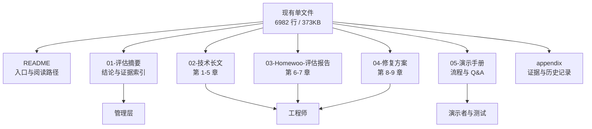
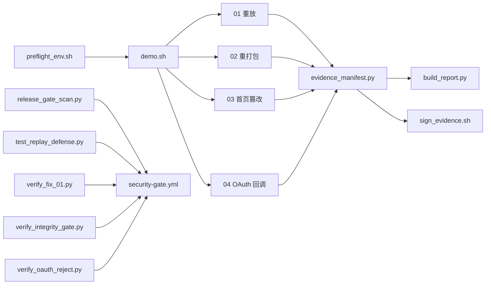

# Homewoo 安全项目改进与演示方案

> **文档性质**：方案与决策底稿。本文只给建议，不修改任何现有文档、脚本或产物。
>
> **生成日期**：2026-10-18
>
> **适用范围**：`app-safe` 项目下的主文档、四个攻击复现目录、两份静态评估报告及演示准备。
>
> **使用方式**：每条建议都有唯一编号（`D-` 文档、`S-` 脚本、`P-` 演示）。在「状态」列填写决策结果，在「备注」列写负责人、截止时间或修改意见。决定采纳后，直接从对应条目复制「建议动作」执行。

---

## 0. 状态图例与使用说明

| 状态 | 含义 |
| --- | --- |
| `待决策` | 尚未拍板，默认状态 |
| `待执行` | 已采纳，尚未开始 |
| `进行中` | 正在处理 |
| `已完成` | 已落地并通过验收 |
| `暂不做` | 本轮明确不做，保留记录 |
| `已放弃` | 评估后认为不值得做 |

**使用规则：**

1. 不要删除未采纳的条目，把状态改成 `暂不做` 并写原因，避免下次重复讨论。
2. 每条建议的「验收标准」是判断 `已完成` 的唯一依据，不凭主观感受。
3. P0 条目未完成前，不建议进入演示彩排。
4. 涉及现有文档的修改，建议先复制一份再改，保留当前版本作为对照。

---

## 1. 现状核查

### 1.1 资产盘点

| 资产 | 路径 | 规模/标识 | 当前状态 |
| --- | --- | --- | --- |
| 主文档 | `App安全-从比亚迪车机破解到Homewoo.md` | 6982 行 / 373KB | 内容完整，结构待调整 |
| Android APK | `app-arm64-v8a-release.apk` | 73MB，SHA-256 `968460c4...c8545c38` | 静态 + 动态验证 |
| iOS IPA | `Homewoo.ipa` | 75MB，SHA-256 `f3ccf8cc...b71581` | 仅静态验证 |
| 攻击链 01 | `01-接口日志泄露与请求重放攻击/` | 2 个脚本 + 1 个主流程 | 证据待补齐 |
| 攻击链 02 | `02-APK二次打包与返回数据篡改攻击/` | 4 个子脚本 + 1 个主流程 | 证据待补齐 |
| 攻击链 03 | `03-客户端首页内容篡改攻击/` | 6 个脚本 + v2–v8 产物 | 证据部分可用 |
| 攻击链 04 | `04-外部链接与OAuth回调伪造验证/` | 2 个子脚本 + 1 个主流程 | 证据可用，含失败记录 |
| 静态评估报告 | `AWP 项目安全评估/` | Android 984 行、iOS 745 行 | 与主文档有口径差异 |
| 攻击流程图 | `App 攻击流程图/` | 2 个 HTML，各约 130KB | 可复用为演示素材 |
| 仓库体积 | `.` | 974MB，`.git` 177MB | 偏重，影响分发 |

### 1.2 四条攻击链的"说法"与"证据"对照

| 链条 | 主文档口径 | 子目录当前证据 | 一致性 |
| --- | --- | --- | --- |
| 01 日志泄露与重放 | **已打通**（主文档 :1625） | `evidence/` 只有 README；子文档 :79、:95 写明"未保存本次运行证据" | ❌ 不一致 |
| 02 二次打包与数据篡改 | **已打通**（主文档 :1635） | `evidence/` 只有 README；子文档 :81 写明"不预置运行时业务证据" | ❌ 不一致 |
| 03 首页内容篡改 | **已打通**（主文档 :1645） | `evidence/` 有 UI、Activity、landing 记录；子文档 :76 指出缺少新版摘要文件 | ⚠️ 部分一致 |
| 04 OAuth 回调伪造 | **入口已实测，利用未证实**（主文档 :1655） | 4 个 JSON；其中 `031317`、`031336` 是 ADB 退出码 127 的失败记录 | ⚠️ 需清理 |

### 1.3 关键缺口

| 编号 | 缺口 | 证据 | 影响 |
| --- | --- | --- | --- |
| G-01 | 主文档与子目录对"已验证"的口径不一致 | 见 1.2 | 演示时被质疑"证据在哪" |
| G-02 | 文档承诺的多个脚本在仓库中不存在 | `release_gate_scan.py`、`build_release.sh`、`replay_guard.py`、`tests/` 等 | 无法执行，也无法进 CI |
| G-03 | 复现文档使用过期绝对路径 | 10 处 `/Users/h1610/Desktop/安全方案/` | 别人第一步就失败 |
| G-04 | 单文件过长且内容重复 | 6982 行；6.4 与 7.11、8.1 与 9.1 重复 | 维护易漂移，读者找不到重点 |
| G-05 | 证据目录混入失败记录与历史产物 | 04 的两条无效 JSON；03 的 v2–v7 APK | 稀释有效证据 |
| G-06 | iOS 只有静态结论 | `Homewoo-iOS-IPA安全静态评估报告.md` | 无法回应"iOS 呢" |
| G-07 | 缺少统一入口与 CI 门槛 | 无 `demo.sh`、无 workflow | 不能一键复现，修复易回退 |
| G-08 | 测试 keystore 已入库 | `02/keys/`、`03/keys/` | 需明确"仅测试"，避免误用 |

---

## 2. 文档改进建议（D 系列）

### 2.1 P0：演示前必须解决

| 编号 | 优先级 | 状态 | 建议动作 | 验收标准 | 依据 |
| --- | --- | --- | --- | --- | --- |
| D-01 | P0 | 待决策 | 统一 01/02 的"已验证"口径：要么重跑并补齐证据，要么降级为"历史验证，当前证据待补" | 主文档、子文档、两份评估报告对四条链的表述逐字一致 | 主文档 :1625/:1635；01 子文档 :79/:95；02 子文档 :81 |
| D-02 | P0 | 待决策 | 增加「证据索引表」：结论 → 证据文件 → 复现命令 → 执行时间 → 产物哈希 | 任意一条结论都能在 1 分钟内找到对应证据 | 见附录 A 模板 |
| D-03 | P0 | 待决策 | 清理证据目录：04 的 `031317`/`031336` 移入 `evidence/history/` 并标注"无效"；03 的 v2–v7 移入 `artifacts/history/` | `evidence/` 顶层只保留有效证据；历史目录有 README 说明 | `04/evidence/`、`03/artifacts/` |
| D-04 | P0 | 待决策 | 把 10 处 `/Users/h1610/Desktop/安全方案/` 改为相对路径或 `git rev-parse --show-toplevel` | 在任意克隆路径下按文档执行不报"路径不存在" | 01:8；02:8/:18；04:34；iOS 报告 :3/:229/:299/:439；Android 报告 :3 |

### 2.2 P1：结构改造

| 编号 | 优先级 | 状态 | 建议动作 | 验收标准 | 依据 |
| --- | --- | --- | --- | --- | --- |
| D-05 | P1 | 待决策 | 拆分为 5 个文档：README、评估摘要、技术长文、评估报告、修复方案、演示手册（可把最后两项合并） | 每类读者 10 分钟内能找到自己的入口 | 见 2.4 目标结构 |
| D-06 | P1 | 待决策 | 去重：6.4 与 7.11 只保留一张结论表；8.1 讲"为什么"，9.1 只讲"谁、何时" | 同一事实只在一处定义，其余位置用链接 | 主文档 :1675、:2499、:2540、:6763 |
| D-07 | P1 | 待决策 | 把 8.2–8.12 的大段代码移到 `tools/`、`server/`、`tests/`，正文保留关键片段与链接 | 正文体积明显下降；脚本可被 CI 直接执行 | 主文档 8.2–8.12 |
| D-08 | P1 | 待决策 | 增加「对外表述口径」：可以说 / 不可以说 / 需要条件 | 演示者、公关、管理层使用同一套措辞 | 见 2.5 |
| D-09 | P1 | 待决策 | 增加「修复前后验证矩阵」：每个问题给出修复前/后预期结果 | 矩阵可直接转为回归用例 | 见 2.6 |

### 2.3 P2：表达与规范

| 编号 | 优先级 | 状态 | 建议动作 | 验收标准 | 依据 |
| --- | --- | --- | --- | --- | --- |
| D-10 | P2 | 待决策 | 开头增加「一页纸结论」：3 条已打通、1 条入口实测、9 个问题的分类 | 管理层只读首屏即可掌握结论 | 主文档第 1 章前 |
| D-11 | P2 | 待决策 | 给"高/中/低"补判定依据，或映射 OWASP MASVS/MASTG 编号 | 每个级别都能被追问和解释 | 6.4、7.11 |
| D-12 | P2 | 待决策 | 增加「攻击成本」表：是否需要 Root、诱导安装、服务端配合、预估耗时 | 每个链条都有可比较的成本维度 | 6.3 |
| D-13 | P2 | 待决策 | 增加「蓝队视角」：攻击会留下什么痕迹、如何检测、如何告警 | 安全团队能据此设计监控 | 新增章节 |
| D-14 | P2 | 待决策 | 文档头补版本、日期、APK/IPA 哈希、工具版本、Git commit；末尾加 changelog | 被问"测的是哪个版本"时可立即回答 | 文档头尾 |
| D-15 | P2 | 待决策 | 校对与链接检查：章节编号、"十四类"映射、外部链接 | 零死链、零编号错误 | 全文 |
| D-16 | P2 | 待决策 | 校准比亚迪开篇：缩短篇幅，区分"报道称"与"我们验证"，避免标题暗示因果关系 | 开篇 2 页内进入 Homewoo 结论 | 第 1 章 |
| D-17 | P2 | 待决策 | 统一术语：已打通 / 入口已实测 / 入口存在；验证、证实、复现 | 四个子文档与主文档用词一致 | 全文 |
| D-18 | P2 | 待决策 | 增加读者路径：管理层 / 工程师 / 测试复现各自的阅读顺序 | 文档开头有明确指引 | 文档开头 |

### 2.4 建议的目标文档结构

```text
README.md                    项目入口、10 分钟读懂、目录、状态图例
01-评估摘要.md               2 页：结论、影响、优先级、证据索引、对外口径
02-技术长文.md               现有第 1–5 章：认知、风险、攻击链、防御
03-Homewoo-评估报告.md       现有第 6–7 章：问题详解、证据强度
04-修复方案.md               现有第 8–9 章：代码、完成判据、排期
05-演示手册.md               25 分钟脚本、命令、预期输出、Q&A、兜底方案
appendix/                    原始证据、工具版本、变更记录、历史失败记录
```

改造关系如下。拆分不是为了形式，而是为了让"结论、证据、复现、修复"四类内容各自可维护：



### 2.5 对外表述口径（建议直接采用）

| 可以说 | 不可以说 | 需要加条件 |
| --- | --- | --- |
| 在授权测试环境中，攻击链 01 的读/增/改可复现 | 我们可以接管任意用户账号 | 仅限测试账号与测试环境 |
| 攻击链 04 的入口已实测可达 | OAuth 已被绕过 | 利用尚未证实 |
| 共享密钥已确认随包发布 | 服务端一定凭该密钥授权 | 服务端校验逻辑未审计 |
| 02/03 证明客户端内容可被替换 | 生产环境已被攻破 | 需要用户安装篡改包 |
| 四条链中有三条已打通 | 四个漏洞全部利用成功 | 04 只到入口 |
| 根因在构建配置与信任边界 | 加个壳就能解决 | 服务端仍是最终边界 |

### 2.6 修复前后验证矩阵（建议模板）

| 场景 | 修复前预期 | 修复后预期 | 对应脚本 |
| --- | --- | --- | --- |
| 01 原样重放 | 200 / 业务成功 | 401 / 拒绝 | `verify_fix_01.py` |
| 01 改 nonce 保留签名 | 200 | 401 | 同上 |
| 01 改时间戳保留签名 | 200 | 401 | 同上 |
| 01 并发 20 个相同 nonce | 多个成功 | 仅 1 个成功 | 同上 |
| 02 重打包包请求关键接口 | 200 | 拒绝/风控标记 | `verify_integrity_gate.py` |
| 03 篡改首页展示 | 成功覆盖 | 服务端拒绝或降级 | `verify_integrity_gate.py` |
| 04 伪造 state 回调 | 入口可达 | 服务端拒绝绑定 | `verify_oauth_reject.py` |
| 发布门槛扫描旧包 | — | `GATE_RESULT=FAIL` | `release_gate_scan.py` |
| 发布门槛扫描新包 | — | `GATE_RESULT=PASS` | 同上 |

---

## 3. 脚本补充清单（S 系列）

### 3.1 文档承诺但仓库缺失

| 编号 | 优先级 | 状态 | 脚本路径 | 作用 | 验收标准 | 文档位置 |
| --- | --- | --- | --- | --- | --- | --- |
| S-01 | P0 | 待决策 | `tools/release_gate_scan.py` | 发布产物门槛：命中已知坏指纹即失败 | 旧包 FAIL（退出码 1），新包 PASS（退出码 0）；缺失产物退出码 2 | 主文档 8.8 :5171/:5186/:6843 |
| S-02 | P0 | 待决策 | `tools/known-bad-keys.txt` | 4 个共享密钥的基线指纹 | 首尾长度约定写入文件头；手改后工具仍能匹配 | 主文档 8.8、9.3 |
| S-03 | P0 | 待决策 | `tools/build_release.sh` | release 构建入口，强制 prod 变体 | 缺少 `prod` 参数或环境错误时构建失败；构建后自动跑门槛 | 主文档 8.7 :4795 |
| S-08 | P1 | 待决策 | `server/replay_guard.py` | 服务端防重放四步实现 | 原样重放、改 nonce、改时间戳、并发四种用例符合预期 | 主文档 8.3 :3296 |
| S-09 | P1 | 待决策 | `tests/test_replay_defense.py` + `tests/conftest.py` | A/B/C/D 四种实现的对照测试 | `pytest` 全绿，且能复现"隐蔽错误"用例 | 主文档 8.3 :3042 起 |
| S-10 | P1 | 待决策 | `server/replay_defense_demo.py` | 可独立运行的重放防御演示 | 不依赖宿主工程，单独执行即可看到四步顺序 | 主文档 8.3 |

### 3.2 演示与回归新增

| 编号 | 优先级 | 状态 | 脚本路径 | 作用 | 验收标准 |
| --- | --- | --- | --- | --- | --- |
| S-04 | P0 | 待决策 | `demo.sh` / `run_all.sh` | 统一入口：`preflight / attack / verify / restore / report` | 一条命令跑完四条链；任一步失败返回非 0 |
| S-05 | P0 | 待决策 | `tools/preflight_env.sh` | 统一检查 adb、root、Java、apktool、Python、网络、设备哈希、时间同步 | 缺任一项明确报错，不进入攻击 |
| S-06 | P0 | 待决策 | `tools/evidence_manifest.py` | 收集证据，生成 `manifest.json`：时间、commit、设备、哈希、命令、结果 | 每个结论可追溯到文件；manifest 可被独立校验 |
| S-07 | P0 | 待决策 | `tools/verify_fix_01.py` | 修复后重放必须失败 | 输出四组 `PASS/FAIL`，与 2.6 矩阵一致 |
| S-11 | P1 | 待决策 | `tools/verify_integrity_gate.py` | 服务端区分真包/改包 | 输出 `ORIGINAL=PASS / REPACKAGED=FAIL` |
| S-12 | P1 | 待决策 | `tools/oauth_state_testbed.py` | 本地 OAuth 授权服务器桩：state/PKCE/过期/重放 | 四种非法回调全部拒绝，合法回调通过 |
| S-13 | P1 | 待决策 | `tools/verify_oauth_reject.py` | 修复后验证 04 的利用不成立 | 明确输出 `BYPASS_PROVEN=false` 或 `REJECTED=true` |
| S-14 | P1 | 待决策 | `tools/restore_verify.sh` | 每条链的恢复验证 | 原包签名、哈希、页面标记全部通过 |
| S-15 | P1 | 待决策 | `.github/workflows/security-gate.yml` | CI 跑产物门槛、密钥扫描、文档校验、目录校验 | 旧产物 FAIL，新产物 PASS |
| S-16 | P1 | 待决策 | `tools/scan_secrets.py` | 扫描仓库和产物中的密钥/令牌/密码 | 零命中，或有基线豁免且记录原因 |
| S-17 | P1 | 待决策 | `tools/validate_all_attack_dirs.py` | 调用现有 `validate_attack_package.py` 检查四个目录 | 结构、章节、脚本、清理项全通过 |
| S-18 | P2 | 待决策 | `tools/ios_gate_scan.py` | iOS IPA 的 ATS、调试框架、URL Scheme、密钥基线检查 | 与 Android 门槛对齐 |
| S-19 | P2 | 待决策 | `tools/ios_deeplink_attack.sh` | `simctl openurl` 验证 iOS 回调入口 | 入口可达/不可达有明确记录 |
| S-20 | P2 | 待决策 | `tools/mitm_capture.py` | 代理抓包，验证证书绑定/明文传输 | 能区分"抓不到"与"没请求" |
| S-21 | P2 | 待决策 | `tools/sign_evidence.sh` | 用 GPG/openssl 对 manifest 签名 | 观众可独立验证证据未被篡改 |
| S-22 | P2 | 待决策 | `tools/build_report.py` | 从 evidence manifest 生成统一报告表格 | 文档与证据不再手工同步 |
| S-23 | P2 | 待决策 | `tools/cleanup_test_data.py` | 清理测试日历、账号、临时文件 | 演示后可重复使用同一账号 |
| S-24 | P2 | 待决策 | `tools/check_doc_links.py` | 检查锚点和外链 | CI 中零死链 |
| S-25 | P2 | 待决策 | `tools/demo_dashboard.py` | 可选：本地演示控制台，显示步骤与结果 | 不影响命令行主流程 |
| S-26 | P3 | 待决策 | `tools/frida_hook_demo.js` | 可选：运行时 Hook 演示，当前四条链未使用 | 仅作为扩展素材，需单独授权与隔离环境 |

### 3.3 脚本设计的硬要求

1. **可单独运行，也可被编排。** 每个脚本既能独立执行，也能被 `demo.sh` 调用；不允许"只能按文档顺序手工敲"。
2. **输出机器可读结果。** 验证脚本至少输出 JSON 或 `KEY=VALUE`，并写入 `evidence/`，不能只打印到终端。
3. **成功判据强于 HTTP 200。** 必须有业务前后对比、UI 标记或服务端状态变化。
4. **必须有恢复路径。** 每个攻击脚本配 `restore-original`，每个修复验证脚本配 `verify-fix`。
5. **默认脱敏。** 不落盘完整 Token、Cookie、密码、签名私钥；证据中只保留哈希、状态码、布尔判据和非敏感标题。
6. **失败要响。** 前置条件不满足时立即非 0 退出，不允许"打印 SKIP 后照样返回 0"。

### 3.4 建议的目录结构

```text
tools/
  preflight_env.sh
  demo.sh
  evidence_manifest.py
  release_gate_scan.py
  known-bad-keys.txt
  scan_secrets.py
  verify_fix_01.py
  verify_integrity_gate.py
  oauth_state_testbed.py
  verify_oauth_reject.py
  restore_verify.sh
  ios_gate_scan.py
  ios_deeplink_attack.sh
  sign_evidence.sh
  build_report.py
  cleanup_test_data.py
  check_doc_links.py
server/
  replay_guard.py
  replay_defense_demo.py
tests/
  conftest.py
  test_replay_defense.py
.github/workflows/
  security-gate.yml
evidence/
  manifest.json
  history/
```

脚本依赖关系如下。`preflight` 和 `evidence_manifest` 是横切能力，四条攻击链都依赖它们：



---

## 4. 演示方案（P 系列）

### 4.1 核心原则

演示的目标不是"证明我们很厉害"，而是让观众相信三件事：

1. **结论可证伪**：每条结论都有明确的通过/失败判据，失败和未证实也照实说。
2. **因果可追溯**：不是"页面变了"，而是"谁、在什么时候、用什么命令、让服务端的哪条数据发生了变化"。
3. **别人能复现**：独立的人、独立的机器、按文档能跑出同样结果。

### 4.2 25 分钟演示流程

| 时间 | 环节 | 做什么 | 关键证据 | 失败兜底 |
| --- | --- | --- | --- | --- |
| 0–2 min | 授权与边界 | 说明测试账号、测试设备、开发/测试环境；明确今天能证明什么、不能证明什么 | 授权说明、设备型号、APK 哈希 | — |
| 2–5 min | 钩子：03 首页替换 | 登录后原首页被完整覆盖，重启仍保持 | 手机实拍 + UI dump + 录屏 | 预录视频 |
| 5–10 min | 01 服务端数据重放 | 观众随机出一个字符串，攻击者写入日历事件，在 App 外重放，展示服务端前后对比 | 独立攻击机 + 终端 + 服务端查询 + 时间戳 | 预置证据 + 录屏 |
| 10–14 min | 02 二次打包 | 对比原包与重打包包签名，安装后页面显示伪造数据 | `apksigner verify`、Mock 日志、UI | 预录视频 |
| 14–16 min | 04 入口边界 | 证明回调可达，同时明确"利用未证实" | JSON 证据、`OAUTH_BYPASS_PROVEN=false` | 静态证据 |
| 16–22 min | 修复前后对照 | 同一套命令打修复版，全部失败；发布门槛拦旧包、放新包 | 前后结果矩阵、CI 输出 | 预跑视频 |
| 22–25 min | 证据与路线图 | 展示证据包、独立复现记录、修复优先级 | manifest、Git commit、哈希 | — |

流程如下。把视觉冲击放在最前，把最严重的结论放在视觉之后，最后用"修复后打不进去"收尾：


### 4.3 六个可信度增强手段

**手段一：观众参与制造证据。** 让观众随机说一个字符串（例如 `DEMO-7F3K`），把它写入被篡改的事件或首页，现场刷新后出现在手机和服务端查询里。"提前录好"的质疑会直接消失。内容必须无害，不使用真实姓名或敏感信息。

**手段二：三地同框。** 手机显示结果、攻击机显示命令、服务端显示前后数据，三个画面同一时钟。只用手机录屏，说服力会打对折。可用 scrcpy + OBS 把三路画面并排。

**手段三：修复前后对照。** 先打未修复版本，成功；再切到修复环境，同一套命令失败；最后用发布门槛扫描旧包 `FAIL`、新包 `PASS`。这是整场演示的胜负手：**能打进去只是能力展示，修完打不进去才是安全结论。**

**手段四：证据链可验证。** 准备 `evidence-bundle`：

```text
manifest.json          时间、commit、设备、工具版本、APK/IPA 哈希
apk-sha256.txt         原始包与篡改包哈希
signature-diff.txt     原包与重打包包签名对比
commands.log           实际执行的命令
results/               每条链的 PASS/FAIL JSON
recording.mp4          完整录屏
```

现场让观众挑一条证据打开，或自己算一遍 APK 哈希与屏幕上的值对比。条件允许时用 GPG 对 manifest 签名。

**手段五：独立复现。** 演示前一周，找一位未参与项目的同事，只给文档和仓库，在另一台机器/设备上跑一遍并录屏。演示时放 30 秒复现片段，或直接说明"这份结果由某人在独立环境复现，录屏在证据包里"。

**手段六：主动展示未证实项。** 明确说 04 只到入口、01 的删除动作未完成独立因果验证、未做跨账号访问和生产复现。愿意暴露边界的团队，比声称"全攻破了"的团队更可信。

### 4.4 现场执行清单

**会前：**

- [ ] 专用测试账号、专用测试设备、开发/测试环境，明确不碰生产
- [ ] 关闭通知、自动更新、锁屏干扰；使用测试机
- [ ] 终端清空历史、调大字体、隐藏真实令牌
- [ ] 准备备用设备、备用热点、离线录屏
- [ ] 完整彩排至少 3 次并计时
- [ ] 角色分工：主讲、操作、证据记录（第三人负责录屏和记录命令）
- [ ] `demo.sh` 全流程跑通，`evidence/manifest.json` 生成
- [ ] 发布门槛对旧包 FAIL、对新包 PASS

**会中：**

- [ ] 每步先报"预期结果"，再执行，再对照
- [ ] 失败不掩饰：切录屏并说明原因
- [ ] 不现场改代码、不现场装工具、不依赖网络下载
- [ ] 不用 HTTP 200 当成功，必须展示业务数据变化或前后对比
- [ ] 观众随机值写入后，先刷新服务端再刷新客户端

**会后：**

- [ ] 仓库打 tag，发布证据包和复现指南
- [ ] 给出 30 天独立复现窗口和联系人
- [ ] 记录现场问题，补入 Q&A
- [ ] 执行 `restore-original`，确认测试设备与账号已恢复

### 4.5 预设 Q&A

| 质疑 | 回答要点 |
| --- | --- |
| 设备 Root 了，生产用户不会 Root | 01 的攻击面确实依赖日志可读；02/03 不需要 Root，只需要用户安装篡改包。两条要分开说。 |
| 这是测试环境，生产不一定成立 | 我们证明的是"能力存在"；生产验证需要授权，未做。能力存在本身就是风险。 |
| 数据是不是你们自己改的？ | 观众随机字符串、服务端前后查询、独立攻击机、完整录屏、证据哈希。 |
| 为什么 04 不算漏洞？ | 入口可达是前置条件，不是危害。我们明确标注"利用未证实"，并给出验证路径。 |
| 修完之后会不会复发？ | 发布门槛 + 每版回归四条链 + CI 阻断；旧包会被门槛拦住。 |
| 为什么 01 优先级最高？ | 不需要诱导安装、直接影响服务端真实数据；02/03 只改客户端显示；04 危害未证实。 |
| iOS 为什么没有动态验证？ | 当前只做静态；如果有设备与授权，可补 `simctl openurl` 和 IPA 门槛检查。 |
| 这些测试数据会保留吗？ | 演示后执行清理脚本；证据只保留脱敏摘要。 |

### 4.6 三件不要做的事

1. **不要声称未验证的结论**：尤其是"OAuth 绕过""任意账号接管""生产环境可复现"。
2. **不要只放截图**：截图无法证明因果，必须有命令、日志、前后对比。
3. **不要隐藏前提条件**：Root、测试账号、开发环境、诱导安装，主动说清楚反而增加可信度。

---

## 5. 决策与排期

### 5.1 如果只做三件事

1. **补齐 01/02 的当前证据，统一口径**（D-01、D-03）。
2. **把门槛与编排脚本落到仓库**（S-01、S-02、S-03、S-04、S-05、S-06）。
3. **按"03 钩子 → 01 最严重 → 02 视觉 → 04 边界 → 修复对照"演示**，用观众随机值、服务端前后对比、修复后重跑失败建立可信度。

### 5.2 建议的两周排期

| 时间 | 工作 | 完成标志 |
| --- | --- | --- |
| 第 1–2 天 | 重跑 01/02，清理证据目录，修过期路径 | `evidence/` 有当前有效证据；D-01、D-03、D-04 完成 |
| 第 3–4 天 | 落地发布门槛、构建入口、统一 preflight | S-01、S-02、S-03、S-05 可执行 |
| 第 5–6 天 | 落地防重放与修复验证脚本 | S-07、S-08、S-09、S-11 通过 |
| 第 7 天 | 落地统一入口与证据 manifest | `demo.sh` 全流程跑通，`manifest.json` 生成 |
| 第 8–9 天 | 第一次、第二次彩排 | 25 分钟内完成，失败项有兜底 |
| 第 10 天 | 独立复现 | 外部同事按文档跑通并录屏 |
| 第 11–12 天 | 修复彩排暴露的问题 | 所有 P0 项关闭 |
| 第 13 天 | 最终彩排 | 计时、分工、兜底全部确认 |
| 第 14 天 | 演示 | 证据包归档 |

### 5.3 决策记录表

| 编号 | 决定（采纳/暂不做/修改） | 负责人 | 截止日期 | 备注 |
| --- | --- | --- | --- | --- |
| D-01 |  |  |  |  |
| D-02 |  |  |  |  |
| D-03 |  |  |  |  |
| D-04 |  |  |  |  |
| D-05 |  |  |  |  |
| S-01 |  |  |  |  |
| S-02 |  |  |  |  |
| S-03 |  |  |  |  |
| S-04 |  |  |  |  |
| S-05 |  |  |  |  |
| S-06 |  |  |  |  |
| S-07 |  |  |  |  |
| P-01 |  |  |  |  |

> 需要完整清单时，以第 2、3 章的表格为准；本表只跟踪最先要拍板的条目。

### 5.4 风险与依赖

| 风险 | 影响 | 应对 |
| --- | --- | --- |
| 01/02 重跑失败或环境不可用 | 证据无法补齐 | 降级为"历史验证"，演示改以 03/04 为主，并说明缺口 |
| 现场网络/设备故障 | 演示中断 | 预录视频 + 备用设备 + 热点 |
| 观众质疑数据真实性 | 可信度下降 | 观众随机值、服务端前后查询、证据哈希、独立复现 |
| iOS 无动态验证 | 被追问覆盖面 | 明确范围，给补测计划，不用 Android 结论代替 iOS |
| 修复依赖服务端排期 | 无法演示"修复后失败" | 先做本地服务端桩验证，演示时说明真实接入计划 |
| 文档过长导致修改遗漏 | 口径漂移 | 先执行 D-05 拆分与 D-06 去重 |

---

## 附录 A：证据索引表模板

复制到评估摘要或 README 中使用：

| 结论 | 证据文件 | 复现命令 | 执行时间 | 产物哈希 | 结果 |
| --- | --- | --- | --- | --- | --- |
| 01 读取重放成功 | `01/evidence/...` | `./run_replay_attack.sh list` |  |  | PASS |
| 01 新增重放成功 | `01/evidence/...` | `./run_replay_attack.sh create` |  |  | PASS |
| 01 编辑重放成功 | `01/evidence/...` | `./run_replay_attack.sh update` |  |  | PASS |
| 02 页面显示伪造数据 | `02/evidence/...` | `./run_repackaging_attack.sh verify` |  |  | PASS |
| 03 登录后覆盖首页 | `03/evidence/ui-*.xml` | `./run_custom_home_attack.sh verify` |  |  | PASS |
| 03 重启后仍覆盖 | `03/evidence/reopen-*.txt` | `./run_custom_home_attack.sh reopen` |  |  | PASS |
| 04 回调到达入口 | `04/evidence/forged-invalid-*.json` | `./run_oauth_callback_attack.sh verify` |  |  | PASS |
| 04 OAuth 绕过成立 | 待补 | 待补 |  |  | NOT PROVEN |

---

## 附录 B：术语与口径

| 术语 | 含义 | 判据 |
| --- | --- | --- |
| **已打通** | 从入口到危害的完整因果链跑通 | 有前/后对比的实测记录 |
| **入口已实测** | 第一段被证实可达，危害未证实 | 有可复现的入口证据，**没有**危害证据 |
| **入口存在** | 包内有明确配置，未做动态验证 | 只有静态证据 |
| **已确认缺陷** | 证据闭合，需立即处置 | 静态 + 动态证据一致 |
| **真实攻击面** | 入口存在，危害待验证 | 入口证据成立，危害证据缺失 |
| **待核查项** | 尚不知是否有问题 | 尚无足够证据下结论 |
| **加固建议** | 不是漏洞，是纵深防御 | 无直接可利用路径 |
| **验证** | 实际执行并得到可复现结果 | 有命令、有证据、有前后对比 |
| **证实** | 达到可对外结论的强度 | 独立复现或证据链闭合 |
| **复现** | 他人按文档得到相同结果 | 独立环境、独立执行、结果一致 |

---

## 附录 C：变更记录

| 日期 | 版本 | 变更 | 作者 |
| --- | --- | --- | --- |
| 2026-10-18 | v0.1 | 初稿：现状核查、D/S/P 三类建议、演示方案、决策表 |  |

---

> **一句话总结**：这份材料的技术内容已经足够硬，接下来要补的不是"更多发现"，而是**证据一致性、可执行脚本、可复现演示**。把这三件事做完，说服力会有质的变化。
